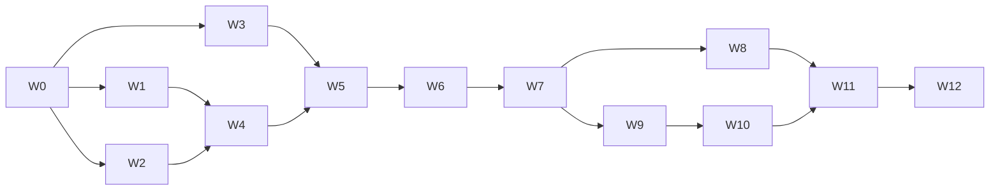

# Implementation waves — base-app

> Spec de origem: [docs/specs/base-app.md](../specs/base-app.md) e as specs de área.
> Este arquivo é a fonte da verdade do roadmap; a tabela do [NOTES.md](../../NOTES.md)
> espelha a coluna Status.

Fundações concluídas localmente em 2026-11-25: [evidências e critérios das ondas 1/2/3](waves-1-3-verification.md).
Onda 4 concluída localmente em 2026-11-25: [aceites e evidências](wave-4-verification.md).
Onda 5 parcialmente entregue: [verificação](wave-5-verification.md) e
[decisões pendentes](wave-5-execution.md). API/mobile verificados; operação
administrativa ainda incompleta. Mantém-se ⬜; retomar essa onda antes da 6.
O aceite segue o foco de template de desenvolvimento em base-app §2: código e
provas locais são obrigatórios; contas, implantação e publicação do app derivado
são etapas documentadas. Falhas do banco e contratos pendentes continuam bloqueando
o aceite do código correspondente.

| Onda | Entrega | Depende de | Paralela com | Status |
|------|---------|------------|--------------|--------|
| 0 | Fundação do monorepo, tooling e CI | — | — | ✅ |
| 1 | Plataforma da API (`defineRoute`, erros, headers, logs, rate limit, idempotência, extensões) | 0 | 2, 3 | ✅ |
| 2 | Baseline do Supabase (config, papéis, auditoria, `pg_cron`, pgTAP, tipos Kysely) | 0 | 1, 3 | ✅ |
| 3 | Casca do app mobile (Expo Router, gates, i18n, tema, client, Sentry, EAS, extensões) | 0 | 1, 2 | ✅ |
| 4 | Auth na API, perfil (`/v1/me`) e consentimentos | 1, 2 | 3 | ✅ |
| 5 | Configuração remota e gates (app e servidor) | 3, 4 | — | ⬜ |
| 6 | Login por e-mail no app (código, senha, redefinição, troca, sessão cifrada, termos) | 5 | — | ⬜ |
| 7 | Assinatura (SDK, paywall, restaurar, gerenciar; conferência no servidor) | 6 | — | ⬜ |
| 8 | Feature de exemplo protegida por assinatura | 7 | 9 | ⬜ |
| 9 | Exclusão de conta (API, app, página web) e site institucional | 7 | 8 | ⬜ |
| 10 | Exportação de dados | 9 | — | ⬜ |
| 11 | Tooling do template (`bootstrap:init`) e documentação para alunos | 8, 10 | — | ⬜ |
| 12 | E2E, pipelines de release e checklist das lojas | 11 | — | ⬜ |

## Como executar uma onda com um agente de código

Uma onda por sessão, numa branch `feat/w<n>-<slug>`. Prompt padrão (Codex ou Claude Code):

> Execute a onda `<n>` de `docs/plan/implementation-waves.md`, seguindo `AGENTS.md`. Leia
> antes as specs e ADRs citados na onda. Faça só o escopo da onda. Comece pelos contratos
> (`packages/contracts`) quando a onda mexer na API e escreva os testes dos critérios de
> aceite. Termine quando todos os comandos de **Verificação** passarem e cada critério de
> aceite estiver atendido. Ao final: marque a onda como ✅ aqui e no `NOTES.md`, atualize o
> status do `NOTES.md` e faça commits atômicos em Conventional Commits. Não faça push.
> Se a spec estiver errada ou faltar informação, pare e descreva o problema.

Spikes têm limite de meio dia; o resultado vai para a spec ou o ADR correspondente no mesmo
commit. Ondas paralelas (1/2/3, 8/9) podem rodar em worktrees separadas, uma por agente, com
merge de uma por vez.

---

## Onda 0 — Fundação do monorepo

- **Objetivo**: repositório pronto para receber código, com qualidade e segurança no CI desde
  o primeiro commit.
- **Specs/ADRs**: base-app §3.3, §3.4.2–3.4.3, §3.5, §3.9, §3.11; identity-and-auth §3.7;
  local-quality-gates; ADRs 0001, 0007, 0010, 0012 (histórico), 0013, 0014, 0015.
- **Escopo**:
  - `package.json` raiz, `pnpm-workspace.yaml`, `turbo.json`, `.nvmrc`, `.npmrc` (pnpm com
    `allowBuilds` explícito, `strictDepBuilds: true` e `minimumReleaseAge: 1440` em
    `pnpm-workspace.yaml`; `.npmrc` só para registro/autenticação, sem credenciais).
  - `packages/tooling`: tsconfig strict (`noUncheckedIndexedAccess`,
    `exactOptionalPropertyTypes`), ESLint com `no-console` e regra de `.strict()` nos
    schemas de body, Prettier, dependency-cruiser com as regras de base-app §3.5.
  - `packages/tooling`: gerador `pnpm supabase:config` (mescla `supabase/config.base.toml` e
    `supabase/config.d/*.toml`; ADR 0014) e a checagem de drift no CI. A lista de arquivos
    gerados (base-app §3.4.3) inclui o `config.toml`. A regra de lint de `.strict()` já conhece
    a exceção `.strip()` em `packages/contracts/src/**/webhooks/**`.
  - `packages/config`: schema Zod de `product.config.ts` + valores de exemplo +
    `extensions.ts` vazio + testes.
  - `packages/contracts`: schema de erro RFC 9457, contrato de `GET /v1/health`,
    `extensions/index.ts` vazio, gerador de OpenAPI e checagem de drift.
  - `pnpm ci:local` (executor local/KVM, recibo por commit/tree, fail-fast e versões
    fixadas; sem GitHub Actions), `.github/dependabot.yml`, `.gitignore`, `.env.example` sem valores, pre-commit com
    gitleaks, regras Semgrep do projeto (`SET` de sessão, `sql.raw`, `sql.lit`,
    `console.*`, `insert into audit.events` fora de `platform/audit`).
  - Regras de lint de base-app §3.5: `no-purge-account-outside-privacy`, `no-direct-jwt-verify`,
    `no-dynamic-log-message`, `webhook-schemas-only-in-webhook-routes`.
  - Proteções do repositório como código (ADR 0015): `.github/security-baseline.json`,
    `pnpm security:doctor` (somente leitura, via `gh api`; distingue controles visíveis,
    ausentes e manuais), `CODEOWNERS`, `zizmor` no gate, `SECURITY.md`.
  - `packages/tooling`: `pnpm supabase:config:check` (invariantes do `config.toml` gerado e
    marcador `# allow-override`; identity-and-auth.md §3.7) e `pnpm db:lint-migrations` (migrations
    de extensão não tocam schema do núcleo; só as exceções de base-app §3.4.2) e `pnpm vercel:check`
    (allowlist de chaves de topo do `vercel.json`); ambos no `ci:local`.
- **Critérios de aceite**:
  - `pnpm install --frozen-lockfile && pnpm turbo run lint typecheck test` termina com 0.
  - `pnpm security:doctor` falha contra um repositório sem os controles que o baseline exige
    (rulesets da `main`/tags; Environments só quando explicitamente declarados em teste)
    e `zizmor` barra um workflow de
    teste com `pull_request_target`.
  - `db:lint-migrations` reprova, em migration `_ext-`, `create table audit.x`, `grant select on
    identity.profiles`, `create policy` em `audit.events` e `create trigger` em `auth.users`, e
    aprova `grant audit_writer to x_system`, `alter function x.f owner to auth_fn_owner` com
    registro em `auth-fn-registry.d`, e `grant audit_writer to x_admin_grantor` só com o prefixo
    `<ext_schema>_`; `vercel:check` reprova `headers`, `rewrites`,
    `redirects` e `routes` e aprova `functions`, `crons` e `regions`.
  - `supabase:config:check`: `enable_anonymous_sign_ins` ou `enable_manual_linking` = `true` passa
    só com `# allow-override` e CAPTCHA ligado; com CAPTCHA desligado falha mesmo com o marcador.
  - Regra do dependency-cruiser `supabase-client-only-in-auth` (usada na onda 3).
  - `supabase:config:check` reprova um fragmento de teste que afrouxa uma chave protegida sem o
    marcador e aceita o mesmo com o marcador e valor dentro da regra.
  - Gerador e check recusam `supabase/config.json` e `supabase/config.jsonc`, que poderiam
    ter precedência sobre o TOML validado.
  - `pnpm contracts:openapi && git diff --exit-code docs/reference/openapi.yaml` termina com 0.
  - Um `product.config.ts` inválido faz o teste de `packages/config` falhar com a mensagem do
    Zod.
  - `pnpm ci:local` roda gitleaks, Semgrep e osv-scanner, com versões verificadas.
  - Não existe workflow executável de GitHub Actions; uma falha interrompe o gate e
    checkout sujo/alterado durante a execução não atesta o commit.
  - Lint: `.strip()` passa só dentro de `webhooks/`; `.strict()` ausente em body fora dela falha.
- **Verificação**: `pnpm ci:local` em checkout limpo, com todos os gates aprovados e
  recibo referente ao SHA/tree testado; contrato em `docs/specs/local-quality-gates.md`.

## Onda 1 — Plataforma da API

- **Objetivo**: pipeline HTTP que torna impossível criar rota sem autenticação declarada, e o
  registro de extensões funcionando vazio.
- **Specs/ADRs**: base-app §3.4, §3.6, §3.7, §3.12; account-lifecycle-and-privacy (§4.1,
  `platform/audit`); ADRs 0003, 0009, 0013.
- **Escopo**:
  - **Spike S-TM-2** (primeiro): confirmar que cabeçalhos e CSP chegam a todas as respostas (API,
    site, `/_next/**`) e o que o `matcher` cobre.
  - `apps/web` (Next.js App Router) com headers de segurança em três camadas (RNF-09):
    `next.config` (estáticos e CSP `frame-ancestors/base-uri/object-src/form-action`),
    `defineRoute` e middleware (CSP com nonce); a página que segura sessão responde 503 estático
    sem o nonce; Deployment Check que confere os cabeçalhos no preview. Regra do Vercel
    Firewall (300 req/min por IP em `/api`) documentada no how-to `cost-guardrails`.
  - Middleware de borda (`proxy.ts`) lendo `extensions/edge.ts` (`edgeExtensions`, vazio) com o
    `matcher` cobrindo **todos** os paths, inclusive `/_next/**` e estáticos: host
    desconhecido → 404; host de extensão só serve os `pathPrefixes` dele e esses paths não
    passam pelo host principal; normalização de caminho antes de comparar (D16/G34); acréscimos
    de CSP só sob o `pathPrefix`, com nonce; `csp[].strict` com a política base estrita de D18
    (`default-src 'none'`, `trusted-types`, `require-trusted-types-for 'script'`); `EdgeExtension.headers` com a allowlist de nomes e
    valores (`Referrer-Policy: no-referrer`, COOP e CORP `same-origin`, `X-Robots-Tag:
    noindex, nofollow`, `Cache-Control: no-store`); `APP_HOST` obrigatório e previews tratados. Teste que
    recusa origem que não seja `https://<host>` explícito (nada de `*`, `'unsafe-inline'`,
    `'unsafe-eval'`, `data:`, `blob:` em `script-src`). `extensions/site.tsx` (`siteExtensions`,
    vazio) fica criado aqui; o uso é da onda 9. `publicEnv` de `SiteExtension` (só `NEXT_PUBLIC_*`,
    validado no build da web) e a checagem de prefixo e de nomes proibidos (`SECRET`,
    `KEY_PRIVATE`, `TOKEN`) entram aqui (D17).
  - `platform/http`: `defineRoute` (auth `user` | `public` | `webhook` com verificadores
    `sharedSecret(envNames)` e `standardWebhooks(envNames)`, que aceitam lista de variáveis para
    rotação sem janela e comparam em tempo constante contra todas, no máximo 3 segredos e
    `<NOME>_EXPIRES_AT` para os anteriores; `rateLimit` obrigatório com `key`
    `ip` | `user` | `global`, `ipLimit` (padrão 120/min nas autenticadas, 60/min antes da
    verificação de webhook, /64 no IPv6) e `onStoreFailure` sem padrão (vira `x-rate-limit-failure`
    no OpenAPI); `maxBodyBytes` por rota, padrão 32 KB, máximo 1 MB; `maintenance: 'exempt'` só para webhook ou política `{ operator: true }`
    (`addAuthorizationPolicy(name, policy, opts)`; teste estático lista as isentas); `destructive: true` com
    `loadFreshRoles()`; política de autorização que lança ou não decide → 403
    `authz.policy_error`), `requestId` do servidor (o do cliente vira `clientRequestId`),
    problem+json, limite de body,
    `Cache-Control`, gate de versão e manutenção como porta (implementação real na onda 5),
    idempotência (porta + adaptador Postgres; a migration é da onda 2), cotas diárias.
  - `platform/testing/contracts`: suítes de contrato de `EntitlementsReader`,
    `AccountDeletionPolicy`, `EmailSender` e `AuthorizationPolicy`, e `assertExportIsolation`; o
    registro as roda em teste. Registro com timeout por handler de evento (3 000 ms, máximo
    8 000 ms), `registerPurgeJob` e os tipos `PurgeAuthorization` (a fábrica e o uso são da onda
    9), nomes de `systemRoles` no padrão `<extensão>_system`, colisão de `env` e de nome de
    política falham o boot.
  - `platform/audit`: `recordAuditEvent(db, event)` (Zod, metadata sem PII, falha fechado) e
    `subjectRef(userId)` (HMAC-SHA256 com `AUDIT_SUBJECT_KEY`); testado com fake de banco aqui
    e contra o banco real na onda 2.
  - `platform/env` (Zod), logger pino com redaction por padrão de nome, `@vercel/otel`,
    Sentry com `beforeSend`.
  - Porta `RateLimiter` com adaptador Upstash e fake; IP por `ipAddress()`.
  - Porta `EmailSender` com adaptador Resend e fake.
  - `platform/extensions`: tipos `ServerExtension` / `ExtensionRegistry`, composição em
    `composition/`, `extensions/index.ts` vazio. Tipos `AuthorizationPolicy` (com
    `AuthorizationRequest` e `AuthorizationDecision`) e `ExportSectionProvider`, e as listas
    vazias `edgeExtensions` e `siteExtensions` na composição.
  - `GET /v1/health`.
- **Critérios de aceite**:
  - `defineRoute` sem `auth` não compila (teste de tipo com `@ts-expect-error`).
  - Teste estático: todo `route.ts` em `app/api/**` usa `defineRoute`, e as rotas `public`
    do código são exatamente as do contrato com `security: []`.
  - Teste: uma extensão fake registra handler, rota e substituição de porta; duas extensões
    substituindo a mesma porta fazem o boot falhar; com a lista vazia tudo funciona.
  - Teste de redaction: token, e-mail e senha não aparecem no log nem no evento do Sentry.
  - Replay de `Idempotency-Key` concluída devolve a resposta guardada sem chamar o handler
    (com adaptador fake); em andamento → 409; hash diferente → 409.
  - Erros nunca trazem stack trace; 429 traz `Retry-After`.
  - `rateLimit.key: 'global'` usa um balde único; `maxBodyBytes` acima de 1 MB é recusado na
    definição; body acima do limite da rota responde 413; os verificadores aceitam o segredo
    anterior da lista e recusam desconhecido.
  - Teste do middleware: host desconhecido → 404; path fora dos prefixos do host de extensão →
    404; acréscimo de CSP só sob o prefixo e rejeitado se trouxer `*`, `unsafe-*`, `data:` ou
    `blob:` em `script-src`. Com `edgeExtensions` e `siteExtensions` vazios o site responde
    como antes.
  - `recordAuditEvent` recusa metadata com chave de PII e propaga erro de insert;
    `subjectRef` é estável e diferente por usuário.
  - Duas extensões registrando `captchaWidget` fazem o boot falhar.
  - `csp[].strict`: a política final é a base de D18; acréscimo que a afrouxe (curinga,
    `unsafe-*`, `data:`, `blob:`) ou `trustedTypesPolicies` com `*` reprova; sem `strict` nada
    muda.
  - `EdgeExtension.headers`: nome ou valor fora da allowlist faz o boot e o teste falharem; o
    header vale sob o prefixo e em qualquer host que o sirva; o `matcher` cobre `/_next/**`;
    tabela de caminhos comprova 404 quando o Proxy recebe a forma proibida e isolamento de
    host/prefixo após normalização. Redirecionamentos 308 anteriores ao Proxy podem vir sem
    headers do app (ADR 0003); o teste TCP confere Location e destino final. `pathPrefix: '/'` com
    CSP e prefixo de `/account-deletion` com `img-src` ou `style-src` reprovam.
  - `publicEnv` de `SiteExtension`: prefixo errado, `SECRET`, `KEY_PRIVATE`, `TOKEN` e chave
    repetida falham; site key de CAPTCHA passa.
  - Cabeçalhos presentes em respostas da API e do site com o middleware desligado (camadas
    independentes); `/account-deletion` sem nonce → 503 estático.
  - Pipeline: teto por IP compartilhado entre contas diferentes do mesmo IP; `onStoreFailure`
    obrigatório (rota sem ele não compila); `X-Request-Id` do cliente não vira
    `correlation_id`; lista de segredos com 4 itens ou sem `_EXPIRES_AT` falha; política que
    lança nega com 403; erro de driver só loga `name` e `code`.
  - `maintenance: 'exempt'` em rota de usuário comum falha no boot e no teste estático; em webhook e
    em rota com política `operator: true` passa, mantendo autenticação, rate limit e auditoria.
  - Suítes de contrato: leitor de entitlements que devolve acesso em erro reprova; política de
    autorização que lança reprova; seção sem teste de isolamento reprova.
- **Verificação**: `pnpm --filter web test && pnpm --filter web typecheck && pnpm turbo run lint`

## Onda 2 — Baseline do Supabase

- **Objetivo**: banco local e remoto com papéis, auditoria e testes de RLS desde o início.
- **Specs/ADRs**: base-app §3.8, §4; identity-and-auth (tabela de `config.toml`);
  account-lifecycle-and-privacy (auditoria e retenção); ADRs 0005, 0008, 0016.
- **Escopo**:
  - **Spike S-DB-1** (primeiro): `set_config` com bind pelo pooler em modo transação.
  - **Spike S-TM-4:** documentar a cobertura do `supabase config push` e as chaves
    locais/painel a partir da CLI versionada. A confirmação em um projeto hospedado
    fica no checklist de configuração do derivado, sem alegar execução antecipada.
  - `supabase/config.base.toml` (Auth endurecido conforme identity-and-auth, SMTP para Mailpit
    no local, Data API e `pg_graphql` desligados), `supabase/config.d/` vazia com `.gitkeep` e o
    `supabase/config.toml` **gerado** por `pnpm supabase:config` (ADR 0014), com o aviso "gerado;
    não edite" no cabeçalho.
  - Migration de papéis: `api_runtime` sem grants, `migrator`, `identity_system`,
    `privacy_system`, `app_config_system`, `platform_system`, `ops`, `app_config_admin`;
    revogação em `public`. Papéis-grupo NOLOGIN, sem membros no base-app: `audit_writer`,
    `audit_operator_writer`, `audit_reader` e `app_config_writer`. Funções de Auth do núcleo
    são pequenas, registradas e pertencem a `postgres`, com EXECUTE restrito e search_path
    vazio (ADR 0016). Extensões não podem transferir funções próprias a esse dono.
    Storage/Realtime são verificados pela superfície desabilitada e negação funcional;
    não se promete remover ACLs gerenciadas que o papel de migration não pode alterar.
  - Schemas `identity`, `privacy`, `app_config`, `platform`, `audit`, `ops`;
    `audit.events` com políticas (`actor_type` aceita `'operator'`; política
    `events_insert_writer` para `audit_writer`; `events_insert_operator` para `audit_operator_writer` (`audit_writer` só `system` e `webhook`;
    `app_config_admin` entra nos dois por `grant`), `events_select_reader` para `audit_reader`
    (`select` e nada mais); `app_config_admin` entra por `grant audit_writer` e `grant audit_operator_writer`), `check` de formato
    de `actor_ref`, `subject_ref`, `resource_ref` e `metadata`, e a trava com `current_user =
    'ops'`; `app_config.settings` e `app_config.set_setting(...)`
    (`SECURITY DEFINER`, dona `app_config_admin`, `search_path` vazio, `execute` só para
    `app_config_writer` e `app_config_admin`; app-config §4); `platform.idempotency_keys` (DDL de base-app §3.7, com lease);
    `ops.purge_expired()` em lotes com evento de auditoria, `ops.purge_unconfirmed_users()` e
    `ops.check_signals()` com `ops.alerts` (ADR 0008), agendadas no `pg_cron`;
    `identity.before_user_created` com reserva atômica de até 300 aprovações por hora,
    sem PII, ligado em `config.base.toml`; falha posterior pode consumir a reserva.
    Alertas ficam persistidos, sem transporte de credenciais por `pg_net` (ADR 0016). `set_setting` com ator derivado de `app.operator_id`, `p_expected_updated_at` (controle
    otimista, `AC409`), `check` de forma e limite de 20 alterações por hora (app-config §4);
    `app_config.operator_alert_exempt_keys` (vazia) e o sinal de `ops.check_signals()` para
    operador em chave fora dela.
  - `config.base.toml` completo (identity-and-auth §3.7): OTP de 8 dígitos e 600 s, limites por IP,
    `email_sent` de 60/h, superfícies não usadas desligadas, tetos de sessão, `[db.pooler]`; e o
    `pnpm supabase:config:check` em verde.
  - `platform/db`: `userScopedDb`, `systemDb(<contexto>)`, pool com TLS verificado.
  - Harness pgTAP, `kysely-codegen` com checagem de drift, Mailpit.
- **Critérios de aceite**:
  - pgTAP: `anon` e `authenticated` sem privilégio em schema do app; cada `*_system` só com
    grants do próprio schema; `api_runtime` sem grant de tabela e sem ser dono; ninguém com
    `delete` em `audit.events`.
  - Teste de integração: claims com aspas e `;` não quebram nem injetam SQL.
  - `ops.purge_expired()` apaga só o que venceu.
  - pgTAP: `audit_writer` insere `system` e `webhook`, recusa `user` e `operator`, sem `select`,
    `update` nem `delete`; `authenticated` e os `*_system` do núcleo recusam `operator`; um papel
    de teste sem `grant audit_writer` não insere. `app_config_writer` só tem `execute` em
    `set_setting`; a função recusa chave desconhecida e `p_actor_type` fora de `system` e
    `operator`, e grava o evento `app_config.updated` na mesma transação.
  - `pnpm supabase:config` gera um `config.toml` igual ao commitado; um fragmento de teste em
    `config.d/` sobrescreve uma chave e aparece listado no cabeçalho; o CI falha se divergir.
  - pgTAP: `audit_writer` recusa `operator`; `audit_operator_writer` só insere `operator`; os
    membros dos dois conferem com `expected-group-members.json`.
  - `set_setting`: segunda escrita com o mesmo `p_expected_updated_at` falha com `AC409`;
    `null` em chave existente falha; `check_signals` alerta operador em chave fora de
    `operator_alert_exempt_keys` e não alerta ator `system` nem chave listada.
  - pgTAP: `audit_reader` lê `audit.events` e não escreve; um papel de teste sem o grant não lê;
    `authenticated` continua sem `select`; os membros de `audit_writer`, `audit_operator_writer`, `audit_reader` e
    `app_config_writer` são os de `expected-group-members.json`; teste de catálogo (RLS forçado,
    sem grant para `anon`, allowlist de grants); `anon` e `authenticated` sem acesso a `storage` e
    `realtime`; formato das colunas de `audit.events` e `delete` com GUC forjado barrados.
  - `ops.purge_expired()` apaga em lotes, grava o evento com as contagens; `purge_unconfirmed_users`
    só apaga conta por e-mail não confirmada com mais de 3 dias, preservando anônimos;
    `check_signals` persiste os sinais disponíveis de ADR 0008. Mapeamento do volume de
    e-mail continua no S-AU-4. O hook recusa a aprovação 301 da hora, inclusive sob
    concorrência; funções privilegiadas têm catálogo e negativas de chamada testados.
  - `set_setting` recusa operador sem `app.operator_id` igual, valor fora do `check` e a 21ª
    alteração por hora; a idempotência recusa chave de outro usuário e reassume a chave com lease
    vencido.
  - Resultado do S-DB-1 registrado no ADR 0005 e o do S-TM-4 no ADR 0014.
- **Verificação**: `pnpm supabase:config && git diff --exit-code supabase/config.toml && supabase start && supabase db reset && supabase test db && pnpm db:types && git diff --exit-code apps/web/src/platform/db/types.ts`

## Onda 3 — Casca do app mobile

- **Objetivo**: app que abre, navega, troca idioma e tema, e fala com a API pelo client
  tipado.
- **Specs/ADRs**: mobile-app-shell; base-app §3.4; ADR 0002.
- **Escopo**: Expo com Expo Router e a árvore de rotas da spec; framework de gates de boot;
  i18n por namespaces (pt-BR, en, es); tema; TanStack Query; client de API com os headers e
  as regras da spec; Sentry; `app.config.ts` lendo `packages/config`; `eas.json` com perfis;
  configuração de assinatura das atualizações OTA; registro `MobileExtension` vazio, com os tipos de CAPTCHA (`CaptchaAction`, `CaptchaToken`,
`CaptchaError`, `CaptchaProvider`) e a regra de um único `captchaProvider`; `publicEnv` de
`MobileExtension` (só `EXPO_PUBLIC_*`, validado no boot com o env público do app; D17);
`AuthMethodProps` mínimo e `SessionSummary` sem tokens em `BootContext`; `openExternalUrl`,
`usePreventScreenCapture` nas telas sensíveis, `beforeBreadcrumb` sem parâmetros de rota e
e-mail fora de parâmetro de rota (SH-N8 a SH-N11); fachada `extensions/api.ts`
(`extensionAuth` com `withPreviousSession`, `useSessionSummary`, `extensionApiClient`, props de
`SettingsItem`) e regra `supabase-client-only-in-auth` (cliente cru do Supabase só em
`features/auth`); Android
  com R8, `allowBackup=false` e `dataExtractionRules`.
- **Critérios de aceite**:
  - Testes do client: headers sempre presentes; token ausente em rota pública; 401 renova uma
    vez; `problem+json` vira mensagem traduzida.
  - Teste: o app monta com a lista de extensões vazia e com uma extensão fake (gate, item de
    configurações, namespace de i18n).
  - Teste de composição: dois `captchaProvider` fazem o boot falhar.
  - Fachada: extensão fake usa `extensionAuth`, `withPreviousSession`, `useSessionSummary`,
    `extensionApiClient` e `SettingsItem` sem importar o Supabase (a regra reprova); `withPreviousSession`
    entrega só o token anterior a `fn`, faz `signOut({ scope: 'local' })` mesmo se `fn` lançar e não
    deixa o token em log, storage nem retorno; toda função de `extensionAuth` com CAPTCHA passa por
    `withCaptcha`. O retorno de `withPreviousSession` aceita apenas dados simples
    inspecionáveis (inclusive `undefined`), recusando token, getters, funções, classes e
    ciclos; a limpeza da sessão capturada preserva a nova sessão primária.
  - `publicEnv`: chave sem o prefixo `EXPO_PUBLIC_`, com `SECRET`, `KEY_PRIVATE` ou `TOKEN`, ou
    repetida falha; site key de CAPTCHA passa. Uma extensão fake não alcança sessão nem token
    por `AuthMethodProps` nem por `BootContext`.
  - `openExternalUrl` recusa `http:` e host fora da allowlist; `app.config.ts` resolvido sem
    tráfego em texto claro nem exceção de ATS.
  - Nenhuma rota executa efeito ao montar (teste de renderização das rotas).
  - Configuração Expo/EAS resolve, prebuilds e exports locais passam para as duas
    plataformas; perfis e requisitos de assinatura ficam documentados. O build
    EAS real é verificado pelo derivado depois de configurar conta/projeto,
    sem bloquear sozinho a entrega do código do template.
- **Verificação**: `pnpm --filter mobile test && pnpm --filter mobile typecheck && pnpm --filter mobile lint`

## Onda 4 — Auth na API, perfil e consentimentos

- **Objetivo**: a API reconhece o usuário pelo JWT e serve o perfil e os termos.
- **Specs/ADRs**: identity-and-auth; account-lifecycle-and-privacy (consentimentos); ADR 0004.
- **Spike S-TM-3** (primeiro): `app_metadata` (papéis, provedores) chega ao JWT e é renovado no
  refresh como o `AuthContext` espera.
- **Escopo**: verificação de JWT por JWKS (`jose`, allowlist ES256/RS256, `iss`, `aud`,
  `exp`, cache das chaves); `AuthContext` com `isAnonymous`, `appRoles` e `providers`
(validados por Zod; inválido vira `[]` com log de aviso; nunca entram em `dbClaims`);
`verifyAccessToken(token)` exportado por `platform/auth` e usado pelo pipeline; `dbClaims` mínimas; contexto `identity` (`identity.profiles`,
  `GET/PATCH /v1/me`); contexto `privacy` com `privacy.consents` e `POST /v1/me/consents`;
  `requireRecentAuth` pelo `amr`; `loadFreshRoles()` (relê `app_metadata.roles` no banco para
  rota `destructive`); regra `no-direct-jwt-verify` ativa.
- **Critérios de aceite**:
  - Integração com JWT real do Auth local: token válido → 200; vencido → 401
    `auth.token_expired`; `alg: none` ou chave errada → 401.
  - Usuário A não lê nem altera nada de B (pgTAP e endpoint).
  - Body com campo desconhecido → 400.
  - `AuthContext`: `is_anonymous` ausente → `false`; `app_metadata.roles` e `providers` com mais
    de 10 itens, item fora de `/^[a-z][a-z0-9_]{0,31}$/` ou tipo errado → `[]` e log de aviso sem
    o valor; nenhum dos três campos chega a `dbClaims`.
  - `verifyAccessToken` dá o mesmo resultado do pipeline (token válido, `alg: none`, expirado,
    conta excluída) e é usado por uma rota de extensão fake que recebe um segundo token no
    corpo.
- **Verificação**: `supabase test db && pnpm --filter web test -- identity privacy`

## Onda 5 — Configuração remota e gates

- **Objetivo**: bloquear versões antigas e ligar manutenção sem release.
- **Specs/ADRs**: app-config; mobile-app-shell.
- **Escopo**: contexto `app-config`; `GET /v1/app-config` com cache da CDN; gate do servidor
  (426 e 503 em escrita) ligado ao pipeline; script `pnpm app-config:set` e workflow do
  GitHub com aprovação (Environment `production-config` com `prevent_self_review` e job
  `protections`), que grava por `app_config.set_setting` com o papel `app_config_writer`
(`actor_type = 'system'`), com guarda de salto (`--force`) e `pnpm app-config:rollback`;
  manutenção bloqueia **todas** as rotas exceto `/v1/health` e `/v1/app-config`;
  `stale-while-revalidate=60`; `modules/app-config/index.ts` exporta `APP_CONFIG_KEYS` e
`appConfigValueSchemas`; gates de atualização e manutenção
  no app.
- **Critérios de aceite**: os critérios de app-config (inclusive a escrita só por `set_setting` e
  a coincidência entre `APP_CONFIG_KEYS`, a função e o `check` da tabela); valor inválido no banco não derruba o
  endpoint; o app offline entra com a configuração guardada; o gate do servidor bloqueia em
  ≤ 60 s e o app em ≤ 150 s no pior caso; em manutenção `GET /v1/me` responde 503; `--force` e
  `rollback` funcionam e a autoaprovação do workflow é impedida; script e `rollback` passam o
  `updated_at` lido e um conflito responde 409 `app_config.conflict`.
- **Verificação**: `pnpm --filter web test -- app-config && pnpm --filter mobile test -- app-config`

## Onda 6 — Login por e-mail no app

- **Objetivo**: criar conta, entrar e gerenciar credenciais por e-mail.
- **Specs/ADRs**: identity-and-auth; mobile-app-shell; ADR 0004.
- **Escopo**:
  - **Spikes da onda** (primeiro): S-AU-1 (templates por idioma via `{{ .Data.locale }}`),
    **S-AU-2** (pré-sequestro; escolhe o plano A ou B de identity §3.2; padrão B), S-AU-3a e
    S-AU-3b (troca de e-mail e de senha, `nonce`, notificações) e **S-AU-4** (invalidação do OTP
    por tentativas, IPv6 por /64; plano A ou B do OTP). Resultados vão para identity §8 e
    ADR 0004 no mesmo commit.
  - Plano B de S-AU-2 (se não houver prova do plano A): cadastro com senha por código e senha
    definida depois; migration `identity.clear_unverified_password()` e o trigger em `auth.users`.
  - Plano B de S-AU-4 (se o Auth não invalidar o código ou não agrupar o IPv6): `otp_length` 10,
    `otp_expiry` 300, `token_verifications` 10 por 5 min; o `pnpm supabase:config:check` passa a
    exigir esses valores.
  - Domínio de envio dedicado com SPF, DKIM e DMARC verificados (identity §3.8); texto "não
    compartilhe este código" nos templates; alerta de Sentry para `over_email_send_rate_limit`;
    how-to `email-abuse-response`.
  - Telas e máquina de estados de login por código e por senha; confirmação de e-mail;
    redefinição de senha por código; troca de senha e de e-mail com reautenticação; reauth
    em cliente separado; sair e sair de todos os aparelhos.
  - Adaptador do Supabase Auth com sessão cifrada (AES-256-GCM, chave no SecureStore) e
    `captchaToken` opcional do `CaptchaProvider`: `withCaptcha(provider, action, call)` em
    `features/auth/api/with-captcha.ts` e **toda** chamada do SDK que aceita `captchaToken`
    passa por ele.
  - Templates de e-mail em `supabase/templates/` nos três idiomas; gate de aceite de termos.
- **Critérios de aceite**:
  - Adaptador de storage: sessão gravada cifrada; sem a chave nada é lido; dado adulterado
    leva a sign-out limpo.
  - Login com senha antes de confirmar o e-mail é recusado.
  - **Pré-sequestro (bloqueante):** `signUp` com senha direto na API, a vítima entra por código,
    e o `signInWithPassword` do atacante falha.
  - Telas do código e de reautenticação sem captura (`usePreventScreenCapture`); e-mail e código
    nunca em parâmetro de rota.
  - `pnpm supabase:config:check` verde sobre o `config.toml` gerado.
  - Mensagens de erro não revelam se o e-mail existe.
  - `withCaptcha`: sem provedor chama `call(undefined)`; com provedor falso toda chamada leva o
    token; `CaptchaError` não chama o Auth; teste estático barra chamada com `captchaToken` fora
    de `withCaptcha`.
  - Fluxos de login por código e com senha passam em E2E local (código lido do Mailpit).
- **Verificação**: `pnpm --filter mobile test -- auth && maestro test apps/mobile/e2e/auth`

## Onda 7 — Assinatura

- **Objetivo**: comprar, restaurar e ter o acesso pago confirmado pelo servidor.
- **Specs/ADRs**: billing; ADR 0006.
- **Escopo**:
  - **Spike S-BI-1** (primeiro): endpoints, permissões mínimas e limites da API REST v2 do
    RevenueCat; o limite medido dimensiona o orçamento global (60% dele; padrão 240/min).
  - **Spike S-TM-1:** o SDK recria o cliente apagado quando outro aparelho do usuário continua
    aberto?
  - Cache de entitlements assinado (HMAC) e conferido contra o TTL, inclusive resultado vazio;
    orçamento global e disjuntor compartilhado no Redis (billing §3.2); `billing.sandboxInProduction`.
  - App: SDK configurado, `logIn`/`logOut` (erro de `logOut` anônimo tratado), paywall remoto, restaurar, gerenciar assinatura,
    `POST /v1/billing/refresh` depois de compra e restauração.
  - API: porta `EntitlementsReader` com adaptador REST e cache no Upstash, fake para testes (a porta é só `read(userId, { fresh })`, sem `has`, `list` nem `refresh`);
    `GET /v1/billing/entitlements`; `POST /v1/billing/refresh`; `hasEntitlement`; handler de
    `AccountPurgeRequested` que exclui o cliente no RevenueCat.
- **Critérios de aceite**: os critérios de billing; cache com assinatura trocada ou `fetchedAt`
  fora do TTL conta como miss; o balde de 240/min nega cache miss abaixo de 60 fichas e deixa
  `refresh` passar; 429 do RevenueCat abre o disjuntor global; RevenueCat fora e sem cache → 503
  `billing.unavailable`; compra no Test Store reflete no servidor em ≤ 5 s após o refresh.
- **Verificação**: `pnpm --filter web test -- billing && pnpm --filter mobile test -- billing`

## Onda 8 — Feature de exemplo

- **Objetivo**: mostrar, num exemplo copiável, como proteger uma ação paga.
- **Specs/ADRs**: billing (fatia `examples/premium-action`).
- **Escopo**: contexto `examples`; `POST /v1/examples/premium-action` com entitlement,
  `Idempotency-Key` e cota diária; `modules/billing/index.ts` exporta `consumeDailyQuota` (devolve `receiptId`) e
  `refundDailyQuota` (idempotente por recibo; só sem custo externo) e a cota global
  `globalPerDay` (a fatia de exemplo usa só essas funções); tela no app com o paywall quando falta assinatura.
- **Critérios de aceite**: sem entitlement → 402; replay da mesma chave não executa de novo;
  cota estourada → 429; cota global esgotada → 429 `quota.global_exceeded`; devolver duas vezes o
  mesmo recibo devolve uma; Redis fora → 503; `consumeDailyQuota` e `refundDailyQuota` funcionam
  chamadas por uma rota de extensão fake.
- **Verificação**: `pnpm --filter web test -- examples && pnpm --filter mobile test -- examples`

## Onda 9 — Exclusão de conta e site institucional

- **Objetivo**: cumprir a exigência das duas lojas de excluir a conta no app e pela web.
- **Specs/ADRs**: account-lifecycle-and-privacy.
- **Escopo**:
  - **Spike S-PR-1** (primeiro): `delete from auth.users` por função definer.
  - API: porta `AccountDeletionPolicy` (`request`, `cancel`, `getPending`; `immediate`),
    `purgeAccount` exportado em `modules/privacy/index.ts` com `PurgeAuthorization`
    (`authorizeUserPurge`, `registerPurgeJob`; `guest_*` só em usuário anônimo; `notify: false`
    só com `guest_*`; evento `account.deleted` com `reason` e `caller`),
    `POST`, `GET` e `DELETE` de `/v1/account/deletion-request` no mesmo `route.ts` (o `DELETE`
    com `requireRecentAuth: true`, 5/h por usuário e 10/h por IP, evento
    `account.deletion_cancelled` e e-mail de cancelamento), funções `privacy.lookup_email_for_purge`,
    `privacy.is_anonymous_user` e `privacy.delete_auth_user` (donas de `auth_fn_owner`, presas a
    `app.purge_user_id`, apagando `auth.audit_log_entries` e `auth.flow_state`), 5 purgas
    simultâneas no máximo (`privacy.deletion_busy`), timeout de 3 s por handler e 15 s no total,
    métricas por handler, handlers de
    `AccountPurgeRequested` em todos os contextos, HMAC em `audit.events`, e-mail de conta
    excluída, uso de `platform/audit` na purga.
  - App: tela de exclusão com aviso de assinatura, reautenticação e confirmação.
  - Site: landing, termos, privacidade e `/account-deletion` (OTP com cliente sem
    persistência, sessão só em memória, `signOut` ao fim, CSP com nonce, sem scripts de terceiros
    no núcleo; renderiza o `captchaWidget` de `siteExtensions` quando
    houver e passa o token em `options.captchaToken`).
- **Critérios de aceite**:
  - Teste de purga completa: depois da exclusão, o UUID não aparece em nenhuma coluna `uuid`,
    `text`, `text[]` ou `jsonb` dos schemas do app; o teste falha ao criar uma tabela com
    `user_id` sem handler.
  - Falha na exclusão do cliente no RevenueCat desfaz tudo e responde 503.
  - Sem login recente → 401 com código de reautenticação.
  - `GET` → 200 `{ pending: null }`; `DELETE` → 404 `privacy.no_pending_deletion` (10/h);
    uma política fake de carência usa `cancel`, `getPending` e `purgeAccount` sem editar o
    núcleo; `notify: false` não lê o e-mail nem envia nada.
  - Um `captchaWidget` fake aparece em `/account-deletion` e o envio do código só sai com o
    token; sem widget o comportamento é o de hoje.
  - Uma extensão fake grava `actor_type = 'operator'` com `audit_operator_writer`, e a purga do titular
    pseudonimiza o `subject_ref`.
  - `DELETE` sem login recente → 401 `auth.recent_auth_required`; com a política fake de carência
    grava `account.deletion_cancelled` e envia o e-mail.
  - `purgeAccount` com autorização forjada, `guest_*` em usuário não anônimo e `notify: false`
    com `user_request` são recusados; o lint barra o import fora de `modules/privacy/**` e
    `extensions/**`; a sexta purga simultânea recebe `privacy.deletion_busy`; handler lento
    (acima de 3 s) desfaz a purga com 503.
  - Purga completa varre também `auth.*`: sem `audit_log_entries` do usuário; funções
    `SECURITY DEFINER` recusam `uuid` diferente de `app.purge_user_id`.
  - Com o `captchaWidget` fake, a CSP de `/account-deletion` só ganha `script-src`, `frame-src`
    e `connect-src` (máx. 2 origens) e a página não escreve em `localStorage` nem cookie.
  - Aparelho que recebe `auth.account_deleted` chama `Purchases.logOut()` e para de reconfigurar
    o SDK.
- **Verificação**: `supabase test db && pnpm --filter web test -- privacy && pnpm --filter mobile test -- account`

## Onda 10 — Exportação de dados

- **Objetivo**: o titular baixa os próprios dados (LGPD).
- **Specs/ADRs**: account-lifecycle-and-privacy.
- **Escopo**: `GET /v1/me/export` (login recente, 1 por hora), o registro de seções
  (`ExportSectionProvider` por `addExportSection`: `systemRole`, `schema`, `collect`) e a tela
  no app que salva ou compartilha o JSON (arquivo no cache, apagado depois do compartilhamento e
  varrido na abertura; tela sem captura).
- **Critérios de aceite**: o JSON traz todos os dados listados no inventário da spec;
  segunda exportação na mesma hora → 429; usuário A nunca recebe dado de B; uma extensão fake
  aparece no export sob a chave do seu `name`, validada pelo `schema`; seção sem `systemRole`
  roda com RLS e uma com `systemRole` passa em `assertExportIsolation` com dois usuários;
  `systemRole` fora do padrão `<extensão>_system` derruba o boot; seção inválida → 503;
  nome colidindo com chave do núcleo falha no boot.
- **Verificação**: `pnpm --filter web test -- export && pnpm --filter mobile test -- export`

## Onda 11 — Tooling do template e documentação para alunos

- **Objetivo**: um aluno cria o próprio app a partir do template sem ajuda.
- **Specs/ADRs**: base-app §3.9; ADR 0010; `docs/tutorials/README.md` e
  `docs/how-to/README.md`.
- **Escopo**: `pnpm bootstrap:init` (nome, slug, bundle id, scheme; valida e reescreve só o
  `product.config.ts` e os assets; preenche `environments`; **mostra o plano de proteções do
  GitHub, pede confirmação, aplica `.github/security-baseline.json` com `gh api` e roda o
  `security:doctor`**; `--skip-github` só imprime o checklist); os how-tos
  `github-protections`, `email-abuse-response`, `cost-guardrails`, `rotate-ota-signing-key` e
  `publish-repository`; os tutoriais e how-tos listados nos índices; job de CI
  que roda o `bootstrap:init` com valores de teste.
- **Critérios de aceite**: em CI, `pnpm bootstrap:init --name "Test App" --slug testapp --bundle-id com.example.testapp --yes` seguido de lint, typecheck e test termina com 0; cada tutorial termina com um resultado verificável. O `bootstrap:init` com `--skip-github` não
  chama `gh`; sem ele, num repositório de teste, aplica e o `security:doctor` passa; recusando a
  confirmação nada é alterado.
- **Verificação**: `pnpm bootstrap:init --name "Test App" --slug testapp --bundle-id com.example.testapp --yes --dry-run && pnpm turbo run lint typecheck test`

## Onda 12 — E2E, release e lojas

- **Objetivo**: pipeline de produção completo e app aprovado nas lojas.
- **Specs/ADRs**: base-app §2.4, §3.11, §7; ADR 0012.
- **Escopo**: fluxos Maestro críticos em EAS Workflows; `release-ota.yml` em dois jobs (`build`
  sem segredo; `sign-and-publish` no Environment `release`, sem instalar dependências do app,
  com `eas-cli` de `.github/release-tools/` e `--ignore-scripts`) e job `protections`;
  verificação do manifesto de release (sem tráfego em texto claro); how-to de rotação da chave
  OTA; checklist de publicação do repositório (varredura do histórico, `SECURITY.md`, tags
  assinadas); `db-migrate.yml` com o papel `migrator` e aprovação; Deployment Checks e Deployment Protection da Vercel; EAS Workflows
  de build, submit e update com aprovação e ruleset de tags; alertas do ADR 0009; checklist
  de lojas verificado num build de produção.
- **Critérios de aceite**: o job `sign-and-publish` não executa `pnpm install` nem scripts de
  pacote (teste do workflow), só roda após aprovação e recusa SHA-256 diferente; `security:doctor`
  falha o `release-ota.yml` num Environment sem revisores; tag `mobile-v0.1.0` gera builds e envia para TestFlight e trilha
  interna; migration de teste passa por staging, para na aprovação e chega à produção; os
  critérios de aceite de base-app §7 marcados.
- **Verificação**: execução verde dos workflows `ci.yml`, `db-migrate.yml` e do EAS Workflow
  de produção, mais o checklist de base-app §7 todo marcado.
