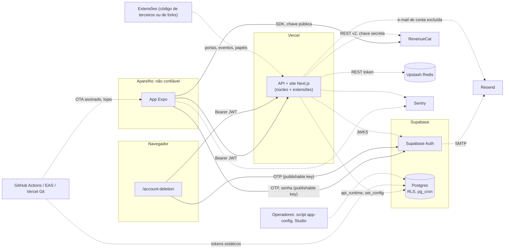

# Threat model — base-app

> **Status:** proposed · **Data:** 2026-11-24 · **Método:** STRIDE por fronteira de confiança +
> OWASP API Security Top 10 (2023) + OWASP MASVS (app) · **Escopo:** o **desenho** descrito em
> `docs/specs/*` e `docs/adr/0001–0013` (ainda sem código). O documento descreve classes de
> ataque e mitigações, sem roteiro de exploração.
>
> Este é o threat model do template público (MIT). Cada app criado a partir dele herda as
> ameaças abaixo e deve revisá-las para as suas extensões, que são código confiável e ampliam a
> superfície (ver §3.9 e §3.12). A coluna **Tratamento** diz onde a mitigação está no desenho
> (spec, ADR ou onda do plano) e marca **Gn resolvida**, **Gn aceita (Rn)** ou **Cn resolvida**.
> As lacunas (§7) e as contradições (§8) foram fechadas nas specs; a tabela de situação de §7 diz
> onde. Revisar este documento sempre que a superfície mudar (rota, integração, papel de banco,
> pipeline, ponto de extensão).
>
> **Critério de aceite da spec principal (§7):** "o threat model não tem ameaça alta sem
> mitigação implementada". Todas as lacunas **Altas** (G1 a G6) têm mitigação especificada e
> onda definida no plano; o critério passa a valer quando as ondas correspondentes (0, 1, 2, 6,
> 7, 9 e 12) estiverem implementadas e seus testes verdes. Status do documento: `proposed`.

Legenda: P = probabilidade, I = impacto (B, M, A, Crít.). Abreviações de spec: `base-app` =
specs/base-app.md, `identity` = specs/identity-and-auth.md, `billing`, `privacy` =
specs/account-lifecycle-and-privacy.md, `app-config`, `shell` = specs/mobile-app-shell.md,
`ADR n` = docs/adr/000n-*.md.

## 1. Ativos

| # | Ativo | Por que importa |
|---|-------|-----------------|
| A1 | Contas de usuário (e-mail como raiz de confiança, sessões, refresh tokens) | tomada de conta, exclusão e exportação indevidas |
| A2 | Credencial `api_runtime` do Postgres e papéis `*_system` | assumem papéis que leem e apagam dados de todos os usuários |
| A3 | Chave secreta v2 do RevenueCat (`REVENUECAT_SECRET_KEY`) e o cache de entitlements no Redis | decide o acesso pago; permite apagar clientes |
| A4 | Orçamento de e-mail (`email_sent`, cota do Resend) e a reputação do domínio de envio | sem e-mail ninguém entra, redefine senha nem exclui a conta |
| A5 | Cadeia de release (org Expo/EAS, chave de assinatura OTA, credenciais das lojas, `SUPABASE_ACCESS_TOKEN`, URL do papel `migrator`, tags, GitHub Environments, Actions) | código malicioso para todos os usuários e para todos os apps derivados |
| A6 | PII (e-mail, nome de exibição, aceites, IP e user agent nos logs das plataformas, histórico de compras no RevenueCat) | LGPD |
| A7 | Controles operacionais (`app_config.settings`, `audit.events`, `AUDIT_SUBJECT_KEY`, `platform.idempotency_keys`, chaves do Upstash) | indisponibilidade, repúdio, quebra da pseudonimização |
| A8 | O repositório público e o seu histórico | alvo de adulteração e ponto único de propagação para todos os apps criados do template |
| A10 | Pontos de extensão do núcleo (`verifyAccessToken`, `purgeAccount`, `app_config.set_setting`, `audit_writer`, `audit_operator_writer`, `audit_reader`, `edge.ts` (hosts, CSP e headers), `publicEnv`, fragmentos de `config.d/`) | capacidades privilegiadas entregues a código de extensão |
| A9 | Contas de terceiros: RevenueCat (paywall remoto), Resend, Sentry, Vercel, Upstash, Supabase, lojas | cada uma é um operador com poder sobre o produto |

## 2. Fronteiras de confiança

TB1 aparelho ↔ Internet · TB2 navegador ↔ Auth e API (a página de exclusão segura uma sessão
completa na origem do site) · TB3 Internet ↔ API · TB4 função ↔ Postgres (pooler na Internet;
papéis são separação lógica) · TB5 API ↔ Auth (JWKS) · TB6 API ↔ RevenueCat · TB7 API ↔ Upstash
· TB8 Auth ↔ Resend (SMTP, direto, sem a API) · TB9 CI/CD → produção · TB10 operadores → banco
· TB11 núcleo ↔ extensões (mesmo processo, sem sandbox; inclui `edge.ts`, hosts de extensão, widget de CAPTCHA no site e papéis de banco de extensão) · TB12 repositório público ↔ apps
derivados (merge de `upstream`).

## 3. Ameaças e tratamento

### 3.1 Supabase Auth e e-mail (TB1, TB2, TB8)

| # | STRIDE | Cenário | P/I | Tratamento |
|---|--------|---------|-----|------------|
| AU-1 | D | O `email_sent` é orçamento do projeto inteiro; abuso distribuído esgota o envio e bloqueia login, redefinição e o código da página de exclusão de todos | A/A | R-ID-3 aceito com condições: teto `email_sent` de 60/h, alerta de volume em 70% e 90% (`ops.check_signals`), alerta de Sentry em `over_email_send_rate_limit`, runbook `email-abuse-response`, teto de 300 contas novas/h (identity §3.7, §3.8, ADR 0008). **G5 resolvida** |
| AU-2 | D/R | Uso do domínio do produto para enviar e-mails não solicitados a terceiros (até ~60 por hora por tipo de e-mail e por endereço); queixas e rejeições levam o provedor a suspender o domínio ou a conta de envio | A/A | `max_frequency` de 60 s, domínio de envio dedicado com SPF, DKIM e DMARC `reject`, limiares de bounce e reclamação e runbook (identity §3.8). Alerta automático de bounce/complaint: R3 e R21. **G5 resolvida** |
| AU-3 | S | Força bruta distribuída do OTP de 8 dígitos (600 s) de um e-mail-alvo; o limite por IP perde eficácia com rotação de IP e IPv6, e a invalidação do código após N erros não está confirmada | M/A | 8 dígitos, 600 s, 30 verificações por 5 min por IP, conferidos no CI (identity §3.7); spike S-AU-4 bloqueante da onda 6 com plano B (10 dígitos, 300 s, 10 verificações) (identity §8). **G4 resolvida** |
| AU-4 | S | Pré-sequestro: o atacante cadastra o e-mail da vítima com senha antes dela; a senha pode sobreviver ao primeiro login legítimo por código | M/A | Plano B como padrão (cadastro por código, senha depois, trigger que zera a senha na primeira confirmação) até o spike S-AU-2 provar o plano A; teste de integração bloqueante (identity §3.2, §6, §8). **G1 resolvida** |
| AU-5 | I | Enumeração de e-mails chamando a API do Auth com a publishable key (inclui o OTP com `shouldCreateUser: false` usado pela página de exclusão) | A/B | App e API não revelam nada (identity ID-N4, §3.6); resto aceito em R-ID-2 (residual R2) |
| AU-6 | S | Credential stuffing em `signInWithPassword`; o endpoint continua aceito mesmo com `email_password` desligado no produto | M/A | Política de senha e proteção contra senhas vazadas quando o plano permitir (ID-04); `sign_in_sign_ups` por IP (§3.7); efeito só de produto (Q-AU-1); sem CAPTCHA (ID-14). Residual R5 |
| AU-7 | E | Com um access token roubado, trocar a senha sem o código, se o Auth isentar sessões recentes do `nonce` | B/A | `secure_password_change` e `reauthenticate()` (identity ID-06); confirmar que o `nonce` vale sempre (spike S-AU-3b, §6) |
| AU-8 | T/E | Com um access token roubado, chamar o Auth direto (`updateUser`), fora do `requireRecentAuth` | B/A | Troca de senha e e-mail exigem código (ID-06, ID-07); avisos de segurança quando existirem; R-ID-4 (S-AU-3a e S-AU-3b) |
| AU-9 | T | Conteúdo injetado no e-mail via `user_metadata.locale` | B/M | O `locale` só escolhe ramos fixos do template e nunca é impresso (identity ID-12, §3.7; teste de template) |
| AU-10 | S | Falsificação do domínio do produto (SPF, DKIM, DMARC não especificados) e leitura de códigos nos logs do provedor SMTP por quem tiver acesso à conta de e-mail | M/M | Subdomínio de envio dedicado, SPF, DKIM e DMARC `reject` (identity §3.8, ID-15); chave SMTP só de envio com escopo de domínio, 2FA, rotação trimestral; código no log do Resend: R21. **G15 resolvida** |
| AU-11 | D | Cada pedido de OTP cria uma conta não confirmada; o acúmulo não é expurgado | M/B | `ops.purge_unconfirmed_users()` apaga contas não confirmadas com mais de 3 dias, diária (identity ID-17, ADR 0008). **G18 resolvida** |
| AU-12 | E | Superfícies do Auth não usadas ficam ligadas por padrão (provedores externos, telefone, enrolamento de MFA, Realtime, Storage) e a sessão não tem teto de vida | B/M | Tabela de `config.base.toml` com provedores externos, SMS, MFA, SAML, servidor OAuth, Realtime e Storage desligados e teto de sessão (`timebox` 720 h, `inactivity_timeout` 168 h) quando o plano permitir (identity §3.7); invariantes no CI (ADR 0014); S-TM-4. **G16 resolvida**; sem o recurso de plano: R17 |
| AU-13 | R | A trilha de login e de troca de senha e e-mail só existe nos logs do Auth | A/M | R-ID-5, Q-AU-3 (residual R12) |
| AU-14 | S/E | Quem controla a caixa de e-mail controla a conta: login, exportação e exclusão | B/A | Inerente ao OTP por e-mail; login recente não ajuda aqui (residual R4) |

### 3.2 Sessão e login recente (TB1, TB2)

| # | STRIDE | Cenário | P/I | Tratamento |
|---|--------|---------|-----|------------|
| SS-1 | I | Sessão lida do armazenamento do aparelho | M/A | AES-256-GCM com IV aleatório e AAD, chave no SecureStore `THIS_DEVICE_ONLY`; adulteração → sign-out (identity ID-N1, §3.3); `allowBackup=false` e `dataExtractionRules` (shell SH-N5). Aparelho com root é residual R8 |
| SS-2 | S | Access token vale até 15 min depois de logout, "sair de todos" ou exclusão | A/M | R-ID-1 (residual R1); marcador `auth:deleted:v1:<user_id>` (identity §3.5, privacy §3.2) |
| SS-3 | E | Token roubado com login de menos de 5 min passa pelo `requireRecentAuth` | B/A | Janela de 5 min (identity ID-09); aceito (residual R9) |
| SS-4 | T | Reauth com outra conta troca a sessão ativa | B/M | Cliente de step-up separado, `persistSession: false`, comparação de `user_id` (identity §3.4) |
| SS-5 | I/E | A página web segura uma sessão completa do Auth na origem do site | M/A | Sessão só em memória, `signOut()` ao fim, CSP com nonce, nenhum script de terceiros no núcleo, Server Actions rejeitadas, `no-store` (privacy §3.4, PR-N4); CSP e cabeçalhos em três camadas e página que se recusa a renderizar sem nonce (base-app RNF-09, privacy §3.4). **G13 resolvida** |
| SS-6 | S | Refresh token roubado vale indefinidamente (rotação e detecção de reuso, mas sem teto de vida) | B/A | Rotação e reuso (identity ID-N2) e teto de vida e de inatividade da sessão (identity §3.7). **G16 resolvida**; sem o recurso de plano: R17 |
| SS-7 | D | JWKS fora do ar ou `kid` desconhecido em volume | B/M | Cache de 10 min, cooldown de 60 s, 503 e nunca aceita sem verificar (identity ID-N7, §3.5) |

### 3.3 Pipeline HTTP e fronteira da API (TB3) — OWASP API

| # | STRIDE | Cenário | P/I | Tratamento |
|---|--------|---------|-----|------------|
| PL-1 | S | JWT forjado ou confundido (`alg: none`, `HS256`, `iss`/`aud` trocados, `role` `anon` ou `service_role`) | B/Crít. | Allowlist `ES256`/`RS256`, `iss`, `aud`, `role`, claims obrigatórias, teto de 4096 caracteres (identity ID-N3, §3.5, §7) |
| PL-2 | D | Rate limit só depois da autenticação e por usuário nas rotas autenticadas; inundação de requisições anônimas ou de contas descartáveis consome função, Redis e e-mail | A/A | RNF-06: Vercel Firewall em `/api` (300/min por IP), teto por IP também nas rotas autenticadas (120/min, /64), balde por usuário e Upstash (base-app §3.6, §3.13). **G12 resolvida** |
| PL-3 | D | Rate limit em memória não limita nada em serverless | A/M | Upstash compartilhado; cada rota declara `onStoreFailure` (`x-rate-limit-failure` no contrato); IPv6 por /64 (base-app RNF-06, §3.6). **G25 resolvida** |
| PL-4 | S | Token de outro app ou ambiente aceito (mesmo projeto Supabase), ou preview apontando para o projeto de produção | B/A | Um projeto por app e por ambiente (base-app §3.10) e asserção de ambiente no boot: `environments` de `product.config.ts` contra `VERCEL_ENV` (base-app §3.9, ADR 0010). **G22 resolvida** |
| PL-5 | T | Mass assignment | B/B | `.strict()` com regra de lint (base-app §3.6, ADR 0007) |
| PL-6 | I | Token enviado a rota pública e cacheável | M/B | O client omite `Authorization` em rota pública (shell §3.3) |
| PL-7 | E | Rota nova (de extensão) sem autenticação ou pública sem contrato | M/A | `auth` obrigatório e sem padrão no `defineRoute`; teste estático; rotas públicas do código = as do contrato (base-app §3.6, §3.5, ADR 0007) |
| PL-8 | R/T | `X-Request-Id` aceito do cliente vira `correlation_id` do `audit.events` e polui traces | M/B | A API gera o próprio `requestId`; o do cliente só vira `clientRequestId` no log e nunca `correlation_id` de auditoria (base-app §3.6, ADR 0009). **G25 resolvida** |
| PL-9 | D/E | Chave de idempotência presa em "em andamento" após queda; DDL, RLS e grants de `platform.idempotency_keys` não especificados | M/M | DDL, RLS forçado, grants de `platform_system` e lease de 60 s da chave em andamento (base-app §3.7). **G17 resolvida** |
| PL-10 | I | Erro vaza internals (mensagem do Postgres, dica de autenticação) | M/M | `problem+json` sem stack nem mensagem do banco; erro de driver loga só `name` e `code`; mensagem de log literal e filtro de e-mail e JWT em texto livre (base-app §3.6, §3.12, ADR 0009). **G25 resolvida** |
| PL-11 | T | CSP e demais cabeçalhos dependem só do `proxy.ts` | B/A | RNF-09: cabeçalhos estáticos no `next.config`, no `defineRoute` e no middleware; Deployment Check; S-TM-2 na onda 1 (base-app RNF-09, plano onda 1). **G13 resolvida** |
| PL-12 | S | Payload ou cabeçalhos gigantes, JSON profundo | M/B | Body máximo de 32 KB e token máximo de 4096 caracteres (base-app §3.6, identity §3.5) |

### 3.4 Acesso a dados (TB4)

| # | STRIDE | Cenário | P/I | Tratamento |
|---|--------|---------|-----|------------|
| DB-1 | T/E | Claims interpoladas no `set` (com `user_metadata` editável) viram SQL injection | M/Crít. | `set_config(..., $1, true)` com bind, claims mínimas sem `user_metadata`, Semgrep, teste com aspas (base-app §3.8, ADR 0005, identity §7). Spike S-DB-1 |
| DB-2 | E | Um único papel de sistema alcançaria todos os contextos | A/A | Um papel `*_system` por contexto e regra `system-db-per-context` (ADR 0005). Separação lógica: residual R11 |
| DB-3 | E | `api_runtime` troca de papel livremente; `SET` de sessão vaza papel no pooler | M/A | `api_runtime` sem grants; proibição de `SET` de sessão e de SQL cru (Semgrep); invariantes no banco (ADR 0005) |
| DB-4 | E | Definer de Auth com autoridade ampla ou UUID sem vínculo à operação pode atingir outra conta | M/A | Funções pequenas do núcleo pertencentes a `postgres`, registro fechado, SQL fixo, search_path vazio e EXECUTE mínimo (ADR 0016). Purga futura valida UUID não nulo e `app.purge_user_id`; GUC não autentica. JWT/login recente/capacidade de purga na API; risco residual R11/R30 |
| DB-5 | R/T | A trava `audit.guard_mutation` depende de um GUC que qualquer sessão consegue definir; a pseudonimização pode reescrever a atribuição de eventos | B/M | Ninguém tem `update` nem `delete`; a trava confere `current_user = 'ops'` além do GUC; `pseudonymize` só opera no usuário em purga e com HMAC no formato (privacy §4.1). **G7 resolvida** |
| DB-6 | I/E | Data API aberta, `public` com grants ou falsa confiança em REVOKE de objeto gerenciado | B/A | Data API e pg_graphql desligados; grants/RLS estritos nos schemas da aplicação. Storage/Realtime desabilitados e sem dados/policies da aplicação; testes funcionais distinguem ACLs gerenciadas que `postgres` não pode revogar (ADRs 0005/0016) |
| DB-7 | S/I | Pooler na Internet sem verificação de TLS | B/A | `ssl: { ca, rejectUnauthorized: true }` e SSL obrigatório (ADR 0005 #5) |
| DB-8 | E | Tabela nova de aluno ou extensão sem RLS ou com grant largo | M/A | Regra de banco, pgTAP por tabela e teste de catálogo (RLS forçado, sem grant para `anon`, allowlist de grants) (base-app §3.8, §7, ADR 0005). **G26 resolvida** |
| DB-9 | D | Pooler saturado | M/M | Timeout de 3 s e 503 com `Retry-After` (base-app §6). Compete com a purga (PR-4) |
| DB-10 | I | Pseudonimização por HMAC reidentifica quem tem a chave e uma lista de usuários | B/M | `AUDIT_SUBJECT_KEY` Sensitive só em Production (privacy §3.2, R-PR-1; residual R10) |
| DB-11 | D/T | COUNT seguido de aprovação permite ultrapassar o teto de cadastro em concorrência; espera por lock esgota o hook | M/A | Reserva sem PII sob lock transacional fixo, expurgo/contagem/inserção atômicos e espera limitada, falhando fechada; teste concorrente e hook real. Falha posterior pode consumir vaga por uma hora (ADR 0016) |
| DB-12 | I | Credencial de e-mail em header de pg_net fica acessível por ACLs gerenciadas da fila | M/A | Baseline nova não instala nem usa pg_net/Vault para enviar alertas. Persiste sinais; nenhum segredo em filas. Banco existente exige plano separado, sem DROP automático (ADR 0016) |

### 3.5 Cobrança e RevenueCat (TB6, TB7)

| # | STRIDE | Cenário | P/I | Tratamento |
|---|--------|---------|-----|------------|
| BI-1 | E | Compra de sandbox ou de TestFlight dá acesso pago em produção | M/M | Aceito para a revisão da Apple (billing BI-11, R-BI-1), com `billing.sandboxInProduction: 'reject'` para virar depois da aprovação (billing §3.5). **G19 resolvida** |
| BI-2 | E | Test Store em produção | B/M | Ignorado com métrica; build recusa chave `test_` (billing §3.5) |
| BI-3 | T/E | Cache de entitlements forjado ou adulterado no Redis (credencial estática compartilhada com cota, rate limit e marcador de exclusão) vira acesso pago | B/A | Valor assinado com HMAC e validado por schema; `fetchedAt` conferido contra o TTL; um banco e um token por ambiente (billing BI-N4). Credencial do Upstash ainda apaga o marcador de conta excluída: R1 e R24. **G11 resolvida** |
| BI-4 | D | Contas descartáveis esgotam o limite da API v2 do RevenueCat; a falha fechada derruba as ações pagas de todos | M/A | Orçamento global de 240/min com reserva de 60/min, disjuntor compartilhado, cache do resultado vazio, teto por IP, contas novas limitadas (billing §3.2, BI-N8; base-app §3.13). **G6 resolvida** |
| BI-5 | E | Janela de 60 s: o acesso continua depois de cancelamento ou reembolso | A/B | ADR 0006; `fresh` para ações caras (billing §6). Residual R6 |
| BI-6 | I | `appUserID` = `user_id`: quem souber o UUID lê o `CustomerInfo` e escreve atributos do cliente com a chave pública do SDK | B/M | BI-N3 (`user_id` nunca em superfície pública), R-BI-2 (residual R7). O UUID também vai a logs e ao Sentry (residual R10) |
| BI-7 | T | `CustomerInfo` adulterado libera a interface premium em aparelho com root | M/B | Trusted Entitlements; só o servidor protege (BI-12, R-BI-3; residual R8) |
| BI-8 | T | Resposta do RevenueCat fora do contrato ou comprometida | B/A | Zod em toda resposta, timeout de 5 s, retry só em GET, `Retry-After` limitado (BI-N1, §3.4, S-BI-1) |
| BI-9 | I | Chave secreta do RevenueCat vazada (pode ler clientes e apagá-los) | B/A | Escopo mínimo, só na API, Sensitive só em Production, rotação (BI-N2, billing §6, ADR 0012) |
| BI-10 | E | "Restaurar compras" move a assinatura entre contas; a cota diária é por conta e não por assinatura | M/B | Cota global da feature (`globalPerDay`) limita o custo total; cota por conta continua (billing §3.3, §6). **G19 resolvida** |
| BI-11 | E | Falha provocada depois de custo externo e devolução da cota (`refund`) multiplicam o custo | B/M | `refundDailyQuota` idempotente por recibo e só sem custo externo (billing §3.3, §3.7). **G19 resolvida** |
| BI-12 | T | Paywall remoto e links dele controlados no painel do RevenueCat; conta de painel comprometida vira phishing dentro do app | B/A | Fora do código; 2FA e papéis mínimos no RevenueCat (residual R15) |
| BI-13 | E | Entitlements `promotional` e `stripe` aceitos | B/B | Intencional no base-app (suporte concede acesso); `store` é exposto no contrato (billing §3.3) |

### 3.6 Exclusão de conta, purga e exportação

| # | STRIDE | Cenário | P/I | Tratamento |
|---|--------|---------|-----|------------|
| PR-1 | E/T | Exclusão imediata e irreversível por token recente roubado ou por quem controla a caixa de e-mail | B/A | Login recente, `confirm: true`, gesto do usuário, e-mail de conta excluída depois (privacy PR-02, PR-09, SH-N6). Sem carência: residual R9 |
| PR-2 | S | Página web usada para disparar códigos a e-mails alheios (e para engenharia social "me passe o código") | M/B | Código só vale para quem lê aquela caixa (privacy §6); limites por IP do Auth (R-PR-2) |
| PR-3 | I/E | Sessão completa do Auth na origem do site | M/A | Ver SS-5 |
| PR-4 | D | Contas descartáveis pedem exclusão em paralelo: cada purga segura uma conexão do pooler por até 20 s e chama o RevenueCat | M/M | `statement_timeout` e `idle_in_transaction_session_timeout` de 20 s, 5 exclusões por hora por usuário e 10 por IP, no máximo 5 purgas simultâneas (`privacy.deletion_busy`) e pool de 3 conexões por instância (privacy §3.2, §5; base-app §3.13). **G6 resolvida** |
| PR-5 | D/T | Falha no meio da purga | M/M | Transação única e rollback, 503 retentável, chamada ao RevenueCat idempotente (privacy PR-06, PR-08, §6) |
| PR-6 | I | `auth.audit_log_entries` e rastros do Auth guardam e-mail e IP e não saem por cascade | A/M | A função de purga apaga explicitamente `auth.audit_log_entries` e `auth.flow_state` do usuário; teste de purga completa varre `auth`; tensão com R-ID-5 registrada (privacy §3.2, §7; S-PR-1). **G8 resolvida** |
| PR-7 | I | `user_id` sobra em logs da Vercel e do Sentry (campo `userId`) e em chaves do Redis; PR-N5 diz "sem PII" | A/B | Só o UUID, pseudônimo; retenção máxima de 30 dias nos logs e 90 dias no Sentry; base legal de legítimo interesse (privacy PR-N5, §4.2, §4.3; ADR 0009). Residual R10. **C7 resolvida** |
| PR-8 | I | Outro aparelho do mesmo usuário recria o cliente no RevenueCat depois da purga | M/B | App limpa o RevenueCat no 401 `auth.account_deleted` em qualquer momento e para de reconfigurar o SDK; recriação por outro aparelho aberto é R22 (privacy §3.7, PR-N1; spike S-TM-1). **G27 aceita (R22)** |
| PR-9 | I | Exportação devolve dado de outro usuário por seção de extensão que roda com papel de sistema | M/A | Núcleo usa o `userId` do JWT, login recente e 1 por hora; `collect` roda por padrão como `authenticated` (RLS), `systemRole` só com nome `<extensão>_system`, e `assertExportIsolation` com dois usuários é obrigatório (privacy PR-11, §3.6). **G9 resolvida** |
| PR-10 | D | Um handler de extensão lento ou com falha trava toda exclusão (tudo ou nada) | M/A | Timeout de 3 s por handler (máx. 8 s) e 15 s no total, métricas por handler, alerta em `privacy.deletion_unavailable`, contrato de handler idempotente e rápido (privacy §3.2, §7). **G10 resolvida** |
| PR-11 | T | Token ainda válido de conta excluída | A/M | Marcador no Redis (30 min) e FK como reserva (identity §3.5, privacy §3.2). Com Redis fora, leituras seguem até o token expirar (residual R1) |
| PR-12 | R | Falha silenciosa do pg_cron deixa a retenção sem executar | M/M | `ops.check_signals()` confere cron e heartbeat do expurgo, persistindo o sinal em `ops.alerts`. Não há entrega automática no template; conferência operacional ou monitor externo do derivado é obrigatória (ADRs 0008/0016, R23) |
| PR-13 | I | Arquivo da exportação (PII completa) fica no aparelho depois do compartilhamento | M/M | Arquivo no cache, apagado depois do compartilhamento e varrido na abertura; tela de exportação sem captura (privacy §3.7, shell SH-N8). **G21 resolvida** |
| PR-14 | T | Aceite de termos em nome de outro usuário ou de versão futura | B/M | RLS com `auth.uid()`, versão atual obrigatória, `on conflict do nothing` (privacy §3.5, §4.1) |

### 3.7 Configuração remota e gate de versão

| # | STRIDE | Cenário | P/I | Tratamento |
|---|--------|---------|-----|------------|
| AC-1 | T/D | Operador ou credencial `app_config_admin` comprometidos fixam `minSupported` inalcançável ou ligam manutenção: todos os apps ficam bloqueados | B/A | Papel dedicado, workflow com aprovação, `audit.events`, validação cruzada; Environment `production-config` com `prevent_self_review` (regra de duas pessoas), guarda de salto com `--force` e `app-config:rollback` (app-config §3.3, AC-05). **G20 resolvida** |
| AC-2 | T | Cliente modificado ou antigo ignora o gate, omitindo ou forjando `X-App-Version` | A/B | O gate do servidor só protege contra apps oficiais (AC-02, §3.2). Não é fronteira de segurança: residual R13 |
| AC-3 | T | Resposta pública cacheada atrasa a tela de bloqueio do app (CDN `s-maxage` 60 s mais `stale-while-revalidate` 60 s, mais 30 s em memória: pior caso de 150 s) | M/M | O gate do servidor bloqueia em ≤ 60 s e é a garantia (app-config §3.2, §6, AC-N1, AC-N2); resíduo do app em R13. **C6 resolvida** |
| AC-4 | T | Valor inválido no banco derruba ou desliga o gate | B/M | Último valor válido em memória ou padrão seguro, com alerta (AC-06). O padrão seguro é "sem bloqueio" (fail-open para o kill switch) |
| AC-5 | T | URL da loja ou legal adulterada para apontar a site malicioso | B/A | URLs montadas de `product.config.ts`, nunca do banco; `messageKey` com regex (app-config §3.1, §4) |
| AC-6 | D | Variar `X-App-Version`, `X-Platform` ou query fura o cache | M/M | Resposta não depende de query; rate limit de 60/min por IP; cache em memória (AC-01, AC-N1, AC-N2) |
| AC-7 | D | Rota pública com Redis fora | M/B | Segue sem rate limit e com alerta (AC-N3) |
| AC-8 | R | Alteração da configuração fora do script (Studio, credencial de administração) | B/M | MFA na plataforma e papéis mínimos; trilha só na plataforma (residual R12) |

### 3.8 App mobile (MASVS)

| # | MASVS | STRIDE | Cenário | P/I | Tratamento |
|---|-------|--------|---------|-----|------------|
| MB-1 | STORAGE | I | Sessão, cache de configuração, preferências | M/A | Ver SS-1; cache do Query sem persistência em disco (shell Q-SH-3) |
| MB-2 | STORAGE/PLATFORM | I | Captura de tela e seletor de apps mostram código ou dados exportados; e-mail em parâmetro de rota vai a breadcrumbs do Sentry | M/M | Redaction no Sentry (SH-N2); proteção de captura nas telas do código e da exportação (SH-N8); e-mail fora de parâmetro de rota e `beforeBreadcrumb` (SH-N9). **G21 resolvida** |
| MB-3 | CODE | T/E | OTA malicioso para todos os usuários (conta do Expo ou chave de assinatura comprometidas) | B/Crít. | Assinatura de código, 2FA, token de robô (SH-N7, §3.6, ADR 0012); chave só no job `sign-and-publish`, sem instalação de dependências, depois de um job `build` sem segredo (shell §3.6, ADR 0012). **G3 resolvida**; KMS com OIDC fica para quando o EAS oferecer |
| MB-4 | PLATFORM | T | Deep link para rota com efeito colateral; esquema customizado reivindicado por outro app | M/B | Nenhuma rota age ao montar, parâmetros com Zod, teste RNTL (SH-N6, §3.7). Nenhum token trafega em deep link (OTP sem link) |
| MB-5 | PLATFORM | T | `Linking.openURL` com URL vinda de SDK ou de resposta sem validação | B/M | URLs da loja vêm do config (AC-5); `openExternalUrl` exige `https` e allowlist de host, e `managementURL` fora dela cai no link público da loja (shell SH-N10). **G21 resolvida** |
| MB-6 | NETWORK | I | Tráfego sem TLS ou com cleartext habilitado; sem pinning | B/A | Só HTTPS pelos clientes; pinning fora (R8); `usesCleartextTraffic: false`, sem exceção de ATS, testado no `app.config.ts` e no manifesto de release (shell SH-N11). **G21 resolvida** |
| MB-7 | CODE | T | App reempacotado ou automatizado com as chaves públicas | A/M | Sem segredo no bundle (base-app RNF-05); sem attestation (residual R8): o que tem custo no servidor é protegido por autenticação, cota e rate limit |
| MB-8 | CODE | T | Dependência nativa ou SDK comprometidos | B/A | `allowBuilds` explícito, `strictDepBuilds`, `minimumReleaseAge: 1440`, osv-scanner (ADR 0012); plugins revisados (ADR 0002) |
| MB-9 | PRIVACY | I | SDKs coletam mais do que o declarado no privacy manifest e no Data Safety | M/M | Checklist de loja (base-app §2.4); sem analytics, sem ATT, sem push (ADR 0002) |

### 3.9 Extensões (TB11) — código confiável no mesmo processo

Extensões e portas substituídas rodam com os mesmos privilégios do núcleo (variáveis de
ambiente, papéis de banco, sessão no app). Não há sandbox: o controle é revisão, teste e as
regras de fronteira. Os itens abaixo cobrem extensão mal escrita ou maliciosa.

| # | STRIDE | Cenário | P/I | Tratamento |
|---|--------|---------|-----|------------|
| EX-1 | E | Substituir `EntitlementsReader` por implementação que libera acesso em erro ou sempre | M/A | Uma substituição por porta (boot falha se houver duas); suíte de contrato por porta rodada pelo registro em teste (base-app §3.4.2, ADR 0013). **G24 resolvida** |
| EX-2 | E/R | Substituir `AccountDeletionPolicy` (devolve `scheduled` sem agendar) ou `EmailSender` | B/A | Suítes de contrato de `AccountDeletionPolicy` e `EmailSender`; teste de purga completa varre o catálogo (base-app §3.4.2, privacy §7). **G24 resolvida** |
| EX-3 | I | Seção de exportação com papel de sistema vaza dados de outros usuários | M/A | `collect` roda por padrão sob RLS; `assertExportIsolation` obrigatório por seção (privacy §3.6). **G9 resolvida** |
| EX-4 | E | Extensão declara em `systemRoles` o papel de um contexto do núcleo | B/A | `systemRoles` e `systemRole` precisam ser `<extensão>_system`; papel do núcleo ou de outra extensão derruba o boot (base-app §3.4.2). **G9 resolvida** |
| EX-5 | D | Handler de `AccountPurgeRequested` trava a exclusão | M/A | Timeout por handler e no total, contrato de handler rápido e idempotente (privacy §3.2). **G10 resolvida** |
| EX-6 | E | Rota de extensão sem auth, webhook com `sharedSecret` sem proteção contra replay | M/A | `defineRoute` obrigatório, verificadores em tempo constante, rotas públicas = contrato (base-app §3.4.1, ADR 0013). `standardWebhooks` cobre assinatura e janela de tempo; a escolha é da extensão |
| EX-7 | T | Migration de extensão altera tabela do núcleo, cria grant largo ou papel sem teste | M/A | Regra em ADR 0005 #11 e ADR 0013; `pnpm db:lint-migrations` barra migration de extensão que toque schema alheio; pgTAP de papéis e membros (base-app §3.4.2). **G24 resolvida** |
| EX-8 | T | Colisão de nomes (variável de ambiente, política de autorização) sobrescreve a do núcleo | B/A | Colisão de seção de exportação, de variável de ambiente e de nome de política falha o boot (base-app §3.4.2, §3.9, privacy §3.6). **G23 resolvida** |
| EX-9 | I | Extensão mobile acessa a sessão por `AuthMethodProps` amplo ou por provider | B/A | `AuthMethodProps` mínimo (sem sessão, token nem cliente do Supabase) e `BootContext` com `SessionSummary` sem tokens (shell §3.8, base-app §3.4.2). **G24 resolvida** |
| EX-10 | T | Merge de `upstream` traz regressão ou código malicioso para o app derivado | B/A | Merge de teste com CI completo e falha em conflito fora da lista (ADR 0013); revisão do diff do upstream. Ver CI-7 |

### 3.10 Supply chain, CI/CD e repositório público (TB9, TB12)

| # | STRIDE | Cenário | P/I | Tratamento |
|---|--------|---------|-----|------------|
| CI-1 | E | Environments com revisor, restrição de branch, ruleset de tags e branch protection não viajam com "Use this template"; um Environment inexistente citado no workflow é criado sem proteção | A/A | `.github/security-baseline.json`, `pnpm security:doctor` no CI, aplicado pelo `bootstrap:init` com confirmação, job `protections` nos workflows sensíveis (base-app §3.11, ADR 0012). O que a API não permite ver fica na lista `manual`. **G2 resolvida** |
| CI-2 | T | Injeção em workflow (título de PR, nome de branch, `pull_request_target`) e execução de código de fork com segredos | M/A | Actions por SHA, `permissions` mínimas, `zizmor` no CI (barra `pull_request_target` e injeção de expressão) (ADR 0012, base-app §3.11). **G2 resolvida** |
| CI-3 | T | Pacote npm malicioso rouba segredos na instalação | M/A | `allowBuilds` explícito, `strictDepBuilds`, `minimumReleaseAge: 1440`, job de install sem segredos, lockfile congelado (ADR 0012, ADR 0001) |
| CI-4 | E | Tokens estáticos de maior alcance: `SUPABASE_ACCESS_TOKEN`, URL do `migrator`, token de robô do Expo, `APP_CONFIG_ADMIN_DATABASE_URL` | M/Crít. | Exceções registradas, Environment com aprovação, escopo mínimo, rotação trimestral, `migrator` só DDL (ADR 0012, app-config §3.3) |
| CI-5 | T | Chave de assinatura OTA exposta por um job que instala dependências | B/Crít. | Chave OTA só no job `sign-and-publish` (Environment `release`, sem instalação de dependências do app, `eas-cli` de lockfile próprio com `--ignore-scripts`) (shell §3.6, ADR 0012). **G3 resolvida** |
| CI-6 | T | Quem tem escrita cria tag `mobile-v*` e dispara release | M/A | Ruleset de tags e aprovação (ADR 0012). Ver CI-1 |
| CI-7 | T/S | O template público é alvo: adulteração do repositório, PR malicioso, `bootstrap:init` e scripts de `postinstall`; uma falha vira falha de todos os apps derivados, que talvez nunca façam o merge da correção | B/Crít. | Branch protection, `CODEOWNERS`, Dependabot, `SECURITY.md`, relato privado, tags assinadas e aviso nas releases (ADR 0012 seção de publicação, base-app §3.11). **G14 resolvida** |
| CI-8 | I | Segredo ou referência interna no histórico quando o repositório passar de privado a público (Q3) | M/A | gitleaks no diff e varredura de todo o histórico (ou histórico novo) antes de publicar (ADR 0012, how-to `publish-repository`). **G14 resolvida** |
| CI-9 | E | Previews recebem segredos de produção | M/A | Segredos por ambiente, Sensitive só em Production, Deployment Protection (base-app §3.10, ADR 0012) e asserção de ambiente no boot (base-app §3.9). **G22 resolvida** |
| CI-10 | E | Chave secreta do Supabase no runtime público | B/Crít. | Removida do runtime; funções `SECURITY DEFINER` (ADR 0004, spike S-PR-1). Se o spike reabrir a decisão, o item volta a Alta |
| CI-11 | T | Migration ou workflow malicioso aprovado sem revisão | B/Crít. | PR e revisão (ADR 0012); `migrator` só DDL; aprovação do Environment; `CODEOWNERS` para `.github/` e `supabase/migrations/` (base-app §3.11). **G2 resolvida** |
| CI-12 | R | Ações no Studio e no painel das plataformas fora da auditoria | M/M | MFA e papéis mínimos (residual R12) |

### 3.11 Operação, logs e terceiros

| # | STRIDE | Cenário | P/I | Tratamento |
|---|--------|---------|-----|------------|
| OP-1 | I | PII ou token em log, métrica, trace ou Sentry | M/A | Redaction por nome de chave, sem corpo de requisição, `sendDefaultPii: false`, `beforeSend`, teste de redaction (ADR 0009, base-app RNF-10, shell SH-N2); mensagem de log literal e filtro de valores em texto livre (ADR 0009). **G25 resolvida** |
| OP-2 | D/T | DSN pública do Sentry usada para inundar eventos ou mascarar erros reais | M/B | DSN é pública por desenho; filtros de entrada e teto de gasto no how-to (residual R16) |
| OP-3 | D | Denial of wallet: tráfego e comandos de Redis pagos por uso (Vercel, Upstash, Supabase, Resend) | M/A | Vercel Firewall, Spend Management, tetos de gasto e alertas na Vercel, Upstash, Resend e Supabase, e no máximo 4 comandos de Redis por requisição (base-app §3.13, how-to `cost-guardrails`). **G12 resolvida** |
| OP-4 | D | Alertas dependem da mesma plataforma que pode estar fora; sem alerta de consumo de `email_sent` | M/M | Alertas do ADR 0009 mais `ops.check_signals()` (volume de e-mail, falha do `pg_cron`, volume de auditoria) e Sentry em `over_email_send_rate_limit` (ADR 0008, identity §3.8). **G5 resolvida** |
| OP-5 | I | Operadores recebem dado pessoal (transferência internacional, DPAs, retenção) | A/M | Inventário e papéis LGPD (privacy §1, §4.3); contratos e retenção mínima nos how-tos (residual R10) |

### 3.12 Pontos de extensão do núcleo (D1 a D14)

Superfícies que o núcleo expõe para extensões e versões derivadas. Os controles do núcleo valem
com as listas de extensão vazias; os riscos abaixo aparecem quando alguém as preenche.

| # | STRIDE | Cenário | P/I | Tratamento |
|---|--------|---------|-----|------------|
| NX-1 | E | `appRoles` e `providers` vêm de `app_metadata` (D1); se uma extensão ou um caminho da Admin API gravar um papel indevido, a política de autorização o aceita. O papel fica no JWT por até 15 min depois de revogado | B/A | Só a chave secreta grava `app_metadata`, e ela não está no runtime (ADR 0004); valores validados com Zod e fora de `dbClaims` (D1); ação destrutiva relê o papel no banco com `loadFreshRoles()` (base-app §3.6). **G36 resolvida**; atraso de revogação: R19 |
| NX-2 | S | `isAnonymous` lido do JWT e tratado como autorização por extensão; o núcleo nunca liga o login anônimo | B/M | `is_anonymous` ausente = `false` (D1); `enable_anonymous_sign_ins = false` (identity §3.7) |
| NX-3 | S/E | `verifyAccessToken` público (D2) usado para um segundo token no corpo: confused deputy, token em log ou query string, rota sem rate limit que vira oráculo de verificação | M/A | Mesmas checagens do pipeline, marcador de conta excluída, nunca lê query string (D2); regra `no-direct-jwt-verify`; `rateLimit` obrigatório em toda rota (base-app §3.5, §3.6). **G36 resolvida** |
| NX-4 | E | `AuthorizationPolicy` (D3) devolve a decisão com base em `host`, `method`, `path`: host forjado, política que lança erro ou política que não nega por padrão | M/A | `host` normalizado e conferido (D3); decisão restrita a 401, 403 ou 404; política que lança, estoura 500 ms ou não decide nega com 403 `authz.policy_error` e evento de segurança (base-app §3.4.2, §3.6). **G36 resolvida** |
| NX-5 | S/E | `edge.ts` (D6): confusão de host (cabeçalhos de encaminhamento, previews com domínio não configurado) ou de prefixo (barras duplicadas, codificação, caixa) faz o host de uma extensão servir rotas do site principal, ou o contrário | M/A | Host desconhecido, prefixo fora do host e prefixo da extensão pelo host principal → 404 (D6); caminho normalizado antes de comparar; respostas 308 pré-Proxy do Next são distinguidas, com Location seguro e destino final validado (ADR 0003); tabela de bypass; `matcher` cobre todos os paths; `APP_HOST` obrigatório e previews tratados (base-app §3.4.2). **G34 resolvida** |
| NX-6 | T/I | Acréscimos de CSP por prefixo (D6) ampliam a política de uma rota; um prefixo largo atinge `/account-deletion`, que segura uma sessão completa | B/A | Teste do núcleo recusa `*`, `unsafe-*`, `data:` e `blob:` e exige `https://<host>` em **todas** as diretivas; `pathPrefix: '/'` sem acréscimo; o prefixo de `/account-deletion` só aceita `script-src`, `frame-src` e `connect-src` (até 2 origens) (base-app §3.4.2). **G34 resolvida** |
| NX-7 | I/E | Widget de CAPTCHA (D7) é script de terceiros executando na origem da página `/account-deletion`, que depois guarda a sessão completa em memória; quebra a garantia "nenhum script de terceiros" | M/A | Só um widget por app; sem widget, comportamento atual (D7). Mitigações: sessão só em memória, página sem outra função, `connect-src` restrito, widget desmontado antes do `verifyOtp` (privacy §3.4, PR-N4). **G29 aceita com mitigações (R20)** |
| NX-8 | R/T | `audit_writer` (D8; depois de D20 só `system` e `webhook`, e `operator` fica em `audit_operator_writer`, NX-22): qualquer papel que receba o grupo grava eventos `system` ou `webhook` com `actor_ref` e `subject_ref` arbitrários, forjando atribuição ou enchendo a tabela | M/M | Só `insert`; `check` de formato em `actor_ref`, `subject_ref`, `resource_ref` (sem UUID) e `metadata`; pgTAP lista os membros; só `recordAuditEvent` grava (lint); alerta de volume por `actor_type` (privacy §4.1, ADR 0008). **G33 resolvida** |
| NX-9 | E/T | `app_config.set_setting` (D9) chamável por papéis de uma extensão (ex.: um painel web): o kill switch deixa de depender do workflow com aprovação e passa a depender da segurança de uma aplicação web | B/A | `SECURITY DEFINER`, `search_path = ''`, `execute` restrito, chave e ator conferidos (D9); ator `operator` precisa coincidir com `app.operator_id` da transação; `check` de forma e regras cruzadas na tabela; 20 alterações por hora; painel exige reautenticação e segundo aprovador (app-config §3.3, §4). **G31 resolvida** |
| NX-10 | R | `app_config_admin` vira membro de `audit_writer` e `audit_operator_writer` (D9, D20) e ganha o poder de inserir eventos de sistema fora da função | B/M | Papel sem login, credencial só no Environment com aprovação (app-config §3.3). Coberto por G33 |
| NX-11 | T/E | Fragmentos de `supabase/config.d/` (D10) sobrescrevem chaves de segurança do núcleo (limites de taxa, `jwt_expiry`, redirects, `api.enabled`, `enable_signup`, CAPTCHA); o último fragmento em ordem alfabética vence e o aviso fica só no cabeçalho | M/A | CI exige gerado igual ao commitado; `pnpm supabase:config:check` com invariantes; sobrescrita de chave protegida só com `# allow-override` e listada no cabeçalho (identity §3.7, ADR 0014). **G32 resolvida** |
| NX-12 | I | Segredo literal num fragmento de configuração | M/A | Regra "segredos só com `env(...)`" (D10) e gitleaks no CI |
| NX-13 | T/E | `DELETE /v1/account/deletion-request` (D11) sem login recente: quem tem um token roubado cancela uma exclusão pendente do titular; a resposta `GET` revela só o estado do próprio usuário | B/M | Autenticada, **com login recente**, 5/h por usuário e 10/h por IP, 404 `privacy.no_pending_deletion` (D11); grava `account.deletion_cancelled` e avisa o titular por e-mail (privacy §3.2, §5). **G30 resolvida** |
| NX-14 | E | `purgeAccount` exportado por `privacy` (D11) apaga qualquer `userId` fora do pipeline (sem login recente nem rate limit), com `reason` e `notify: false` escolhidos pelo chamador; um caminho com `verifyAccessToken` ou um agendador defeituoso apaga a conta errada | B/Crít. | `purgeAccount` exige `PurgeAuthorization` (tipo marcado emitido só pelas fábricas, conferido em runtime); `guest_*` exige `is_anonymous` no banco; `notify: false` só com `guest_*`; `account.deleted` com `reason` e `caller`; limite por job e 5 purgas simultâneas; lint barra o import fora de `modules/privacy/**` e `extensions/**` (privacy §3.1). **G30 resolvida** |
| NX-15 | D/S | Webhooks de terceiros (D12): inundação sem autenticação força leitura do corpo de até 1 MB e HMAC antes de qualquer limite (a ordem fixa põe a autenticação antes do rate limit) | M/M | Limite grosso por IP (60/min) antes da verificação de webhook e regra do Firewall; leitura do corpo cortada no limite (`maxBodyBytes`) (base-app §3.6). **G35 resolvida** |
| NX-16 | S | Lista de segredos de rotação (D12): segredo antigo nunca sai da lista e continua válido; `sharedSecret` não tem assinatura de corpo nem janela de tempo | M/M | Primeiro é o atual, todos comparados em tempo constante; lista com no máximo 3 itens e `<NOME>_EXPIRES_AT` (≤ 30 dias) para os anteriores (base-app §3.6). **G35 resolvida** |
| NX-17 | T | Exceção `.strip()` (D12) usada por esquema que não é de emissor autenticado, reabrindo mass assignment | B/M | Lint conhece só `webhooks/**` e um teste estático liga os schemas dessa pasta a rotas com `auth.kind: 'webhook'` (base-app §3.5, ADR 0007). **G35 resolvida** |
| NX-18 | D | `rateLimit.key: 'global'` (D12): um balde único por rota que um atacante esgota com tráfego que passou pela autenticação de um segredo vazado, ou configurado baixo demais e que derruba eventos legítimos | B/M | Autenticação antes do rate limit evita que lixo anônimo consuma o balde (base-app §3.6); resposta 429 faz o emissor repetir |

### 3.13 Superfícies acrescentadas por D15, D16 e D17

| # | STRIDE | Cenário | P/I | Tratamento |
|---|--------|---------|-----|------------|
| NX-19 | I/E | `audit_reader` (D15): quem recebe o grupo lê **toda** a trilha, inclusive `metadata` e `subject_ref` de outros titulares e `before`/`after` da configuração; um painel comprometido ou um papel `<schema>_system` com o grant vira leitura ampla de dados de todos os usuários, e a leitura não deixa rastro no banco | B/A | Só `select` (sem `insert`, `update` ou `delete`), nenhuma política criada por extensão (`events_select_reader` é do núcleo); `metadata` sem PII e `check` de formato nas referências (privacy §4.1); pgTAP lista os membros de `audit_reader` e falha com membro não declarado (`expected-group-members.json`); a leitura feita por painel é auditada por ele com `audit_writer` (`audit.viewed`); seção de exportação de extensão **não** lê `audit.events` (privacy §3.6); `grant audit_reader` é raro e revisado em PR (CODEOWNERS de `supabase/migrations/`). Volume anormal de `operator` é alertado (ADR 0008). Residual R25: o núcleo não impõe que o painel audite a própria leitura |
| NX-20 | T/I | `EdgeExtension.headers` (D16): header por prefixo enfraquece uma proteção (ex.: `Cache-Control` público numa rota autenticada, `Referrer-Policy` frouxa), vaza dado por cache, ou um prefixo largo atinge `/account-deletion`; o `matcher` que não cobre `/_next/**` deixa resposta sem host conferido nem cabeçalhos | B/M | Allowlist fechada de nomes (`Referrer-Policy`, COOP, CORP, `X-Robots-Tag`, `Cache-Control`) e de **valores** (`no-referrer`, `same-origin`, `same-origin`, `noindex, nofollow`, `no-store`): só endurecem; fora disso o boot e o teste falham; header de segurança do núcleo nunca é removido; valem em qualquer host que sirva o prefixo; `matcher` cobre todos os paths e o host é conferido sempre; caminho normalizado antes de comparar prefixo (base-app §3.4.2, onda 1). Aceito: `no-store` em prefixo largo só custa desempenho |
| NX-21 | I | `publicEnv` (D17): uma extensão coloca segredo em variável pública (`EXPO_PUBLIC_*` vai para o bundle do app, `NEXT_PUBLIC_*` para o JavaScript do site), ou usa um nome que o núcleo já usa e muda o comportamento do app | M/A | Só o prefixo certo (`EXPO_PUBLIC_` no app, `NEXT_PUBLIC_` na web); nome com `SECRET`, `KEY_PRIVATE` ou `TOKEN` falha o boot, o build e o teste; chave repetida (núcleo ou outra extensão) falha; site key de CAPTCHA, que é pública, passa; gitleaks cobre valores literais (base-app §3.4.2, mobile-app-shell §3.8, reference). Limite: o teste vê o nome, não o valor; uma chave secreta com nome neutro (`EXPO_PUBLIC_FOO`) passa e depende de revisão e do gitleaks: R26 |

### 3.14 Superfícies acrescentadas por D18 a D21

| # | STRIDE | Cenário | P/I | Tratamento |
|---|--------|---------|-----|------------|
| NX-22 | R/E | Com `audit_writer` aceitando `operator`, qualquer papel que só precisa de eventos de sistema forja a ação de uma pessoa (atribuição falsa na trilha) | B/A | D20: `audit_writer` só `system` e `webhook` (`events_insert_writer`); `operator` só por `audit_operator_writer` (`events_insert_operator`); membros dos dois conferidos por pgTAP em `expected-group-members.json`; `app_config_admin` entra nos dois por `set_setting` (account-lifecycle §4.1, base-app §3.8; onda 2). Complementa NX-8 e NX-10. **L-20 resolvida** |
| NX-23 | T/I | `csp[].strict` (D18) mal usado: `trusted-types` com `*` ou `'allow-duplicates'`, ou `directives` que afrouxam a base estrita num prefixo que o núcleo considera protegido | B/M | Política base fixa sob o prefixo (`default-src 'none'`, nonce, `strict-dynamic`, `require-trusted-types-for 'script'`); lista de políticas de trusted-types com nome validado (≤ 5, sem `*`); teste compara a política final com a base e falha se alguma diretiva estrita foi afrouxada (base-app §3.4.2; onda 1). Estender `strict` com origens de terceiros continua valendo as regras de NX-6. **L-6 resolvida** |
| NX-24 | T/E | Race entre dois operadores (ou o script e o painel) em `app_config.set_setting`: a última escrita apaga a alteração da outra sem aviso | M/M | `p_expected_updated_at` (controle otimista): divergência levanta `AC409`, mapeada para 409 `app_config.conflict`; `null` exige chave inexistente (app-config §3.3, §4; onda 2). **L-9 resolvida** |
| NX-25 | E | Painel comprometido, ou operador, altera uma chave de `app_config` fora do que o papel dele devia tocar: o banco não sabe quem chamou (GUC forjável dentro de `SECURITY DEFINER`) | B/A | A allowlist por papel é da aplicação de quem chama; toda escrita gera `app_config.updated`; `ops.check_signals()` alerta operador em chave fora de `app_config.operator_alert_exempt_keys` (ADR 0008). **Mitigação parcial: R27** |
| NX-26 | T/E | Migration `_ext-` com DDL, `GRANT`, `REVOKE` ou `POLICY` sobre schema do núcleo (ex.: `grant select` em `identity.profiles`, política nova em `audit.events`, trigger em `auth.users`) ou `vercel.json` com `headers`, `rewrites`, `redirects` ou `routes` que contornam o middleware de borda | M/A | `pnpm db:lint-migrations` recusa tudo isso (exceções fechadas: `grant <papel-grupo> to <ext>_system`, `insert` em `operator_alert_exempt_keys`, FK 1:1 para `auth.users`) e exige prefixo `_ext-` em toda migration fora do `upstream`; `pnpm vercel:check` limita as chaves de topo a `$schema`, `functions`, `schedules`, `crons` e `regions` (base-app §3.4.2; ADR 0013; ondas 0). **L-11 resolvida**; a allowlist de chaves de topo não valida os valores (R28) |
| NX-27 | T | Fragmentos de `config.d` enfraquecem a configuração do Auth | B/A | Já coberto por NX-11: invariantes no `config.toml` gerado e marcador `# allow-override` (identity §3.7, ADR 0014). **L-10 confirmada** |
| NX-28 | E | `DELETE /v1/account/deletion-request` sem login recente cancela a exclusão com um token roubado | B/M | Já coberto por NX-13: `requireRecentAuth: true`, 5/h e 10/h por IP; verificado em account-lifecycle PR-14, §3.2, §5 (tabela, nota e erros), §7 e critérios, sem trecho que ainda diga o contrário. **L-21 confirmada** |

### 3.15 Superfícies acrescentadas por D22 a D25

| # | STRIDE | Cenário | P/I | Tratamento |
|---|--------|---------|-----|------------|
| NX-29 | E | **`withPreviousSession` (D24) entrega um access token a código de extensão.** Uma extensão (ou dependência dela) pode reter, logar, enviar a terceiro ou reutilizar o token da sessão anterior (ex.: a de visitante), que vale até 15 min como identidade completa | M/A | O token vai só à `fn` recebida, nunca é logado, persistido ou devolvido; a sessão anterior é descartada com `signOut({ scope: 'local' })` mesmo se `fn` lançar; teste confere storage, log, breadcrumbs e retorno; no servidor a fusão passa por `verifyAccessToken` (marcador de conta excluída, `rateLimit` obrigatório) (mobile-app-shell §3.8, base-app §3.4.2; onda 3). A extensão é código confiável no mesmo processo (R14), então o controle é revisão: R29 |
| NX-30 | E | Extensão do app contorna a fachada e usa o cliente cru do Supabase (token, `updateUser`, `signOut`, chamadas sem `withCaptcha`) | M/A | Regra do dependency-cruiser `supabase-client-only-in-auth` (cliente cru só em `features/auth`); toda chamada de `extensionAuth` que aceita CAPTCHA passa por `withCaptcha` (base-app §3.5, §3.4.2; ondas 0 e 3) |
| NX-31 | E/T | Extensão tenta assumir `postgres` por definer ou adulterar o registro de funções de Auth | B/A | Transferência de função de extensão para `postgres` é proibida; registro fechado do núcleo, schemas JSON estritos, guard de migrations e pgTAP de assinatura/dono/EXECUTE/search_path. Nova operação exige revisão do núcleo (ADR 0016); resíduo R30 |
| NX-32 | D/E | `maintenance: 'exempt'` aplicado a rota comum furaria o modo manutenção e o kill switch para tráfego de usuário | B/M | Aceito só com `auth.kind: 'webhook'` ou política registrada com `{ operator: true }`; qualquer outro caso falha no boot e no teste estático, que lista as rotas isentas; rota isenta mantém auth, authz, rate limit e auditoria (base-app §3.6; onda 1) |
| NX-33 | E/S | Login anônimo ou vínculo manual ligado por fragmento sem CAPTCHA: cadastro e vínculo em massa sem barreira | M/A | `allow-override` só vale com CAPTCHA ligado no `config.toml` gerado; sem CAPTCHA o check falha mesmo com o marcador; o modo visitante só liga depois do CAPTCHA (identity §3.7, ADR 0014; ondas 0 e 2) |

## 4. Mapeamento OWASP API Security Top 10 (2023)

| Item | Ameaças e controles |
|------|---------------------|
| API1 BOLA | `user_id` só do JWT (RNF-03, ADR 0011), RLS forçado, filtro no repositório, teste entre usuários por tabela e por endpoint. Riscos: EX-3, DB-8, PR-9 |
| API2 Broken Authentication | NX-1, NX-3, NX-16, PL-1, AU-3, AU-4, AU-6, AU-7, SS-3, SS-6, PR-11 |
| API3 Broken Object Property Level Authorization | `.strict()` (PL-5, NX-17), claims mínimas (DB-1), `user_metadata` nunca usado como autoridade, exportação sem segredos (PR-9) |
| API4 Unrestricted Resource Consumption | PL-2, PL-3, PL-9, PL-12, AU-1, AU-2, BI-4, PR-4, OP-3, NX-15, NX-18 |
| API5 Broken Function Level Authorization | Sem rotas administrativas no núcleo; `authorize` e `AuthorizationPolicies` para extensões (PL-7, EX-6, NX-4, NX-9, NX-14, NX-19); script de configuração fora da API (AC-1) |
| API6 Unrestricted Access to Sensitive Business Flows | Cadastro e envio de OTP (AU-1, AU-2, AU-11), exclusão em massa (PR-4), ação com custo (BI-1, BI-10, BI-11), consulta ao RevenueCat (BI-4) |
| API7 SSRF | Não se aplica ao núcleo: nenhuma URL fornecida pelo usuário é buscada no servidor; URL do RevenueCat e do JWKS são fixas. Extensões que busquem URL de terceiros precisam do controle de SSRF de `~/.claude/rules/security.md` |
| API8 Security Misconfiguration | PL-4, PL-11, DB-6, AU-12, CI-1, CI-9, MB-6, NX-5, NX-6, NX-11, NX-20, NX-21; configuração do Auth como código (`config.toml` gerado de fragmentos) |
| API9 Improper Inventory Management | Versão no path (`/v1`), gate de versão (AC-2), OpenAPI gerado e verificado contra drift (ADR 0007), previews e ambientes (PL-4, CI-9), apps e projetos por ambiente (base-app §3.10) |
| API10 Unsafe Consumption of APIs | Respostas do RevenueCat, do JWKS e do Redis validadas por schema (BI-8, BI-3, SS-7), timeouts e retry só idempotente (RNF-12) |

## 5. Riscos residuais aceitos

| # | Risco | Por que é aceito (e a condição) |
|---|-------|--------------------------------|
| R1 | Access token vale até 15 min depois de logout, "sair de todos", troca de senha ou exclusão; com Redis fora, o marcador de conta excluída não é checado | Sem introspecção por requisição; vida curta; a FK barra as escritas e as leituras não alcançam dado de outro usuário |
| R2 | Enumeração de e-mail pela API do Auth com a publishable key | O app e a API não revelam nada; só CAPTCHA reduz (extensão) |
| R3 | Sem limite de e-mails por destinatário no base-app | Aceito porque as condições de G5 estão especificadas: teto `email_sent`, domínio de envio dedicado com SPF, DKIM e DMARC, alertas de volume e de Sentry, runbook (identity §3.7, §3.8). A mitigação completa é o Send Email Hook das versões derivadas. Dono: operador do app. Gatilho de revisão: qualquer aviso de reputação do Resend |
| R4 | Quem controla a caixa de e-mail controla a conta | Raiz de confiança do login por OTP; mitigado por MFA do provedor de e-mail do usuário, fora do nosso controle |
| R5 | Credential stuffing, cadastro em massa e cota gratuita exploráveis sem CAPTCHA ou attestation | Limites por IP do Auth e cota por usuário; CAPTCHA é ponto de extensão (ID-14) |
| R6 | Janela de até 60 s de entitlements; sandbox e TestFlight dão acesso pago; transferência de assinatura entre contas | BI-11 e R-BI-1; o exemplo tem cota diária; ações caras usam `fresh` e podem exigir `isSandbox = false` |
| R7 | `appUserID` = `user_id` | UUID v4 não adivinhável e BI-N3; consequência de ler dados de compra, sem poder gastar |
| R8 | Sem pinning, detecção de root ou attestation; `CustomerInfo` adulterável em aparelho com root; sessão legível com root | Só o que tem custo no servidor é protegido; complexidade desproporcional para um template |
| R9 | Exclusão imediata e irreversível; step-up prova sessão recente, não conhecimento | Exigência das lojas e da LGPD; versões derivadas podem trocar a política (`scheduled`) |
| R10 | `user_id` pseudonimizado em logs da Vercel, Sentry e Redis (TTL) até a retenção da plataforma; HMAC não é anonimização; operadores no exterior | Sem PII direta nos logs; `AUDIT_SUBJECT_KEY` Sensitive; texto da política de privacidade deve dizer isso (contradição C7) |
| R11 | Separação `api_runtime` → papéis é lógica; SQL injection ou execução de código na API alcança todos os usuários | Invariantes críticas no banco, Semgrep, bind de claims |
| R12 | Trilha de login, troca de senha e ações no Studio ficam nos logs das plataformas | Retenção do plano; MFA no Studio |
| R13 | O gate de versão não é fronteira de segurança (cabeçalho forjável) e a tela de atualização do app tem atraso de até 150 s (CDN 60 s + 60 s de revalidação + 30 s de cache); o gate do servidor bloqueia em ≤ 60 s | Protege apenas contra apps oficiais antigos; correção de falha do servidor tem de ser feita no servidor (C6 resolvida em app-config §3.2 e §6) |
| R14 | Extensões e forks são código confiável no mesmo processo | Revisão e testes; sandbox seria um novo ADR |
| R15 | Contas de painel (RevenueCat, Resend, Expo, lojas, Vercel, Supabase, Upstash) são cadeia de confiança | 2FA obrigatório e papéis mínimos no how-to de operação |
| R16 | DSN pública do Sentry permite ruído | Filtros de entrada e teto de gasto |
| R17 | Recursos de plano pago (senhas vazadas, teto de sessão, notificações de segurança) podem faltar | Ligados por ambiente quando o plano permitir; documentar o que muda |
| R19 | Papéis e provedores em `app_metadata` podem permanecer no token até expirar (15 min mais a tolerância de 30 s) depois de alterados | Rotas `destructive` releem somente os papéis via `identity.read_fresh_roles`/`loadFreshRoles`; providers não são reconferidos por esse leitor. S-TM-3 provou propagação de metadata após refresh. G36 e ADR 0016 |
| R18 | Feature real que use LLM no lugar de `doTheWork()` | Exige threat model próprio (OWASP LLM e Agentic Top 10) |
| R20 | O widget de CAPTCHA de uma versão derivada executa na origem da página `/account-deletion`, que guarda uma sessão completa em memória (G29) | Mitigações obrigatórias e testadas: sessão só em memória, página sem outra função, CSP restrita a `script-src`, `frame-src` e `connect-src` com `https://<host>` (até 2 origens), widget desmontado antes do `verifyOtp`. A alternativa mais forte (etapa do e-mail em origem separada) fica como recomendação. Dono: mantenedor da versão derivada. Gatilho: adotar qualquer CAPTCHA, ou incidente no provedor do widget |
| R21 | O Resend guarda o corpo dos e-mails (inclui o OTP) e não há alerta automático de bounce e reclamação: o Resend avisa o dono da conta por e-mail e o runbook manda revisar o painel (diário nas 4 primeiras semanas, depois semanal) (G5, G15) | Código de uso único e 600 s de vida; 2FA e papéis mínimos; retenção de conteúdo mínima do plano; limiares de ação (bounce ≥ 2%, reclamação ≥ 0,05%). Dono: operador do app. Gatilho: primeiro aviso de reputação, ou o Resend oferecer alerta ou webhook sem custo de rota nova |
| R22 | Outro aparelho do mesmo usuário, ainda aberto, pode recriar um cliente vazio no RevenueCat depois da purga (G27) | O cliente recriado só tem o `appUserID` (UUID de conta que já não existe); o app o limpa ao receber `auth.account_deleted`. Dono: mantenedor. Gatilho: o spike S-TM-1 mostrar recriação com dado além do UUID |
| R23 | Alertas são apenas persistidos; se o pg_cron parar, até a detecção local para | Conferência semanal de `ops.alerts` e heartbeat no runbook. Notificador externo é configuração/projeto posterior do derivado, não entrega implementada. Dono: operador. Gatilho: primeira operação com usuários reais; ADRs 0008/0016 |
| R24 | Quem tem o token do Upstash apaga o marcador `auth:deleted`, zera cotas e limpa rate limits (o cache de entitlements é assinado, o resto não) (G11) | Um banco e um token por ambiente, token Sensitive só em Production; a FK de `auth.users` barra escrita de conta excluída. Dono: operador. Gatilho: o Upstash oferecer ACL por comando no plano usado |
| R25 | O núcleo não impõe que um painel audite a própria leitura de `audit.events` com `audit_reader` (NX-19) | Obrigação documentada na revisão da extensão, pgTAP dos membros, alerta de volume. Dono: mantenedor da versão derivada. Gatilho: o primeiro `grant audit_reader` |
| R26 | Uma extensão pode pôr um valor secreto em variável pública com nome neutro; o teste vê o nome, não o valor (NX-21) | gitleaks e revisão de PR. Dono: mantenedor da versão derivada. Gatilho: o primeiro `publicEnv` de extensão |
| R27 | A allowlist de chaves de `app_config` por papel não é imposta no banco (D19): quem tem `app_config_writer` pode alterar qualquer chave conhecida; o núcleo só alerta quando um operador mexe em chave fora de `operator_alert_exempt_keys` e grava auditoria | Dentro de `SECURITY DEFINER` o papel chamador só se saberia por um GUC forjável; impor a allowlist assim seria falsa segurança. Mitigações: allowlist na aplicação, evento por escrita, alerta de `ops.check_signals()`, controle otimista, limite de 20 alterações por hora, `prevent_self_review` no workflow. Dono: mantenedor da versão derivada. Gatilho: o primeiro `grant app_config_writer` a um papel de painel |
| R28 | `pnpm vercel:check` valida só as chaves de topo do `vercel.json`, não os valores de `functions`, `crons` e `schedules` | Os valores passam por PR com `CODEOWNERS` em `vercel.json`; rota de cron nova exige `defineRoute` com `auth`. Dono: mantenedor da versão derivada. Gatilho: o primeiro `crons` ou `schedules` |
| R29 | `withPreviousSession` entrega a código de extensão o access token anterior (até 15 min de validade); o núcleo não consegue impedir que uma extensão maliciosa o retenha ou o envie a terceiro | Extensões são código confiável no mesmo processo (R14); o token é entregue só à `fn`, descartado e testado contra log, storage e retorno; o servidor revalida na fusão. Dono: mantenedor da versão derivada. Gatilho: primeira extensão que use `withPreviousSession`, ou dependência nova nela |
| R30 | Definer do núcleo pertencente a `postgres` tem autoridade maior que seus chamadores; erro de SQL pode ampliar acesso a Auth | Registro fechado com dono/assinatura/callers/motivo, SQL fixo, search_path vazio, EXECUTE mínimo, negativas pgTAP e revisão do corpo. Extensões não criam esses definers. Dono: mantenedor do núcleo. Gatilho: cada função nova ou alterada (ADR 0016) |

## 6. Spikes que podem mudar este documento

| Spike | Pergunta | Impacto se a resposta for "não" |
|-------|----------|--------------------------------|
| S-AU-2 | O que acontece com a senha de um cadastro não confirmado quando o dono do e-mail entra por código? | Plano B (padrão) permanece; o plano A só vale com a prova (identity §3.2, §8; onda 6) |
| S-AU-4 | O Auth invalida o OTP depois de N erros? Como o limite por IP trata IPv6 (por endereço ou por /64)? Como `max_frequency` e `email_sent` contam por tipo de e-mail? | Plano B do OTP (10 dígitos, 300 s, 10 verificações) e recomendação de CAPTCHA; ajusta o alerta de volume (onda 6) |
| S-AU-3a e S-AU-3b | 3a: parâmetros dos dois `verifyOtp` da troca de e-mail. 3b: a troca de senha exige o `nonce` sempre, ou o Auth isenta sessões recentes (janela de 24 h na documentação)? Existem notificações de segurança? (onda 6) | AU-7 vira lacuna Alta; compensar exigindo login recente no app para a troca de senha |
| S-PR-1 | `delete from auth.users` limpa identidades, sessões, fatores e `auth.audit_log_entries`? | G8 passa a exigir limpeza explícita; se não bastar, a chave secreta volta ao runtime (CI-10) |
| S-DB-1 | `set_config` com bind funciona no pooler em modo transação? | Mudar a forma de acesso e reavaliar DB-1 a DB-3 |
| S-BI-1 | Limites de taxa da API v2 por projeto, comportamento em 429 e `store`/`isSandbox` | Dimensiona G6 e BI-1 |
| S-AU-1 | `{{ .Data.locale }}` em todos os tipos de e-mail | Ajusta AU-9 |
| S-TM-1 | O SDK do RevenueCat recria o cliente apagado quando outro aparelho do mesmo usuário continua aberto? (onda 7) | Confirma R22 (G27) como residual documentado |
| S-TM-3 | `app_metadata` (papéis, provedores) chega ao JWT e é renovado no refresh como esperado em D1? (onda 4) | Ajusta NX-1 e a janela de R19 |
| S-TM-4 | O `supabase config push` aplica todas as chaves de segurança do `config.toml` gerado, ou algumas só valem no painel? (onda 2) | NX-11 e AU-12: as chaves de painel vão para o how-to de configuração |
| S-TM-2 | CSP e demais cabeçalhos chegam a todas as respostas (API, site e `/_next/**`) sem depender do `proxy.ts`, e o matcher cobre o que deve? (onda 1) | PL-11, SS-5 e NX-20 |
| S-PR-1 (ampliado) | As funções estreitas de purga do núcleo com proprietário `postgres` alcançam os objetos necessários de Auth e respeitam os vínculos/limites? Quanto custa apagar audit_log_entries por actor_id? (onda 9) | PR-6/DB-4: registrar a incompatibilidade e revisar a spec; não introduzir chave administrativa no runtime automaticamente (ADR 0016) |

## 7. Lacunas encontradas

Ranqueadas por severidade (impacto × probabilidade, considerando o público do template). Cada
item traz a mitigação **proposta** na revisão original (texto histórico, abaixo da tabela). As
specs foram editadas depois; a tabela diz onde cada lacuna foi resolvida e onde a decisão
diferiu da proposta.

### Situação das lacunas

| # | Situação | Onde (spec, ADR e onda) |
|---|----------|-------------------------|
| G1 | Resolvida | identity §3.2, §6, §8 e ADR 0004: plano B padrão, plano A só com prova; spike S-AU-2 e teste bloqueante na onda 6. Diferença: o trigger em `auth.users` (zera a senha na primeira confirmação) é o plano B junto com o cadastro por código |
| G2 | Resolvida | base-app §3.11, ADR 0012, ondas 0, 11 e 12: `security-baseline.json`, `security:doctor`, job `protections`, `bootstrap:init` aplica com confirmação, `CODEOWNERS`, `zizmor`. Diferença: usa rulesets (legíveis pelo `GITHUB_TOKEN`) em vez de proteção clássica de branch |
| G3 | Resolvida | mobile-app-shell §3.6, ADR 0012, onda 12: `build` sem segredo e `sign-and-publish` sem instalar dependências. KMS com OIDC fica para quando existir |
| G4 | Resolvida | identity §3.7, §8, ADR 0004, ondas 2 e 6: valores no `config.base.toml` e `supabase:config:check`; plano B de S-AU-4. Diferença: `otp_expiry` 600 s (decisão do dono), compensado pelo limite de 30 verificações por 5 min por IP |
| G5 | Resolvida (com R3 e R21) | identity §3.7, §3.8, ADR 0004, ADR 0008, how-to `email-abuse-response`, ondas 2 e 6. Alerta automático de bounce e reclamação não entra (exigiria webhook no núcleo): R21 |
| G6 | Resolvida | base-app §3.13, billing §3.2 (BI-N8), privacy §3.2, identity §3.7, ondas 1, 2, 7 e 9, com números |
| G7 | Revisada pelo ADR 0016 | Funções Auth registradas e restritas do núcleo pertencem a `postgres`; funções de auditoria continuam com `ops`. GUC é vínculo transacional, não autenticação; purga futura segue a própria onda |
| G8 | Resolvida | privacy §3.2, §7, PR-N1, onda 9 |
| G9 | Resolvida | privacy §3.6, base-app §3.4.2, ADR 0013, ondas 1 e 10 |
| G10 | Resolvida | privacy §3.2, base-app §3.4.2, ondas 1 e 9 |
| G11 | Resolvida (com R24) | billing BI-N4, onda 7. Diferença: o valor é assinado com HMAC já agora |
| G12 | Resolvida | base-app §3.13, RNF-06, RNF-19, ADR 0003, ADR 0012, how-to `cost-guardrails`, ondas 1 e 11 |
| G13 | Resolvida | base-app RNF-09, privacy §3.4, ADR 0003, onda 1. Diferença: a página falha fechada sem nonce, em vez de duas rotas |
| G14 | Resolvida | ADR 0012 (publicação), how-to `publish-repository`, ondas 0 e 12. O padrão é publicar com histórico novo |
| G15 | Resolvida | identity §3.8, ID-15, onda 6 (junto com G5); código no log do Resend: R21 |
| G16 | Resolvida | identity §3.7, ADR 0014, ondas 2 e 6; teto de sessão depende do plano (R17) |
| G17 | Resolvida | base-app §3.7 (DDL, RLS, lease), onda 2 |
| G18 | Resolvida | identity ID-17, ADR 0008, onda 2 |
| G19 | Resolvida | billing §3.3, §3.5, §6 (cota global, recibo, `sandboxInProduction`), ondas 7 e 8 |
| G20 | Resolvida | app-config §3.3, ADR 0012, onda 5. Diferença: GitHub não exige dois aprovadores; vale `prevent_self_review`, guarda de salto com `--force` e `rollback` |
| G21 | Resolvida | mobile-app-shell SH-N8 a SH-N11, privacy §3.7, ondas 3, 10 e 12 |
| G22 | Resolvida | base-app §3.9, §3.10, ADR 0010, ondas 0 e 1 |
| G23 | Resolvida | base-app §3.4.2, §3.9, ADR 0010, onda 1 |
| G24 | Resolvida | base-app §3.4.2, mobile-app-shell §3.8, ADR 0013, ondas 0, 1 e 3 |
| G25 | Resolvida (com R23) | base-app §3.6, §3.12, ADR 0008, ADR 0009, ondas 1 e 2 |
| G26 | Resolvida | base-app §3.8, §7, ADR 0005, onda 2 |
| G27 | Aceita (R22) | privacy PR-N1, §3.7, billing, spike S-TM-1, onda 7 e 9 |
| G28 | Resolvida | `base-app.md` e demais docs usam "versão derivada"; só `README.md` e `NOTES.md` nomeiam |
| G29 | Aceita com mitigações (R20) | privacy §3.4, PR-N4, base-app §3.4.2, onda 9. Decisão do dono: sem rota separada; sessão só em memória, página sem outra função, CSP restrita |
| G30 | Resolvida | privacy §3.1, §3.2, §5, base-app §3.4.2, ADR 0013, onda 9. Diferença: o lint é ESLint (`no-restricted-imports` com `importNames`), porque o dependency-cruiser não enxerga símbolos; `PurgeAuthorization` como pedido |
| G31 | Resolvida | app-config §3.3, §4, onda 2 |
| G32 | Resolvida | identity §3.7, ADR 0014, onda 0 e 2 |
| G33 | Resolvida | privacy §4.1, ADR 0008, ondas 0 e 2 |
| G34 | Resolvida | base-app §3.4.2, ondas 1 |
| G35 | Resolvida | base-app §3.6, §3.5, ADR 0007, onda 1 |
| G36 | Resolvida | base-app §3.4.2, §3.5, §3.6, ondas 1 e 4 |

### Alta

- **G1. Pré-sequestro sem plano B definido (AU-4).** O teste é bloqueante, mas o plano B está
  "a definir" (S-AU-2). Mesmo com `email_password` desligado no produto o Auth aceita o
  cadastro por senha (Q-AU-1), então a superfície existe sempre.
  *Mitigação:* definir já o desenho que elimina a classe: cadastro por e-mail sempre começa por
  OTP e a senha só é definida depois do primeiro login verificado (`updateUser` com `nonce`);
  `signUp` com senha deixa de ser usado. O spike apenas confirma se dá para manter o fluxo atual.
  *Spec:* `identity-and-auth.md` (§3.2, §6, §8).
- **G2. As proteções do GitHub não viajam com o template (CI-1, CI-2, CI-6, CI-11).** Revisores
  de Environment, restrição de branch de deploy, ruleset de tags, branch protection e secret
  scanning são configurações da plataforma, não código; um Environment citado em workflow e
  inexistente é criado sem proteção. As garantias de aprovação de `db-migrate.yml`,
  `app-config-set.yml` e do release do EAS dependem delas.
  *Mitigação:* script `pnpm security:doctor` (via `gh api`) que falha se faltar revisor,
  restrição de branch, ruleset de tags ou proteção de `main`, e roda no CI; passo obrigatório no
  tutorial; linter de workflows (zizmor ou equivalente) no CI barrando `pull_request_target` e
  interpolação de entrada não confiável; `CODEOWNERS` para `.github/`, `supabase/migrations/` e
  `packages/config`.
  *Spec:* `docs/adr/0012-ci-cd-and-release.md`, `base-app.md` §3.11 e o plano (ondas 0 e 12).
- **G3. Chave de assinatura OTA no mesmo job que instala dependências (MB-3, CI-5).** A chave
  privada fica como segredo do GitHub e o job de release instala pacotes; um pacote ou script
  comprometido a exfiltra e assina JavaScript para todos os usuários.
  *Mitigação:* gerar o bundle num job sem segredo e assinar num job separado que não instala
  dependências (CLI com versão pinada, sem scripts), com aprovação; considerar KMS com
  federação OIDC quando o tooling permitir; registrar rotação e o plano de perda de chave (o
  certificado fica embutido no app).
  *Spec:* `mobile-app-shell.md` (§3.6, Q-SH-2) e `ADR 0012`.
- **G4. Força bruta do OTP depende de comportamentos não confirmados (AU-3).** Não se sabe se o
  Auth invalida o código após erros nem como o limite por IP trata IPv6; sem CAPTCHA no base-app.
  *Mitigação:* tornar S-AU-4 bloqueante da onda 6 com regra de decisão: se não houver
  invalidação por tentativas ou o IPv6 não for agrupado por /64, reduzir `token_verifications`
  e `otp_expiry` e adotar OTP de 10 dígitos; documentar o CAPTCHA como endurecimento
  recomendado para apps públicos.
  *Spec:* `identity-and-auth.md` (§3.7, §6, §8).
- **G5. Abuso de e-mail: orçamento global, caixa de terceiros e reputação do domínio (AU-1,
  AU-2, OP-4).** O R-ID-3 aceita o risco sem alerta de consumo nem runbook, e ignora que
  queixas e rejeições podem suspender o domínio de envio, o que derruba o login de todos.
  *Mitigação:* domínio de envio dedicado (subdomínio) com SPF, DKIM e DMARC; alertas de cota e
  de taxa de rejeição e queixa no Resend e de `email_sent` no Supabase; runbook de resposta
  (reduzir limites, ligar CAPTCHA por extensão, rotacionar a credencial SMTP); condicionar a
  aceitação de R3 a esses itens.
  *Spec:* `identity-and-auth.md` (R-ID-3, §3.7), `ADR 0004` e o how-to de operação.
- **G6. Exaustão do RevenueCat e do pooler por contas descartáveis (BI-4, PR-4).** Os limites são
  por usuário, e contas são grátis; a falha fechada converte a exaustão em indisponibilidade das
  ações pagas para todos, e cada exclusão segura uma conexão do pooler enquanto chama o
  RevenueCat.
  *Mitigação:* orçamento global de chamadas ao RevenueCat no Redis (token bucket) com reserva
  para `refresh` pós-compra; cache também de resultado vazio por 60 s; limite por IP também nas
  rotas autenticadas; limite de exclusões simultâneas e fila curta no `privacy`; medir os
  limites da v2 (S-BI-1).
  *Spec:* `billing.md` (§3.2, §3.4), `base-app.md` (RNF-06), `account-lifecycle-and-privacy.md`
  (§3.2).

### Média

- **G7. Funções `SECURITY DEFINER` aceitam qualquer `uuid` e o guard depende de GUC forjável
  (DB-4, DB-5).** `delete_auth_user`, `lookup_email_for_purge` e `pseudonymize_audit_refs` não
  se ligam ao chamador; o dono é "papel com acesso a `auth.users`" (possivelmente `postgres`); a
  pseudonimização pode reatribuir eventos de outro usuário.
  *Mitigação:* dono dedicado `purge_owner` com o mínimo de grants; as funções exigem GUCs
  definidos pelo caso de uso na transação (`app.purge_user_id`) e conferem o argumento contra
  eles; `pseudonymize` valida que o `subject_ref` é o HMAC esperado e só opera no usuário em
  purga; reconhecer no texto que isso reduz erro de código, não impede injeção de SQL (R11).
  *Spec:* `account-lifecycle-and-privacy.md` (§3.2, §4.1) e `base-app.md` §3.8.
- **G8. `auth.audit_log_entries` e rastros do Auth não saem por cascade (PR-6).** Não têm FK
  para `auth.users` e guardam e-mail, IP e ids; o desenho "assume que sim" (S-PR-1), o que
  contraria PR-N1 e quebraria o teste de purga completa.
  *Mitigação:* a função de purga apaga explicitamente essas linhas pelo `actor_id` do payload
  (e documenta o que resta nos logs da plataforma); ajustar o inventário e a exceção do teste;
  explicitar a tensão com R-ID-5 (trilha de login).
  *Spec:* `account-lifecycle-and-privacy.md` (§3.2, §4.3, §8) e `ADR 0004`.
- **G9. Seção de exportação de extensão com papel de sistema (EX-3, EX-4, PR-9).** O papel de
  sistema tem `using (true)`; esquecer o filtro por `userId` devolve dados de outros usuários, e
  `systemRoles` não impede declarar o papel de um contexto do núcleo.
  *Mitigação:* `collect` roda por padrão como `authenticated` com as claims do usuário (RLS se
  aplica); papel de sistema só se declarado e com nome `<extensão>_system` (boot falha se o
  nome não começar pelo da extensão); teste de contrato com dois usuários obrigatório por
  seção.
  *Spec:* `account-lifecycle-and-privacy.md` (§3.6), `base-app.md` (§3.4.2), `ADR 0013`.
- **G10. Handler de extensão pode travar toda exclusão (PR-10, EX-5).** Os handlers rodam
  síncronos na mesma transação sem orçamento de tempo; um com falha ou lento impede qualquer
  usuário de excluir a conta (exigência de lojas e da LGPD).
  *Mitigação:* timeout por handler e total, handler sem chamada externa sem timeout, métrica por
  handler e alerta em `privacy.deletion_unavailable`; o teste de extensão exige handler
  idempotente e rápido.
  *Spec:* `account-lifecycle-and-privacy.md` (§3.2) e `base-app.md` (§3.2).
- **G11. Integridade do cache de entitlements e do Redis compartilhado (BI-3).** Uma credencial
  do Upstash permite forjar entitlements, zerar cotas, apagar o marcador de conta excluída e
  limpar rate limits. O valor guardado tem `fetchedAt`, mas a leitura não o confere contra o TTL.
  *Mitigação:* rejeitar snapshot com `fetchedAt` fora do TTL mais folga; um banco e um token
  Upstash por ambiente, token Sensitive só em Production; assinar o valor (HMAC com chave do
  servidor) quando o ganho justificar; ACL por comando se o plano permitir.
  *Spec:* `billing.md` (BI-N4, §3.2) e `base-app.md` (§3.10).
- **G12. Denial of wallet (PL-2, OP-3).** Só há Upstash; nada de Vercel Firewall, teto de gasto
  ou limite por IP antes da função; o consumo de comandos do Redis e de e-mails é pago por uso.
  *Mitigação:* regra de rate limit no Vercel Firewall como linha de base, spend management e
  alertas de custo na Vercel, Upstash, Resend e Supabase; limite por IP também nas rotas
  autenticadas; registrar no how-to de operação.
  *Spec:* `base-app.md` (RNF-06), `ADR 0003` e `ADR 0012`.
- **G13. Cabeçalhos e CSP numa camada só (PL-11, SS-5).** A CSP com nonce e a rejeição de
  `Next-Action` vivem no `proxy.ts`; falha de matcher ou de interceptação deixa a página que
  segura a sessão sem CSP.
  *Mitigação:* cabeçalhos estáticos (HSTS, nosniff, frame, referrer, permissions) também por
  `next.config` ou `vercel.json`; teste de integração que confere os cabeçalhos em respostas da
  API e do site e a CSP da página de exclusão; manter o Next.js atualizado (SCA) e S-TM-2.
  *Spec:* `base-app.md` (RNF-09) e `account-lifecycle-and-privacy.md` (§3.4).
- **G14. Publicação do repositório e blast radius (CI-7, CI-8).** Q3 prevê tornar o repositório
  público depois da v1: o histórico inteiro vira público; uma falha do template afeta todos os
  apps criados dele; não há política de divulgação nem canal de aviso.
  *Mitigação:* varredura completa do histórico (gitleaks, e revisão de referências internas) ou
  publicação com histórico novo; `SECURITY.md` com canal privado de reporte e GitHub private
  vulnerability reporting; tags assinadas, releases versionadas e orientação de os alunos
  partirem de uma tag; GitHub Security Advisories e aviso nas releases; 2FA obrigatório e
  proteção de branch para os mantenedores.
  *Spec:* `base-app.md` (Q3, §3.11), `ADR 0012` e `ADR 0013`.
- **G15. Domínio de e-mail e códigos no provedor SMTP (AU-10).** SPF, DKIM e DMARC não são
  especificados; o corpo dos e-mails (com o OTP) fica no painel e nos logs do Resend, legível por
  quem tiver acesso à conta; a credencial SMTP é de longa vida.
  *Mitigação:* DMARC com política `reject`, subdomínio dedicado, 2FA e papéis mínimos na conta do
  Resend, chave só de envio com escopo de domínio, retenção mínima de conteúdo, rotação
  trimestral; texto do e-mail com "não compartilhe este código".
  *Spec:* `identity-and-auth.md` (ID-15, §3.7) e o how-to de configuração de e-mail.
- **G16. Superfícies do Auth e do Supabase não usadas, e teto de sessão (AU-12, SS-6, DB-6).**
  Só alguns recursos estão explicitamente desligados, e o `config.toml` agora é gerado de fragmentos (G32).
  *Mitigação:* tabela do `config.toml` com `external.*.enabled=false`, telefone e SMS, enrolamento
  de MFA, SAML e servidor OAuth desligados; Realtime e Storage desligados no projeto; teto de
  vida e inatividade das sessões (`timebox`, `inactivity_timeout`) quando o plano permitir, ou
  risco registrado.
  *Spec:* `identity-and-auth.md` (§3.7) e `base-app.md` (§3.8).

- **G29. Widget de CAPTCHA executa na origem da página que segura a sessão (NX-7).** A página
  `/account-deletion` tinha como garantia "nenhum script de terceiros" (PR-N4) porque guarda uma
  sessão completa em memória.
  *Mitigação:* separar em duas rotas: `/account-deletion` (e-mail e CAPTCHA, sem sessão) e uma
  segunda rota, sem o widget e com a CSP original, que recebe o código e segura a sessão; o
  widget é desmontado antes do `verifyOtp`; acréscimo de CSP do widget só no prefixo da
  primeira rota; falha do widget nunca libera o envio.
  *Spec:* `account-lifecycle-and-privacy.md` (§3.4, PR-N4) e `base-app.md` (§3.4).
- **G30. `purgeAccount` e `cancel` sem prova de autorização (NX-13, NX-14).**
  *Mitigação:* `purgeAccount` aceita só `userId` vindo de `AuthContext` ou de um tipo marcado
  como verificado; motivos `guest_*` exigem no banco `auth.users.is_anonymous = true`;
  `notify: false` só para esses motivos; evento `account.deleted` sempre com `reason` e chamador;
  limite de execuções por minuto; `cancel` grava evento e avisa por e-mail.
  *Spec:* `account-lifecycle-and-privacy.md` (§3.1, §3.2, §5) e `base-app.md` (§3.2).
- **G31. `app_config.set_setting` confia em `p_actor_ref` e no valor do chamador (NX-9).**
  *Mitigação:* derivar o ator das claims da transação quando o ator for `operator`; validar
  forma e regras cruzadas (`minSupported <= latest`, tamanho) dentro da função ou por `check`
  na tabela; limite de alterações por hora; o caminho por um painel exige confirmação
  equivalente à aprovação do workflow (segundo aprovador ou reautenticação), ver G20.
  *Spec:* `app-config.md` (§3.3, §4) e `base-app.md` (§3.8).
- **G32. Fragmentos de `config.d/` podem enfraquecer o Auth sem barreira (NX-11).**
  *Mitigação:* teste de invariantes sobre o `config.toml` gerado, executado também na CI da
  versão derivada (`api.enabled=false`, `jwt_expiry` ≤ 900, `secure_password_change`,
  `double_confirm_changes`, `additional_redirect_urls` vazio ou explícito, limites de taxa não
  menores que o núcleo, SMTP por `env()`); sobrescrita de chave protegida falha o gerador sem
  um marcador explícito de exceção; cobrir S-TM-4.
  *Spec:* `identity-and-auth.md` (§3.7), `base-app.md` (§3.4.3, §3.11) e `ADR 0013`.
- **G33. `audit_writer` permite forjar e inundar a trilha (NX-8, NX-10).**
  *Mitigação:* `check` de formato em `actor_ref` e `subject_ref` (UUID, `script:`, ou HMAC em
  hexadecimal) e `resource_ref` sem UUID; pgTAP lista os membros de `audit_writer` e falha com
  membro não declarado; só `recordAuditEvent` grava; alerta de volume por `actor_type`.
  *Spec:* `account-lifecycle-and-privacy.md` (§4.1) e `base-app.md` (§3.8).

### Baixa

- **G17. Tabela de idempotência sem DDL, RLS e lease (PL-9).** Falta definir a tabela, os
  grants do `platform_system`, o isolamento por usuário e o prazo de uma chave "em andamento".
  *Spec:* `base-app.md` (§3.7, §4).
- **G18. Contas não confirmadas acumulam (AU-11).** *Mitigação:* rotina que remove usuários não
  confirmados com mais de N dias (função `SECURITY DEFINER` própria, no `pg_cron`).
  *Spec:* `identity-and-auth.md` e `ADR 0008`.
- **G19. Abuso do exemplo (BI-1, BI-10, BI-11).** *Mitigação:* chave de configuração para recusar
  sandbox em produção depois da aprovação das lojas; cota atrelada à assinatura (transação
  original) quando a feature tiver custo; `refund` só se nenhuma cobrança externa ocorreu e de
  forma idempotente. *Spec:* `billing.md` (§3.5, §3.7).
- **G20. Alteração da configuração remota (AC-1).** *Mitigação:* dois aprovadores no Environment,
  `--force` para salto de versão maior que o publicado, e o valor anterior guardado para
  reversão rápida. *Spec:* `app-config.md` (§3.3).
- **G21. App (MB-2, MB-5, MB-6, PR-13).** *Mitigação:* proteção de tela em telas sensíveis (código
  e exportação), apagar o arquivo da exportação depois do compartilhamento, e-mail fora de
  parâmetros de rota, validar `https` e allowlist antes de `openURL`, verificar no manifesto
  gerado que o tráfego em texto claro está desligado. *Spec:* `mobile-app-shell.md` (§3.7).
- **G22. Ambiente errado (PL-4, CI-9).** *Mitigação:* asserção no boot de que `SUPABASE_URL` e o
  projeto do RevenueCat correspondem ao ambiente (`VERCEL_ENV`), com lista no
  `product.config.ts`. *Spec:* `base-app.md` (§3.10).
- **G23. Limites de configuração (EX-8).** `recentAuthMaxAgeSec` e `billing.cacheTtlSec` sem teto
  no schema; colisão de variável de ambiente e de política de autorização não falha o boot.
  *Spec:* `base-app.md` (§3.9), `ADR 0010`.
- **G24. Extensões (EX-1, EX-2, EX-7, EX-9).** Suíte de contrato por porta substituível (erro →
  falha fechada), `AuthMethodProps` mínimo, verificação automática de que migrations de extensão
  só tocam o próprio schema. *Spec:* `base-app.md` (§3.4), `mobile-app-shell.md` (§3.8), `ADR 0013`.
- **G25. Observabilidade e limites (PL-3, PL-8, PL-10, PR-12, OP-1).** Classificar cada rota como
  falha fechada ou aberta no contrato; bucket de IPv6 por /64; `correlation_id` do servidor
  ao lado do enviado pelo cliente; logar `code`/`name` do erro do driver e não a mensagem;
  mecanismo concreto de alerta para o `pg_cron`. *Spec:* `base-app.md` (RNF-06, §6), `ADR 0008`,
  `ADR 0009`.
- **G26. Teste genérico de RLS (DB-8).** Tabelas da aplicação e extensões exigem
  RLS forçado e ACLs da allowlist. Objetos gerenciados pelo provedor são distinguidos;
  a superfície desabilitada e suas negativas são testadas sem alegar REVOKE impossível.
  *Spec:* `base-app.md` (§7), ADRs 0005/0016.
- **G27. Cliente recriado no RevenueCat depois da purga (PR-8).** Registrar como residual
  documentado, orientar o app a chamar `Purchases.logOut()` e parar o SDK ao receber
  `auth.account_deleted`, e ajustar o critério "o cliente não existe mais" para o aparelho que
  pediu. *Spec:* `account-lifecycle-and-privacy.md` (PR-N1, §6) e `billing.md` (BI-13).
- **G28. Spec pública cita o produto pago.** `base-app.md` (§1.2, §2.1, §3.4) nomeia a versão
  paga, contra a regra do ADR 0013 de o base-app não referenciar versões derivadas; além disso
  expõe o roteiro e detalhes do que fica fora. *Mitigação:* trocar por "versões derivadas".
  *Spec:* `base-app.md`; `NOTES.md` também, se for publicado.

- **G34. Borda: host, prefixo e CSP (NX-5, NX-6).** *Mitigação:* normalizar o caminho antes de
  comparar prefixos (barras duplicadas, `%2e`, caixa) com teste de bypass; a regra de CSP vale
  para todas as diretivas, exige origem `https://` sem curinga e proíbe acréscimo sobre
  `/account-deletion` salvo o do widget (G29); `APP_HOST` obrigatório por ambiente, com previews
  tratados explicitamente. *Spec:* `base-app.md` (§3.4.1, §3.5, RNF-09).
- **G35. Webhooks de terceiros (NX-15 a NX-18).** *Mitigação:* limite grosso por IP antes da
  verificação (Firewall ou Upstash), leitura do corpo com teto antes do HMAC, lista de segredos
  com no máximo 3 itens e data de expiração do anterior, e a pasta `webhooks/**` aceita pela
  lint só em schemas importados por rotas com `auth.kind: 'webhook'`. *Spec:* `base-app.md`
  (§3.6, §3.4.1) e `ADR 0007`.
- **G36. Autorização por papéis e `verifyAccessToken` (NX-1, NX-3, NX-4).** *Mitigação:* política
  que lança erro ou não decide nega (403) e registra evento de segurança; ações destrutivas
  reconferem o papel no banco em vez de confiar só no JWT; regra de lint contra `jwtVerify`
  direto em extensões e contra `verifyAccessToken` em rota sem `rateLimit`. *Spec:* `base-app.md`
  (§3.4.2, §3.6) e `identity-and-auth.md` (§3.5).

## 8. Contradições entre specs e ADRs

| # | Onde | Contradição |
|---|------|-------------|
| C1 | `ADR 0006` × `billing.md` BI-01 e Q-BI-1 | O ADR diz que o app "nunca faz `logOut`" (criaria ID anônimo); a spec manda `Purchases.logOut()` ao sair |
| C2 | `ADR 0006` × `billing.md` e `base-app.md` §8 | O spike S-BI-1 é da onda 9 no ADR e da onda 7 nas specs |
| C3 | `ADR 0009` × `identity-and-auth.md` (Q-AU-3) e `base-app.md` §3.12 | O ADR lista "troca de e-mail ou senha" em `audit.events`; as specs dizem que essas chamadas não passam pela API e não são auditadas |
| C4 | `ADR 0008` × `account-lifecycle-and-privacy.md` §4.1 | O ADR diz que `ops.purge_expired()` apaga em lotes e registra `ops.purge_expired` em `audit.events`; o SQL da spec não faz nenhum dos dois |
| C5 | `ADR 0013` × `base-app.md` §1.2, §2.1, §3.4 | O ADR proíbe o base-app de referenciar versões derivadas, inclusive por nome; a spec nomeia a versão paga |
| C6 | `app-config.md` AC-01 e §7 × §6 | O critério de aceite "bloqueia em ≤ 2 min" não vale para o app quando a CDN serve `s-maxage` 60 s mais `stale-while-revalidate` 300 s; só o gate do servidor (cache de 30 s) cumpre |
| C7 | `account-lifecycle-and-privacy.md` PR-N5 e PR-N1 × `ADR 0009` | PR-N5 diz que logs e Sentry não têm PII; o ADR registra `userId` em logs e no Sentry, e PR-N1 promete que nada sobra, inclusive no RevenueCat (ver G27) |
| C8 | `identity-and-auth.md` §3.7 × `billing.md` | Menores: S-AU-3 acumula duas perguntas (troca de e-mail e notificações) e não está na lista de spikes de `base-app.md` §8; `GET /v1/me` e `GET /v1/me/export` escrevem no banco mas o gate de manutenção só bloqueia métodos diferentes de GET |
| C9 | Decisão D7 (CAPTCHA na página de exclusão) × `account-lifecycle-and-privacy.md` PR-N4 e §3.4 | A spec exige "nenhum script de terceiros" na página que segura a sessão; o widget é código de terceiros nessa origem (ver G29) |
| C10 | Decisões D6, D7, D10 × `base-app.md` §3.4.3 e `ADR 0013` | `edge.ts`, `site.tsx` e o `config.toml` gerado precisam entrar na lista de arquivos editáveis e gerados; a spec de privacidade (§3.4) ainda descreve a página e `proxy.ts` sem `edge.ts` |
| C11 | Decisão D11 × `account-lifecycle-and-privacy.md` §5 | O contrato da rota só tem `POST`; `GET` e `DELETE` e `purgeAccount` ainda não estão nas specs, e `DELETE` dispensa login recente (NX-13) |

### Resolução das contradições

| # | Situação | Decisão e onde |
|---|----------|----------------|
| C1 | Resolvida | Vale `billing.md`: `Purchases.logOut()` ao sair, com o erro de usuário anônimo tratado. ADR 0006 corrigido |
| C2 | Resolvida | S-BI-1 na onda 7. ADR 0006 corrigido |
| C3 | Resolvida | Vale a spec: troca de e-mail e senha não passam pela API nem vão para `audit.events`; o log do Auth cobre. ADR 0009 corrigido |
| C4 | Resolvida | `ops.purge_expired()` em lotes e com evento de contagens (privacy §4.1), como no ADR 0008 |
| C5 | Resolvida | `base-app.md` e demais docs usam "versão derivada"; só `README.md` e `NOTES.md` nomeiam |
| C6 | Resolvida | A garantia de 2 min é do gate do servidor (cache de 30 s, teto 60 s); `stale-while-revalidate` baixou para 60 s; pior caso do app é 150 s (app-config §3.2, §6, AC-N1, AC-N2) |
| C7 | Resolvida | Logs e Sentry só com o UUID (pseudônimo), retenção de 30 e 90 dias, base legal de legítimo interesse; PR-N1 e PR-N5 com a exceção (privacy PR-N5, §4.2, §4.3; ADR 0009) |
| C8 | Resolvida | S-AU-3a e S-AU-3b e os demais spikes entram em base-app §8; manutenção bloqueia todas as rotas exceto `/v1/health` e `/v1/app-config` (app-config AC-02, §3.2) |
| C9 | Resolvida (R20) | PR-N4: o núcleo não carrega script de terceiros; uma versão derivada pode acrescentar só o widget de CAPTCHA, com CSP ampliada por `edge.ts` só sob `/account-deletion` |
| C10 | Resolvida | `edge.ts`, `site.tsx` e `config.toml` gerado estão em base-app §3.4.3, ADR 0013 e ADR 0014 |
| C11 | Resolvida | `GET`, `DELETE` e `purgeAccount` estão em privacy §3.1 e §5; o `DELETE` agora exige login recente |

## Validação da superfície W4 — 2026-11-25

- JWT/JWKS usa issuer fixo de configuração, ES256/RS256 e audiência authenticated;
  `jku`/`x5u` do token não selecionam URLs. Cache de 10 min implica janela de
  confiança na chave removida até expirar o cache; cooldown de 60 s não autoriza
  assinatura desconhecida. Rede indisponível não vira token válido.
- Leitura do marcador Redis falha fechada com `auth.unavailable`; os limites
  das três rotas W4 também falham fechados. O dono aprovou essa política.
- O helper de roles usa caller `authenticated`, UUID não nulo igual a auth.uid(),
  e retorna só papéis do próprio usuário. A assinatura entra no registry fechado
  e recebe testes negativos de caller/UUID. GUC não se torna autenticação.
- Locale é só uma sugestão allowlisted, mantida privadamente; nenhum metadata
  bruto entra em AuthContext/dbClaims/logs. `Me.createdAt` é data do perfil.
- Perfil e consentimentos exigem RLS forçado e provas HTTP/pgTAP A/B; requests
  não aceitam user_id. O aceite é naturalmente idempotente, preserva accepted_at
  e rejeita versão desatualizada. Testes cobrem normalização e campos extras.
