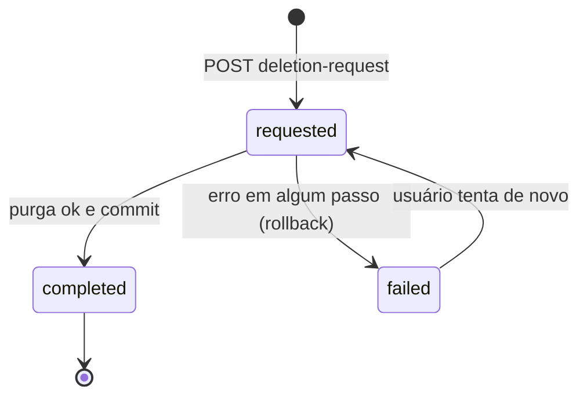

# Spec — Exclusão de conta, consentimento e LGPD

> **Status:** proposed · **Contexto:** `privacy` · **Spec principal:** [base-app.md](base-app.md)
> **ADRs:** [0005](../adr/0005-data-access-sql-migrations-kysely-rls.md),
> [0008](../adr/0008-maintenance-jobs-pg-cron.md), [0009](../adr/0009-observability.md),
> [0013](../adr/0013-extensible-core.md)

## 1. Visão geral

Cobre o fim da vida de uma conta e os direitos do titular:

- **exclusão imediata** da conta, no app e na página web `/account-deletion`;
- purga orquestrada dos dados em todos os contextos e no RevenueCat, numa única transação;
- aceite versionado de termos e política de privacidade;
- exportação dos dados do titular em JSON;
- inventário de dados, retenção e auditoria.

Papéis LGPD: o operador do app (quem publica o app criado do template) é **controlador**;
Supabase, Vercel, RevenueCat, Sentry, Upstash e Resend são **operadores**. O inventário de §4.3
alimenta a política de privacidade de cada app.

A exclusão no base-app é imediata e sem carência. O contrato de `POST
/v1/account/deletion-request` já aceita a resposta `scheduled`, e a decisão fica atrás da
porta `AccountDeletionPolicy`, para que versões derivadas troquem a política sem mudar o app
(base-app.md §3.4).

## 2. Requisitos

### 2.1 Funcionais

| ID | Requisito |
|----|-----------|
| PR-01 | Em Configurações → Excluir conta, o usuário vê o que será apagado e o aviso de que **excluir a conta não cancela a assinatura na loja**, com o link para gerenciá-la (exigência da Apple). Só então confirma |
| PR-02 | `POST /v1/account/deletion-request` exige login recente (≤ `recentAuthMaxAgeSec`) e corpo `{ confirm: true }` |
| PR-03 | A exclusão é imediata: a resposta é `{ status: 'completed' }` e, quando ela volta, os dados já foram apagados |
| PR-04 | A porta `AccountDeletionPolicy` decide o resultado (`completed` ou `scheduled`). O base-app traz só a implementação `immediate` |
| PR-05 | Página web `/account-deletion` (exigência do Google Play): o usuário informa o e-mail, recebe um código, confirma e a conta é excluída sem o app instalado |
| PR-06 | A purga roda numa transação: e-mail lido só em memória → evento `AccountPurgeRequested` → auditoria → `privacy.delete_auth_user` (sempre o último passo) → commit |
| PR-07 | Os handlers do evento fazem a chamada externa idempotente (exclusão do cliente no RevenueCat) e apagam os próprios dados, cada um com o papel `*_system` do próprio contexto |
| PR-08 | Falha em qualquer passo desfaz a transação e responde 503 retentável. Nada fica apagado pela metade |
| PR-09 | Depois do commit, se havia e-mail, o usuário recebe "sua conta foi excluída" pelo `EmailSender`, em modo best-effort. O e-mail não é guardado |
| PR-10 | Termos e privacidade têm versão (de `app-config`). O primeiro login e cada nova versão pedem aceite; o aceite grava versão e data |
| PR-11 | `GET /v1/me/export` devolve um JSON com os dados do usuário em todos os contextos e nas extensões. Exige login recente; limite de 1 por hora |
| PR-12 | Extensões com dado de usuário registram uma seção de exportação (`addExportSection`) e um handler de purga |
| PR-13 | `ops.purge_expired()` apaga auditoria vencida (12 meses) e chaves de idempotência vencidas (24 h), agendada no `pg_cron` |
| PR-14 | `GET /v1/account/deletion-request` informa se há exclusão agendada e `DELETE /v1/account/deletion-request` a cancela; o `DELETE` exige login recente (uma sessão roubada não cancela a exclusão do titular), grava `account.deletion_cancelled` em `audit.events` e avisa o titular por e-mail (`EmailSender`, melhor esforço). No base-app (`immediate`) o `GET` responde `{ pending: null }` e o `DELETE` responde 404 `privacy.no_pending_deletion`; as rotas existem para que a política de carência de uma versão derivada não precise de rota nova |
| PR-15 | `modules/privacy/index.ts` exporta `purgeAccount`, a mesma purga que a política `immediate` usa e que uma política de carência chama ao vencer o prazo. Ela só aceita uma `PurgeAuthorization` (§3.1), que prova de onde veio o pedido |
| PR-16 | Extensões e o núcleo gravam auditoria por `platform/audit` (`recordAuditEvent`, `subjectRef`); os papéis-grupo `audit_writer` (`system` e `webhook`) e `audit_operator_writer` (`operator`) cobrem quem age fora do runtime do usuário (painel, script) |

### 2.2 Não funcionais

| ID | Requisito |
|----|-----------|
| PR-N1 | Depois da purga não sobra o `user_id` nem dado pessoal em nenhuma coluna `uuid`, `text`, `text[]` ou `jsonb` dos nossos schemas e do `auth` (inclui `auth.audit_log_entries`, apagado explicitamente), nem no RevenueCat. O que precisa continuar existindo (`audit.events`) guarda só o `subject_ref` = HMAC-SHA256(`user_id`, `AUDIT_SUBJECT_KEY`). Isso é pseudonimização, não anonimização. **Exceções documentadas (PR-N5):** o UUID pseudônimo em logs da Vercel e eventos do Sentry, que some pela retenção (30 e 90 dias), não pela purga; e, no RevenueCat, um aparelho do mesmo usuário ainda aberto pode recriar um cliente vazio com aquele UUID (R22; o app o limpa ao receber `auth.account_deleted`) |
| PR-N2 | O e-mail do usuário só existe em memória durante a purga: nunca é logado, guardado ou enviado a um serviço além do `EmailSender` |
| PR-N3 | Duas exclusões simultâneas da mesma conta não geram erro nem efeito duplicado (trava consultiva por usuário; a segunda recebe `completed`) |
| PR-N4 | O **núcleo** não carrega nenhum script de terceiros na página web e roda com CSP com nonce. Uma versão derivada pode acrescentar **só** o widget de CAPTCHA, por `site.tsx`, com a CSP ampliada por `edge.ts` e só sob `/account-deletion` (§3.4; risco residual R20) |
| PR-N5 | Logs da Vercel e eventos do Sentry contêm **só o UUID do usuário**, dado pseudônimo: nunca e-mail, nome, token ou código. Base legal: legítimo interesse em segurança, prevenção a fraude e estabilidade (LGPD art. 7º, IX). Retenção máxima: logs 30 dias; Sentry 90 dias (onde a plataforma retém menos, vale a dela). Por isso não há purga por titular nesses sistemas: o UUID expira pela retenção. Isto é uma exceção declarada a PR-N1 |

## 3. Design técnico

### 3.1 Porta `AccountDeletionPolicy`

```ts
// modules/privacy/domain/account-deletion-policy.ts
export type DeletionOutcome =
  | { status: 'completed' }
  | { status: 'scheduled'; scheduledFor: Date };            // não usado no base-app

export interface AccountDeletionPolicy {
  request(input: { userId: UserId; channel: 'app' | 'web'; correlationId: string }): Promise<DeletionOutcome>;
  cancel(input: { userId: UserId; correlationId: string }): Promise<{ status: 'cancelled' } | { status: 'none' }>;
  getPending(input: { userId: UserId }): Promise<{ scheduledFor: Date } | null>;
}
```

A implementação `immediate` executa a purga de §3.2 e devolve `completed`; `cancel` responde
`{ status: 'none' }` e `getPending` responde `null` (não existe pedido pendente). A porta é
substituível por `ServerExtension.overrides` (base-app.md §3.4.1).

A purga em si é o caso de uso `purgeAccount`, exportado em `modules/privacy/index.ts`:

```ts
// modules/privacy/index.ts
export function purgeAccount(input: {
  authorization: PurgeAuthorization;                     // prova de autorização (abaixo); traz userId e reason
  correlationId: string;
  notify: boolean;                                       // decide o e-mail final de §3.2
}): Promise<Result<{ completedAt: Date }, PurgeError>>;

export function authorizeUserPurge(auth: AuthContext): PurgeAuthorization;   // só com login recente verificado
// registry.registerPurgeJob({ name, reasons, maxPerMinute }).authorize(userId, reason): PurgeAuthorization
```

A política `immediate` obtém a autorização por `authorizeUserPurge(auth)` e chama
`purgeAccount` com `reason: 'user_request'` e `notify: true`. Uma política de carência (versão
derivada) registra um **job de purga** no boot (`registerPurgeJob`, com os `reason` que pode usar e
um teto por minuto) e chama a mesma função ao vencer o prazo, com `reason: 'scheduled'`; um job
de visitantes abandonados ou fundidos usa `'guest_abandoned'` e `'guest_merged'` com `notify:
false` (visitante não tem e-mail). Não há segunda implementação da purga: o teste de purga
completa (§7) cobre todos os caminhos porque todos passam por ela. `reason` e o chamador
(`policy:immediate` ou `job:<nome>`) entram no evento `account.deleted` (`metadata.reason`,
`metadata.caller`).

**Prova de autorização.** `PurgeAuthorization` é um tipo marcado (branded): só as duas fábricas
acima o produzem, e elas registram cada autorização emitida num `WeakSet` interno; `purgeAccount`
recusa (`PurgeError: unauthorized`) o que não estiver nele, o que cobre também código que
contorne o tipo em JavaScript. Regras validadas dentro de `purgeAccount`:

| Regra | Efeito se violada |
|-------|-------------------|
| `guest_*` exige `auth.users.is_anonymous = true` (lido na transação por `privacy.is_anonymous_user`, que não devolve e-mail) | recusa e evento `account.purge_denied` |
| `notify: false` só com `guest_*` | recusa |
| `user_request` só pela fábrica do `AuthContext` com login recente | não há outra fábrica |
| teto do job (`maxPerMinute`, padrão 30, máximo 120) e de 5 purgas simultâneas no projeto (§3.2) | 503 `privacy.deletion_busy` com `Retry-After` |

Quem pode importar o símbolo: regra de lint `no-purge-account-outside-privacy`
(`no-restricted-imports` com `importNames: ['purgeAccount']`, liberada só em `modules/privacy/**`
e `extensions/**`; o dependency-cruiser enxerga módulos e não símbolos, então a regra é do
ESLint).

### 3.2 Purga

```mermaid
sequenceDiagram
  participant App as App / página web
  participant API as POST /v1/account/deletion-request
  participant P as privacy (immediate)
  participant DB as Postgres
  participant Bus as platform/events
  participant I as identity
  participant B as billing
  participant X as extensões
  participant RC as RevenueCat
  participant Mail as EmailSender (Resend)

  App->>API: Bearer JWT + { confirm: true }
  API->>API: auth, rate limit, requireRecentAuth, validação
  API->>P: request(userId)
  P->>DB: begin; advisory lock do usuário
  P->>DB: privacy.lookup_email_for_purge(userId) (e-mail só em memória)
  P->>Bus: AccountPurgeRequested { userId }
  Bus->>B: deleteCustomer
  B->>RC: DELETE cliente (404 = ok)
  Bus->>I: apaga identity.profiles
  Bus->>X: handlers das extensões
  Bus->>P: apaga privacy.consents; platform apaga idempotency_keys
  P->>DB: ops.pseudonymize_audit_refs + insert em audit.events (subject_ref HMAC)
  P->>DB: privacy.delete_auth_user(userId) (último passo)
  P->>DB: commit
  P->>API: completed
  API->>API: marca auth:deleted:v1:userId no Redis (TTL 30 min)
  API-->>App: 200 { status: 'completed' }
  P->>Mail: "sua conta foi excluída" (best-effort, e-mail em memória)
```

Detalhes:

- **Transação única** aberta por `systemDb('privacy')`, com `idle_in_transaction_session_timeout`
  e `statement_timeout` de 20 s. A chamada ao RevenueCat acontece dentro dela (timeout de 5 s,
  base-app.md RNF-12). Antes de abrir a transação, a purga reserva uma das **5 vagas
  simultâneas** do projeto (contador no Redis com lease de 25 s); sem vaga, 503
  `privacy.deletion_busy` com `Retry-After: 5`, sem tocar no pooler.
- **Orçamento de tempo dos handlers:** cada handler de `AccountPurgeRequested` tem timeout de
  3 000 ms (`onEvent(..., { timeoutMs })` pode subir até 8 000 ms para quem chama um terceiro; o
  handler do RevenueCat usa 6 000 ms) e a purga inteira tem 15 s. Estouro = rollback, 503
  `privacy.deletion_unavailable` e log com o nome do handler. Handler de extensão não faz
  chamada externa sem timeout, é idempotente e rápido (o teste de contrato de extensão roda o
  handler duas vezes e exige menos de 3 s). Métricas por handler: duração e falha
  (`purge.handler.duration_ms`, `purge.handler.failure`); alerta quando
  `privacy.deletion_unavailable` passa de 3 em 5 min.
- **Contexto de purga no banco:** logo depois da trava, o caso de uso faz
  `set_config('app.purge_user_id', $1, true)` (bind). `lookup_email_for_purge`,
  `pseudonymize_audit_refs` e `delete_auth_user` conferem o `uuid` recebido contra esse GUC e
  recusam qualquer outro. Isso reduz erro de código, não impede injeção de SQL (R11).
- **Trava:** `pg_advisory_xact_lock(hashtextextended('purge:' || user_id, 0))` no começo.
  Se `lookup_email_for_purge` não encontra o usuário (outra requisição já terminou), a
  resposta é `completed` sem novo efeito.
- **Barramento síncrono:** os handlers rodam na transação e na ordem de registro. Cada um troca
  para o papel do próprio contexto com `set_config('role', ..., true)` e volta. Handlers que
  chamam terceiros fazem a chamada **antes** de apagar o dado local.
- **Cancelamento (`DELETE`):** o handler da rota exige login recente, chama `cancel`, grava
  `account.deletion_cancelled` (`recordAuditEvent`) e envia o e-mail `deletion-cancelled` ao
  titular (melhor esforço, mesmo `EmailSender`). No base-app (`immediate`) não há o que cancelar e
  nada disso ocorre.
- **Auditoria (passo 3):** `ops.pseudonymize_audit_refs(user_id, subject_ref)` troca o
  `user_id` por `subject_ref` nos eventos antigos (§4.2) e a purga insere o evento
  `account.deleted` com `actor_ref` e `subject_ref` = HMAC. O HMAC é calculado na aplicação com
  `AUDIT_SUBJECT_KEY` (variável Sensitive, só em Production, ≥ 32 bytes aleatórios). A função
  exige que `p_subject_ref` seja 64 caracteres hexadecimais e só opera sobre o usuário em purga.
  Trocar a chave depois separa os registros antigos dos novos; por isso ela não é rotacionada.
- **`privacy.delete_auth_user(user_id)`:** função `SECURITY DEFINER` (`search_path = ''`)
  executável só por `privacy_system` e com owner `postgres` quando a W9 a implementar e incluir
  no registry fechado com a revisão de ameaça e os testes da spec. Não está autorizada pelo
  registry W2. Apaga **explicitamente**, antes do
  usuário, as linhas de `auth.audit_log_entries` (por `payload->>'actor_id'`; elas não têm FK e
  guardam e-mail e IP) e de `auth.flow_state`, e então o usuário em `auth.users`; as FKs `on
  delete cascade` removem identidades, sessões, refresh tokens, fatores e códigos. É sempre o
  último passo, na mesma conexão, sem a chave secreta do Supabase e sem espera circular. Fica
  fora do nosso alcance o que as plataformas guardam nos próprios logs (retenção do Supabase por
  plano), e a trilha de login do titular deixa de existir no Auth (tensão aceita com R-ID-5; o
  `audit.events` pseudonimizado continua). O spike S-PR-1 (onda 9) confirma o alcance das FKs,
  operações Auth suportadas por uma função estreita de owner `postgres` e o custo do `delete` em
  `audit_log_entries` (sem índice por `actor_id`); se for lento, a limpeza vira lote diário em
  `ops.purge_expired()` para as linhas órfãs. A chave secreta não volta ao runtime sem outra
  decisão de segurança.
- **Falha:** erro em qualquer handler (RevenueCat fora, timeout) desfaz tudo e a resposta é 503
  `privacy.deletion_unavailable` com `Retry-After`. O app oferece "tentar de novo". Efeito
  externo já aplicado (cliente do RevenueCat apagado) é idempotente e não impede a nova
  tentativa.
- **`notify`:** com `notify: true` o `purgeAccount` lê o e-mail por `lookup_email_for_purge` e,
  depois do commit, envia o aviso de "conta excluída". Com `false` não lê o e-mail e não envia
  nada (visitante, ou conta fundida a outra).
- **Depois do commit:** (1) `SET auth:deleted:v1:<user_id>` no Redis com TTL de 30 min
  (acima da vida do access token), que faz a API responder 401 `auth.account_deleted` para
  tokens ainda válidos (se o Redis falhar, a violação de FK em `identity.ensureProfile` e nas
  demais escritas dá o mesmo 401); (2) envia o e-mail de conta excluída. Falha no envio não
  reverte nada: log e métrica `account_deleted_email_failed`.
- **Redis e purga:** contadores de cota e cache de entitlements têm TTL curto (≤ 48 h) e
  handlers de `AccountPurgeRequested` os apagam em melhor esforço. Falha de Redis **não**
  bloqueia a exclusão (o TTL garante o expurgo).
- **Idioma do e-mail:** `lookup_email_for_purge` devolve também `raw_user_meta_data->>'locale'`;
  a aplicação o valida contra a allowlist (padrão: `defaultLocale`). O template fica em
  `platform/email/templates/account-deleted.<locale>` e não imprime dado do usuário.

### 3.3 Diagrama de estados do resultado



Não há estado persistido: o pedido só existe durante a transação.

### 3.4 Página web de exclusão

`apps/web/src/app/(site)/account-deletion/page.tsx`:

1. Explica o que é apagado, que a exclusão é imediata e irreversível e que a assinatura se
   cancela na loja (com os links para gerenciar na App Store e no Google Play).
2. Formulário: e-mail → `signInWithOtp({ email, options: { shouldCreateUser: false,
   captchaToken } })` com a publishable key do Supabase, num cliente com `persistSession: false`,
   `autoRefreshToken: false` e `detectSessionInUrl: false`.
   O `captchaToken` só existe quando uma extensão registra `captchaWidget` em `siteExtensions`
   (`extensions/site.tsx`, base-app.md §3.4.2): a página renderiza o widget (ação
   `sign_in_otp`), guarda o token que chega em
   `onToken` e o descarta em `onExpire` e `onError`, desabilitando o envio até haver outro.
   Sem widget, o campo não é enviado e o comportamento é o descrito aqui. O widget é um
   componente da extensão; o CSP dela é acrescentado por `edge.ts` só sob
   `/account-deletion` (PR-N4 vale para o núcleo sem extensão).
3. Mostra sempre "Se houver uma conta com esse e-mail, enviamos um código" e a mesma tela de
   código, exista a conta ou não.
4. Código → `verifyOtp({ type: 'email' })` → sessão só em memória do componente (nunca em
   `localStorage`, cookie ou URL).
5. Botão "Excluir minha conta" (gesto do usuário) → `POST /v1/account/deletion-request` com
   `Authorization: Bearer` dessa sessão (login recente por definição).
6. Depois, chama `signOut()` (falha ignorada, a conta já não existe) e descarta o cliente.
7. Mostra a confirmação.

Segurança da página, porque ela manipula uma sessão completa do Auth na origem do site:

| Controle | Detalhe |
|----------|---------|
| CSP | com nonce por requisição (`script-src 'nonce-…' 'strict-dynamic'`, `object-src 'none'`, `base-uri 'none'`, `frame-ancestors 'none'`, `connect-src 'self'` + origem do Supabase), emitida pelo `proxy.ts` em todas as respostas do site. Uma CSP estática (`frame-ancestors 'none'; base-uri 'none'; object-src 'none'; form-action 'self'`) vem também do `next.config`. **Falha fechada:** a página só renderiza o formulário se o middleware injetou o nonce (header interno `x-nonce`); sem ele responde 503 estático e nada de sessão roda |
| Cabeçalhos | HSTS, nosniff, `X-Frame-Options: DENY`, `Referrer-Policy: no-referrer` e `Cross-Origin-Opener-Policy: same-origin` na página, conferidos por teste de integração e pelo Deployment Check do preview |
| Scripts de terceiros | nenhum no núcleo (sem analytics, pixel, tag manager, fonte externa). O único ponto de entrada é o `captchaWidget` de uma extensão, com a origem liberada no CSP por `edge.ts` (`https://<host>` explícito, só sob este path; base-app.md §3.4.2) |
| Server Actions | não existem; o `proxy.ts` rejeita com 404 qualquer requisição com o header `Next-Action` |
| Mesma origem | a API é da mesma origem; não há CORS |
| Abuso | limites por IP do Auth para envio e verificação do código; o pedido de código vai do navegador direto ao Supabase, então o limite da nossa API não o vê (R-PR-2) |
| Cache | `Cache-Control: no-store` na página |

**Widget de CAPTCHA de uma versão derivada (R20).** Mesmo origem, mesma página, script de
terceiros ao lado de uma sessão completa: o risco é aceito com estas mitigações obrigatórias,
verificadas por teste do núcleo:

- a sessão nesta página fica **só em memória** (nenhum `localStorage`, `sessionStorage` ou
  cookie persistente), e o cliente é descartado depois do `signOut()`;
- a página não faz nada além da exclusão (sem outras rotas, formulários ou links de navegação
  da aplicação);
- o acréscimo de CSP sob `/account-deletion` só vale para `script-src`, `frame-src` e
  `connect-src`, até 2 origens `https://<host>` em cada, nunca `*`, `unsafe-*`, `data:` ou
  `blob:` (base-app.md §3.4.2); `connect-src` continua restrito a `'self'`, ao Supabase e à
  origem do widget;
- o widget é desmontado assim que entrega o token e antes do `verifyOtp` (reduz a janela; não
  elimina o risco, porque o script já executou);
- falha, expiração ou erro do widget nunca libera o envio do código.

Quem adotar um CAPTCHA recebe o alerta de que a alternativa mais forte é servir a etapa do
e-mail de uma origem separada da que guarda a sessão.

### 3.5 Consentimentos

- `app-config` expõe `legal.termsVersion` e `legal.privacyVersion` (datas ISO) e as URLs
  `/terms` e `/privacy`. Versões antigas ficam publicadas em `/terms/<versão>` e
  `/privacy/<versão>`.
- `privacy` lê as versões atuais pela consulta pública de `app-config` (porta
  `LegalVersionsReader`).
- `GET /v1/me` inclui `consents.needsAcceptance`: os documentos cuja versão atual não tem
  aceite do usuário.
- O app mostra a tela de aceite antes do Início enquanto houver pendência e chama
  `POST /v1/me/consents { document, version }`. A versão enviada precisa ser a atual, senão 409
  `privacy.consent_version_outdated`. O aceite é idempotente (`on conflict do nothing`).
- A tela leva aos textos completos; recusar não dá acesso ao Início: o usuário pode sair ou
  excluir a conta.

### 3.6 Exportação

`GET /v1/me/export` monta o JSON a partir de consultas públicas de cada contexto e das seções
das extensões, sempre para o `userId` do JWT:

| Chave | Origem |
|-------|--------|
| `exportedAt` | relógio injetado |
| `account` | `id`, `email` (do JWT) e `createdAt` |
| `profile` | `identity.getProfile` (via porta `ProfileReader`, ver Q-PR-2) |
| `consents` | `privacy.consents` |
| `entitlements` | `billing.listActiveEntitlements` (sem cache) |
| `auditEvents` | eventos de `audit.events` sobre o usuário, só `occurredAt`, `action`, `resourceType` e `outcome`, os 500 mais recentes |
| `<name>` | uma chave por extensão, com a seção registrada em `addExportSection` |

```ts
// apps/web/src/platform/extensions/types.ts
export interface ExportSectionContext {
  readonly userId: string;                    // sempre o do JWT, nunca de argumento do cliente
  readonly db: Kysely<unknown>;               // transação somente leitura; sem `systemRole`, roda como `authenticated` com as claims do usuário
}

export interface ExportSectionProvider {
  readonly systemRole?: string;               // opcional; se existir, precisa estar em ServerExtension.systemRoles e chamar-se `<extensão>_system`
  readonly schema: z.ZodType<unknown>;        // forma da seção; valida o que collect devolve
  collect(ctx: ExportSectionContext): Promise<unknown>;
}
```

Regras das seções:

- `privacy` abre, para cada seção, uma transação `read only`. **Por padrão** com
  `set_config('role', 'authenticated', true)` e as claims do usuário do JWT, então a RLS vale.
  Só com `systemRole` declarado troca para esse papel (que ignora o filtro por usuário: o
  `collect` filtra por `ctx.userId`). Chama `collect`, valida o resultado com `schema` e limita
  o JSON da seção a 2 MB.
- **Teste de contrato obrigatório por seção** (`assertExportIsolation`, em
  `platform/testing/contracts`): cria dois usuários com dados, coleta a seção do primeiro e falha
  se aparecer qualquer valor do segundo. O teste de exportação falha para extensão sem ele.
- Seção de exportação **nunca lê `audit.events`**: a chave `auditEvents` do núcleo já exporta os
  eventos sobre o titular, inclusive os de operador.
- O `name` segue `^[a-z][a-z0-9_]{0,31}$`, não pode repetir nem colidir com as chaves do núcleo
  (`exportedAt`, `account`, `profile`, `consents`, `entitlements`, `auditEvents`). Violação faz
  o boot falhar. O mesmo vale para `systemRole`: nome que não comece pelo da extensão ou que seja
  papel do núcleo derruba o boot.
- Seção que lança erro ou devolve JSON que não passa no `schema` faz a exportação inteira
  falhar com 503 `privacy.export_unavailable`: o arquivo precisa sair completo.
- O export nunca inclui segredos, tokens, o e-mail de outros usuários nem dado de outro
  `user_id`.

Resposta: `Content-Disposition: attachment; filename="<slug>-data-export.json"`, `Cache-Control:
no-store`. A exportação grava `data.exported` em `audit.events`. Se o RevenueCat estiver fora, a
resposta é 503 `billing.unavailable` retentável (base-app.md §6).

```json
{
  "exportedAt": "2026-11-24T12:00:00Z",
  "account": { "id": "6f0e1c2a-8b6d-4f0a-9d63-0c5c9f1a2b3c", "email": "user@example.com", "createdAt": "2026-10-01T09:00:00Z" },
  "profile": { "displayName": "Ana", "locale": "pt-BR" },
  "consents": [{ "document": "terms", "version": "2026-11-24", "acceptedAt": "2026-11-24T11:00:00Z" }],
  "entitlements": [{ "key": "pro", "expiresAt": "2027-01-01T00:00:00Z", "willRenew": true, "store": "app_store" }],
  "auditEvents": [{ "occurredAt": "2026-11-24T11:30:00Z", "action": "data.exported", "resourceType": "account", "outcome": "success" }]
}
```

### 3.7 App

- `features/privacy/ui`: tela de aceite, tela Excluir conta (aviso de assinatura sempre visível,
  mesmo que a consulta de entitlements falhe), tela Exportar dados (baixa o JSON e abre o
  compartilhamento do sistema com `expo-sharing`). O arquivo é gravado no diretório de cache, e
  apagado no `finally` depois do compartilhamento e, por varredura, na próxima abertura do app. A
  tela de exportação e a do código usam proteção contra captura (`expo-screen-capture`,
  mobile-app-shell.md SH-N8).
- Excluir conta: depois do `200 completed`, o app limpa a sessão local, chama
  `Purchases.logOut()` e limpa o cache. Resposta 401 `auth.account_deleted` logo depois de um
  pedido de exclusão conta como sucesso. Em qualquer outro momento, o 401 `auth.account_deleted`
  (por exemplo, a conta excluída em outro aparelho) também chama `Purchases.logOut()` e para de
  reconfigurar o SDK até haver nova sessão, para o aparelho não recriar o cliente apagado (R22,
  spike S-TM-1).
- A tela de exclusão exige o login recente (modal `reauth`) e um gesto de confirmação; nunca
  age ao montar (SH-N6 de mobile-app-shell.md).

## 4. Modelo de dados e retenção

### 4.1 Tabelas

```sql
-- schema privacy
create table privacy.consents (
  user_id     uuid not null references auth.users(id) on delete cascade,
  document    text not null check (document in ('terms', 'privacy')),
  version     text not null check (version ~ '^\d{4}-\d{2}-\d{2}$'),
  accepted_at timestamptz not null default now(),
  primary key (user_id, document, version)
);
-- a primary key já cobre a consulta "último aceite do usuário por documento"

alter table privacy.consents enable row level security;
alter table privacy.consents force row level security;
revoke all on privacy.consents from public, anon, authenticated, privacy_system;
grant usage on schema privacy to authenticated, privacy_system;
grant select, insert on privacy.consents to authenticated;
grant select, delete on privacy.consents to privacy_system;

create policy consents_select_own on privacy.consents for select to authenticated
  using (user_id = (select auth.uid()));
create policy consents_insert_own on privacy.consents for insert to authenticated
  with check (user_id = (select auth.uid()));
create policy consents_system_select on privacy.consents for select to privacy_system using (true);
create policy consents_system_delete on privacy.consents for delete to privacy_system using (true);
```

```sql
-- schema audit
create table audit.events (
  id             uuid primary key default gen_random_uuid(),
  occurred_at    timestamptz not null default now(),
  actor_type     text not null check (actor_type in ('user', 'system', 'webhook', 'operator')),
  actor_ref      text,                       -- user_id (texto) ou subject_ref; 'script:<nome>' para scripts; 'operator': user_id do operador
  subject_ref    text,                       -- a quem o evento se refere: user_id ou subject_ref
  action         text not null,              -- ex.: 'account.deleted', 'data.exported', 'app_config.updated'
  resource_type  text not null,
  resource_ref   text,                       -- nunca contém user_id; use subject_ref
                                             -- 'operator' = pessoa da equipe agindo por canal privilegiado (painel, script)
  outcome        text not null check (outcome in ('success', 'denied', 'failed')),
  correlation_id text not null,
  metadata       jsonb not null default '{}', -- sem PII; validado por schema na aplicação
  -- formato das referências: ninguém forja atribuição com texto livre (G33)
  constraint actor_ref_format check (actor_ref is null or actor_ref ~
    '^([0-9a-f]{8}-[0-9a-f]{4}-[0-9a-f]{4}-[0-9a-f]{4}-[0-9a-f]{12}|script:[a-z0-9:_-]{1,96}|[0-9a-f]{64})$'),
  constraint subject_ref_format check (subject_ref is null or subject_ref ~
    '^([0-9a-f]{8}-[0-9a-f]{4}-[0-9a-f]{4}-[0-9a-f]{4}-[0-9a-f]{12}|[0-9a-f]{64})$'),
  constraint resource_ref_no_uuid check (resource_ref is null or resource_ref !~*
    '[0-9a-f]{8}-[0-9a-f]{4}-[0-9a-f]{4}-[0-9a-f]{4}-[0-9a-f]{12}'),
  constraint action_format check (action ~ '^[a-z_]+(\.[a-z_]+)+$'),
  constraint metadata_size check (pg_column_size(metadata) <= 4096)
);
-- consulta por período, expurgo por retenção e exportação por titular
create index audit_events_occurred_idx on audit.events (occurred_at);
create index audit_events_subject_idx on audit.events (subject_ref, occurred_at desc);

alter table audit.events enable row level security;
alter table audit.events force row level security;
revoke all on audit.events from public, anon, authenticated;
grant usage on schema audit to authenticated, identity_system, privacy_system,
  app_config_system, platform_system, audit_writer, audit_operator_writer, audit_reader, ops;
grant insert on audit.events to authenticated, identity_system, privacy_system,
  app_config_system, platform_system, audit_writer, audit_operator_writer, ops;
grant select on audit.events to privacy_system;       -- exportação
grant select, delete on audit.events to ops;          -- expurgo em lotes (policies abaixo)
grant update (actor_ref, subject_ref) on audit.events to ops;   -- pseudonimização

-- papel-grupo para extensões e para o script de configuração: só insere, sem select/update/delete
create role audit_writer nologin;
grant audit_writer to app_config_admin;               -- dono de app_config.set_setting (app-config.md)

-- papel-grupo separado só para eventos de operador (pessoa agindo por canal privilegiado); só insere
create role audit_operator_writer nologin;
grant audit_operator_writer to app_config_admin;      -- set_setting grava 'operator'

-- papel-grupo de leitura (ex.: tela de auditoria de um painel): só select, sem insert/update/delete
create role audit_reader nologin;
grant select on audit.events to audit_reader;

-- o usuário só registra eventos dele, sobre ele
create policy events_insert_user on audit.events for insert to authenticated
  with check (actor_type = 'user'
              and actor_ref = (select auth.uid())::text
              and (subject_ref is null or subject_ref = actor_ref));
-- papéis de sistema do núcleo registram eventos de sistema
create policy events_insert_system on audit.events for insert
  to identity_system, privacy_system, app_config_system, platform_system, ops
  with check (actor_type in ('system', 'webhook'));
-- o papel ops (funções de expurgo e pseudonimização) lê, apaga e atualiza só as referências
create policy events_ops_select on audit.events for select to ops using (true);
create policy events_ops_delete on audit.events for delete to ops using (true);
create policy events_ops_update on audit.events for update to ops using (true) with check (true);
-- leitura ampla da auditoria, só para quem recebeu audit_reader
create policy events_select_reader on audit.events for select to audit_reader using (true);
-- extensões e o script de configuração (via audit_writer): só sistema e webhook
create policy events_insert_writer on audit.events for insert to audit_writer
  with check (actor_type in ('system', 'webhook'));
-- 'operator' só entra por audit_operator_writer
create policy events_insert_operator on audit.events for insert to audit_operator_writer
  with check (actor_type = 'operator');
create policy events_select_privacy on audit.events for select to privacy_system using (true);
```

`authenticated` só **insere** e só com ator = `auth.uid()`; ele não lê nem altera nada. Os
papéis `*_system` do núcleo também inserem, com `actor_type` de sistema. `audit_writer` (NOLOGIN,
sem `select`, `update` nem `delete`) é o ponto de entrada das extensões para eventos de `system`
e `webhook`: a migration de uma extensão faz `grant audit_writer to <schema>_system`.
`audit_operator_writer` (NOLOGIN, também só `insert`) é o único que aceita `actor_type =
'operator'`, para que um papel que só precisa de eventos de sistema nunca possa forjar a ação de
uma pessoa; um painel recebe os dois. **Nenhuma extensão cria política em `audit.events`**. `audit_reader` (NOLOGIN, só `select`) é o ponto de leitura: um painel de
auditoria faz `grant audit_reader to <schema>_system`, lê toda a trilha (inclusive `metadata` de
outros titulares, por isso o grant é raro e revisado em PR) e registra a própria leitura com
`audit_writer` (`action: 'audit.viewed'`). Os formatos das colunas (`check`) barram atribuição
forjada e referência a usuário em `resource_ref`; só `recordAuditEvent` grava (regra
`audit-only-via-record`). Só `audit_operator_writer` (e, por herança, quem é membro) insere `actor_type =
'operator'`; `audit_writer`, `authenticated` e os `*_system` do núcleo não. **Ninguém recebe `update` nem
`delete`**; as duas únicas mutações passam por funções do papel `ops` (sem login):

```sql
create schema if not exists ops;

-- trava de defesa em profundidade: mesmo com grant indevido, só as duas funções mutam
create function audit.guard_mutation() returns trigger
language plpgsql set search_path = '' as $$
begin
  -- current_user = 'ops' dentro das funções SECURITY DEFINER do papel ops: o GUC sozinho não basta
  if tg_op = 'DELETE' and current_user = 'ops'
     and current_setting('audit.mutation', true) = 'purge' then
    return old;
  end if;
  if tg_op = 'UPDATE' and current_user = 'ops'
     and current_setting('audit.mutation', true) = 'pseudonymize'
     and (to_jsonb(new) - 'actor_ref' - 'subject_ref') = (to_jsonb(old) - 'actor_ref' - 'subject_ref') then
    return new;
  end if;
  raise exception 'audit.events is append-only' using errcode = '42501';
end $$;
create trigger events_guard before update or delete on audit.events
  for each row execute function audit.guard_mutation();

-- expurgo por retenção (agendada no pg_cron; dona: papel ops)
create function ops.purge_expired() returns void
language plpgsql security definer set search_path = '' as $$
declare
  c_batch      constant int := 5000;
  c_max_rounds constant int := 20;      -- no máximo 100 000 linhas por tabela e por execução
  v_audit      bigint := 0;
  v_idem       bigint := 0;
  v_n          bigint;
  v_round      int;
begin
  perform set_config('audit.mutation', 'purge', true);
  for v_round in 1..c_max_rounds loop
    with doomed as (
      select id from audit.events where occurred_at < now() - interval '12 months'
      order by occurred_at limit c_batch)
    delete from audit.events e using doomed d where e.id = d.id;
    get diagnostics v_n = row_count;
    v_audit := v_audit + v_n;
    exit when v_n < c_batch;
  end loop;
  perform set_config('audit.mutation', '', true);

  for v_round in 1..c_max_rounds loop
    with doomed as (
      select user_id, key from platform.idempotency_keys where expires_at < now() limit c_batch)
    delete from platform.idempotency_keys k using doomed d where k.user_id = d.user_id and k.key = d.key;
    get diagnostics v_n = row_count;
    v_idem := v_idem + v_n;
    exit when v_n < c_batch;
  end loop;

  -- prova de execução e contagens, sem PII (também é o sinal de vida que ops.check_signals confere)
  insert into audit.events (actor_type, actor_ref, action, resource_type, outcome, correlation_id, metadata)
  values ('system', 'script:ops:purge_expired', 'ops.purge_expired', 'ops.cron', 'success',
          gen_random_uuid()::text,
          jsonb_build_object('audit_events_deleted', v_audit, 'idempotency_keys_deleted', v_idem));
end $$;

-- pseudonimização na exclusão (só privacy_system executa)
create function ops.pseudonymize_audit_refs(p_user_id uuid, p_subject_ref text) returns void
language plpgsql security definer set search_path = '' as $$
begin
  -- só o usuário em purga, e só com o HMAC no formato esperado
  if p_user_id::text is distinct from current_setting('app.purge_user_id', true)
     or p_subject_ref !~ '^[0-9a-f]{64}$' then
    raise exception 'pseudonymize outside purge context' using errcode = '42501';
  end if;
  perform set_config('audit.mutation', 'pseudonymize', true);
  update audit.events set actor_ref = p_subject_ref where actor_ref = p_user_id::text;
  update audit.events set subject_ref = p_subject_ref where subject_ref = p_user_id::text;
  perform set_config('audit.mutation', '', true);
end $$;

revoke all on function ops.purge_expired(), ops.pseudonymize_audit_refs(uuid, text) from public;
grant execute on function ops.pseudonymize_audit_refs(uuid, text) to privacy_system;
select cron.schedule('ops-purge-expired', '17 3 * * *', 'select ops.purge_expired()');
```

A função de expurgo roda em lotes se o volume crescer (loop de 5 000 linhas). `api_runtime` não
alcança o papel `ops`. O `set_config` com `true` vale só na transação.

```sql
-- Exemplo contratual para a futura onda de privacidade; não faz parte da migration W2.
-- Owner postgres, search_path vazio, SQL fixo, EXECUTE apenas por privacy_system;
-- W9 adiciona as assinaturas ao registry fechado e testa a autorização.
create function privacy.lookup_email_for_purge(p_user_id uuid)
  returns table (email text, locale text)
language plpgsql security definer set search_path = '' as $$
begin
  if p_user_id::text is distinct from current_setting('app.purge_user_id', true) then
    raise exception 'lookup outside purge context' using errcode = '42501';
  end if;
  return query select u.email::text, u.raw_user_meta_data ->> 'locale'
               from auth.users u where u.id = p_user_id;
end $$;

-- usada pelos motivos guest_*: não devolve e-mail
create function privacy.is_anonymous_user(p_user_id uuid) returns boolean
language plpgsql security definer set search_path = '' as $$
begin
  if p_user_id::text is distinct from current_setting('app.purge_user_id', true) then
    raise exception 'lookup outside purge context' using errcode = '42501';
  end if;
  return coalesce((select u.is_anonymous from auth.users u where u.id = p_user_id), false);
end $$;

create function privacy.delete_auth_user(p_user_id uuid) returns void
language plpgsql security definer set search_path = '' as $$
begin
  if p_user_id::text is distinct from current_setting('app.purge_user_id', true) then
    raise exception 'delete outside purge context' using errcode = '42501';
  end if;
  -- rastros do Auth sem FK para auth.users (guardam e-mail e IP)
  delete from auth.audit_log_entries where payload ->> 'actor_id' = p_user_id::text;
  delete from auth.flow_state where user_id = p_user_id;
  delete from auth.users where id = p_user_id;
end $$;

alter function privacy.lookup_email_for_purge(uuid) owner to postgres;
alter function privacy.delete_auth_user(uuid) owner to postgres;
alter function privacy.is_anonymous_user(uuid) owner to postgres;
revoke all on function privacy.lookup_email_for_purge(uuid), privacy.delete_auth_user(uuid),
  privacy.is_anonymous_user(uuid) from public;
grant execute on function privacy.lookup_email_for_purge(uuid), privacy.delete_auth_user(uuid),
  privacy.is_anonymous_user(uuid) to privacy_system;
```

| Tabela ou função | `authenticated` | `privacy_system` | `ops` |
|------------------|-----------------|------------------|-------|
| `privacy.consents` | select e insert próprios | select, delete | — |
| `audit.events` | insert com ator = `auth.uid()` | insert (sistema), select | via funções: delete vencido, update de refs |
| `ops.purge_expired()` | — | — | dona; chamada pelo `pg_cron`; grava o evento `ops.purge_expired` |
| `ops.pseudonymize_audit_refs()` | — | execute | dona |
| `privacy.lookup_email_for_purge()`, `privacy.is_anonymous_user()`, `privacy.delete_auth_user()` | — | execute (só com `app.purge_user_id` igual ao argumento) | — |

Os grants de `audit.events` para os demais papéis de sistema e para `audit_writer` estão no
bloco acima (`app_config_admin` insere por ser membro de `audit_writer`). `platform.idempotency_keys` pertence à plataforma (base-app.md §3.7); o handler
de purga de `platform_system` apaga as chaves do usuário.

**`platform/audit`.** Módulo da plataforma que concentra a gravação de eventos:

```ts
// apps/web/src/platform/audit/index.ts
export const AuditEventInput = z.object({
  actorType: z.enum(['user', 'system', 'webhook', 'operator']),
  actorRef: z.string().max(128).nullable(),
  subjectRef: z.string().max(128).nullable(),            // user_id ou subjectRef(userId)
  action: z.string().regex(/^[a-z_]+(\.[a-z_]+)+$/),     // ex.: 'account.deleted'
  resourceType: z.string().max(64),
  resourceRef: z.string().max(128).nullable(),           // nunca user_id
  outcome: z.enum(['success', 'denied', 'failed']),
  correlationId: z.string().uuid(),
  metadata: z.record(z.string(), z.union([z.string().max(256), z.number(), z.boolean(), z.null()])),
}).strict();
export type AuditEvent = z.infer<typeof AuditEventInput>;

export function recordAuditEvent(db: Transaction, event: AuditEvent): Promise<void>;
export function subjectRef(userId: string): string;      // HMAC-SHA256(userId, AUDIT_SUBJECT_KEY), hex
```

`recordAuditEvent` valida o evento com Zod antes do `insert` (metadata plana, sem PII; chaves
proibidas como `email`, `token` e `name` são recusadas), roda na transação e no papel que o
chamador já tem, e falha fechado: erro de validação ou de insert propaga. `subjectRef` é a
única forma de calcular o `subject_ref`; a purga e as extensões usam a mesma função. Quem age
como operador grava `actor_type: 'operator'` e `actor_ref` = `user_id` do operador; o
`subject_ref` é o titular afetado. Os dois são pseudonimizados na purga do respectivo usuário
(`ops.pseudonymize_audit_refs` já cobre `actor_ref` e `subject_ref`).

### 4.2 Retenção

| Dado | Retenção | Mecanismo |
|------|----------|-----------|
| Dados da conta (perfil, consentimentos, extensões) | até a exclusão | purga imediata |
| Cliente no RevenueCat | até a exclusão | `deleteCustomer` na purga |
| `audit.events` | 12 meses; após a exclusão do titular, só com `subject_ref` | `ops.purge_expired()` |
| `platform.idempotency_keys` | 24 h | `ops.purge_expired()` |
| Cache de entitlements e contadores de cota (Redis) | 60 s e 48 h (TTL) | expiração do Redis; apagados na purga em melhor esforço |
| Marcador `auth:deleted:v1:<user_id>` | 30 min | TTL |
| E-mails enviados (log do provedor SMTP) | retenção do Resend | operador; configurar a menor retenção disponível |
| Logs da Vercel e demais logs da API | no máximo 30 dias (a plataforma pode reter menos) | só o UUID, pseudônimo (PR-N5) |
| Eventos do Sentry | 90 dias | só o UUID, pseudônimo (PR-N5) |
| `auth.audit_log_entries` e rastros do Auth | até a exclusão (apagados na purga) e a retenção de logs da plataforma | `privacy.delete_auth_user` |

### 4.3 Inventário de dados pessoais (base da política de privacidade)

| Dado | Onde | Finalidade | Base legal | Retenção |
|------|------|------------|------------|----------|
| E-mail | Supabase Auth | login e e-mails da conta | execução de contrato | até a exclusão |
| Hash da senha | Supabase Auth | login por senha | execução de contrato | até a exclusão |
| Sessões e refresh tokens | Supabase Auth | manter o login | execução de contrato | até a exclusão ou expiração |
| Nome de exibição e idioma | `identity.profiles` | personalização | execução de contrato | até a exclusão |
| Histórico de compras e entitlements | RevenueCat | entregar o que foi pago | execução de contrato | até a exclusão |
| Aceites de termos e privacidade | `privacy.consents` | prova de aceite | exercício regular de direitos | até a exclusão |
| Eventos de auditoria | `audit.events` | segurança e prestação de contas | legítimo interesse; obrigação legal | 12 meses (pseudonimizado após a exclusão) |
| IP e user agent | logs da Vercel e do Supabase Auth | segurança e rate limit | legítimo interesse | até 30 dias nos logs da API; retenção da plataforma no Auth |
| UUID do usuário em logs e no Sentry | logs da Vercel e Sentry | segurança, prevenção a fraude e estabilidade | legítimo interesse (art. 7º, IX) | 30 dias (logs) e 90 dias (Sentry); expira pela retenção, sem purga por titular |
| Endereço do destinatário | Resend | entregar e-mails de conta | execução de contrato | retenção do provedor |
| Erros e dados de aparelho, sem PII além do UUID | Sentry | estabilidade | legítimo interesse | 90 dias |

## 5. Contratos de API

| Método | Path | Auth | Rate limit | Request | Response |
|--------|------|------|------------|---------|----------|
| POST | `/v1/account/deletion-request` | usuário, login recente | 5/h por usuário | `DeletionRequestBody` | 200 `DeletionResponse` |
| GET | `/v1/account/deletion-request` | usuário | 60/h por usuário | — | 200 `DeletionStatusResponse` |
| DELETE | `/v1/account/deletion-request` | usuário, login recente (`requireRecentAuth: true`) | 5/h por usuário e 10/h por IP | — | 200 `DeletionCancelResponse` |
| POST | `/v1/me/consents` | usuário | 20/h por usuário | `ConsentBody` | 204 |
| GET | `/v1/me/export` | usuário, login recente | 1/h por usuário | — | 200 `ExportResponse` |

```ts
// packages/contracts/src/privacy.ts
export const DeletionRequestBody = z.object({ confirm: z.literal(true) }).strict();

export const DeletionResponse = z.discriminatedUnion('status', [
  z.object({ status: z.literal('completed') }),
  z.object({ status: z.literal('scheduled'), scheduledFor: z.string().datetime() }),
]);                                                       // `scheduled` não é produzido no base-app

export const DeletionStatusResponse = z.object({
  pending: z.object({ scheduledFor: z.string().datetime() }).nullable(),   // sempre null no base-app
});

export const DeletionCancelResponse = z.object({ status: z.literal('cancelled') });

export const ConsentBody = z.object({
  document: z.enum(['terms', 'privacy']),
  version: z.string().regex(/^\d{4}-\d{2}-\d{2}$/),
}).strict();

export const ExportResponse = z.object({
  exportedAt: z.string().datetime(),
  account: z.object({ id: z.string().uuid(), email: z.string().email().nullable(), createdAt: z.string().datetime() }),
  profile: z.object({ displayName: z.string().nullable(), locale: Locale }).nullable(),
  consents: z.array(z.object({ document: z.enum(['terms', 'privacy']), version: z.string(), acceptedAt: z.string().datetime() })),
  entitlements: z.array(EntitlementItem),
  auditEvents: z.array(z.object({
    occurredAt: z.string().datetime(), action: z.string(), resourceType: z.string(),
    outcome: z.enum(['success', 'denied', 'failed']),
  })),
}).catchall(z.unknown());                                 // seções das extensões, validadas por cada `schema`
```

```json
// 200 — POST /v1/account/deletion-request
{ "status": "completed" }
```

```json
// 200 — GET /v1/account/deletion-request (base-app)
{ "pending": null }
// 200 — DELETE /v1/account/deletion-request (só com política de carência e pedido pendente)
{ "status": "cancelled" }
```

As três operações vivem no mesmo `route.ts` (`app/api/v1/account/deletion-request/route.ts`),
cada uma com o próprio `defineRoute` e `rateLimit` por usuário (mais o teto de 10/h por IP no
`POST` e no `DELETE`). O `DELETE` exige login recente: uma sessão roubada não pode cancelar a
exclusão que o titular pediu. Age só sobre o `userId` do JWT, grava `account.deletion_cancelled`
e avisa o titular por e-mail.

Erros (`code`):

| `code` | Status | Quando |
|--------|--------|--------|
| `auth.recent_auth_required` | 401 | login antigo |
| `auth.account_deleted` | 401 | conta já excluída (o app trata como sucesso depois de um pedido de exclusão) |
| `privacy.deletion_unavailable` | 503 + `Retry-After` | falha em algum passo (inclui handler que estourou o tempo); nada foi apagado |
| `privacy.deletion_busy` | 503 + `Retry-After: 5` | já há 5 purgas simultâneas no projeto |
| `privacy.no_pending_deletion` | 404 | `DELETE` sem exclusão agendada (sempre, no base-app) |
| `privacy.consent_version_outdated` | 409 | versão enviada diferente da atual |
| `privacy.export_unavailable` | 503 | seção de extensão falhou ou excedeu o tamanho |
| `billing.unavailable` | 503 | RevenueCat fora durante a exportação |
| `validation.failed` | 400 | corpo inválido |
| `rate_limited` | 429 | limite da rota |

O `POST /v1/account/deletion-request` não usa `Idempotency-Key`: a operação é naturalmente
idempotente (a segunda chamada recebe `completed` ou `auth.account_deleted`), e a chave
guardada seria apagada junto com a conta.

## 6. Edge cases

| Situação | Comportamento |
|----------|---------------|
| Usuário com assinatura ativa pede exclusão | aviso explícito antes de confirmar + link "gerenciar assinatura"; o pedido não é bloqueado |
| RevenueCat fora no momento da exclusão | rollback; 503 `privacy.deletion_unavailable`; nada local foi apagado |
| Cliente do RevenueCat apagado mas o commit falhou depois | a exclusão do cliente é idempotente e o histórico do RevenueCat se reconstrói na próxima compra ou restauração; o usuário tenta de novo |
| Dois pedidos simultâneos (duplo toque, app + web) | trava consultiva; o segundo recebe `completed` |
| Token ainda válido depois da exclusão | 401 `auth.account_deleted` (marcador no Redis, ou violação de FK); o app limpa a sessão |
| Redis fora no pós-commit | marcador não gravado; vale a violação de FK; a limpeza de chaves de cota fica para o TTL |
| E-mail de "conta excluída" falha | log e métrica; a exclusão vale |
| Usuário pede na web com e-mail de outra pessoa | precisa do código enviado àquele endereço; sem ele nada acontece |
| Usuário pede na web um e-mail sem conta | a tela é igual à de um e-mail com conta ("se houver conta, enviamos um código"); o código nunca chega e a verificação falha como um erro de digitação |
| Mesmo e-mail cria conta nova depois | é um usuário novo, sem vínculo com o anterior |
| Compra feita depois da exclusão com o mesmo `appUserID` | o RevenueCat cria um cliente novo; como a conta não existe, ninguém consegue logar com aquele `user_id` |
| Evento de auditoria sobre usuário já pseudonimizado | grava com o `subject_ref`; nunca com o `user_id` |
| Termos mudam com o app aberto | a próxima chamada a `GET /v1/me` devolve a pendência; o app mostra o aceite no próximo foco |
| Usuário recusa os novos termos | não entra no Início; pode sair ou excluir a conta |
| Dois aceites da mesma versão | o segundo não faz nada (`on conflict do nothing`) e responde 204 |
| Exportação pedida duas vezes na mesma hora | 429 `rate_limited` com `Retry-After` |
| Extensão sem seção de exportação | o teste de exportação falha no CI |
| `DELETE /v1/account/deletion-request` no base-app | 404 `privacy.no_pending_deletion` (a exclusão é imediata, não há o que cancelar) |
| Evento de operador sobre um titular que depois é excluído | `actor_ref` (se o operador for excluído) e `subject_ref` são pseudonimizados na purga de cada um; `resource_ref` nunca tinha `user_id` |
| Tabela ou chave de Redis nova com `user_id` sem handler de purga | o teste de purga completa (§7) falha |

## 7. Plano de testes

**Unit**

- `AccountDeletionPolicy` `immediate`: devolve `completed`; propaga erro de handler sem engolir.
- Ordem dos passos da purga com fakes: lookup → evento → auditoria → `delete_auth_user`.
  `delete_auth_user` é sempre o último.
- Cálculo do `subject_ref` (HMAC) estável e diferente por usuário; `subjectRef` é a única
  implementação.
- `recordAuditEvent`: rejeita metadata com chave de PII e campo desconhecido; propaga erro de
  insert (falha fechado); grava `actor_type: 'operator'` com `actor_ref` do operador.
- `immediate.cancel` → `{ status: 'none' }` e `immediate.getPending` → `null`.
- `purgeAccount`: `notify: false` não chama `lookup_email_for_purge` nem `EmailSender`;
  `reason` e `caller` aparecem em `metadata`; os quatro `reason` passam pelos mesmos passos.
  Autorização forjada (objeto literal, ou reutilizada depois do limite do job) é recusada;
  `guest_*` contra usuário não anônimo é recusado; `notify: false` com `user_request` é recusado;
  uma sexta purga simultânea responde `privacy.deletion_busy`.
- Handlers: handler lento (acima de 3 s) ou que lança desfaz a purga com 503 e nome do handler no
  log; o contrato de extensão roda o handler duas vezes.
- `needsAcceptance` com versões atuais, antigas e ausentes.
- Registro de seções de exportação: nome duplicado, nome reservado e `systemRole` fora do
  `systemRoles` da extensão fazem o boot falhar.

**Integração (Supabase local)**

- **Teste de purga completa.** Cria um usuário com dados em todas as tabelas, roda a exclusão e
  procura o valor do UUID (como texto) em toda coluna `uuid`, `uuid[]`, `text`, `varchar`,
  `text[]` e `jsonb` de todos os schemas, **inclusive `auth`**. A lista de colunas vem do
  `information_schema.columns` (tabelas base, fora de `pg_catalog` e `information_schema`),
  então tabelas de extensões entram sem configuração. Como busca:
  `col = $1` (uuid), `col::text ilike '%'||$1||'%'` (jsonb e texto), `exists(select 1 from
  unnest(col) x where x::text ilike …)` (arrays). O teste procura também o e-mail do usuário
  de teste.
  - Controle positivo: antes da purga o mesmo scanner **encontra** o UUID nas tabelas
    semeadas; o teste falha se encontrar zero.
  - Cobertura de fixture: toda coluna `user_id` ou FK para `auth.users` precisa pertencer a uma
    tabela do registro de fixtures do teste; tabela nova sem fixture (e, portanto, sem handler
    de purga) quebra o teste.
  - Única exceção documentada: `audit.events`, que só pode conter o `subject_ref`.
- Purga com fake do RevenueCat falhando: nada é apagado e a resposta é 503; a segunda tentativa
  conclui.
- O e-mail só aparece em memória: nenhum log nem tabela o contém (teste de redaction).
- Purga completa também varre `auth.*`: depois da exclusão não restam linhas de
  `auth.audit_log_entries` com o `actor_id` do usuário nem o e-mail dele no payload.
- Funções `SECURITY DEFINER`: chamadas com `uuid` diferente de `app.purge_user_id` falham;
  `pseudonymize_audit_refs` recusa `p_subject_ref` fora do formato HMAC e o trigger recusa
  `delete` com o GUC `audit.mutation` forjado por um papel que não é `ops`.
- Auditoria: `authenticated` não insere com ator de outro usuário nem `actor_type` de
  sistema; nenhum papel executa `update` ou `delete` direto; `ops.purge_expired()` apaga só o
  que tem mais de 12 meses e as chaves de idempotência vencidas; a trigger bloqueia mutação
  fora das duas funções.
- Rotas: `GET /v1/account/deletion-request` → 200 `{ pending: null }`; `DELETE` → 404
  `privacy.no_pending_deletion`; ambos exigem JWT (401 sem); o `DELETE` sem login recente → 401
  `auth.recent_auth_required`; o limite de 5/h do `DELETE` responde 429, e `userId` vem só do
  JWT. Com a política fake de carência, o `DELETE` grava `account.deletion_cancelled` e envia o
  e-mail de cancelamento. Uma política fake de carência (extensão fake)
  devolve `scheduledFor` no `GET` e `cancelled` no `DELETE`.
- Página `/account-deletion`: sem `captchaWidget` o `signInWithOtp` sai sem `captchaToken`; com
  um widget fake, o envio fica desabilitado até `onToken` e o token vai em
  `options.captchaToken`; `onExpire` e `onError` o descartam.
- Usuário A não aceita termos em nome de B (pgTAP); `authenticated` não lê `audit.events`.
- Exclusão concorrente (duas requisições): uma purga, a outra devolve `completed`.
- Exportação: `assertExportIsolation` com dois usuários para cada seção (sem `systemRole`, a RLS
  isola; com `systemRole`, o `collect` filtra); contém os dados de todos os contextos e nada de
  outro usuário; **uma extensão
  fake aparece no export sob a chave do seu `name`**, com o `schema` validando a seção; seção
  com JSON inválido faz o export responder 503; nome colidindo com chave do núcleo falha no
  boot.
- Exportação com RevenueCat fora: 503 `billing.unavailable`.
- Segunda exportação na mesma hora: 429.

**Banco (pgTAP)**

- Grants de cada papel (`privacy_system` sem acesso fora do próprio schema, exceto as funções e o
  `audit.events`); `api_runtime` sem grant de tabela.
- RLS de `privacy.consents` e `audit.events` com acesso entre usuários.
- `audit_writer`: insere `actor_type` `'system'` e `'webhook'` e recusa `'user'` e `'operator'`;
  não tem `select`, `update` nem `delete`; um `*_system` de teste que ganhou
  `grant audit_writer` insere, e o mesmo papel sem o grant não insere.
- `audit_operator_writer`: insere só `'operator'` (recusa `'system'`, `'webhook'` e `'user'`) e não
  tem `select`, `update` nem `delete`. `authenticated` e os `*_system` do núcleo recusam
  `actor_type = 'operator'`. `app_config_admin` é membro de `audit_writer` e de
  `audit_operator_writer`.
- `audit_reader`: lê `audit.events` e não tem `insert`, `update` nem `delete`; um `*_system` de teste
  com `grant audit_reader` lê, o mesmo papel sem o grant não lê, e `authenticated` continua sem
  `select`. A lista de membros de `audit_writer`, `audit_reader` e `app_config_writer` bate com
  `supabase/tests/expected-group-members.json`; membro extra falha.
- Formato de `audit.events`: `actor_ref` e `subject_ref` fora de UUID, `script:...` ou HMAC são
  recusados; `resource_ref` com UUID e `metadata` acima de 4 KB também.
- `ops.purge_expired()`: apaga em lotes, grava o evento com as contagens e não apaga o que não
  venceu.

**E2E (Maestro)**

- Excluir conta no app: aviso de assinatura → login recente (código do Mailpit) → conta
  excluída → Boas-vindas.
- Página web: código do Mailpit → conta excluída.
- Mudar a versão dos termos → o app pede novo aceite.

### Critérios de aceite

- [ ] O teste de purga completa passa e falha ao adicionar uma tabela com `user_id` sem handler
      de purga.
- [ ] Depois da exclusão, o cliente não existe mais no RevenueCat.
- [ ] Falha de terceiro durante a exclusão deixa a conta intacta e responde 503.
- [ ] A página `/account-deletion` funciona sem o app, sem script de terceiros e está pronta para
      o formulário do Google Play.
- [ ] O aviso sobre assinatura aparece antes da confirmação.
- [ ] O export traz perfil, consentimentos, entitlements e eventos de auditoria, e a seção de uma
      extensão fake.
- [ ] Mudar a versão dos termos faz o app pedir novo aceite.
- [ ] `GET` e `DELETE` de `/v1/account/deletion-request` respondem como em §5, e uma política
      fake de carência (extensão fake) usa `cancel`, `getPending` e `purgeAccount` sem editar o
      núcleo.
- [ ] A página `/account-deletion` renderiza o `captchaWidget` de uma extensão fake e passa o
      token ao `signInWithOtp`; sem extensão, não muda.
- [ ] Uma extensão fake grava `actor_type = 'operator'` por `recordAuditEvent` com o papel
      `audit_operator_writer` (e um evento de `system` com `audit_writer`), e a purga do titular pseudonimiza o `subject_ref`.
- [ ] Nenhum papel consegue apagar ou alterar `audit.events` fora das funções de `ops`.
- [ ] `DELETE /v1/account/deletion-request` exige login recente, grava o cancelamento e avisa o
      titular.
- [ ] `purgeAccount` só roda com `PurgeAuthorization`; o lint barra o import fora de
      `modules/privacy/**` e `extensions/**`; `guest_*` só em usuário anônimo.
- [ ] Handler de extensão lento ou com falha desfaz a purga com 503, e a sexta purga simultânea
      recebe `privacy.deletion_busy`.
- [ ] Depois da purga não restam linhas de `auth.audit_log_entries` do usuário.
- [ ] `audit_reader` lê e não escreve; os membros dos papéis-grupo são os declarados.

## 8. Questões em aberto e spikes

| # | Item | Padrão adotado |
|---|------|----------------|
| S-PR-1 | `delete from auth.users` por função definer limpa identidades, sessões, refresh tokens e fatores? Quais operações são suportadas por helper estreito owner `postgres`? Quanto custa o `delete` em `auth.audit_log_entries` por `actor_id`? (onda 9) | validar as FKs e a função mínima sob credencial `postgres`; `audit_log_entries` e `flow_state` só são apagados explicitamente se a prova e a autorização da W9 permitirem; a chave secreta não volta ao runtime sem decisão própria |
| S-TM-1 | O SDK do RevenueCat recria o cliente apagado quando outro aparelho do mesmo usuário continua aberto? (onda 7) | risco residual R22; o app chama `Purchases.logOut()` ao receber `auth.account_deleted` |
| Q-PR-1 | Carência na exclusão | não existe no base-app; a porta `AccountDeletionPolicy` e o contrato `scheduled` deixam o caminho aberto |
| Q-PR-2 | O export inclui o perfil, mas `privacy` não pode importar `identity` (o grafo de contextos só tem `identity → privacy`) | `privacy` declara a porta `ProfileReader`, ligada na composição à consulta pública `identity.getProfile` |
| Q-PR-3 | `privacy` precisa das versões legais de `app-config` | porta `LegalVersionsReader`, ligada na composição à consulta pública de `app-config` |
| Q-PR-4 | Exportação por e-mail (link assinado) em vez de download | download direto |
| Q-PR-5 | Bloquear a exclusão durante o modo manutenção | bloqueada, como toda rota (app-config.md); reavaliar se a manutenção for longa |
| R-PR-1 | A pseudonimização com HMAC não é anonimização; quem tem a chave e uma lista de usuários consegue confirmar a presença | aceito; a chave é Sensitive, só em Production |
| R-PR-2 | O pedido de código da página web vai do navegador direto ao Supabase, fora do rate limit da nossa API | limites por IP do Auth; ver R-ID-3 em identity-and-auth.md |
