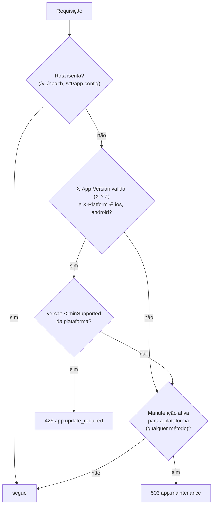
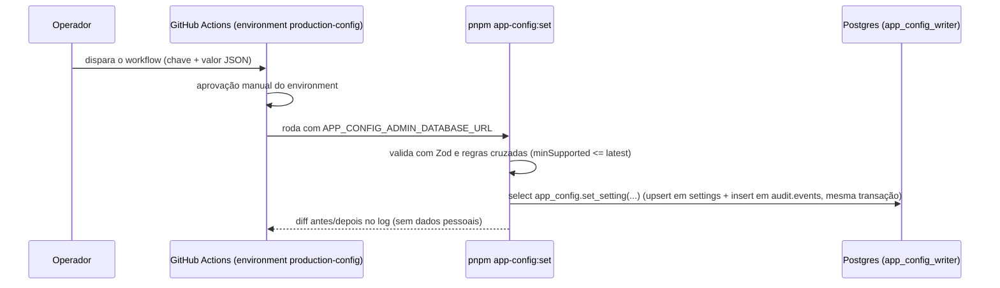

# Spec — Configuração remota (atualização obrigatória e manutenção)

> **Status:** proposed · **Contexto:** `app-config` · **Spec principal:** [base-app.md](base-app.md)
> **ADRs:** [0005](../adr/0005-data-access-sql-migrations-kysely-rls.md),
> [0012](../adr/0012-ci-cd-and-release.md) (histórico),
> [0015](../adr/0015-local-and-kvm-quality-gates.md)

## 1. Visão geral

Um endpoint público e cacheável diz ao app, antes de qualquer outra chamada: se a versão
instalada ainda é aceita, se há manutenção e quais são as versões atuais dos termos e da
privacidade. Mudar esses valores não exige release do app nem deploy da API.

A API também **impõe** as regras (gate no servidor), para forçar a saída de uma versão com
falha de segurança mesmo que o app ignore a configuração.

Flags de funcionalidade (`features`) não fazem parte do base-app.

## 2. Requisitos

| ID | Requisito |
|----|-----------|
| AC-01 | `GET /v1/app-config` devolve, por plataforma, `minSupported`, `latest` e a URL da loja; o app compara com a própria versão. A resposta não depende de query string, então a CDN serve todos do mesmo cache |
| AC-02 | **Gate no servidor:** toda requisição com `X-App-Version` abaixo do `minSupported` da `X-Platform` recebe 426 `app.update_required`; durante a manutenção, **toda** rota, de qualquer método, recebe 503 `app.maintenance`, exceto as isentas (`GET /v1/health` e `GET /v1/app-config`) |
| AC-03 | Modo manutenção global ou por plataforma, com chave de mensagem traduzida no app e previsão opcional de fim |
| AC-04 | Versões atuais dos termos e da privacidade, com as URLs (consumidas por `privacy` e pelo gate de termos do app) |
| AC-05 | Os valores ficam em `app_config.settings` e mudam pelo script `pnpm app-config:set`, que valida com Zod e grava em `audit.events` atomicamente por `app_config.set_setting`. `app_config_admin` não lê linhas de auditoria: a cota de 20/h usa `ops.app_config_change_count_last_hour()` (sem argumentos, apenas escalar, `EXECUTE` só para `app_config_admin`). Em produção, o script roda num workflow aprovado com `app_config_writer` (só `execute` em `set_setting`), nunca com a senha do `postgres` |
| AC-06 | Valor inválido no banco não derruba o endpoint: a API usa o último valor válido em memória ou os padrões seguros (sem atualização obrigatória, sem manutenção) e emite alerta |
| AC-07 | O app guarda a última resposta. Sem rede, usa a guardada; sem nenhuma, segue com os padrões. Só bloqueia um usuário offline se a última resposta guardada já mandava atualizar |

Não funcionais:

| ID | Requisito |
|----|-----------|
| AC-N1 | Rota pública declarada com `security: []`; `Cache-Control: public, s-maxage=60, stale-while-revalidate=60`; rate limit de 60/min por IP; resposta sem nenhum dado de usuário |
| AC-N2 | Cache em memória da função por 30 s para a leitura do banco (teto de 60 s). **A garantia de bloqueio em até 2 min é do gate do servidor**, que lê a configuração com esse cache. O app depende também da CDN, e o pior caso dele é de 150 s (§6) |
| AC-N3 | Redis fora não bloqueia a rota (sem rate limit por IP, com alerta): ela é o que permite ao app descobrir que precisa atualizar |

## 3. Design técnico

### 3.1 Leitura e cache

- `getAppConfig()` (consulta pública do contexto) lê `app_config.settings` com
  `systemDb('app-config')` (papel `app_config_system`, só `select`) e guarda o resultado em
  memória por 30 s.
- Cada chave é validada por Zod. Chave inválida ou ausente: usa o último valor válido em memória;
  sem ele, o padrão seguro; emite a métrica `app_config.invalid` (alerta).
- A URL da loja vem de `product.config.ts`:
  `https://apps.apple.com/app/id<ios.appStoreId>` e
  `https://play.google.com/store/apps/details?id=<android.package>`.
- As URLs legais são `web.origin` + `legal.termsPath` e `legal.privacyPath`.

### 3.2 Gate no servidor

Executado pelo pipeline (base-app.md §3.6, passo 2), com os mesmos dados em cache:



- `X-App-Version` ausente ou fora do formato `X.Y.Z` não bloqueia (clientes antigos sem o header
  seguem as regras do app).
- Manutenção bloqueia **todas** as rotas, de qualquer método (inclusive `GET /v1/me` e
  `GET /v1/me/export`, que escrevem no banco), exceto as isentas (`GET /v1/health` e
  `GET /v1/app-config`) e as rotas marcadas `maintenance: 'exempt'` (só webhook ou política de operador;
  base-app.md §3.6). Sem `X-Platform` válido, a manutenção por plataforma não se aplica, mas
  a global (todas as plataformas) sim.
- Comparação por números (`1.10.0 > 1.9.0`), sem tratar sufixos de pré-lançamento.
- O 426 carrega o problem+json com `code`, e o 503 inclui `Retry-After: 60`.

### 3.3 Alteração dos valores



- `pnpm app-config:set <chave> --json '<valor>'` (ou `--file valor.json`); `--dry-run` mostra o
  diff sem gravar. A mesma validação roda no CI sobre os exemplos do how-to.
- O workflow `app-config-set.yml` tem como primeiro job `protections` (`pnpm security:doctor`) e usa `environment: production-config` (aprovação, `prevent_self_review`), `permissions:
  contents: read` e actions pinadas por SHA. A credencial `APP_CONFIG_ADMIN_DATABASE_URL` é
  estática (o Supabase não tem OIDC para o banco), com escopo mínimo e rotação trimestral
  (base-app.md §3.11).
- O script **não escreve na tabela**: chama `app_config.set_setting` (§4), a mesma função que
  uma extensão (ex.: painel) usa por `app_config_writer`. A conexão do script usa um usuário de
  login dedicado que só assume `app_config_writer`.
- O evento de auditoria é `app_config.updated`, gravado pela própria função, com
  `actor_type = 'system'` e `actor_ref = script:app-config:<run_id>` no script (um painel passa
  `'operator'` e o `user_id` do operador), `resource_type = 'app_config.settings'`,
  `resource_ref` = a chave alterada e `metadata` com `before` e `after` (valores de
  configuração, sem PII). O `p_correlation_id` é o `run_id` ou o correlation ID da requisição. O `p_expected_updated_at`
  é o `updated_at` que quem escreve leu antes de montar o valor (o script e o painel o carregam
  com o valor atual): se a linha mudou desde então, a função levanta o `sqlstate` próprio
  `AC409`, que a aplicação mapeia para 409 `app_config.conflict`, sem gravar nada. `null` exige que
  a chave ainda não exista (primeira escrita).
- Regras cruzadas do script: `minSupported <= latest` por plataforma;
  `maintenance.until` no futuro quando informado; `maintenance.platforms` com ao menos uma
  plataforma; **guarda de salto:** `minSupported` não pode passar do `latest` que já está no
  banco antes da alteração (ninguém exige uma versão que ainda não foi anunciada), a não ser com
  `--force`, que o workflow só aceita com o input `force: true` e que fica em `metadata.force` do
  evento.
- `versions.<plataforma>.published` (opcional): a versão que de fato está disponível na loja.
  O operador a atualiza por `pnpm app-config:set` quando a loja libera o release (a revisão da
  loja não tem data previsível, então não é o workflow de build que a escreve). Quando presente,
  o script recusa `minSupported` acima dela, salvo `--force`. Quem escreve `versions` por outro
  canal (ex.: um painel de versão derivada) trata `published` como somente leitura e repete o
  valor atual. Ausente: vale só a guarda de salto acima.
- **Regra de duas pessoas:** o Environment `production-config` exige revisor com
  `prevent_self_review`: quem aprova não é quem disparou. O diff antes e depois aparece no pedido
  de aprovação.
- **Reversão rápida:** `pnpm app-config:rollback <chave>` relê o último `before` de `audit.events`
  para a chave e o reaplica por `set_setting` (mesma validação e mesma aprovação).

### 3.4 No app

`features/app-config` expõe `useAppConfig()` e a função pura
`evaluateGate(config, { appVersion, platform }): 'ok' | 'update' | 'maintenance'`. O resultado
alimenta o gate de boot (mobile-app-shell.md). O app usa a versão **nativa** instalada
(`Application.nativeApplicationVersion`), não a de uma atualização OTA. A última resposta fica no
AsyncStorage (não é dado sensível). Conforme AC-07, sem rede a configuração guardada
só bloqueia por atualização obrigatória; manutenção guardada não bloqueia o uso offline.

## 4. Modelo de dados

```sql
-- schema app_config
-- regra cruzada no banco: formato X.Y.Z e minSupported <= latest em cada plataforma
create function app_config.semver_key(p_version text) returns int[]
language sql immutable parallel safe set search_path = '' as $$
  select string_to_array(p_version, '.')::int[]
$$;

create function app_config.valid_versions(p_value jsonb) returns boolean
language sql immutable parallel safe set search_path = '' as $$
  select coalesce(bool_and(
    (p_value -> p ->> 'minSupported') ~ '^\d+\.\d+\.\d+$'
    and (p_value -> p ->> 'latest') ~ '^\d+\.\d+\.\d+$'
    and app_config.semver_key(p_value -> p ->> 'minSupported') <= app_config.semver_key(p_value -> p ->> 'latest')
    and ((p_value -> p ->> 'published') is null or (p_value -> p ->> 'published') ~ '^\d+\.\d+\.\d+$')
  ), false)
  from unnest(array['ios', 'android']) as p
$$;

create table app_config.settings (
  key        text primary key check (key in ('versions', 'maintenance', 'legal')),
  value      jsonb not null check (jsonb_typeof(value) = 'object' and pg_column_size(value) <= 2048),
  updated_at timestamptz not null default now(),
  -- forma e regras cruzadas também no banco (a função e o script validam antes, o check é a rede)
  constraint settings_value_shape check (
    case key
      when 'versions' then app_config.valid_versions(value)
      when 'maintenance' then jsonb_typeof(value -> 'active') = 'boolean'
        and (value -> 'messageKey' is null or (value ->> 'messageKey') ~ '^maintenance\.[a-z0-9_]{1,60}$')
      when 'legal' then (value ->> 'termsVersion') ~ '^\d{4}-\d{2}-\d{2}$'
        and (value ->> 'privacyVersion') ~ '^\d{4}-\d{2}-\d{2}$'
    end)
);

alter table app_config.settings enable row level security;
alter table app_config.settings force row level security;

revoke all on app_config.settings from public, anon, authenticated;
grant usage on schema app_config to app_config_system, app_config_admin, app_config_writer;
grant select on app_config.settings to app_config_system;
grant select, insert, update on app_config.settings to app_config_admin;

create policy settings_system_select on app_config.settings for select to app_config_system using (true);
create policy settings_admin_select on app_config.settings for select to app_config_admin using (true);
create policy settings_admin_insert on app_config.settings for insert to app_config_admin with check (true);
create policy settings_admin_update on app_config.settings for update to app_config_admin
  using (true) with check (true);

insert into app_config.settings (key, value) values
  ('versions',    '{"ios":{"minSupported":"1.0.0","latest":"1.0.0"},"android":{"minSupported":"1.0.0","latest":"1.0.0"}}'),
  ('maintenance', '{"active":false}'),
  ('legal',       '{"termsVersion":"2026-01-01","privacyVersion":"2026-01-01"}');
```

A migration semeia valores iniciais; quem cria o app edita pelo script. Não há chave `features`.

**Escrita por `app_config.set_setting`.** Toda escrita em `settings` (script ou extensão) passa
por esta função; ninguém além do dono escreve na tabela:

```sql
-- Fixed quota helper; app_config_admin receives EXECUTE, never SELECT on audit.events.
create function ops.app_config_change_count_last_hour() returns bigint
language sql volatile security definer set search_path = '' as $$
  select count(*)
  from audit.events
  where action = 'app_config.updated'
    and occurred_at > clock_timestamp() - interval '1 hour'
$$;
alter function ops.app_config_change_count_last_hour() owner to ops;
revoke all on function ops.app_config_change_count_last_hour()
  from public, anon, authenticated, api_runtime, app_config_writer;
grant usage on schema ops to app_config_admin;
grant execute on function ops.app_config_change_count_last_hour() to app_config_admin;

-- papel-grupo app_config_writer (NOLOGIN, sem membros no base-app): criado com os demais papéis, na migration de papéis

create function app_config.set_setting(
  p_key text, p_value jsonb, p_actor_type text, p_actor_ref text, p_correlation_id text,
  p_expected_updated_at timestamptz     -- controle otimista; null = a chave ainda não pode existir
) returns void
language plpgsql security definer set search_path = '' as $$
declare
  v_before jsonb;
  c_max_changes_per_hour constant int := 20;
begin
  if p_key not in ('versions', 'maintenance', 'legal') then
    raise exception 'unknown app_config key' using errcode = '22023';
  end if;
  if p_actor_type not in ('system', 'operator') then
    raise exception 'invalid actor type' using errcode = '22023';
  end if;
  -- o ator vem do contexto da transação, não só do argumento
  if p_actor_type = 'system' and p_actor_ref !~ '^script:app-config:[A-Za-z0-9_-]{1,64}$' then
    raise exception 'invalid system actor' using errcode = '22023';
  end if;
  if p_actor_type = 'operator' and (p_actor_ref !~ '^[0-9a-f]{8}-[0-9a-f]{4}-[0-9a-f]{4}-[0-9a-f]{4}-[0-9a-f]{12}$'
     or p_actor_ref is distinct from current_setting('app.operator_id', true)) then
    raise exception 'operator does not match transaction context' using errcode = '42501';
  end if;
  -- All writers serialize the quota check, setting write, and audit insert.
  if current_setting('transaction_isolation') <> 'read committed' then
    raise exception 'app_config requires read committed isolation' using errcode = '25001';
  end if;
  perform pg_advisory_xact_lock(hashtextextended('base-app-config:' || p_key, 0));
  perform pg_advisory_xact_lock(hashtextextended('base-app-config-hourly-limit', 0));
  -- Volatile helper reads a fresh READ COMMITTED snapshot after the lock wait.
  if ops.app_config_change_count_last_hour() >= c_max_changes_per_hour then
    raise exception 'too many app_config changes' using errcode = '54000';
  end if;

  select s.value into v_before from app_config.settings s where s.key = p_key;
  -- controle otimista: quem escreve diz qual versão leu; divergência = conflito (409 app_config.conflict)
  if (select s.updated_at from app_config.settings s where s.key = p_key) is distinct from p_expected_updated_at then
    raise exception 'app_config conflict' using errcode = 'AC409';
  end if;

  insert into app_config.settings (key, value, updated_at)
  values (p_key, p_value, now())
  on conflict (key) do update set value = excluded.value, updated_at = excluded.updated_at;

  insert into audit.events (actor_type, actor_ref, action, resource_type, resource_ref,
                            outcome, correlation_id, metadata)
  values (p_actor_type, p_actor_ref, 'app_config.updated', 'app_config.settings', p_key,
          'success', p_correlation_id,
          jsonb_build_object('before', v_before, 'after', p_value));
end $$;

alter function app_config.set_setting(text, jsonb, text, text, text, timestamptz) owner to app_config_admin;
revoke all on function app_config.set_setting(text, jsonb, text, text, text, timestamptz) from public;
grant execute on function app_config.set_setting(text, jsonb, text, text, text, timestamptz)
  to app_config_writer, app_config_admin;
grant audit_writer to app_config_admin;           -- o dono insere eventos 'system' (events_insert_writer)
grant audit_operator_writer to app_config_admin;  -- e eventos 'operator' (events_insert_operator)

-- chaves que um operador pode alterar sem alerta (dado, populado pela versão derivada com insert)
create table app_config.operator_alert_exempt_keys (
  key text primary key check (key in ('versions', 'maintenance', 'legal'))
);
alter table app_config.operator_alert_exempt_keys enable row level security;
alter table app_config.operator_alert_exempt_keys force row level security;
revoke all on app_config.operator_alert_exempt_keys from public, anon, authenticated;
grant select on app_config.operator_alert_exempt_keys to ops, app_config_system;
-- vazia no base-app: toda alteração por operador é alertada até a derivada declarar o que é rotina
```

A função confere a **chave** (contra a lista conhecida), o **ator**, a **versão lida**
(`p_expected_updated_at`) e o **valor**. Ator
`system`: `p_actor_ref` no formato `script:app-config:<run_id>`. Ator `operator`: `p_actor_ref` é
um UUID que **precisa ser igual** a `current_setting('app.operator_id')`, definido pelo painel na
mesma transação com `set_config(..., true)` a partir da sessão autenticada dele; o argumento
sozinho não vale. O valor passa pelo `check settings_value_shape` da tabela (forma, tamanho de
2 KB e `minSupported <= latest`), e a função recusa mais de 20 alterações por hora. O Zod de
quem chama (abaixo) continua sendo a primeira validação, com mensagens boas. O `search_path` vazio
exige nomes qualificados, e a função é a única que escreve em `settings`: o `grant` de `insert` e
`update` da tabela é do dono (`app_config_admin`), e `app_config_writer` não tem grant de tabela.
Uma versão derivada faz `grant app_config_writer to <papel do painel>` na migration dela e nunca
altera esta função nem a tabela. **Obrigação de quem escreve por um painel:** a alteração só
acontece com reautenticação do operador e confirmação equivalente à aprovação do workflow
(segundo aprovador), porque o painel tira o kill switch da trilha de aprovação do GitHub. O
núcleo não consegue impor isso; entra no checklist de revisão da extensão.

**Quais chaves um operador pode mexer (D19).** A lista de chaves permitidas por papel **não** vai
para o banco: dentro de uma função `SECURITY DEFINER` não há como saber o papel que chamou sem
um GUC que o chamador poderia forjar, então o banco não pode impô-la de forma honesta. O que o
núcleo faz: (1) a allowlist por papel é imposta na aplicação de quem chama; (2) toda escrita deixa
um evento `app_config.updated`; (3) a tabela `app_config.operator_alert_exempt_keys` (vazia no
núcleo) lista as chaves que um operador altera sem alarme, e `ops.check_signals()` (ADR 0008)
alerta quando um evento `operator` altera uma chave **fora** dessa lista. É mitigação parcial: um
painel comprometido altera, no máximo, uma chave por vez e fica visível, mas não é impedido
(risco residual R27 do threat model). A versão derivada popula a tabela com `insert` na migration
dela (exceção do `db:lint-migrations`).

```ts
// packages/contracts/src/app-config.ts
const SemVer = z.string().regex(/^\d+\.\d+\.\d+$/);
const IsoDate = z.string().regex(/^\d{4}-\d{2}-\d{2}$/);
const Platform = z.enum(['ios', 'android']);

export const VersionsSetting = z.object({
  ios: z.object({ minSupported: SemVer, latest: SemVer, published: SemVer.optional() }),
  android: z.object({ minSupported: SemVer, latest: SemVer, published: SemVer.optional() }),
}).strict();

export const MaintenanceSetting = z.object({
  active: z.boolean(),
  platforms: z.array(Platform).min(1).default(['ios', 'android']),
  messageKey: z.string().regex(/^maintenance\.[a-z0-9_]{1,60}$/).default('maintenance.default'),
  until: z.string().datetime().nullable().default(null),
}).strict();

export const LegalSetting = z.object({ termsVersion: IsoDate, privacyVersion: IsoDate }).strict();
```

```ts
// apps/web/src/modules/app-config/index.ts (API pública do contexto)
export const APP_CONFIG_KEYS = ['versions', 'maintenance', 'legal'] as const;
export type AppConfigKey = (typeof APP_CONFIG_KEYS)[number];
export const appConfigValueSchemas = {
  versions: VersionsSetting,
  maintenance: MaintenanceSetting,
  legal: LegalSetting,
} as const satisfies Record<AppConfigKey, z.ZodType>;
```

Quem escreve (o script ou uma extensão) valida o valor com `appConfigValueSchemas[key]` (e as
regras cruzadas do script) **antes** de chamar `set_setting`. Um teste garante que
`APP_CONFIG_KEYS` é igual à lista da função e ao `check` da tabela.

| Tabela | `anon`, `authenticated`, `api_runtime` | `app_config_system` | `app_config_admin` |
|--------|----------------------------------------|---------------------|--------------------|
| `settings` | nenhum grant | select | select, insert, update (sem delete) |
| `audit.events` | nenhum grant | nenhum grant | nenhum grant de leitura; insert via papel de auditoria |
| `ops.app_config_change_count_last_hour()` | nenhum grant | nenhum grant | execute |

`app_config_admin` é dono de `app_config.set_setting`, pode executar o helper escalar de cota e
é membro de `audit_writer` e de `audit_operator_writer`, por onde insere em `audit.events`
(account-lifecycle-and-privacy.md). Não tem `SELECT` direto nos eventos. `app_config_writer` só tem
`execute` na função, sem grant de tabela. A conexão do script usa um usuário de login dedicado
que só assume `app_config_writer`.

## 5. Contratos de API

| Método | Path | Auth | Rate limit | Request | Response |
|--------|------|------|------------|---------|----------|
| GET | `/v1/app-config` | pública (`security: []`) | 60/min por IP | — | `AppConfigResponse` |

```ts
export const AppConfigResponse = z.object({
  versions: z.object({
    ios: z.object({ minSupported: SemVer, latest: SemVer, storeUrl: z.string().url() }),
    android: z.object({ minSupported: SemVer, latest: SemVer, storeUrl: z.string().url() }),
  }),
  maintenance: z.object({
    active: z.boolean(),
    platforms: z.array(Platform),
    messageKey: z.string(),
    until: z.string().datetime().nullable(),
  }),
  legal: z.object({
    termsVersion: IsoDate, privacyVersion: IsoDate,
    termsUrl: z.string().url(), privacyUrl: z.string().url(),
  }),
}).strict();
```

```json
{
  "versions": {
    "ios": { "minSupported": "1.2.0", "latest": "1.4.0", "storeUrl": "https://apps.apple.com/app/id0000000000" },
    "android": { "minSupported": "1.2.0", "latest": "1.4.0", "storeUrl": "https://play.google.com/store/apps/details?id=com.example.myapp" }
  },
  "maintenance": { "active": false, "platforms": ["ios", "android"], "messageKey": "maintenance.default", "until": null },
  "legal": {
    "termsVersion": "2026-11-24", "privacyVersion": "2026-11-24",
    "termsUrl": "https://myapp.example/terms", "privacyUrl": "https://myapp.example/privacy"
  }
}
```

Erros produzidos pelo gate em qualquer rota (não só nesta):

| `code` | Status | Quando |
|--------|--------|--------|
| `app.update_required` | 426 | `X-App-Version` abaixo do `minSupported` da plataforma |
| `app.maintenance` | 503 + `Retry-After: 60` | qualquer método em rota não isenta durante a manutenção |
| `rate_limited` | 429 | mais de 60 chamadas por minuto do mesmo IP |

## 6. Edge cases

| Situação | Comportamento |
|----------|---------------|
| `minSupported` maior que `latest` (erro de digitação) | o script recusa; se estiver no banco, conta como inválido (AC-06) |
| Banco com valor inválido numa chave | usa o último válido em memória ou o padrão seguro e alerta; as outras chaves seguem normais |
| Instância nova (cold start) com valor inválido | padrão seguro: sem atualização obrigatória e sem manutenção |
| App de build interno com versão maior que `latest` | nenhuma atualização |
| Atraso do kill switch | **Servidor:** o gate lê a configuração com cache de 30 s (teto 60 s), então bloqueia em até 60 s depois da alteração. **App** (tela de atualização ou manutenção): `s-maxage` 60 s + `stale-while-revalidate` 60 s + cache de 30 s da função = **pior caso de 150 s (2,5 min)**; a CDN pode servir resposta de até 120 s de idade. A proteção real durante esse intervalo é o gate do servidor |
| App muito antigo sem o header `X-App-Version` | o gate do servidor não bloqueia; o app (se for novo o bastante para ler a configuração) decide |
| Manutenção ativa e o usuário no meio de uma compra | a compra é com a loja e o RevenueCat; o `POST /v1/billing/refresh` recebe 503 e é repetido depois |
| Manutenção ativa e o usuário abre o app | toda rota exceto `GET /v1/health` e `GET /v1/app-config` responde 503 `app.maintenance`, inclusive `GET /v1/me`; o app mostra a tela de manutenção |
| Manutenção ativa e o usuário pede exclusão de conta | recebe 503 (Q-AC-2) |
| `minSupported` acima do `latest` armazenado | o script recusa sem `--force` (guarda de salto) |
| `messageKey` desconhecida no app | usa `maintenance.default` |
| Dois operadores alteram a mesma chave a partir do mesmo `updated_at` | a primeira grava; a segunda recebe 409 `app_config.conflict`, sem alteração nem novo evento de sucesso |
| Relógio do aparelho errado | irrelevante: a comparação é de versões e a manutenção não depende de hora local |

## 7. Plano de testes

**Unit**

- Comparação de versões (`1.10.0 > 1.9.0`, igual não é menor).
- `evaluateGate` para todas as combinações (ok, update, manutenção por plataforma, manutenção global).
- Gate do servidor: 426 por plataforma; manutenção em todo método de rota não isenta; `X-App-Version` ausente ou
  inválido não bloqueia; rotas isentas nunca são bloqueadas.
- Fallback: valor inválido usa o último válido; sem ele, o padrão seguro.
- Montagem da URL da loja e das URLs legais a partir de `product.config.ts`.
- Regras cruzadas do script (`minSupported <= latest`, `until` no futuro, guarda de salto e
  `--force`); `rollback` reaplica o último `before`.
- Manutenção bloqueia `GET`, `POST`, `PATCH` e `DELETE` de rotas não isentas.

**Integração (Supabase local)**

- Valor inválido no banco não derruba o endpoint e dispara a métrica.
- O script grava por `app_config.set_setting`, em `settings` e em `audit.events` na mesma
  transação; falha na auditoria desfaz o `upsert`. A função recusa chave desconhecida e
  `p_actor_type` fora de `system` e `operator`, e grava `before` e `after`; o `execute` é negado a
  `public`, `authenticated` e `app_config_system`.
- `app_config_admin` não tem `SELECT` em `audit.events`, mas consegue chamar o helper escalar;
  `app_config_writer`, `api_runtime`, `anon` e `authenticated` não conseguem executá-lo. A cota
  admite a 20ª alteração e rejeita a 21ª sob o lock horário.
- Controle otimista: duas escritas com o mesmo `p_expected_updated_at` → a segunda levanta `AC409`
  (409 `app_config.conflict`) e não grava; `null` numa chave existente falha; `null` numa chave
  nova passa. `ops.check_signals()` grava alerta quando um evento `operator` altera chave fora de
  `operator_alert_exempt_keys` e não alerta para chave listada nem para ator `system`.
- Quem tem só `app_config_writer` consegue chamar a função e não consegue `insert`, `update` nem
  `select` direto em `settings` nem em `audit.events`; um papel de teste com
  `grant app_config_writer` (extensão fake) altera `maintenance` e deixa o evento `operator`.
- `APP_CONFIG_KEYS`, a lista da função e o `check` da tabela coincidem; `appConfigValueSchemas`
  tem um schema por chave.
- pgTAP: `app_config_system` só lê; `app_config_admin` não tem `delete` nem `SELECT` em
  `audit.events`; `app_config_writer` sem
  grant de tabela e com `execute` só na função; `authenticated` e `anon` não
  alcançam a tabela; nenhum papel altera `audit.events` além do `insert`.
- A resposta não varia com query string e traz os headers de cache esperados.

**E2E (Maestro)**

- Subir `minSupported` acima da versão do build → o app mostra a tela de atualização.
- Ativar manutenção → o app mostra a tela de manutenção.

### Critérios de aceite

- [ ] Mudar `minSupported` pelo script faz o **gate do servidor** bloquear versões antigas em ≤ 60 s,
      sem deploy. A tela de atualização do app aparece em até 150 s no pior caso (CDN 60 s + 60 s
      de revalidação + 30 s de cache).
- [ ] Em manutenção, toda rota fora `GET /v1/health` e `GET /v1/app-config` responde 503, de
      qualquer método.
- [ ] `set_setting` recusa operador cujo `p_actor_ref` não coincide com `app.operator_id`, valor
      fora do `check` (inclusive `minSupported > latest`) e a 21ª alteração na hora; o Environment
      `production-config` impede a autoaprovação.
- [ ] O gate do servidor responde 426 e 503 mesmo com um cliente que ignora a configuração.
- [ ] App offline na abertura entra normalmente com a configuração guardada.
- [ ] Endpoint responde do cache da CDN (`x-vercel-cache: HIT`) na segunda chamada.
- [ ] Uma extensão fake com `grant app_config_writer` escreve a configuração só por
      `app_config.set_setting`, valida com `appConfigValueSchemas` e deixa um evento
      `app_config.updated` com `actor_type = 'operator'`.
- [ ] O workflow em produção só roda depois da aprovação e deixa um evento em `audit.events`.

## 8. Questões em aberto

| # | Item | Padrão adotado |
|---|------|----------------|
| Q-AC-1 | `maintenance.until` expira sozinho? | não; é só informação para o usuário, e o operador desliga a manutenção |
| Q-AC-2 | Permitir a exclusão de conta durante a manutenção | bloqueada, como toda rota |
| Q-AC-3 | O gate do servidor considera a versão nativa (`X-App-Version`); atualizações OTA não a mudam | decisão registrada em mobile-app-shell.md |
