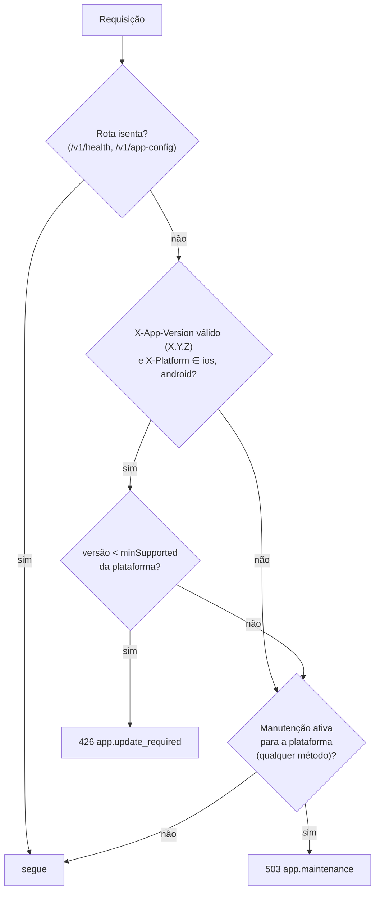

# Spec — Configuração remota (atualização obrigatória e manutenção)

> **Status:** proposed · **Contexto:** `app-config` · **Spec principal:** [base-app.md](base-app.md)
> **ADRs:** [0005](../adr/0005-data-access-sql-migrations-kysely-rls.md),
> [0012](../adr/0012-ci-cd-and-release.md) (histórico),
> [0015](../adr/0015-local-and-kvm-quality-gates.md),
> [0017](../adr/0017-local-app-config-operations.md) (operação aprovada em 2026-11-26)

## 1. Visão geral

Um endpoint público e cacheável diz ao app, antes de qualquer outra chamada: se a versão
instalada ainda é aceita, se há manutenção e quais são as versões atuais dos termos e da
privacidade. Mudar esses valores não exige release do app nem deploy da API.

A API também **impõe** as regras (gate no servidor), para forçar a saída de uma versão com
falha de segurança mesmo que o app ignore a configuração.

Flags de funcionalidade (`features`) não fazem parte do base-app.

## 2. Requisitos

| ID | Requisito |
|----|-----------|
| AC-01 | `GET /v1/app-config` devolve, por plataforma, `minSupported`, `latest` e a URL da loja; o app compara com a própria versão. A resposta não depende de query string, então a CDN serve todos do mesmo cache |
| AC-02 | **Gate no servidor:** toda requisição com `X-App-Version` abaixo do `minSupported` da `X-Platform` recebe 426 `app.update_required`; durante a manutenção, **toda** rota, de qualquer método, recebe 503 `app.maintenance`, exceto as isentas (`GET /v1/health` e `GET /v1/app-config`) |
| AC-03 | Modo manutenção global ou por plataforma, com chave de mensagem traduzida no app e previsão opcional de fim |
| AC-04 | Versões atuais dos termos e da privacidade, com as URLs (consumidas por `privacy` e pelo gate de termos do app) |
| AC-05 | Os valores ficam em `app_config.settings` e mudam pelo script `pnpm app-config:set`, que valida com Zod e grava em `audit.events` atomicamente por `app_config.set_setting`. `app_config_admin` não lê linhas de auditoria: a cota de 20/h usa `ops.app_config_change_count_last_hour()` (sem argumentos, apenas escalar, `EXECUTE` só para `app_config_admin`). A operação local exige plano aprovado por duas assinaturas distintas (ADR 0017), com `app_config_writer` (EXECUTE apenas nos leitores restritos e setter), nunca a senha de `postgres` |
| AC-06 | Valor inválido no banco não derruba o endpoint: a API usa o último valor válido em memória ou os padrões seguros (sem atualização obrigatória, sem manutenção) e emite alerta |
| AC-07 | O app guarda a última resposta. Sem rede, usa a guardada; sem nenhuma, segue com os padrões. Só bloqueia um usuário offline se a última resposta guardada já mandava atualizar |

Não funcionais:

| ID | Requisito |
|----|-----------|
| AC-N1 | Rota pública declarada com `security: []`; `Cache-Control: public, s-maxage=60, stale-while-revalidate=60`; rate limit de 60/min por IP; resposta sem nenhum dado de usuário |
| AC-N2 | Cache em memória da função por 30 s para a leitura do banco (teto de 60 s). O gate do servidor bloqueia em até 60 s com banco disponível. A resposta pode ter até 150 s; o app online/foreground consulta a cada 60 s, então detecta em até 210 s mais rede (§6). Offline/background não têm prazo garantido |
| AC-N3 | Redis fora não bloqueia a rota (sem rate limit por IP, com alerta): ela é o que permite ao app descobrir que precisa atualizar |

## 3. Design técnico

### 3.1 Leitura e cache

- `getAppConfig()` (consulta pública do contexto) lê `app_config.settings` com
  `systemDb('app-config')` (papel `app_config_system`, só `select`) e guarda o resultado em
  memória por 30 s.
- Cada chave é validada por Zod. Chave inválida ou ausente: usa o último valor válido em memória;
  sem ele, o padrão seguro; emite a métrica `app_config.invalid` (alerta).
- A URL da loja vem de `product.config.ts`:
  `https://apps.apple.com/app/id<ios.appStoreId>` e
  `https://play.google.com/store/apps/details?id=<android.package>`.
- As URLs legais são `web.origin` + `legal.termsPath` e `legal.privacyPath`.

### 3.2 Gate no servidor

Executado pelo pipeline (base-app.md §3.6, passo 2), com os mesmos dados em cache:



- `X-App-Version` ausente ou fora do formato `X.Y.Z` não bloqueia (clientes antigos sem o header
  seguem as regras do app).
- Manutenção bloqueia **todas** as rotas, de qualquer método (inclusive `GET /v1/me` e
  `GET /v1/me/export`, que escrevem no banco), exceto as isentas (`GET /v1/health` e
  `GET /v1/app-config`) e as rotas marcadas `maintenance: 'exempt'` (só webhook ou política de operador;
  base-app.md §3.6). Sem `X-Platform` válido, a manutenção por plataforma não se aplica, mas
  a global (todas as plataformas) sim.
- Comparação por números (`1.10.0 > 1.9.0`), sem tratar sufixos de pré-lançamento.
- O 426 carrega o problem+json com `code`, e o 503 inclui `Retry-After: 60`.

### 3.3 Alteração dos valores

O [ADR 0017](../adr/0017-local-app-config-operations.md) substitui o workflow de
Actions por comandos locais. O operador prepara o diff, duas identidades confiáveis
assinam o mesmo plano, e o executor verifica as assinaturas antes de gravar.
O [how-to](../how-to/change-app-config.md) define a sintaxe executável.

- `pnpm app-config:set <chave> --json '<valor>'` ou `--file valor.json` valida a
  proposta com `appConfigValueSchemas`; `--dry-run` mostra o diff sem gravar.
- O snapshot vem de `app_config.read_setting`; rollback consulta
  `app_config.read_rollback_setting` e reaplica o último before validado. Não há
  SELECT direto do writer em settings/audit. Rollback usa a mesma aprovação.
- O plano versionado contém destino, commit/tree, chave, before/after, timestamp
  CAS exato, force, origem do rollback, ID e expiração máxima de uma hora.
  Solicitante e aprovador são identidades e chaves Ed25519 distintas num registro
  confiável fora do checkout. Assinatura cobre bytes canônicos e prefixo de domínio.
- O executor recusa autoaprovação, chaves não confiáveis, adulteração, expiração,
  destino divergente e checkout sujo/diferente; confere o snapshot e chama somente
  `set_setting` sob `app_config_writer`. Não repete mutações automaticamente.
- `p_expected_updated_at` é preservado sem perder microssegundos. Divergência
  produz SQLSTATE `AC409`, apresentado como 409 `app_config.conflict`; null exige
  chave inexistente. Replay de um plano já aplicado encontra outro token CAS.
- Regras cruzadas: minSupported <= latest; until no futuro; ao menos uma plataforma.
  A guarda de salto recusa minSupported acima do latest armazenado, salvo `--force`.
  Published, quando presente, limita minSupported; force também permite exceção a
  esse limite, mas nunca relaxa o schema nem minSupported <= latest.
  Published é atualizado pelo operador quando a loja libera a versão; painéis de
  derivados o tratam como somente leitura e preservam o valor existente.
- A função grava `app_config.updated`, actor_type system, actor_ref
  `script:app-config:<plan_id>`, resource_type app_config.settings e resource_ref
  igual à chave; before/after/force ficam nos metadados. O digest do plano é o
  correlation_id e consta no recibo, ligando a aprovação à escrita.
- Credenciais de produção permanecem na máquina autorizada do operador. TLS é
  verificado. `.env.example` contém apenas nomes vazios; as chaves privadas nunca
  entram no checkout. Testes locais usam credenciais efêmeras descartáveis.
- A assinatura protege o executor; quem detém a credencial DB pode chamar SQL
  diretamente. Isso é residual explícito, não garantia de sandbox. Não há broker
  novo. Painéis precisam de reautenticação e segundo aprovador equivalentes.

### 3.4 No app

Enquanto online e em foreground, a consulta roda a cada 60 s em qualquer estado,
além da abertura, retomada e reconexão. Offline/background interrompem o polling.
A versão nativa e a prioridade atualização → manutenção são preservadas.

`features/app-config` expõe `useAppConfig()` e a função pura
`evaluateGate(config, { appVersion, platform }): 'ok' | 'update' | 'maintenance'`. O resultado
alimenta o gate de boot (mobile-app-shell.md). O app usa a versão **nativa** instalada
(`Application.nativeApplicationVersion`), não a de uma atualização OTA. A última resposta fica no
AsyncStorage (não é dado sensível). Conforme AC-07, sem rede a configuração guardada
só bloqueia por atualização obrigatória; manutenção guardada não bloqueia o uso offline.

## 4. Modelo de dados

`app_config.settings` mantém as três chaves `versions`, `maintenance`, `legal`,
JSONB de até 2 KiB e updated_at timestamptz. RLS é forçado. A baseline semeia os
valores de exemplo existentes; mudanças são migrations aditivas, não reescritas.

| Capacidade | Contrato e restrição |
|------------|---------------------|
| `read_setting(text)` | Retorna value/updated_at da chave; dono app_config_admin; EXECUTE writer |
| `read_rollback_setting(text)` | Retorna event_id/before_value/after_value/occurred_at do último sucesso da chave; dono app_config_history_reader NOLOGIN; grants de colunas e RLS apenas nesses eventos |
| `set_setting(text,jsonb,text,text,text,timestamptz,boolean)` | Valida chave, ator, valor e CAS; locks por chave e cota; até 20 alterações/h; grava settings/audit na mesma transação, incluindo force |
| Aridade antiga de seis argumentos | Wrapper compatível, passando force=false |
| `ops.app_config_change_count_last_hour()` | Escalar sem argumentos, dono ops, EXECUTE só app_config_admin; não concede leitura de auditoria ao admin |

Todas as funções de capacidade usam SQL fixo e search_path vazio. Os leitores
aceitam somente as três chaves; chamadas indevidas não retornam histórico geral.
O writer não possui SELECT/INSERT/UPDATE/DELETE direto nas tabelas. Nenhuma
membership nova permite que api_runtime ou usuários assumam o papel de histórico.

`app_config.updated` só pode ser inserido por app_config_admin, inclusive quando
outras policies de INSERT permitirem eventos genéricos. Assim, um audit_writer
não falsifica a origem do rollback nem consome a cota por eventos falsos.

A comparação de versões no check usa componentes decimais, sem overflow de int32;
minSupported <= latest continua obrigatório. O helper antigo pode permanecer por
compatibilidade. Chave, objeto/tamanho e forma também são conferidos no banco.
As schemas Zod em `packages/contracts/src/app-config.ts` são a primeira validação.
`APP_CONFIG_KEYS` e `appConfigValueSchemas`, exportados pelo contexto, coincidem com
as listas da função e do check, cobertas por testes de catálogo e comportamento.

Ator system exige o formato de script; operador exige UUID igual ao
`app.operator_id` da mesma transação, definido com set_config bind/local. A função
exige READ COMMITTED, serializa as escritas e a cota e usa updated_at como token
opaco de concorrência; conflito não altera valor nem grava sucesso de auditoria.

`operator_alert_exempt_keys` continua vazia no núcleo. A allowlist por papel é
responsabilidade do painel; `ops.check_signals` alerta alterações operator em
chaves fora dela. O banco não pretende autenticar um operador por um GUC forjável
(residual R27). Não há grant novo de metadata para ops nem de tabela para writer.
DDL executável: migrations versionadas em `supabase/migrations`; contratos de
capacidade e propriedade detalhados no ADR 0017 e verificados por pgTAP.

## 5. Contratos de API

| Método | Path | Auth | Rate limit | Request | Response |
|--------|------|------|------------|---------|----------|
| GET | `/v1/app-config` | pública (`security: []`) | 60/min por IP | — | `AppConfigResponse` |

```ts
export const AppConfigResponse = z.object({
  versions: z.object({
    ios: z.object({ minSupported: SemVer, latest: SemVer, storeUrl: z.string().url() }),
    android: z.object({ minSupported: SemVer, latest: SemVer, storeUrl: z.string().url() }),
  }),
  maintenance: z.object({
    active: z.boolean(),
    platforms: z.array(Platform),
    messageKey: z.string(),
    until: z.string().datetime().nullable(),
  }),
  legal: z.object({
    termsVersion: IsoDate, privacyVersion: IsoDate,
    termsUrl: z.string().url(), privacyUrl: z.string().url(),
  }),
}).strict();
```

```json
{
  "versions": {
    "ios": { "minSupported": "1.2.0", "latest": "1.4.0", "storeUrl": "https://apps.apple.com/app/id0000000000" },
    "android": { "minSupported": "1.2.0", "latest": "1.4.0", "storeUrl": "https://play.google.com/store/apps/details?id=com.example.myapp" }
  },
  "maintenance": { "active": false, "platforms": ["ios", "android"], "messageKey": "maintenance.default", "until": null },
  "legal": {
    "termsVersion": "2026-11-24", "privacyVersion": "2026-11-24",
    "termsUrl": "https://myapp.example/terms", "privacyUrl": "https://myapp.example/privacy"
  }
}
```

Erros produzidos pelo gate em qualquer rota (não só nesta):

| `code` | Status | Quando |
|--------|--------|--------|
| `app.update_required` | 426 | `X-App-Version` abaixo do `minSupported` da plataforma |
| `app.maintenance` | 503 + `Retry-After: 60` | qualquer método em rota não isenta durante a manutenção |
| `rate_limited` | 429 | mais de 60 chamadas por minuto do mesmo IP |

## 6. Edge cases

| Situação | Comportamento |
|----------|---------------|
| `minSupported` maior que `latest` (erro de digitação) | o script recusa; se estiver no banco, conta como inválido (AC-06) |
| Banco com valor inválido numa chave | usa o último válido em memória ou o padrão seguro e alerta; as outras chaves seguem normais |
| Instância nova (cold start) com valor inválido | padrão seguro: sem atualização obrigatória e sem manutenção |
| App de build interno com versão maior que `latest` | nenhuma atualização |
| Atraso do kill switch | **Servidor:** o gate lê a configuração com cache de 30 s (teto 60 s), então bloqueia em até 60 s depois da alteração. **App** (tela de atualização ou manutenção): `s-maxage` 60 s + `stale-while-revalidate` 60 s + cache de 30 s da função = **idade de resposta de até 150 s**; somada à consulta foreground de 60 s, a detecção é de até 210 s mais rede. Offline/background não têm garantia temporal. A proteção durante esse intervalo é o gate do servidor |
| App muito antigo sem o header `X-App-Version` | o gate do servidor não bloqueia; o app (se for novo o bastante para ler a configuração) decide |
| Manutenção ativa e o usuário no meio de uma compra | a compra é com a loja e o RevenueCat; o `POST /v1/billing/refresh` recebe 503 e é repetido depois |
| Manutenção ativa e o usuário abre o app | toda rota exceto `GET /v1/health` e `GET /v1/app-config` responde 503 `app.maintenance`, inclusive `GET /v1/me`; o app mostra a tela de manutenção |
| Manutenção ativa e o usuário pede exclusão de conta | recebe 503 (Q-AC-2) |
| `minSupported` acima do `latest` armazenado | o script recusa sem `--force` (guarda de salto) |
| `messageKey` desconhecida no app | usa `maintenance.default` |
| Dois operadores alteram a mesma chave a partir do mesmo `updated_at` | a primeira grava; a segunda recebe 409 `app_config.conflict`, sem alteração nem novo evento de sucesso |
| Relógio do aparelho errado | irrelevante: a comparação é de versões e a manutenção não depende de hora local |

## 7. Plano de testes

**Unit**

- Comparação de versões (`1.10.0 > 1.9.0`, igual não é menor).
- `evaluateGate` para todas as combinações (ok, update, manutenção por plataforma, manutenção global).
- Gate do servidor: 426 por plataforma; manutenção em todo método de rota não isenta; `X-App-Version` ausente ou
  inválido não bloqueia; rotas isentas nunca são bloqueadas.
- Fallback: valor inválido usa o último válido; sem ele, o padrão seguro.
- Montagem da URL da loja e das URLs legais a partir de `product.config.ts`.
- Regras cruzadas do script (`minSupported <= latest`, `until` no futuro, guarda de salto e
  `--force`); `rollback` reaplica o último `before`.
- Manutenção bloqueia `GET`, `POST`, `PATCH` e `DELETE` de rotas não isentas.

**Integração (Supabase local)**

- Valor inválido no banco não derruba o endpoint e dispara a métrica.
- O script grava por `app_config.set_setting`, em `settings` e em `audit.events` na mesma
  transação; falha na auditoria desfaz o `upsert`. A função recusa chave desconhecida e
  `p_actor_type` fora de `system` e `operator`, e grava `before` e `after`; o `execute` é negado a
  `public`, `authenticated` e `app_config_system`.
- `app_config_admin` não tem `SELECT` em `audit.events`, mas consegue chamar o helper escalar;
  `app_config_writer`, `api_runtime`, `anon` e `authenticated` não conseguem executá-lo. A cota
  admite a 20ª alteração e rejeita a 21ª sob o lock horário.
- Controle otimista: duas escritas com o mesmo `p_expected_updated_at` → a segunda levanta `AC409`
  (409 `app_config.conflict`) e não grava; `null` numa chave existente falha; `null` numa chave
  nova passa. `ops.check_signals()` grava alerta quando um evento `operator` altera chave fora de
  `operator_alert_exempt_keys` e não alerta para chave listada nem para ator `system`.
- Quem tem só `app_config_writer` consegue chamar a função e não consegue `insert`, `update` nem
  `select` direto em `settings` nem em `audit.events`; um papel de teste com
  `grant app_config_writer` (extensão fake) altera `maintenance` e deixa o evento `operator`.
- `APP_CONFIG_KEYS`, a lista da função e o `check` da tabela coincidem; `appConfigValueSchemas`
  tem um schema por chave.
- pgTAP: `app_config_system` só lê; `app_config_admin` não tem `delete` nem `SELECT` em
  `audit.events`; `app_config_writer` sem
  grant de tabela e com EXECUTE somente nas capacidades do ADR 0017; `authenticated` e `anon` não
  alcançam a tabela; nenhum papel altera `audit.events` além do `insert`.
- A resposta não varia com query string e traz os headers de cache esperados.

**E2E (Maestro)**

- Subir `minSupported` acima da versão do build → o app mostra a tela de atualização.
- Ativar manutenção → o app mostra a tela de manutenção.

### Critérios de aceite

- [ ] Mudar `minSupported` pelo script faz o **gate do servidor** bloquear versões antigas em ≤ 60 s,
      sem deploy. A resposta pode ter 150 s de idade; a consulta foreground de 60 s permite
      detecção em até 210 s mais rede. Offline/background não têm prazo garantido.
- [ ] Em manutenção, toda rota fora `GET /v1/health` e `GET /v1/app-config` responde 503, de
      qualquer método.
- [ ] `set_setting` recusa operador cujo `p_actor_ref` não coincide com `app.operator_id`, valor
      fora do `check` (inclusive `minSupported > latest`) e a 21ª alteração na hora; o executor local
      impede autoaprovação verificando duas identidades/chaves confiáveis distintas.
- [ ] O gate do servidor responde 426 e 503 mesmo com um cliente que ignora a configuração.
- [ ] App offline na abertura entra normalmente com a configuração guardada.
- [ ] Headers de cache passam na prova HTTP local; HIT real da CDN fica no checklist do derivado.
- [ ] Uma extensão fake com `grant app_config_writer` escreve a configuração só por
      `app_config.set_setting`, valida com `appConfigValueSchemas` e deixa um evento
      `app_config.updated` com `actor_type = 'operator'`.
- [ ] O executor só grava depois de verificar as duas assinaturas e deixa evento correlacionável em `audit.events`.

## 8. Questões em aberto

| # | Item | Padrão adotado |
|---|------|----------------|
| Q-AC-1 | `maintenance.until` expira sozinho? | não; é só informação para o usuário, e o operador desliga a manutenção |
| Q-AC-2 | Permitir a exclusão de conta durante a manutenção | bloqueada, como toda rota |
| Q-AC-3 | O gate do servidor considera a versão nativa (`X-App-Version`); atualizações OTA não a mudam | decisão registrada em mobile-app-shell.md |
