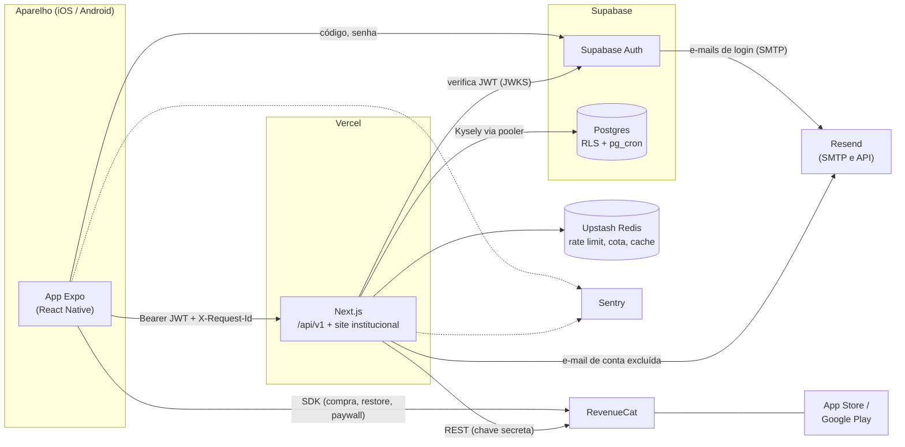
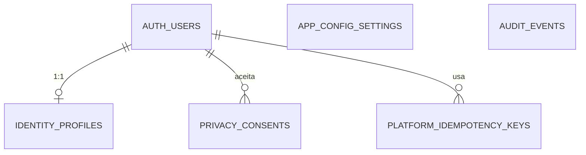

# Spec — base-app (spec principal)

> **Status:** proposed · **Última revisão:** 2026-11-24 · **Dono:** Bruno Bracaioli
>
> Spec de produto e de arquitetura do template. Cada área tem sua spec com contratos,
> edge cases e critérios de aceite:
>
> | Área | Spec |
> |------|------|
> | Login por e-mail (código e senha), sessão, perfil | [identity-and-auth.md](identity-and-auth.md) |
> | Assinatura e paywall (RevenueCat, modo simples) | [billing.md](billing.md) |
> | Exclusão de conta, termos, exportação de dados (LGPD) | [account-lifecycle-and-privacy.md](account-lifecycle-and-privacy.md) |
> | Atualização obrigatória e manutenção | [app-config.md](app-config.md) |
> | Casca do app mobile (boot, navegação, i18n, tema, rede) | [mobile-app-shell.md](mobile-app-shell.md) |
>
> Decisões estruturais: [docs/adr/](../adr/). Threat model:
> [docs/security/threats/base-app.md](../security/threats/base-app.md).
> Plano de execução: [docs/plan/implementation-waves.md](../plan/implementation-waves.md).

---

## 1. Visão geral

### 1.1 Problema

Quem está começando a criar apps gasta as primeiras semanas refazendo as mesmas peças antes
de chegar ao produto: login, sessão, paywall, exclusão de conta, atualização obrigatória,
idiomas e as exigências da App Store e do Google Play. Os exemplos públicos costumam ignorar
segurança (chave secreta no app, banco aberto, webhook sem verificação) e não têm testes.

### 1.2 Objetivo

Um **template de repositório gratuito**, distribuído aos alunos como template público do
GitHub (licença MIT), do qual se cria um app mobile (iOS e Android) com:

- login por e-mail (código ou senha), assinatura pelo RevenueCat, exclusão de conta,
  exportação de dados e atualização obrigatória funcionando;
- arquitetura profissional: monolito modular, Vertical Slice Architecture, DDD, Zero Trust,
  testes e CI desde o primeiro commit;
- documentação didática (tutoriais e how-tos) para que o aluno entenda **por que** cada peça
  existe.

O base-app é também o **núcleo** de versões derivadas, mais completas. Uma versão derivada
parte deste repositório e só acrescenta módulos pelos pontos de extensão de §3.4. Uma correção
no núcleo vale para todas elas.

### 1.3 Métricas de sucesso

| Métrica | Meta |
|---------|------|
| Tempo do clone até um build de desenvolvimento com login e paywall em sandbox | ≤ 1 dia, seguindo o tutorial |
| Rejeições de review de loja causadas pelas partes do template | 0 |
| Arquivos do template alterados para lançar um app novo | só `product.config.ts`, assets, textos e a feature de produto |
| Cobertura de `domain/` e `application/` | ≥ 80% |

### 1.4 Stack (decidida)

| Camada | Escolha | ADR |
|--------|---------|-----|
| Monorepo | pnpm workspaces + Turborepo | [0001](../adr/0001-monorepo-pnpm-turborepo.md) |
| App mobile | React Native com Expo (EAS Build/Submit/Update), Expo Router, TypeScript strict | [0002](../adr/0002-mobile-expo-react-native.md) |
| API + site institucional | Next.js (App Router) na Vercel, monolito modular com VSA + DDD | [0003](../adr/0003-backend-nextjs-modular-monolith-on-vercel.md) |
| Login | Supabase Auth; a API valida o JWT por JWKS | [0004](../adr/0004-supabase-auth-and-jwt-verification.md) |
| Banco | Supabase Postgres, migrations SQL, Kysely, RLS como segunda barreira | [0005](../adr/0005-data-access-sql-migrations-kysely-rls.md) |
| Cobrança | RevenueCat como fonte da verdade; a API consulta a API REST com cache curto | [0006](../adr/0006-revenuecat-simple-entitlement-check.md) |
| Contratos | Zod como fonte, OpenAPI gerado e verificado no CI | [0007](../adr/0007-contracts-zod-first-generated-openapi.md) |
| Rotinas de manutenção | `pg_cron` no Postgres; nenhuma função agendada na Vercel | [0008](../adr/0008-maintenance-jobs-pg-cron.md) |
| Observabilidade | Logs JSON, correlation ID, OpenTelemetry, Sentry, auditoria | [0009](../adr/0009-observability.md) |
| Personalização do template | `product.config.ts` validado + script de bootstrap | [0010](../adr/0010-template-customization-product-config.md) |
| Modelo de conta | B2C: o usuário é o próprio tenant | [0011](../adr/0011-b2c-user-as-tenant.md) |
| CI/CD e release | Gate local/KVM com evidência por commit/tree; aprovações de release separadas | [0015](../adr/0015-local-and-kvm-quality-gates.md) |
| Núcleo extensível | Pontos de extensão explícitos para versões derivadas | [0013](../adr/0013-extensible-core.md) |
| Configuração do Supabase | `supabase/config.toml` gerado a partir de `config.base.toml` e fragmentos em `config.d/` | [0014](../adr/0014-generated-supabase-config.md) |

---

## 2. Requisitos

### Aceite do template de desenvolvimento

O entregável é o código reutilizável do template. Por orientação do dono em
2026-11-25, o aceite do código é separado da configuração e do lançamento de
cada app derivado. Não é necessário criar contas, preencher segredos, publicar
um app ou fazer deploy para entregar o template.

- Cada onda precisa de implementação correspondente, testes locais, contratos
  e tipos coerentes, checks de segurança e instruções reproduzíveis. Fakes nas
  portas verificam integrações sem afirmar que uma conta ou serviço foi criado.
- Banco e isolamento continuam exigindo prova real com reset/pgTAP no ambiente
  local ou KVM. Falhas funcionais ou de permissões não viram aceite por se
  tratar de template.
- Configuração hospedada, builds EAS com assinatura, compra em sandbox de loja,
  envio real de e-mail e publicação são checklists do projeto derivado. O
  template entrega os pontos de configuração, scripts e documentação; o
  relatório distingue essas etapas de verificações já executadas.
- Os critérios por onda indicam a prova local equivalente e a etapa externa
  documentada. Não se usam IDs, credenciais ou resultados fictícios para
  preencher uma etapa que depende do operador.

Essa separação não retira login, assinatura, exclusão, exportação, gates de
versão e bootstrap do escopo funcional do template.

### 2.1 Escopo (v1)

**Dentro:**

- Login por e-mail com código (OTP) e por e-mail + senha, com confirmação de e-mail,
  redefinição de senha, troca de senha e de e-mail com reautenticação.
- Perfil mínimo (nome de exibição, idioma) e aceite versionado de termos e privacidade.
- Assinatura via RevenueCat: paywall remoto, compra, restauração, gerenciar assinatura. A API
  confere o entitlement consultando o RevenueCat, com cache curto.
- Exclusão de conta **imediata**, no app e pela página web (exigência do Google Play).
- Exportação dos dados do titular em JSON (LGPD).
- Atualização obrigatória e modo manutenção, alterados sem release.
- Idiomas pt-BR, en e es; tema claro, escuro e do sistema.
- Uma **feature de exemplo** (`examples/premium-action`) que mostra como proteger uma ação
  por assinatura, com idempotência e cota diária. Existe para ser copiada e depois apagada.
- Site institucional: landing, termos, privacidade, página de exclusão de conta.
- CI com lint, tipos, testes, fronteiras entre módulos, drift de contrato e de tipos do
  banco, segredos, SAST e SCA. Pipelines de release do app (EAS) e da API (Vercel).
- Script `pnpm bootstrap:init` que renomeia o template para um app novo.
- Tutoriais para alunos em `docs/tutorials/`.

**Fora (disponível em versões derivadas):** login com Google e Apple, modo
visitante, webhook do RevenueCat com cópia das assinaturas no banco, créditos, notificações
push, painel administrativo, CAPTCHA, carência na exclusão de conta, envio dos e-mails de
login pela API, portas de analytics e atribuição.

**Fora das duas versões:** web app com login e paywall web, upload de arquivos, B2B.

### 2.2 Requisitos funcionais (resumo; detalhes nas specs de área)

| ID | Requisito | Spec |
|----|-----------|------|
| RF-01 | Usuário cria conta e entra por código de e-mail ou por e-mail + senha, conforme `product.config.ts` | identity-and-auth |
| RF-02 | Usuário redefine a senha por e-mail e troca senha e e-mail depois de se reautenticar | identity-and-auth |
| RF-03 | A sessão sobrevive ao fechamento do app e fica guardada criptografada no aparelho | identity-and-auth |
| RF-04 | Ações sensíveis (excluir conta, exportar dados) exigem login recente (≤ 5 min) | identity-and-auth |
| RF-05 | O paywall mostra a oferta atual do RevenueCat sem precisar de release | billing |
| RF-06 | O servidor decide o acesso pago consultando o RevenueCat, nunca confiando no app | billing |
| RF-07 | Depois de comprar ou restaurar, o acesso pago vale no servidor em até 5 s (o app chama `POST /v1/billing/refresh`, que ignora o cache). Fora desse caminho, mudanças feitas na loja (cancelamento, reembolso) valem em até `billing.cacheTtlSec` (60 s) | billing |
| RF-08 | Usuário exclui a conta no app ou na web; todos os dados são apagados na hora nos nossos sistemas e no RevenueCat | account-lifecycle-and-privacy |
| RF-09 | Usuário baixa seus dados em JSON | account-lifecycle-and-privacy |
| RF-10 | Termos e privacidade têm versão; mudança de versão pede novo aceite | account-lifecycle-and-privacy |
| RF-11 | O app bloqueia versões abaixo da mínima e mostra modo manutenção | app-config |

### 2.3 Requisitos não funcionais

| ID | Categoria | Requisito |
|----|-----------|-----------|
| RNF-01 | Segurança | Toda rota da API exige autenticação, salvo exceção declarada no contrato (`security: []`): `GET /v1/health` e `GET /v1/app-config` |
| RNF-02 | Segurança | Ordem fixa em toda rota: gate de versão e manutenção → autenticação → rate limit → autorização → validação → caso de uso, imposta pelo `defineRoute` (§3.6) |
| RNF-03 | Segurança | Identidade vem só do JWT verificado (assinatura, `iss`, `aud`, `exp`, algoritmo em allowlist). Nenhum `user_id` vem de body, query ou header |
| RNF-04 | Segurança | RLS forçado em toda tabela; teste de acesso entre usuários por tabela (pgTAP) e por endpoint (integração) |
| RNF-05 | Segurança | Nenhum segredo no repositório nem no bundle do app. O app só carrega chaves públicas por desenho (publishable key do Supabase, chave pública do SDK do RevenueCat) |
| RNF-06 | Segurança | Rate limit por IP nas rotas públicas; nas autenticadas, por usuário **e** por IP (teto de IP compartilhado entre contas descartáveis), com armazenamento compartilhado (Upstash Redis; nunca memória da função). IP lido de `ipAddress()` do `@vercel/functions`; IPv6 agrupado por /64. Cada rota declara `onStoreFailure: 'closed' \| 'open'` (sem padrão). Uma regra do Vercel Firewall limita `/api` por IP antes da função. 429 com `Retry-After`. Números em §3.13 |
| RNF-07 | Segurança | Ações com custo variável têm cota diária por usuário e por entitlement, além do rate limit |
| RNF-08 | Segurança | A API impõe os gates no servidor: `426 app.update_required` quando `X-App-Version` < `minSupported` da plataforma (`X-Platform`) e `503 app.maintenance` em **toda** rota, de qualquer método, durante a manutenção, exceto as isentas (`GET /v1/health` e `GET /v1/app-config`) |
| RNF-09 | Segurança | Headers de segurança em todas as respostas, em **três camadas independentes**: `next.config` (HSTS, nosniff, `X-Frame-Options: DENY`, Referrer-Policy, Permissions-Policy e uma CSP estática `frame-ancestors 'none'; base-uri 'none'; object-src 'none'; form-action 'self'`), `defineRoute` (API) e o middleware (CSP com nonce). A página que segura sessão só renderiza se o middleware injetou o nonce; sem ele responde 503 estático. Um Deployment Check confere os cabeçalhos no preview antes da promoção. Sem CORS: a API não responde a origens de terceiros |
| RNF-10 | Privacidade | Nenhuma PII em logs, métricas, traces ou eventos do Sentry. Usuário aparece só pelo UUID interno |
| RNF-11 | Privacidade | Retenção definida por tipo de dado, com expurgo automático por `pg_cron` |
| RNF-12 | Confiabilidade | Toda chamada de saída tem timeout (padrão 5 s), retry com backoff e jitter só em operação idempotente |
| RNF-13 | Performance | API: p95 ≤ 300 ms nas leituras autenticadas com a função aquecida; app: abertura até a tela inicial ≤ 3 s num Android intermediário |
| RNF-14 | Observabilidade | Logs JSON com `requestId`; o app gera o `X-Request-Id` e a API o propaga (OpenTelemetry) |
| RNF-15 | Acessibilidade | Contraste AA, rótulos em todos os controles, suporte a fonte grande do sistema |
| RNF-16 | Qualidade | TypeScript strict (`noUncheckedIndexedAccess`, `exactOptionalPropertyTypes`), sem `any` sem justificativa; cobertura ≥ 80% em `domain/` e `application/` |
| RNF-17 | Extensibilidade | Uma versão derivada acrescenta módulos sem editar arquivos do núcleo, exceto os listados em §3.4.3 |
| RNF-19 | Custo e abuso | Todo recurso pago por uso tem teto de gasto, alerta e limite por IP (§3.13); nenhuma rota pode ser chamada em volume ilimitado por contas descartáveis |
| RNF-18 | Didática | Todo módulo tem um how-to ou tutorial que explica o que faz e por quê; comentários no código só onde a razão não é óbvia |

### 2.4 Requisitos das lojas (checklist que o template já resolve)

| Exigência | Loja | Onde é atendida |
|-----------|------|-----------------|
| Exclusão de conta dentro do app | Apple, Google | account-lifecycle-and-privacy |
| Link web para pedir exclusão de conta | Google | account-lifecycle-and-privacy (página `/account-deletion`) |
| Avisar que excluir a conta não cancela a assinatura na loja | Apple | account-lifecycle-and-privacy |
| Botão de restaurar compras | Apple | billing |
| Preço, período, renovação automática, termos (EULA) e privacidade visíveis no paywall | Apple, Google | billing |
| Link para gerenciar a assinatura | Apple, Google | billing |
| Privacy manifest (`PrivacyInfo.xcprivacy`) e formulário Data Safety coerentes com os SDKs | Apple, Google | how-to de publicação |
| Conta de teste para o revisor da loja | Apple, Google | how-to de publicação |

Como o base-app só tem login por e-mail, "Sign in with Apple" não é exigido (a Apple só o
exige quando há login por serviço de terceiros). Também não há rastreamento, então o app não
pede permissão de ATT.

---

## 3. Design técnico

### 3.1 Visão de contêineres



Pontos centrais:

- **O app fala com três serviços:** Supabase Auth (só autenticação), a nossa API e o SDK do
  RevenueCat. Ele **não** acessa tabelas do Supabase: a Data API fica desligada (ADR 0005).
  Toda regra de negócio fica na API.
- **A API é a única que escreve no banco.** Duas formas de acesso: `userScopedDb(claims)`,
  que roda a transação como `authenticated` com as claims do JWT (RLS se aplica), e
  `systemDb(<contexto>)`, um papel de sistema por contexto com grants só no próprio schema
  (§3.8).
- **RevenueCat é a fonte da verdade de quem pagou** (ADR 0006). No base-app não há webhook:
  a API consulta a API REST do RevenueCat quando precisa decidir um acesso pago e guarda a
  resposta por 60 s no Redis. Depois de uma compra o app pede `POST /v1/billing/refresh`.
- **Os e-mails de login saem direto do Supabase Auth** pelo SMTP do Resend, com os textos
  nos três idiomas em `supabase/templates/`.

### 3.2 Bounded contexts

| Contexto | Responsabilidade | Agregados | Consultas e comandos públicos | Eventos que publica |
|----------|------------------|-----------|-------------------------------|---------------------|
| `identity` | Perfil do usuário | `UserProfile` | `getProfile` | — |
| `billing` | Entitlements consultados no RevenueCat; exclusão do cliente no RevenueCat | — (sem tabelas no base-app) | `hasEntitlement`, `listActiveEntitlements` | — |
| `privacy` | Exclusão de conta, consentimentos, exportação | `ConsentRecord` | `getConsentStatus`, `exportUserData` | `AccountPurgeRequested` |
| `app-config` | Versões mínimas, manutenção, versões dos documentos legais | `AppConfigSnapshot` (leitura) | `getAppConfig` | — |
| `examples` | Feature de exemplo protegida por assinatura | — | — | — |

Duas formas de um contexto usar outro, e só essas duas:

1. **Consulta ou comando síncrono** pelo `index.ts` público do outro contexto. As setas
   formam um grafo acíclico, verificado no CI:

   ```mermaid
   flowchart LR
     examples --> billing
     identity --> privacy
     privacy --> billing
   ```

   `identity → privacy`: o `GET /v1/me` inclui o estado dos termos. `privacy → billing`: a
   exportação inclui os entitlements. Quando `privacy` precisa de dados de `identity` (perfil
   na exportação) ou de `app-config` (versões legais), usa as portas `ProfileReader` e
   `LegalVersionsReader`, declaradas no domínio de `privacy` e ligadas em `composition/`,
   sem import direto (evita o ciclo `identity ↔ privacy`).

2. **Evento de domínio.** Os tipos de evento que cruzam contextos ficam em
   `platform/events`, não no contexto que publica:

   | Evento | Publicado por | Assinado por | Efeito |
   |--------|---------------|--------------|--------|
   | `AccountPurgeRequested` | privacy | identity, billing, privacy, examples, platform | cada um apaga os próprios dados (examples: contadores de cota no Redis); billing exclui o cliente no RevenueCat |

O barramento é em processo e síncrono: os handlers rodam na mesma transação de quem publicou,
então a operação é tudo ou nada. Handlers são idempotentes. Extensões registram handlers no
mesmo barramento (§3.4).

### 3.3 Estrutura do repositório

```
base-app/
├── AGENTS.md                        regras para agentes de código (Codex, Claude Code)
├── apps/
│   ├── mobile/                      Expo (iOS + Android)
│   │   ├── app.config.ts            lê packages/config (nome, bundle id, scheme)
│   │   ├── eas.json
│   │   ├── .eas/workflows/          build, submit e update (EAS Workflows)
│   │   └── src/
│   │       ├── app/                 rotas do Expo Router (finas: só compõem telas)
│   │       ├── features/<feature>/
│   │       │   ├── model/           regras do cliente (puras, testadas)
│   │       │   ├── api/             hooks TanStack Query sobre o client tipado
│   │       │   ├── adapters/        SDKs nativos (Supabase, RevenueCat)
│   │       │   └── ui/              telas e componentes
│   │       ├── shared/              ui kit, i18n, tema, api-client, observabilidade
│   │       ├── composition/         providers e injeção de dependências
│   │       └── extensions/index.ts  ponto de extensão do app (vazio no base-app)
│   └── web/                         Next.js na Vercel
│       └── src/
│           ├── app/
│           │   ├── (site)/          landing, termos, privacidade, exclusão de conta
│           │   └── api/v1/**/route.ts   adaptadores finos → presentation do contexto
│           ├── modules/<context>/
│           │   ├── domain/          agregados, value objects, portas
│           │   ├── features/<slice>/
│           │   │   ├── application/ command ou query handler
│           │   │   ├── presentation/ definição da rota (defineRoute) e mapeamento
│           │   │   └── *.test.ts
│           │   ├── infrastructure/  repositórios Kysely, clientes externos
│           │   └── index.ts         API pública do contexto
│           ├── platform/            pipeline HTTP, logger, db, rate limit, env, eventos, e-mail
│           ├── composition/         composição dos módulos do núcleo e das extensões
│           └── extensions/          pontos de extensão da API (listas vazias no base-app)
│               ├── index.ts         serverExtensions
│               ├── edge.ts          edgeExtensions (hosts e CSP; só dados, sem Node)
│               └── site.tsx         siteExtensions (slots de UI do site)
├── packages/
│   ├── contracts/                   schemas Zod, OpenAPI gerado, client tipado
│   ├── config/                      schema e valores de product.config.ts
│   └── tooling/                     tsconfig, ESLint, dependency-cruiser compartilhados
├── supabase/
│   ├── config.base.toml             Auth, rate limits, SMTP (IaC); fonte editável do núcleo
│   ├── config.d/                    fragmentos *.toml das extensões (vazia no base-app, com .gitkeep)
│   ├── config.toml                  GERADO por `pnpm supabase:config`; nunca editado à mão (ADR 0014)
│   ├── migrations/                  SQL versionado (fonte da verdade do schema)
│   ├── tests/                       pgTAP (RLS, acesso entre usuários, papéis)
│   └── templates/                   e-mails do Auth (pt-BR, en, es)
├── docs/                            specs, ADRs, Diátaxis, threat model, plano
└── .github/workflows/               CI (actions pinadas por SHA)
```

Dentro de `modules/<context>/`, o domínio fica no nível do contexto e cada caso de uso é uma
fatia em `features/<slice>/` (ADR 0003).

### 3.4 Pontos de extensão

O base-app é o núcleo de versões derivadas (produtos construídos sobre ele e os forks dos alunos). Uma versão
derivada acrescenta módulos **sem editar o núcleo**, para continuar recebendo as correções do
base-app por `git merge` (ADR 0013).

#### 3.4.1 Onde se estende

| Camada | Ponto de extensão | Como |
|--------|-------------------|------|
| API: módulos | `apps/web/src/extensions/index.ts` exporta `serverExtensions: ServerExtension[]` (vazio no base-app) | cada extensão declara: nome, schema de variáveis de ambiente, handlers de eventos (inclusive `AccountPurgeRequested`), seções da exportação de dados (LGPD), papéis de sistema que usa e substituições de portas |
| API: substituição de portas | `ServerExtension.overrides` | portas substituíveis: `EntitlementsReader` (billing), `AccountDeletionPolicy` (privacy: `immediate` no base-app), `EmailSender` (platform), `AuthorizationPolicies` (políticas extras de autorização, ex.: papel de administrador; assinatura `AuthorizationPolicy` em §3.4.2) |
| API: borda (host, CSP e headers) | `apps/web/src/extensions/edge.ts` exporta `edgeExtensions: EdgeExtension[]` (vazio) | só dados, seguro para o runtime do middleware (sem Node, sem banco). Uma extensão declara um host dedicado (`hostEnv`) com os `pathPrefixes` que ele serve, acréscimos de CSP por prefixo e headers que só endurecem (`headers`, allowlist de nomes e valores) e CSP estrita por prefixo (`csp[].strict`) (§3.4.2) |
| API: rotas | arquivos novos em `apps/web/src/app/api/v1/<extensão>/**/route.ts` | o roteamento do Next.js é por arquivo; nenhuma edição em arquivo existente |
| API: autenticação de webhooks | `auth: { kind: 'webhook', verifier }` no `defineRoute` | o núcleo traz os verificadores `sharedSecret(envNames)` e `standardWebhooks(envNames)`, que aceitam uma lista de variáveis para rotação sem janela (§3.6); a extensão escolhe |
| API: auditoria | `platform/audit` exporta `recordAuditEvent(db, event)` e `subjectRef(userId)`; papéis-grupo `audit_writer` (só `system` e `webhook`), `audit_operator_writer` (só `operator`) e `audit_reader` | a extensão grava eventos em `audit.events` pelo próprio papel `<schema>_system`, depois de `grant audit_writer to <schema>_system` (e, se agir como operador, também `grant audit_operator_writer to <schema>_system`) na migration dela. Uma tela de auditoria (ex.: painel) lê com `grant audit_reader to <schema>_system` (só `select`; a leitura feita pelo painel é auditada por ele). Nenhuma extensão cria política em `audit.events`; seção de exportação de extensão não lê `audit.events` |
| API: configuração remota | papel-grupo `app_config_writer`; função `app_config.set_setting(...)`; `modules/app-config/index.ts` exporta `APP_CONFIG_KEYS` e `appConfigValueSchemas` | a extensão (ex.: painel) escreve a configuração remota só por essa função, que confere a chave e o ator e grava a auditoria na mesma transação |
| API: exclusão de conta | `modules/privacy/index.ts` exporta `purgeAccount(...)` e as fábricas de `PurgeAuthorization` | a extensão de carência chama a mesma purga que a política `immediate` usa, ao vencer o prazo, com uma `PurgeAuthorization` emitida pelo registro de jobs de purga (§3.4.2). Só `modules/privacy/**` e `extensions/**` podem importar `purgeAccount` (lint) |
| API: cotas | `modules/billing/index.ts` exporta `consumeDailyQuota` e `refundDailyQuota` | extensões reutilizam o `QuotaCounter` do núcleo; o `defineRoute` não tem campo `quota` |
| API: jobs | pasta nova `apps/web/src/jobs/` (não existe no base-app) | o base-app não tem funções agendadas; a extensão as cria |
| Banco | migrations novas com schema próprio | uma extensão **nunca** altera tabela do núcleo; quando precisa de dado extra sobre o usuário, cria tabela 1:1 no próprio schema com FK para `auth.users` |
| Contratos | `packages/contracts/src/extensions/index.ts` (vazio) | a geração do OpenAPI inclui os schemas e rotas das extensões |
| Configuração | `packages/config/src/extensions.ts` exporta `extensionConfigSchema` e `extensionAuthMethods` (vazios) | `product.config.ts` ganha o bloco `extensions`, validado por esse schema |
| App: features | `apps/mobile/src/extensions/index.ts` exporta `mobileExtensions: MobileExtension[]` (vazio) | cada extensão declara: métodos de login extras (componentes na tela de entrada), gates de boot, itens de Configurações, providers, namespaces de i18n um provedor de CAPTCHA para as chamadas ao Auth (contrato `CaptchaProvider` e `withCaptcha` em §3.4.2) e variáveis públicas (`publicEnv`, só `EXPO_PUBLIC_*`) |
| App: rotas | arquivos novos em `apps/mobile/src/app/(ext)/**` | o Expo Router também é por arquivo |
| i18n | um arquivo por namespace: `shared/i18n/locales/<idioma>/<namespace>.json` | a extensão traz os próprios namespaces |
| Site | páginas novas em `apps/web/src/app/(site)/**` ou num grupo próprio; `apps/web/src/extensions/site.tsx` exporta `siteExtensions: SiteExtension[]` (vazio) | `SiteExtension` traz o widget de CAPTCHA que a página `/account-deletion` renderiza e variáveis públicas do build da web (`publicEnv`, só `NEXT_PUBLIC_*`) (§3.4.2) |
| Supabase | `supabase/config.d/<NN>-<nome>.toml` (arquivo novo) | fragmento mesclado ao `config.base.toml` por `pnpm supabase:config` (ADR 0014); segredos só com `env(...)` |
| Testes | pgTAP e testes novos | o teste de purga completa (account-lifecycle-and-privacy) varre o catálogo do banco e passa a cobrir as tabelas da extensão sem configuração |

#### 3.4.2 Contratos dos pontos de extensão

```ts
// apps/web/src/platform/extensions/types.ts
export interface ServerExtension {
  readonly name: string;                                  // kebab-case, único
  readonly env?: z.ZodObject<z.ZodRawShape>;              // validado no boot, junto com o do núcleo
  readonly systemRoles?: readonly string[];               // cada um deve ser `<name com _>_system` (ex.: `panel_system` para `panel`); nome de papel do núcleo ou de outra extensão derruba o boot
  register(registry: ExtensionRegistry): void;
}

// apps/web/src/platform/authorization/types.ts
export type AuthorizationRequest = {
  readonly auth: AuthContext;
  readonly host: string;          // host normalizado e já conferido contra os hosts configurados
  readonly method: string;
  readonly path: string;
  readonly now: Date;
  // relê `app_metadata.roles` no banco (o JWT pode estar até 15 min defasado); obrigatório em ação destrutiva
  loadFreshRoles(): Promise<readonly string[]>;
};
export type AuthorizationDecision =
  | { readonly allow: true }
  | { readonly allow: false; readonly status: 401 | 403 | 404; readonly code: string };
export type AuthorizationPolicy = (req: AuthorizationRequest) => Promise<AuthorizationDecision>;
// Política que lança erro, estoura o tempo (500 ms) ou não devolve decisão = 403 `authz.policy_error`
// e evento de segurança. Nega por padrão.

// modules/privacy/domain: cada módulo com dado de usuário contribui com uma seção da exportação
export interface ExportSectionProvider {
  readonly systemRole?: string;                             // omitido = `collect` roda como `authenticated` com as claims do usuário (RLS vale)
  readonly schema: z.ZodType;                               // valida a seção antes de entrar no arquivo
  collect(ctx: { userId: UserId; db: ExportDb }): Promise<unknown>;
}

export interface ExtensionRegistry {
  onEvent<E extends DomainEvent>(type: E['type'], handler: EventHandler<E>): void;
  override<K extends keyof OverridablePorts>(port: K, impl: OverridablePorts[K]): void;
  addAuthorizationPolicy(name: string, policy: AuthorizationPolicy, opts?: { operator?: boolean }): void;  // operator: true marca política de rota de operador (habilita maintenance: 'exempt')
  addExportSection(name: string, provider: ExportSectionProvider): void;  // dados do módulo no GET /v1/me/export
  // timeout por handler: padrão 3 000 ms, máximo 8 000 ms; total da purga 15 s (privacy §3.2)
  // onEvent(type, handler, opts?: { timeoutMs?: number })
  registerPurgeJob(job: { name: string; reasons: readonly SystemPurgeReason[]; maxPerMinute: number }): PurgeJobHandle;
}

// modules/privacy/index.ts: prova de autorização da purga (tipo marcado; só as fábricas do módulo a emitem)
export type PurgeReason = 'user_request' | 'scheduled' | 'guest_abandoned' | 'guest_merged';
export type SystemPurgeReason = Exclude<PurgeReason, 'user_request'>;
declare const purgeAuthorizationBrand: unique symbol;
export type PurgeAuthorization = {
  readonly [purgeAuthorizationBrand]: true;
  readonly userId: UserId;
  readonly reason: PurgeReason;
  readonly issuedBy: string;                                // 'policy:immediate' | 'job:<name>' (vai para o evento account.deleted)
};
export interface PurgeJobHandle {
  authorize(userId: UserId, reason: SystemPurgeReason): PurgeAuthorization;   // respeita maxPerMinute
}
// Única fonte para o caminho do usuário: AuthContext verificado com login recente (usada pela política `immediate`)
// export function authorizeUserPurge(auth: AuthContext): PurgeAuthorization;
```

```ts
// apps/web/src/extensions/edge.ts (só dados; roda no runtime do middleware)
export type CspDirective = 'script-src' | 'frame-src' | 'connect-src' | 'style-src' | 'img-src';
export interface EdgeExtension {
  readonly name: string;
  // host dedicado (ex.: painel) servindo só estes prefixos
  readonly hosts?: readonly { readonly hostEnv: string; readonly pathPrefixes: readonly string[] }[];
  // acréscimos de CSP por prefixo de rota
  readonly csp?: readonly {
    readonly pathPrefix: string;
    readonly directives: Partial<Record<CspDirective, readonly string[]>>;
    // CSP estrita sob o prefixo (D18); os acréscimos de `directives` valem por cima, mas nunca afrouxam a base
    readonly strict?: { readonly trustedTypesPolicies: readonly string[] };
  }[];
  // headers que só endurecem, por prefixo de rota, em qualquer host que sirva o prefixo
  readonly headers?: readonly { readonly pathPrefix: string; readonly set: Partial<Record<HardeningHeader, string>> }[];
}
export type HardeningHeader =
  | 'Referrer-Policy' | 'Cross-Origin-Opener-Policy' | 'Cross-Origin-Resource-Policy'
  | 'X-Robots-Tag' | 'Cache-Control';
export const edgeExtensions: EdgeExtension[] = [];

// apps/web/src/extensions/site.tsx
export interface SiteExtension {
  readonly name: string;
  readonly publicEnv?: z.ZodObject<z.ZodRawShape>;        // só chaves NEXT_PUBLIC_*, validadas no build da web
  readonly captchaWidget?: ComponentType<{
    action: CaptchaAction;
    onToken(token: string): void;
    onExpire(): void;
    onError(): void;
  }>;
}
export const siteExtensions: SiteExtension[] = [];
```

```ts
// apps/mobile/src/extensions/types.ts
export interface MobileExtension {
  readonly name: string;
  readonly authMethods?: readonly AuthMethodEntry[];      // botão/componente na tela de entrada
  readonly bootGates?: readonly BootGate[];               // executados depois dos gates do núcleo
  readonly settingsItems?: readonly SettingsItem[];
  readonly providers?: readonly ProviderComponent[];      // envolvem a árvore abaixo dos do núcleo
  readonly i18nNamespaces?: readonly I18nNamespace[];
  readonly captchaProvider?: CaptchaProvider;             // usado pelo adaptador do Supabase Auth
  readonly publicEnv?: z.ZodObject<z.ZodRawShape>;        // só chaves EXPO_PUBLIC_*, validadas no boot com o env público do app
}

// Superfície mínima entregue ao componente de login de uma extensão: nenhuma sessão, token ou cliente do Supabase.
// O componente também pode usar `extensionAuth` da fachada `apps/mobile/src/extensions/api.ts` (abaixo)
export type AuthMethodProps = {
  readonly locale: Locale;
  readonly busy: boolean;
  setBusy(busy: boolean): void;
  onError(key: AuthErrorKey): void;                       // chave de i18n `auth.errors.*`
  signInWithIdToken(input: { provider: string; token: string; nonce?: string }): Promise<Result<void, AuthErrorKey>>;  // passa por withCaptcha; o núcleo instala a sessão
};

// apps/mobile/src/extensions/api.ts: fachada do núcleo para extensões (o cliente cru do Supabase
// continua proibido fora de features/auth). Toda chamada que aceita CAPTCHA passa por `withCaptcha`.
export const extensionAuth: {
  signInAnonymously(): Promise<Result<void, AuthErrorKey>>;
  signInWithIdToken(input: { provider: string; token: string; nonce?: string }): Promise<Result<void, AuthErrorKey>>;
  linkIdentity(input: { provider: string }): Promise<Result<void, AuthErrorKey>>;
  unlinkIdentity(input: { identityId: string }): Promise<Result<void, AuthErrorKey>>;   // exige login recente
  updateEmail(email: string): Promise<Result<void, AuthErrorKey>>;
  verifyEmailChangeOtp(input: { email: string; token: string }): Promise<Result<void, AuthErrorKey>>;
  refreshSession(): Promise<Result<void, AuthErrorKey>>;
  signOutEverywhere(): Promise<Result<void, AuthErrorKey>>;            // signOut({ scope: 'global' }); exige login recente
  // guarda a sessão atual (ex.: a de visitante) antes de uma troca de conta e entrega a `fn` SÓ o
  // access token anterior, para o corpo de uma rota de fusão; depois descarta a sessão anterior
  // com signOut({ scope: 'local' }) do cliente secundário. O token nunca é logado nem persistido.
  withPreviousSession<T>(fn: (previousAccessToken: string) => Promise<T>): Promise<T>;
};
export function useSessionSummary(): SessionSummary | null;   // { userId, isAnonymous }; atualiza quando a sessão muda
export const extensionApiClient: ApiClient;                  // mesmos headers, problem+json e refresh do client do núcleo
export type SettingsItemProps = { session: SessionSummary; navigate(route: string): void };

export type CaptchaAction =
  | 'sign_up' | 'sign_in_password' | 'sign_in_otp' | 'reset_password'
  | 'anonymous' | 'resend' | 'reauth' | 'social';
export type CaptchaToken = { readonly token: string; readonly issuedAt: number };
export type CaptchaErrorCode = 'unavailable' | 'cancelled' | 'timeout' | 'failed';
export class CaptchaError extends Error { constructor(readonly code: CaptchaErrorCode) { super(code); } }
export interface CaptchaProvider {
  readonly kind: string;                                  // identifica o serviço (ex.: 'turnstile')
  prewarm(action: CaptchaAction): void;                   // aquece o desafio, sem bloquear a tela
  getToken(action: CaptchaAction): Promise<CaptchaToken>; // rejeita com CaptchaError
  release(token: CaptchaToken): void;                     // descarta token não usado
  dispose(): void;
}

// apps/mobile/src/features/auth/api/with-captcha.ts (núcleo)
export function withCaptcha<T>(
  provider: CaptchaProvider | undefined,
  action: CaptchaAction,
  call: (captchaToken: string | undefined) => Promise<T>,
): Promise<T>;                                            // sem provedor: call(undefined)
```

Regras:

- Uma substituição de porta é registrada uma única vez; duas extensões substituindo a mesma
  porta fazem o boot falhar.
- Extensões não importam internals de módulos do núcleo; usam o `index.ts` público dos
  contextos e os tipos de `platform/events` (dependency-cruiser).
- Só uma extensão pode registrar `captchaProvider` e só uma pode registrar `captchaWidget`;
  duas fazem o boot falhar (e o teste de composição também).
- `withCaptcha` é do núcleo: o adaptador do Supabase Auth do app passa por ele toda chamada
  que aceita `captchaToken` (cadastro, entrada por senha e por código, redefinição, reenvio,
  reautenticação, login social e anônimo). Sem provedor, a chamada segue sem token.
- `edge.ts` e `site.tsx` não importam nada de `modules/**`: `edge.ts` roda no middleware (sem
  Node) e só carrega dados.
- Regras do middleware do núcleo sobre `edgeExtensions`:
  - O `matcher` cobre **todos** os paths, inclusive `/_next/**` e os estáticos. O host é
    conferido sempre e os headers de segurança vão em toda resposta.
  - Host desconhecido (nem `APP_HOST` nem um `hostEnv` de extensão) → 404. `APP_HOST` é
    obrigatório por ambiente, sem esquema, validado por `platform/env`. Em `VERCEL_ENV=preview`
    também valem `VERCEL_URL` e `VERCEL_BRANCH_URL`; nenhum outro host de preview.
  - Path fora dos `pathPrefixes` num host de extensão → 404; path de um `pathPrefixes` de
    extensão chegando pelo host principal → 404.
  - **Normalização antes de comparar prefixos:** decodifica uma vez, colapsa barras duplicadas,
    resolve `.` e `..`, compara sem diferenciar caixa. Caminho com `%2f`, `%5c`, `\`, byte nulo
    ou `%2e` codificado → 404 em qualquer host. Teste de bypass com tabela de casos
    (`//painel`, `/%2e%2e/painel`, `/PAINEL`, `/painel%2f`, `/a/../painel`).
  - **CSP:** os acréscimos só valem sob o `pathPrefix` e o nonce continua. Um teste do núcleo
    recusa, em **todas** as diretivas aceitas (`script-src`, `frame-src`, `connect-src`,
    `style-src`, `img-src`), qualquer origem que não seja `https://<host>` explícito: nada de
    `*`, `'unsafe-inline'`, `'unsafe-eval'`, `data:` ou `blob:`. `pathPrefix: '/'` não aceita
    acréscimo. Um prefixo que cubra `/account-deletion` só aceita `script-src`, `frame-src` e
    `connect-src`, com no máximo 2 origens em cada.
  - **CSP estrita por prefixo (`strict`):** sob o `pathPrefix` o núcleo aplica `default-src
    'none'`; `script-src 'self' 'nonce-…' 'strict-dynamic'`; `style-src 'self' 'nonce-…'`;
    `img-src 'self'`; `font-src 'self'`; `connect-src 'self'`; `form-action 'self'`;
    `frame-ancestors 'none'`; `base-uri 'none'`; `require-trusted-types-for 'script'`; e
    `trusted-types <trustedTypesPolicies>` (nomes `^[a-z][a-z0-9-]{0,31}$`, no máximo 5, nunca
    `*` nem `'allow-duplicates'`). Os `directives` do mesmo item acrescentam origens por cima,
    com as mesmas regras de origem de cima. O teste do núcleo compara a política final com a base
    e falha se alguma diretiva estrita foi afrouxada (curinga, `unsafe-*`, `data:`, `blob:`,
    remoção de `require-trusted-types-for`); o modo estrito só endurece.
  - **Headers (`EdgeExtension.headers`):** só `Referrer-Policy: no-referrer`,
    `Cross-Origin-Opener-Policy: same-origin`, `Cross-Origin-Resource-Policy: same-origin`,
    `X-Robots-Tag: noindex, nofollow` e `Cache-Control: no-store`. Nome ou valor fora dessa
    allowlist faz o boot e o teste falharem; header de segurança do núcleo nunca é
    enfraquecido nem removido. Valem sob o `pathPrefix`, em qualquer host que o sirva.
- **Fachada do app (`extensions/api.ts`).** Extensões do app não importam o cliente do Supabase
  (regra `supabase-client-only-in-auth`) nem o `api-client` do núcleo: usam `extensionAuth`,
  `useSessionSummary`, `extensionApiClient` e as props de `SettingsItem`. `withPreviousSession` é a
  única passagem de um access token a código de extensão: o token vai só à `fn` recebida, nunca é
  logado, persistido ou devolvido, e `fn` não pode devolver o token (o tipo devolve `T` definido pelo
  chamador e o teste verifica que o valor não contém o token). Uso previsto: corpo de uma rota de
  fusão, que chega ao servidor e lá passa por `verifyAccessToken`.
- **`publicEnv`** (`MobileExtension` e `SiteExtension`): chave que não comece com o prefixo do
  lado (`EXPO_PUBLIC_` no app, `NEXT_PUBLIC_` na web) ou cujo nome contenha `SECRET`,
  `KEY_PRIVATE` ou `TOKEN` faz o boot, o build e o teste falharem. Site key de CAPTCHA é
  pública e passa. Chave repetida entre extensões ou já existente no núcleo também falha.
- **Colisões:** o schema `env` de uma extensão que repita uma chave do núcleo ou de outra
  extensão faz o boot falhar; `addAuthorizationPolicy(name)` exige `^[a-z][a-z0-9_.-]{1,48}$` e
  nome único. Papel em `systemRoles` fora do padrão `<extensão>_system` derruba o boot.
- **Purga:** `purgeAccount` só aceita uma `PurgeAuthorization`. Regra de lint
  (`no-restricted-imports` com `importNames: ['purgeAccount']`, liberada só em
  `modules/privacy/**` e `extensions/**`; o dependency-cruiser enxerga módulos, não símbolos,
  por isso a regra é do ESLint) e checagem em runtime: autorização que não saiu das fábricas
  é recusada. Detalhes em account-lifecycle-and-privacy.md §3.1.
- **Contrato por porta:** cada porta substituível tem uma suíte em
  `platform/testing/contracts/` (`entitlementsReader`, `accountDeletionPolicy`, `emailSender`,
  `authorizationPolicy`). Em teste, o registro roda a suíte de toda porta substituída e o
  teste falha se ela não passar. Erro na leitura de entitlements nunca vira acesso; política de
  autorização que lança ou devolve `undefined` nega; `scheduled` só vale se `getPending` o
  devolver em seguida.
- **Migrations de extensão** têm o nome `<timestamp>_ext-<extensão>_<assunto>.sql`.
  `pnpm db:lint-migrations` (parser SQL) recusa nelas qualquer DDL (`create`, `alter`, `drop`,
  `comment`, `truncate`), `GRANT`, `REVOKE` ou `POLICY` cujo alvo esteja nos schemas do núcleo
  (`identity`, `privacy`, `app_config`, `platform`, `audit`, `ops`, `auth`, `public`), e
  também `create trigger` em tabela do núcleo e `alter default privileges`. Exceções, e só
  elas: (1) `grant <papel-grupo do núcleo> to <ext>_system`, com o papel-grupo entre
  `audit_writer`, `audit_operator_writer`, `audit_reader` e `app_config_writer`; (2) `insert` em
  tabela de dados declarada extensível (hoje `app_config.operator_alert_exempt_keys`); (3) FK da
  tabela 1:1 da extensão para `auth.users(id)`; (4) `alter function <ext_schema>.<fn> owner to
  auth_fn_owner`, só para função `SECURITY DEFINER` com `search_path = ''` declarada em
  `auth-fn-registry.d`; (5) `grant <papel-grupo do núcleo> to <ext_schema>_*`, para papéis
  auxiliares cujo nome comece por `<ext_schema>_` (declarados em `expected-group-members.d`). Tudo o mais fica no schema próprio da extensão.
  Para o lint não ser contornado pelo nome, o CI da derivada exige que toda migration que não
  exista no `upstream` tenha o prefixo `_ext-` (o `lint` compara a lista com a do `upstream/main`).
- **`vercel.json`** é arquivo editável pela derivada (§3.4.3), mas a borda é do middleware do
  núcleo. `pnpm vercel:check` valida o arquivo contra uma allowlist de chaves de topo:
  `$schema`, `functions`, `schedules`, `crons`, `regions`. `headers`, `rewrites`, `redirects`,
  `routes`, `cleanUrls`, `trailingSlash` e qualquer outra chave reprovam, porque reescritas e
  cabeçalhos por plataforma contornariam host, CSP e headers de `edge.ts`. Roda no `ci.yml`.
- A lista vazia nos arquivos de extensão do base-app é coberta por teste: o núcleo funciona
  sem nenhuma extensão.
- Toda extensão com dado de usuário registra um handler de `AccountPurgeRequested` e uma
  seção de exportação; o teste de purga completa e o teste de exportação cobrem as duas.

#### 3.4.3 Arquivos que uma versão derivada pode editar

Só estes arquivos do núcleo podem divergir numa versão derivada. Num merge do base-app, o
conflito neles é resolvido à mão:

- `apps/web/src/extensions/index.ts`, `apps/web/src/extensions/edge.ts`,
  `apps/web/src/extensions/site.tsx`, `apps/mobile/src/extensions/index.ts`,
  `packages/contracts/src/extensions/index.ts`, `packages/config/src/extensions.ts`;
- `packages/config/src/product.config.ts` (valores do produto);
- `README.md`, `vercel.json` (só as chaves de topo da allowlist de `pnpm vercel:check`), `apps/*/package.json`, `pnpm-lock.yaml` (regenerado por
  `pnpm install`);
- arquivos novos em `supabase/config.d/` (fragmentos de configuração do Supabase);
- arquivos gerados: `docs/reference/openapi.yaml` (`pnpm contracts:openapi`), os tipos
  Kysely (`pnpm db:types`) e `supabase/config.toml` (`pnpm supabase:config`). Em conflito,
  não se resolve à mão: regenera-se;
- `apps/mobile/app.config.ts`, só para plugins nativos de SDKs da extensão.

Se uma extensão precisar mudar outro arquivo do núcleo, a mudança é feita primeiro no
base-app, como ponto de extensão genérico.

### 3.5 Fronteiras impostas no CI (dependency-cruiser)

| Regra | Proíbe |
|-------|--------|
| `no-cross-module-internals` | importar qualquer arquivo de `modules/B/**` a partir de `modules/A/**` ou de `extensions/**`, exceto `modules/B/index.ts` |
| `no-module-cycles` | ciclo entre contextos via `index.ts` |
| `domain-is-pure` | `domain/**` importar algo fora de `domain/**` e de `platform/kernel` (Result, tipos base) |
| `application-no-infra` | `application/**` importar `infrastructure/**` |
| `routes-are-thin` | `app/api/**` importar algo além de `modules/*/index.ts`, `extensions/**` e `platform/http` |
| `system-db-per-context` | importar `platform/db/system/<ctx>.ts` fora de `modules/<ctx>/infrastructure/**` |
| `routes-use-define-route` | arquivo `route.ts` em `app/api/**` que não exporte handlers criados por `defineRoute` (teste estático) |
| `mobile-no-server` | `apps/mobile/**` importar `apps/web/**` (só `packages/*`) |
| `supabase-client-only-in-auth` | importar o cliente cru do Supabase (`@supabase/supabase-js`, `features/auth/adapters/**`) fora de `apps/mobile/src/features/auth/**`; extensões usam só a fachada `apps/mobile/src/extensions/api.ts` |

Regras de lint (ESLint e Semgrep) que completam o dependency-cruiser:

| Regra | Proíbe |
|-------|--------|
| `no-purge-account-outside-privacy` | importar `purgeAccount` fora de `modules/privacy/**` e `extensions/**` |
| `no-direct-jwt-verify` | importar `jwtVerify`, `decodeJwt` e afins de `jose` fora de `platform/auth`; `verifyAccessToken` só em `app/api/**` e `platform/**` |
| `audit-only-via-record` | `insert into audit.events` (SQL ou Kysely) fora de `platform/audit` |
| `no-dynamic-log-message` | mensagem de log que não seja literal (valores vão em campos) |
| `webhook-schemas-only-in-webhook-routes` | schema de `webhooks/**` usado fora de rota com `auth.kind: 'webhook'` |

### 3.6 Pipeline HTTP (`platform/http`)

Toda rota é declarada com `defineRoute`. O campo `auth` é obrigatório e não tem valor padrão,
então esquecer a autenticação não compila:

```ts
export const POST = defineRoute({
  auth: { kind: 'user', requireRecentAuth: false },      // 'user' | 'public' | 'webhook'
  rateLimit: { key: 'user', limit: 30, windowSec: 60,    // key: 'ip' | 'user' | 'global'; obrigatório em toda rota
               ipLimit: 120,                             // teto por IP (/64 no IPv6); padrão 120/min nas autenticadas
               onStoreFailure: 'closed' },               // 'closed' | 'open': sem padrão; vira `x-rate-limit-failure` no OpenAPI
  maxBodyBytes: 32_768,                                  // opcional; padrão 32 KB, máximo 1 MB
  maintenance: 'block',                                  // 'block' (padrão) | 'exempt' (só webhook ou política de operador)
  authorize: [],                                         // políticas extras (nomes registrados)
  idempotency: 'none',                                   // 'none' | 'required'
  input: { body: UpdateProfileBody },                    // schema Zod de packages/contracts
  output: MeResponse,
  handler: async ({ auth, input, ctx }) => updateProfile(ctx, auth.userId, input.body),
});
```

Ordem executada pelo pipeline, sem exceção:

1. Gera o `requestId` do servidor (UUID v7). O `X-Request-Id` do cliente, se for UUID válido,
   é só registrado como `clientRequestId` no log; nunca vira `correlation_id` de auditoria. A
   resposta devolve o `X-Request-Id` do servidor.
2. Gate de versão e manutenção (RNF-08), lendo `X-App-Version` e `X-Platform`. Não depende
   de identidade, por isso vem antes da autenticação. `GET /v1/health` e `GET /v1/app-config`
   são isentas (sem isso o app não conseguiria ler a configuração). Em manutenção, toda outra
   rota responde 503, de qualquer método. `maintenance: 'exempt'` só é aceito quando
   `auth.kind === 'webhook'` ou quando `authorize` inclui uma política registrada com
   `addAuthorizationPolicy(name, policy, { operator: true })`; qualquer outro caso falha no boot e
   no teste estático, que lista as rotas isentas (no núcleo só `/v1/health` e `/v1/app-config`
   são isentas, por natureza, sem a flag). Rota de operador isenta continua com autenticação,
   autorização, rate limit e auditoria.
   - Rotas `auth.kind: 'webhook'`: o **limite grosso por IP** (`ipLimit`, 60/min) roda antes da
     verificação da assinatura, porque a verificação (leitura do corpo e HMAC) é a operação
     cara. É a única exceção à ordem.
3. Autenticação (JWT por JWKS; ou verificador do webhook em comparação de tempo constante).
4. Rate limit. `key: 'ip'` e `'user'` têm um balde por IP ou por usuário; `'global'` é um
   balde único para a rota inteira (hooks de terceiros, que não têm usuário nem IP estável).
   Em rota autenticada, o balde do usuário **e** o teto por IP valem juntos (contas
   descartáveis de um IP dividem o teto). Chave de IP: endereço IPv4 ou prefixo /64 do IPv6.
   `onStoreFailure` diz o que fazer com o Redis fora: `'closed'` → 503, `'open'` → segue com
   alerta.
5. Autorização: `requireRecentAuth` (timestamp em `amr` do JWT ≤ `recentAuthMaxAgeSec`) e
   políticas de `authorize`. Política que lança, estoura 500 ms ou não decide → 403
   `authz.policy_error` com evento de segurança. Rota marcada `destructive: true` exige login
   recente e entrega `loadFreshRoles()` às políticas, que releem o papel no banco em vez de
   confiar só no JWT.
6. Validação do input com Zod. O body tem no máximo 32 KB por padrão; `maxBodyBytes` sobe o
   limite por rota até 1 MB (webhooks de terceiros costumam passar de 32 KB), e a leitura
   é cortada ao atingir o limite, antes de ler o corpo inteiro. Schemas de body são
   `.strict()` (campo desconhecido = 400), imposto por regra de lint em `packages/contracts`.
   Exceção: schemas de payload de emissor autenticado (webhooks e hooks de terceiros), em
   `packages/contracts/src/**/webhooks/**`, usam `.strip()` (campo desconhecido é descartado,
   não recusado); a regra de lint conhece essa pasta.
7. Idempotência (quando `required`), descrita em §3.7.
8. Caso de uso.
9. Validação do output com o schema de resposta em desenvolvimento e teste.
10. Resposta com headers de segurança, `Cache-Control: no-store` quando autenticada e
    `X-Request-Id`.

Os verificadores de webhook são `sharedSecret(envNames)` e `standardWebhooks(envNames)`, com
`envNames: readonly [string, ...string[]]`: o primeiro é o segredo atual e os seguintes são os
anteriores, para rotação sem janela. A lista tem no máximo 3 itens e cada item depois do
primeiro precisa de uma variável `<NOME>_EXPIRES_AT` (ISO 8601, no máximo 30 dias à frente);
segredo vencido é ignorado com aviso no log. A comparação é sempre em tempo constante e testa
todos os segredos, sem sair no primeiro acerto. Cotas diárias não são campo do `defineRoute`: usam o
`QuotaCounter` do billing (`consumeDailyQuota`, `refundDailyQuota`; ver `billing.md`).

Erros saem em `application/problem+json` (RFC 9457) com `type`, `title`, `status`, `code`
estável (ex.: `billing.entitlement_required`) e `requestId`. Nunca há stack trace, mensagem do
banco ou dica de autenticação ("e-mail não existe"). O app traduz `code` para o idioma do
usuário.

### 3.7 Convenções da API

- Base: `https://<domínio>/api/v1`. Versão no path; mudança incompatível → `/v2` + nota de
  compatibilidade no contrato.
- Autenticação: `Authorization: Bearer <access token do Supabase>`. O client do app não manda
  o token em rotas públicas.
- O app manda `X-App-Version` e `X-Platform` em toda requisição.
- `Idempotency-Key` (UUID) obrigatório nas rotas com `idempotency: 'required'` (ações com
  efeito colateral não natural, como a ação de exemplo). O pipeline guarda em
  `platform.idempotency_keys` (`user_id`, `key`, hash do request, estado, status e corpo da
  resposta, expiração de 24 h):
  - mesma chave e mesmo hash, já concluída → devolve a resposta guardada **sem executar de
    novo** o caso de uso;
  - mesma chave em andamento → 409 `idempotency.in_progress`;
  - mesma chave com hash diferente → 409 `idempotency.key_reused`.
  - Só respostas 2xx ficam guardadas. Um erro (ex.: 402 por falta de assinatura) libera a
    chave, para que o retry depois da compra execute de verdade.
- DDL de `platform.idempotency_keys` (migration da onda 2):

  ```sql
  create table platform.idempotency_keys (
    user_id         uuid not null references auth.users(id) on delete cascade,
    key             uuid not null,
    request_hash    text not null check (request_hash ~ '^[0-9a-f]{64}$'),
    state           text not null check (state in ('in_progress', 'completed')),
    locked_until    timestamptz not null,            -- lease da chave em andamento
    response_status smallint,
    response_body   jsonb check (response_body is null or pg_column_size(response_body) <= 65536),
    created_at      timestamptz not null default now(),
    expires_at      timestamptz not null default now() + interval '24 hours',
    primary key (user_id, key)
  );
  -- expurgo por retenção (ops.purge_expired)
  create index idempotency_keys_expires_idx on platform.idempotency_keys (expires_at);
  alter table platform.idempotency_keys enable row level security;
  alter table platform.idempotency_keys force row level security;
  revoke all on platform.idempotency_keys from public, anon, authenticated;
  grant usage on schema platform to platform_system;
  grant select, insert, update, delete on platform.idempotency_keys to platform_system;
  create policy idem_system_all on platform.idempotency_keys for all to platform_system
    using (true) with check (true);
  ```

  - **Lease:** a chave nasce `in_progress` com `locked_until = now() + 60 s`. Passado o
    prazo, uma nova chamada com a mesma chave e o mesmo hash assume a chave (o primeiro
    processo morreu). Por isso o caso de uso com efeito externo precisa ser idempotente ou
    usar chave de idempotência do terceiro.
  - Resposta acima de 64 KB não é guardada: a chave é liberada e o replay executa de novo.
  - O isolamento é por `(user_id, key)`: o pipeline sempre usa o `user_id` do JWT, então um
    usuário nunca enxerga a chave de outro. pgTAP cobre `authenticated` sem acesso.
- Paginação por cursor opaco (`?cursor=&limit=`, `limit` ≤ 50).
- Datas em ISO 8601 UTC. IDs em UUID.
- O contrato executável é `packages/contracts`; o OpenAPI gerado vive em
  `docs/reference/openapi.yaml`.

### 3.8 Acesso a dados

- Migrations SQL em `supabase/migrations/`, aplicadas pelo Supabase CLI. Migration aplicada é
  imutável.
- Um schema Postgres por contexto que tem tabelas (`identity`, `privacy`, `app_config`), mais
  `platform` (idempotência), `audit` e `ops`. `public` fica vazio e sem grants para `anon` e
  `authenticated`.
- Data API (PostgREST) e `pg_graphql` desligados no projeto.
- Conexão da API: pooler do Supabase em modo transação, `pg` + Kysely, pool anexado ao ciclo
  de vida da função (`attachDatabasePool` do `@vercel/functions`), TLS com verificação do
  certificado (`ssl: { ca, rejectUnauthorized: true }`) e SSL obrigatório no projeto.
- Usuário de login `api_runtime`: **nenhum grant de tabela**; só pode assumir os papéis abaixo.
  Fora de uma transação com papel definido, toda query falha.
- `userScopedDb(claims)`: abre transação e executa
  `select set_config('role', 'authenticated', true), set_config('request.jwt.claims', $1, true)`
  com **bind parameter**. As claims enviadas são só `sub`, `role`, `aal` e `session_id` (nunca
  `user_metadata`, que o usuário edita). Políticas RLS usam `(select auth.uid())`.
- `systemDb(<contexto>)`: transação com o papel do contexto (`identity_system`,
  `privacy_system`, `app_config_system`, `platform_system`), cada um com grants no próprio
  schema e as exceções de auditoria já definidas em account-lifecycle-and-privacy §4.1
  (`usage`/`insert` em `audit.events`; `privacy_system` também lê para exportação),
  listados na migration de papéis. Papéis fora do runtime: `ops` (dono das funções de
  expurgo e pseudonimização, chamado só pelo `pg_cron` e por elas), `auth_fn_owner` (NOLOGIN,
  dono das funções `SECURITY DEFINER` que tocam `auth.*`; nunca `postgres`). O conjunto de
  grants de `auth_fn_owner` em `auth` é **fixo e listado** (nada além): `auth.users`: `select`,
  `delete` e `update (banned_until, encrypted_password, raw_app_meta_data)`; `auth.sessions`, `auth.refresh_tokens`
  e `auth.identities`: `select` e `delete`; `auth.audit_log_entries` e `auth.flow_state`:
  `delete`. O pgTAP compara os grants reais com esta lista e falha em qualquer diferença.
  `raw_app_meta_data` existe para funções que concedem ou revogam papéis em `app_metadata.roles`
  (ex.: administrador de uma versão derivada); uma função assim altera só a chave `roles`, com
  `jsonb_set`, e isso é conferido na revisão da função registrada em `auth-fn-registry.d`.
  Uma extensão pode criar, no **próprio schema**, uma função `SECURITY DEFINER` com `set
  search_path = ''` e transferi-la com `alter function <ext_schema>.<fn> owner to
  auth_fn_owner` (exceção explícita do `db:lint-migrations`); cada uma é declarada em
  `supabase/tests/auth-fn-registry.d/<ext>.json` (nome, assinatura e motivo) e o pgTAP compara as
  funções reais de `auth_fn_owner` com o núcleo mais os `.d`, falhando em função não declarada;
  o `execute` é só do `<ext>_system` dono do caso de uso. Papéis auxiliares de uma extensão
  (ex.: `admin_grantor`, `credits_admin`) devem começar por `<ext_schema>_`; `app_config_admin` (dono de
  `app_config.set_setting` e do script de configuração; membro de `audit_writer` e `audit_operator_writer`) e `migrator`
  (DDL, só no CI). Handlers de eventos que rodam na transação de outro
  contexto trocam para o papel do próprio contexto (`set_config('role', ..., true)`) e voltam
  ao terminar.
- Papéis-grupo (NOLOGIN, sem membros de extensão no base-app; `app_config_admin` é membro
  dos dois grupos de escrita conforme §4.1 da spec de privacidade), que uma extensão ganha com um `grant` na
  migration dela, sem mexer em política do núcleo:
  - `audit_writer`: `usage` no schema `audit`, `insert` em `audit.events` e a política
    `events_insert_writer ... to audit_writer with check (actor_type in ('system',
    'webhook'))`. Sem `select`, `update` nem `delete`. Uma extensão faz
    `grant audit_writer to <schema>_system`.
  - `audit_operator_writer`: `usage` no schema `audit`, `insert` em `audit.events` e a política
    `events_insert_operator ... to audit_operator_writer with check (actor_type = 'operator')`.
    Sem `select`, `update` nem `delete`. Separado do anterior porque falsificar um evento de
    operador é mais grave que gravar um de sistema. Um painel recebe os dois papéis;
    `app_config_admin` também é membro dos dois (a função `set_setting` grava `operator`).
  - `audit_reader`: `usage` no schema `audit`, `select` em `audit.events` e a política
    `events_select_reader ... for select to audit_reader using (true)`. Sem `insert`, `update`
    nem `delete`. Para a tela de auditoria de um painel (`grant audit_reader to
    <schema>_system`); toda leitura feita pelo painel é auditada por ele. O pgTAP lista os
    membros de `audit_writer`, `audit_operator_writer`, `audit_reader` e `app_config_writer` e falha com membro não
    declarado em `supabase/tests/expected-group-members.json` (a versão derivada acrescenta o
    dela em `expected-group-members.d/`).
  - `app_config_writer`: `execute` em `app_config.set_setting(...)` e nada mais. A versão
    derivada faz `grant app_config_writer to admin_system`.
- Proibido `SET` de sessão (sem `local`) e `set_config(..., false)`: vazaria papel e claims
  para o próximo cliente do pooler. Regra Semgrep no CI, junto com a proibição de SQL cru
  interpolado (`sql.raw`, `sql.lit`).
- `audit.events` só recebe inserts (`actor_type` aceita `'user'`, `'system'`, `'webhook'` e
`'operator'`; este último é a pessoa da equipe agindo por canal privilegiado). As duas únicas mutações (expurgo e pseudonimização na
  exclusão de conta) passam por funções do papel `ops`, e a trigger `audit.guard_mutation`
  barra qualquer outra (e confere `current_user = 'ops'`, então forjar o GUC não basta). O
  expurgo é feito por `ops.purge_expired()` (`SECURITY DEFINER`, dona: papel `ops` sem login,
  com `delete` só nas linhas vencidas), agendada no `pg_cron` (ADR 0008): apaga em lotes de
  5 000, no máximo 20 lotes por execução, apaga chaves de idempotência vencidas e grava um
  evento `ops.purge_expired` com as contagens (sem PII). `api_runtime` não alcança o papel
  `ops`. Colunas de `audit.events` têm `check` de formato (referências UUID, `script:...` ou
  HMAC hexadecimal; `resource_ref` sem UUID; `metadata` ≤ 4 KB); só `recordAuditEvent` grava.
- Exclusão do usuário no Auth e leitura do e-mail para o aviso final por funções
  `SECURITY DEFINER` (`privacy.delete_auth_user`, `privacy.lookup_email_for_purge`)
  executáveis só por `privacy_system`, donas de `auth_fn_owner`, e que só operam sobre o
  usuário em purga: o caso de uso define `app.purge_user_id` com `set_config(..., true)` e as
  funções recusam outro `uuid`. Isso reduz erro de código; não impede injeção de SQL (R11).
  A chave secreta do Supabase não fica no runtime da API (spike S-PR-1).
- Teste de catálogo (pgTAP): toda tabela fora dos schemas de sistema (`auth`, `storage`,
  `realtime`, `vault`, `cron`, `net`, `extensions`, `supabase_*`, `pg_*`) tem RLS habilitado e
  forçado, nenhum grant para `anon` ou `public` e grants de `authenticated` só os listados em
  `supabase/tests/grants-allowlist.json`. Tabela nova sem declaração falha o teste.
  `anon` e `authenticated` não têm privilégio nos schemas `storage` e `realtime`.
- Tipos TypeScript das tabelas gerados por `kysely-codegen` contra o banco local; o CI falha se
  o arquivo gerado divergir do commitado.

### 3.9 Configuração do produto

`packages/config/src/product.config.ts` é o único lugar que um app novo edita para se
identificar (ADR 0010). Ele é validado por Zod no build do app e no boot da API:

```ts
export default defineProduct({
  slug: 'myapp',
  displayName: 'My App',
  ios: { bundleId: 'com.example.myapp', appStoreId: '0000000000' },
  android: { package: 'com.example.myapp' },
  scheme: 'myapp',
  web: { origin: 'https://myapp.example' },
  locales: ['pt-BR', 'en', 'es'],
  defaultLocale: 'pt-BR',
  auth: {
    methods: ['email_otp', 'email_password'],   // + extensionAuthMethods de packages/config
    recentAuthMaxAgeSec: 300,
  },
  billing: {
    entitlements: ['pro'],                       // IDs iguais aos do RevenueCat
    cacheTtlSec: 60,
  },
  environments: {                                // valores públicos, conferidos no boot (ver abaixo)
    production: { supabaseUrl: 'https://production.example.invalid', revenuecatProjectId: 'proj_prod' },
    staging: { supabaseUrl: 'https://staging.example.invalid', revenuecatProjectId: 'proj_stg' },
  },
  quotas: { 'examples.premium_action': { perDay: { pro: 500 }, globalPerDay: 20_000 } },
  legal: { termsPath: '/terms', privacyPath: '/privacy' },
  extensions: {},                                // validado por extensionConfigSchema
});
```

`auth.methods` liga e desliga os métodos no app e no contrato. O Supabase não separa código e
senha no provedor de e-mail, então desligar `email_password` não impede a chamada direta ao
Auth; o efeito é só de produto, não de segurança.

Os valores acima são exemplos não operacionais. Os domínios reservados `.invalid`
substituem placeholders que não seriam URLs válidas; não representam projetos provisionados.
O dono deve preencher os identificadores reais antes de configurar um ambiente.

Limites do schema (falha de validação para o build e o boot): `auth.recentAuthMaxAgeSec` entre
60 e 900 (padrão 300); `billing.cacheTtlSec` entre 15 e 300 (padrão 60); cada `perDay` e cada
`globalPerDay` de 1 a 1 000 000; no máximo 10 entitlements e 20 cotas.

Segredos nunca ficam aqui; ficam em variáveis de ambiente validadas no boot por
`platform/env` (Zod), e a API não sobe se faltar alguma. Variável repetida entre o núcleo e
extensões, ou entre extensões, derruba o boot.

**Asserção de ambiente.** No boot, `platform/env` compara `VERCEL_ENV` com `environments`:
em `production`, `SUPABASE_URL` e `REVENUECAT_PROJECT_ID` precisam ser os de
`environments.production`; em `preview`, nenhum dos dois pode ser o de produção. A API não
sobe se a asserção falhar (preview apontando para produção, ou o contrário).

### 3.10 Ambientes

| Ambiente | Supabase | Vercel | App |
|----------|----------|--------|-----|
| local | `supabase start` (Docker), Mailpit para ler os e-mails | `next dev` | dev client do Expo, RevenueCat Test Store |
| staging | projeto `<slug>-staging` | deployments de preview (toda PR) | perfil EAS `preview`, sandbox das lojas |
| production | projeto `<slug>-prod` | produção (branch `main`) | perfil EAS `production` |

Paridade: os três usam o mesmo fluxo de autenticação, as mesmas migrations e os mesmos nomes
de variável de ambiente.

Isolamento entre apps e ambientes:

- Um projeto Supabase e um projeto RevenueCat **por app e por ambiente**. Nunca
  compartilhados entre apps criados do template, porque `iss` e `aud` iguais fariam o token de
  um app valer no outro.
- Segredos separados por ambiente na Vercel; os de produção marcados como Sensitive e
  disponíveis só em Production. Previews nunca recebem segredo de produção e ficam atrás de
  Deployment Protection.
- O RevenueCat Test Store é recusado em produção, e a asserção de ambiente de §3.9 impede
  preview com segredos ou projetos de produção.

### 3.11 CI/CD

Executor definido pelo dono: local ou KVM existente, sem GitHub Actions
(ADR 0015; spec `local-quality-gates.md`). As operações de release da tabela
são desenho para as ondas correspondentes, não funcionalidades já entregues.

| Pipeline | Gatilho | Passos |
|----------|---------|--------|
| `pnpm ci:local` | execução em checkout limpo antes de publicar resultado do PR | install congelado → lint/format/tipos/testes → arquitetura → geração/drift → invariantes → gitleaks/Semgrep/OSV/zizmor → recibo SHA/tree; gates de banco a partir da onda 2 |
| Vercel | Git integration | preview por PR; produção na `main` só depois do CI verde (Deployment Checks) |
| Gate de migration local/KVM | execução explicitamente autorizada sobre commit validado da `main` | papel `migrator` em staging → evidência/revisão → aprovação humana separada → produção |
| EAS Workflows | tag `mobile-v*` | build iOS e Android → submit para TestFlight e trilha interna; `runtimeVersion` por fingerprint |
| Gate OTA local/KVM | autorização explícita, só de commit validado da `main` | build sem segredo e hash do artefato → aprovação humana → contexto isolado de assinatura/publicação, sem instalação de dependências do app |
| Deployment Check | cada preview | confere os cabeçalhos de segurança da API e da página `/account-deletion` (RNF-09) antes da promoção |

Controles do repositório (G2 do threat model), como código e verificados:

- `.github/security-baseline.json` descreve o esperado: ruleset da
  `main` (PR com 1 aprovação e revisão dos `CODEOWNERS`, status `CI / local`, sem force push nem
  exclusão); ruleset de tags `mobile-v*` e `v*` (só administradores criam, alteram e apagam);
  secret scanning e push protection; relato privado de vulnerabilidade.
- `pnpm security:doctor` lê o baseline e confere por `gh api` (somente leitura),
  separado do gate local sem credenciais. Falha se faltar controle obrigatório;
  o que a API oculta vira item manual. O padrão local não exige Environments de
  Actions, mas o doctor consegue validar baselines que os declarem.
- `pnpm bootstrap:init` mostra o plano, pede confirmação e aplica o baseline com `gh api`, com o
  login do próprio `gh` do operador (nenhum token é guardado), e roda o `security:doctor` em
  seguida. `--skip-github` só imprime o checklist de `docs/how-to/github-protections.md`.
- `CODEOWNERS` cobre `.github/`, `supabase/migrations/`, `supabase/config.base.toml`,
  `packages/config/`, `vercel.json`, `apps/web/src/platform/auth/` e `docs/security/`. O CI roda `zizmor` e
  falha em `pull_request_target`, injeção de expressão e `permissions` ausente.

Scanners e dependências fixados por versão/checksum. Segredos de operações remotas
ficam fora do executor de testes, em contexto de release aprovado, com escopo mínimo
e rotação trimestral (ADR 0015). pnpm 12 com `allowBuilds` explícito,
`strictDepBuilds: true` e `minimumReleaseAge: 1440` em `pnpm-workspace.yaml`.

### 3.12 Observabilidade

Detalhada no ADR 0009:

- API: pino em JSON com redaction por padrão de nome (`token`, `secret`, `password`,
  `authorization`, `cookie`, `code`, `email`); campos `requestId`, `clientRequestId`, `userId`
  (UUID), `route`, `durationMs`, `outcome`, `errorCode`. Corpos de requisição não são logados.
  A mensagem do log é sempre literal (valores vão em campos) e um filtro de valores remove
  e-mail e JWT que escapem em texto livre. Erro de driver registra só `name` e `code`
  (SQLSTATE), nunca a mensagem. O UUID é dado pseudônimo, com base legal de segurança e
  legítimo interesse; retenção máxima de 30 dias nos logs e 90 dias no Sentry.
- Traces: `@vercel/otel` com spans para Postgres, RevenueCat e Redis.
- Métricas: latência e taxa de erro por rota, falhas de autenticação, consultas ao
  RevenueCat (acerto de cache, erro), exclusões executadas.
- Erros: Sentry no app e na API com `sendDefaultPii: false` e `beforeSend` com a mesma
  redaction.
- Auditoria: `audit.events` para operações sensíveis que passam pela API (exclusão de conta,
  exportação, mudança de configuração), com retenção de 12 meses. Trocas de senha e de e-mail
  vão direto ao Supabase Auth, não passam pela API e **não** vão para `audit.events`; o log de
  auditoria do próprio Auth as cobre.
- Alertas do banco: `ops.check_signals()` no `pg_cron` (ADR 0008) cobre falha do `pg_cron`,
  volume de e-mails de login, contas não confirmadas e volume de `audit.events` por
  `actor_type`.

### 3.13 Limites, orçamentos e custo

Tabela única dos números. Valores padrão do template; cada app ajusta dentro dos limites
dos invariantes.

| Controle | Valor | Onde |
|----------|-------|------|
| Vercel Firewall: rate limit em `/api` | 300 req/min por IP | regra do projeto (how-to `cost-guardrails`) |
| `GET /v1/health` | 60 req/min por IP; Redis indisponível permite a leitura com alerta (`open`) | contrato e `defineRoute` |
| Teto por IP nas rotas autenticadas | 120 req/min por IP (/64 no IPv6), junto com o balde do usuário | `defineRoute` (`ipLimit`) |
| Teto por IP antes da verificação de webhook | 60 req/min | `defineRoute` |
| Contas novas por IP | 30 por 5 min (`sign_in_sign_ups`) | `config.base.toml` |
| Contas novas no projeto | 300 por hora | hook `before_user_created` (identity §3.7) |
| E-mails de login no projeto | `email_sent` = 60 por hora (mín. 30, máx. 300) | `config.base.toml` |
| Verificações de OTP por IP | 30 por 5 min (reduzido a 10 no plano B de S-AU-4) | `config.base.toml` |
| Orçamento global do RevenueCat | 240 chamadas/min (60% do limite medido em S-BI-1; padrão suposto 400), leituras de cache miss limitadas a 180/min, 60/min reservadas a `refresh` e exclusão | `billing.md` §3.2 |
| Disjuntor global do RevenueCat | abre por `min(Retry-After, 60)` s em 429 ou orçamento esgotado | `billing.md` §3.2 |
| Pool de conexões da API | `max` 3 por instância; `connectionTimeoutMillis` 3 s | `platform/db` |
| Pooler do Supabase | `default_pool_size` 15, `max_client_conn` 200 | `config.base.toml` (`[db.pooler]`) |
| Purgas simultâneas | no máximo 5 no projeto; a sexta recebe 503 `privacy.deletion_busy` com `Retry-After: 5` | `privacy` §3.2 |
| Exclusões por IP | 10 por hora | `defineRoute` |
| Cota global por feature | `quotas.<nome>.globalPerDay` (padrão do exemplo: 20 000) | `billing.md` §3.3 |
| Comandos do Redis por requisição | no máximo 4 | `platform/rate-limit`, teste |
| Spend Management da Vercel | teto mensal definido, pausa automática; alertas em 50%, 80% e 100% | how-to `cost-guardrails` |
| Upstash | plano com orçamento máximo mensal; alertas em 50%, 80% e 100% | how-to `cost-guardrails` |
| Resend | plano com limite duro de envio; alerta de uso em 80% | how-to `cost-guardrails` |
| Supabase | spend cap ligado; alertas de uso em 80% | how-to `cost-guardrails` |


---

## 4. Modelo de dados (visão geral)

Colunas e políticas em cada spec de área.



Regras gerais:

- Toda tabela tem `created_at timestamptz not null default now()`; tabelas mutáveis têm
  `updated_at`.
- Toda tabela com dado de usuário tem `user_id uuid` com FK para `auth.users(id) on delete
  cascade`. `audit.events` guarda `actor_ref` e `subject_ref`; na exclusão, o `user_id` vira
  `subject_ref` = HMAC-SHA256(`user_id`, `AUDIT_SUBJECT_KEY`).
- RLS habilitado e forçado (`force row level security`) em todas as tabelas.

---

## 5. Contratos de API

Contrato executável em `packages/contracts` (ADR 0007). Catálogo:

| Método | Path | Auth | Spec |
|--------|------|------|------|
| GET | `/v1/health` | pública | este documento |
| GET | `/v1/app-config` | pública | app-config |
| GET | `/v1/me` | usuário | identity-and-auth |
| PATCH | `/v1/me` | usuário | identity-and-auth |
| POST | `/v1/me/consents` | usuário | account-lifecycle-and-privacy |
| GET | `/v1/me/export` | usuário (login recente) | account-lifecycle-and-privacy |
| GET | `/v1/billing/entitlements` | usuário | billing |
| POST | `/v1/billing/refresh` | usuário | billing |
| POST | `/v1/account/deletion-request` | usuário (login recente) | account-lifecycle-and-privacy |
| GET | `/v1/account/deletion-request` | usuário | account-lifecycle-and-privacy |
| DELETE | `/v1/account/deletion-request` | usuário (login recente) | account-lifecycle-and-privacy |
| POST | `/v1/examples/premium-action` | usuário + entitlement + `Idempotency-Key` | billing |

`GET /v1/health` responde `200 {"status":"ok"}` sem versão, commit ou dependências.
O contrato declara `security: []` e `rateLimit: { key: 'ip', limit: 60, windowSec: 60,
ipLimit: 60, onStoreFailure: 'open' }`. A política preserva a disponibilidade do health
quando o Redis está indisponível; sua implementação em `defineRoute` pertence à onda 1.

O contrato de `POST /v1/account/deletion-request` já prevê as respostas `completed` (base-app)
e `scheduled` (versões com carência), para que o app trate as duas sem mudança. `GET` informa
se há exclusão agendada e `DELETE` (com login recente) a cancela; no base-app (política `immediate`) o `GET`
responde `{ "pending": null }` e o `DELETE` responde 404 `privacy.no_pending_deletion`.

---

## 6. Edge cases transversais

| Situação | Comportamento |
|----------|---------------|
| JWT expirado no meio de uma requisição | 401 `auth.token_expired`; o client renova a sessão uma vez e repete só requisições idempotentes |
| JWKS do Supabase indisponível | cache das chaves por 10 min; com cache vazio e JWKS fora, 503 `auth.unavailable` (nunca aceita sem verificar) |
| Algoritmo do JWT diferente de `ES256` e `RS256` (a allowlist), inclusive `alg: none` | 401 e log de segurança |
| Access token ainda válido de conta já excluída | a exclusão grava o marcador `auth:deleted:v1:<user_id>` no Redis (TTL 30 min, maior que a vida do token), checado na autenticação → 401 `auth.account_deleted`; a FK para `auth.users` é a reserva. O app limpa a sessão |
| Pooler do Postgres saturado | timeout de 3 s na aquisição de conexão → 503 com `Retry-After`; métrica e alerta |
| Modo manutenção ativo | toda rota, de qualquer método, responde 503 `app.maintenance`, exceto `GET /v1/health` e `GET /v1/app-config` |
| Redis indisponível | rota com `onStoreFailure: 'closed'` (custo, cota, exclusão, exportação): 503; rota `'open'` segue sem rate limit por usuário e com alerta |
| RevenueCat indisponível | sem cache válido, ações pagas respondem 503 `billing.unavailable` (nunca liberam sem confirmar); a exportação de dados também responde 503 retentável, porque precisa sair completa |
| Relógio do aparelho errado | o app nunca decide expiração pelo relógio local |
| App muito antigo chama endpoint removido | o gate do servidor responde 426 antes do roteamento |
| `product.config.ts` inválido | o build do app e o boot da API falham com a mensagem do Zod |
| Variável de ambiente faltando | a API falha no boot (não sobe parcialmente) |

---

## 7. Plano de testes

| Nível | Ferramenta | Escopo | Meta |
|-------|-----------|--------|------|
| Unit (servidor) | Vitest | `domain/` e `application/` de todos os contextos, `platform/http` | ≥ 80% nessas pastas; falha de cobertura quebra o build |
| Unit (app) | Jest (`jest-expo`) + React Native Testing Library | `features/*/model`, hooks e componentes com lógica | casos dos critérios de aceite |
| Banco | pgTAP (`supabase test db`) | cada política RLS; acesso de um usuário a linha de outro retorna vazio; cada papel `*_system` sem grants fora do próprio schema; `api_runtime` sem grant de tabela; ninguém com `delete` em `audit.events`; teste de catálogo (RLS forçado, sem grant para `anon`, allowlist de grants); membros dos papéis-grupo; `anon` e `authenticated` sem acesso a `storage` e `realtime` | 100% das tabelas |
| Integração | Vitest + Supabase local | repositórios Kysely, rotas completas com JWT real do Auth local, acesso entre usuários em todo endpoint, extensão fake registrada, núcleo com as listas de extensão vazias | todos os endpoints |
| Contrato | geração do OpenAPI + diff | contrato commitado igual ao gerado | sem drift |
| E2E | Maestro | login por código (lido do Mailpit), login com senha, compra no RevenueCat Test Store, exclusão de conta, atualização obrigatória | fluxos críticos apenas |

Regras: testes determinísticos (relógio e gerador de ID injetados), sem rede externa
(RevenueCat e Resend simulados por fakes nas portas), dados de teste com seed fixa.

### Critérios de aceite do template

- [ ] `pnpm bootstrap:init` com um nome novo gera um app que compila em iOS e Android e passa
      o CI sem edição manual além do `product.config.ts`.
- [ ] Um usuário consegue: criar conta e entrar pelos dois métodos, redefinir a senha, comprar
      em sandbox, ver o acesso pago valer no servidor em ≤ 5 s, executar a ação de exemplo,
      exportar os dados e excluir a conta, sem sobrar dado dele em nenhuma tabela nem no
      RevenueCat.
- [ ] Uma extensão de teste registrada em `extensions/index.ts` adiciona rota, handler de
      purga e substituição de porta sem editar outro arquivo do núcleo.
- [ ] Uma extensão de teste também registra, sem editar outro arquivo do núcleo: política de
      autorização (`AuthorizationPolicy`), seção de exportação (`ExportSectionProvider`),
      host e acréscimo de CSP (`edge.ts`), widget de CAPTCHA (`site.tsx`) e provedor de CAPTCHA
      do app; escreve em `audit.events` pelos papéis `audit_writer` (sistema) e `audit_operator_writer` (operador); e escreve configuração
      remota por `app_config.set_setting`.
- [ ] Com todas as listas de extensão vazias, o núcleo sobe e passa a suíte inteira
      (teste de composição vazia, servidor e app).
- [ ] Teste de CSP: as extensões de borda só acrescentam origens `https://<host>` explícitas
      sob o próprio `pathPrefix`; `*`, `'unsafe-inline'`, `'unsafe-eval'`, `data:` e `blob:` em
      `script-src` reprovam; host desconhecido e path fora dos prefixos respondem 404.
- [ ] Duas extensões registrando `captchaProvider` (ou `captchaWidget`) fazem o boot e o teste
      falharem; toda chamada de Auth com `captchaToken` no app passa por `withCaptcha`.
- [ ] `defineRoute`: `rateLimit.key: 'global'` usa um balde único; `maxBodyBytes` acima de
      1 MB é recusado na definição e body acima do limite da rota responde 413; os
      verificadores aceitam o segredo anterior da lista e recusam um desconhecido; `.strip()`
      só passa no lint dentro de `webhooks/`.
- [ ] `pnpm supabase:config` gera `config.toml` igual ao commitado (o CI falha se divergir).
- [ ] `audit_reader`: lê `audit.events` e não escreve; um papel de teste sem o grant não lê; o
      pgTAP lista os membros dos papéis-grupo e falha com membro não declarado. Uma extensão
      fake de painel lê pela `audit_reader` e a própria leitura fica auditada.
- [ ] `EdgeExtension.headers`: só a allowlist de nomes e valores passa (qualquer outro faz o boot
      e o teste falharem); o header vale sob o prefixo e em qualquer host que o sirva; o `matcher`
      cobre `/_next/**` e os estáticos; a tabela de bypass de caminho (`//`, `%2e`, `%2f`, caixa)
      responde 404.
- [ ] `publicEnv`: chave sem o prefixo (`EXPO_PUBLIC_` ou `NEXT_PUBLIC_`) ou com `SECRET`,
      `KEY_PRIVATE` ou `TOKEN` falha; site key de CAPTCHA passa; chave repetida falha.
- [ ] `auth_fn_owner` tem exatamente os grants fixos de §3.8 (pgTAP); função de extensão
      transferida a ele sem registro em `auth-fn-registry.d` falha; papel auxiliar sem o prefixo
      `<ext_schema>_` falha.
- [ ] `maintenance: 'exempt'` em rota que não é webhook nem tem política `operator: true` falha no
      boot e no teste estático, que lista as rotas isentas.
- [ ] Extensão fake do app usa `extensionAuth`, `withPreviousSession`, `useSessionSummary`,
      `extensionApiClient` e `SettingsItem` sem importar o cliente do Supabase; a regra
      `supabase-client-only-in-auth` reprova a importação direta; o token de `withPreviousSession`
      não aparece em log, storage nem retorno.
- [ ] `purgeAccount` só roda com `PurgeAuthorization` emitida pelas fábricas; o lint barra o import
      fora de `modules/privacy/**` e `extensions/**`.
- [ ] CSP estrita: `csp[].strict` produz a política base de D18; um acréscimo que afrouxe qualquer
      diretiva estrita (curinga, `unsafe-*`, `data:`, `blob:`) reprova; sem `strict` nada muda.
- [ ] `audit_writer` recusa `actor_type = 'operator'`; `audit_operator_writer` só insere
      `operator`; os membros dos dois estão em `expected-group-members.json`.
- [ ] `db:lint-migrations` reprova, numa migration `_ext-`, `create table audit.x`, `grant select on
      identity.profiles`, `create policy ... on audit.events` e `create trigger` em `auth.users`,
      e aprova `grant audit_writer to x_system`; `vercel:check` reprova `headers`, `rewrites`,
      `redirects` e `routes` e aprova `functions`, `crons`, `regions`.
- [ ] As suítes de contrato das portas substituíveis passam para a extensão fake; política de
      autorização que lança nega com 403; migration de extensão que toca schema alheio falha o
      `pnpm db:lint-migrations`.
- [ ] `pnpm security:doctor` falha num Environment sem revisores e num repositório sem o ruleset
      da `main` ou das tags; o job de assinatura OTA não instala dependências do app.
- [ ] Os números de §3.13 estão no código e em teste (teto por IP, orçamento do RevenueCat,
      purgas simultâneas, cota global, contas novas por hora).
- [ ] O threat model não tem ameaça alta sem mitigação implementada.
- [ ] O checklist de §2.4 está verificado num build de produção.
- [ ] Os tutoriais levam um aluno do clone ao app rodando sem ajuda externa.

---

## 8. Questões em aberto e spikes

| # | Questão | Padrão adotado até decisão |
|---|---------|---------------------------|
| Q1 | Domínio de e-mail transacional e provedor SMTP | Resend, domínio do produto |
| Q2 | Tabela de preços e ofertas | ficam no RevenueCat e nas lojas, nunca no código |
| Q3 | Visibilidade do repositório | privado até a v1; depois público, como template do GitHub, licença MIT |

| Spike | Pergunta | Onda |
|-------|----------|------|
| S-DB-1 | `set_config` com bind funciona pelo pooler do Supabase em modo transação? | 2 |
| S-PR-1 | `delete from auth.users` por função definer limpa identidades, sessões e fatores? | 9 |
| S-BI-1 | Endpoints, permissões mínimas e limites da API REST v2 do RevenueCat para ler entitlements ativos e excluir cliente | 7 |
| S-AU-1 | Templates de e-mail do Supabase escolhem o idioma por `{{ .Data.locale }}` em todos os tipos de e-mail? | 6 |
| S-AU-2 | Pré-sequestro: a senha de um cadastro não confirmado sobrevive quando o dono do e-mail confirma? Escolhe entre o plano A e o plano B (identity §8) | 6 |
| S-AU-3a | Troca de e-mail com `double_confirm_changes` e OTP: parâmetros exatos dos dois `verifyOtp` | 6 |
| S-AU-3b | A troca de senha exige o `nonce` sempre (inclusive em sessão recente)? Existem notificações de segurança por e-mail? | 6 |
| S-AU-4 | O Auth invalida o OTP depois de N erros? Como o limite por IP trata IPv6? Quais ações de `auth.audit_log_entries` contam como envio de e-mail? Escolhe entre o plano A e o plano B (identity §8) | 6 |
| S-TM-1 | O SDK do RevenueCat recria o cliente apagado quando outro aparelho do mesmo usuário continua aberto? | 7 |
| S-TM-2 | CSP e cabeçalhos chegam a todas as respostas (API, site, `/_next/**`) sem depender do `proxy.ts`? O matcher cobre o que deve? | 1 |
| S-TM-3 | `app_metadata` (papéis, provedores) chega ao JWT e é renovado no refresh como o `AuthContext` espera? | 4 |
| S-TM-4 | `supabase config push` aplica todas as chaves de segurança do `config.toml` gerado? | 2 |
