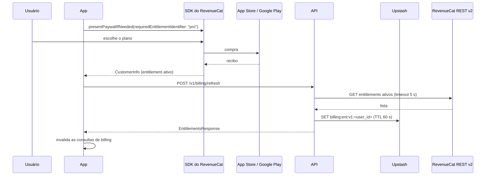
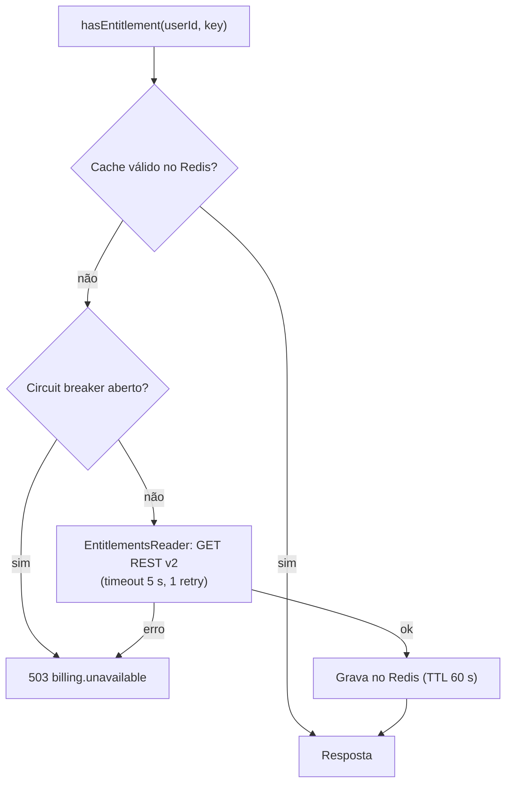

# Spec — Assinatura e paywall (modo simples)

> **Status:** proposed · **Contexto:** `billing` (e a fatia `examples/premium-action`) ·
> **Spec principal:** [base-app.md](base-app.md)
> **ADRs:** [0006](../adr/0006-revenuecat-simple-entitlement-check.md),
> [0013](../adr/0013-extensible-core.md)

## 1. Visão geral

O RevenueCat cuida da compra nas lojas, dos recibos, dos paywalls e do estado das
assinaturas. O servidor **não guarda cópia**: quando precisa decidir um acesso pago, consulta a
API REST do RevenueCat e guarda a resposta por 60 s no Redis. Não há webhook, fila nem tabela no
banco neste contexto.

Preços, ofertas e textos do paywall ficam no RevenueCat e nas lojas. Nenhum preço, ID de produto
ou texto de oferta aparece no código.

Duas decisões se combinam:

- o **app** decide o que mostrar com o `CustomerInfo` do SDK (funciona offline);
- o **servidor** decide o que executar consultando o RevenueCat. Toda ação com custo do nosso
  lado passa por `hasEntitlement`.

O contexto traz também a fatia de exemplo `examples/premium-action`, que mostra como proteger
uma ação por assinatura, com idempotência e cota diária. Existe para ser copiada e depois
apagada.

## 2. Requisitos

### 2.1 Funcionais

| ID | Requisito |
|----|-----------|
| BI-01 | O app configura `react-native-purchases` com a chave pública da plataforma e chama `Purchases.logIn(user_id)` assim que há sessão. Ao sair, chama `Purchases.logOut()`; se o usuário do RevenueCat já for anônimo, o SDK devolve erro, que o app trata (ignora) |
| BI-02 | O paywall é o remoto do RevenueCat (`react-native-purchases-ui`), da oferta atual, com links de termos (EULA) e privacidade |
| BI-03 | Restaurar compras: no paywall e em Configurações |
| BI-04 | Gerenciar assinatura: abre `customerInfo.managementURL` (com o link público da loja como alternativa) |
| BI-05 | Depois de comprar ou restaurar, o app chama `POST /v1/billing/refresh` |
| BI-06 | A porta `EntitlementsReader` devolve os entitlements ativos de um usuário. O adaptador padrão consulta a API REST v2 do RevenueCat; extensões podem substituí-la (base-app.md §3.4.1) |
| BI-07 | Consulta pública do contexto: `hasEntitlement(userId, key)` e `listActiveEntitlements(userId)` |
| BI-08 | `GET /v1/billing/entitlements` devolve os entitlements ativos, usando o cache |
| BI-09 | `POST /v1/billing/refresh` ignora o cache, consulta o RevenueCat, regrava o cache e devolve os entitlements |
| BI-10 | Sem resposta válida do RevenueCat e sem cache válido, as ações pagas **falham fechadas** com 503 `billing.unavailable` |
| BI-11 | Compra de sandbox é aceita em todos os ambientes, porque a revisão da Apple compra em sandbox contra o backend de produção. O RevenueCat Test Store é recusado em produção. Cada ambiente usa um projeto RevenueCat próprio |
| BI-12 | O SDK roda com verificação de entitlements ligada (Trusted Entitlements). Funcionalidade premium que roda só no cliente é considerada desprotegida; o template documenta isso |
| BI-13 | O handler de `AccountPurgeRequested` exclui o cliente no RevenueCat (idempotente; 404 conta como sucesso) |
| BI-14 | Fatia `examples/premium-action`: ação protegida por entitlement `pro`, com `Idempotency-Key` obrigatório e cota diária por entitlement (§3.7) |

### 2.2 Não funcionais

| ID | Requisito |
|----|-----------|
| BI-N1 | Chamadas ao RevenueCat com timeout de 5 s; retry só em GET (no máximo 2 tentativas, backoff exponencial com jitter, prazo total de 8 s) |
| BI-N2 | A chave secreta do RevenueCat (`REVENUECAT_SECRET_KEY`) fica só na API, com a permissão mínima: ler clientes e excluir cliente. Nunca vai ao app |
| BI-N3 | O `appUserID` do RevenueCat é igual ao `user_id`; por isso o `user_id` **nunca** aparece em superfície pública (URL, link compartilhável, QR code, tela de suporte, log público) |
| BI-N4 | Cache no Upstash com chave `billing:ent:v1:<user_id>` e TTL de `billing.cacheTtlSec` (60 s). O valor guardado é `{ v, sig }`, com `sig` = HMAC-SHA256 (`REDIS_VALUE_SIGNING_KEY`, Sensitive, ≥ 32 bytes) sobre `user_id` e o JSON. Na leitura: assinatura inválida, schema inválido, `fetchedAt` mais velho que `cacheTtlSec` + 5 s ou mais de 5 s no futuro contam como cache vazio. Um banco e um token do Upstash por ambiente (token Sensitive só em Production) |
| BI-N5 | `POST /v1/billing/refresh`: rate limit apertado (6/min por usuário e teto de 120/min por IP) |
| BI-N8 | **Orçamento global de chamadas ao RevenueCat** (§3.2): 240/min no projeto; leituras por cache miss usam no máximo 180/min e 60/min ficam reservadas a `refresh` e à exclusão do cliente |
| BI-N6 | Métricas: consultas ao RevenueCat (latência, erro, timeout), acerto e erro de cache, circuit breaker aberto, 402 e 503 por rota |
| BI-N7 | Nenhum dado do RevenueCat além do necessário (chave do entitlement, validade, loja, renovação) é guardado ou logado |

## 3. Design técnico

### 3.1 Compra no app



- Se o SDK diz que o entitlement está ativo mas o `refresh` ainda não o mostra (atraso entre
  o recibo e a API REST), o app repete o `refresh` até 3 vezes, com 1,5 s entre as tentativas.
  Depois disso mostra "processando a compra" e tenta de novo no próximo foco. Isso sustenta
  o requisito RF-07 de base-app.md (acesso valendo no servidor em até 5 s).
- Se o `refresh` falhar (503, rede), o app segue com o `CustomerInfo` para a interface e o
  servidor passa a ver a compra quando o cache vencer (≤ 60 s) ou no próximo `refresh`.
- Uma ação protegida que receba 402 `billing.entitlement_required` faz o app chamar o
  `refresh` uma vez e repetir a ação com a mesma `Idempotency-Key`; persistindo o 402, abre o
  paywall.

### 3.2 Leitura de entitlements na API



- **Falha fechada:** sem cache válido e com o RevenueCat fora, a ação paga responde 503 com
  `Retry-After`. Nunca se libera acesso por falta de resposta, e cache vencido não é servido.
- **Redis fora:** a leitura vai direto ao RevenueCat, sem cache (mais lenta, mas correta).
  As rotas com cota ou custo seguem a regra de base-app.md §6 (503 se o Redis for necessário
  para a cota).
- **Coalescência:** chamadas simultâneas ao mesmo `user_id` dentro da mesma instância
  compartilham uma única consulta.
- **Circuit breaker por instância:** 5 falhas seguidas abrem o circuito por 30 s; nesse
  tempo as leituras sem cache respondem 503 direto, para não amplificar uma queda do
  RevenueCat.
- **Orçamento global e disjuntor compartilhado (Redis).** Token bucket `rc:budget:v1`:
  capacidade e reposição de 240 chamadas por minuto (60% do limite da API v2 medido em S-BI-1;
  se o spike achar outro limite, o orçamento é 60% dele). Cache miss de leitura só passa se o
  balde tiver mais de 60 fichas (a reserva é de `refresh` e `deleteCustomer`). Orçamento
  esgotado, ou resposta 429 do RevenueCat, abre o disjuntor `rc:breaker:v1` para todas as
  instâncias por `min(Retry-After, 60)` s (30 s sem o header): leituras sem cache respondem 503
  `billing.unavailable` com `Retry-After`; quem tem cache válido continua servido. Como o
  orçamento é consumido por usuário novo, contas descartáveis ficam atrás do teto por IP (120/min,
  `defineRoute`), do limite de contas novas (identity-and-auth.md §3.7) e do cache de resultado
  **vazio** (usuário sem assinatura também é guardado por 60 s).
- **Entitlement fora do `product.config.ts`** (`billing.entitlements`) é ignorado com aviso no
  log.
- **Sem reavaliar a validade no servidor:** o RevenueCat já devolve só os entitlements ativos
  (inclusive em período de carência de cobrança). O servidor confia nessa lista por até 60 s e
  nunca usa o relógio do aparelho.

### 3.3 Domínio e portas

```ts
// modules/billing/domain
export type EntitlementKey = string;                    // de product.config billing.entitlements

export type Entitlement = {
  key: EntitlementKey;
  expiresAt: Date | null;                               // null = vitalício
  willRenew: boolean | null;                            // null = a API não informou
  store: 'app_store' | 'play_store' | 'stripe' | 'promotional' | 'test_store' | 'unknown';
  isSandbox: boolean | null;                            // null = a API não informou
};

export type EntitlementsSnapshot = { entitlements: readonly Entitlement[]; fetchedAt: Date };

export interface EntitlementsReader {                   // porta substituível por extensão
  read(userId: UserId, opts: { fresh: boolean }): Promise<EntitlementsSnapshot>;
}

export interface CustomerDeleter {
  deleteCustomer(userId: UserId): Promise<void>;        // 404 = sucesso
}
```

| Porta | Adaptador padrão (`infrastructure/`) |
|-------|--------------------------------------|
| `EntitlementsReader` | `CachedEntitlementsReader` (Upstash) envolvendo `RevenueCatEntitlementsReader` (REST v2, validação Zod da resposta) |
| `CustomerDeleter` | `RevenueCatCustomerDeleter` (REST v2) |

Consultas públicas (`modules/billing/index.ts`):

```ts
export function hasEntitlement(userId: UserId, key: EntitlementKey): Promise<boolean>;
export function listActiveEntitlements(userId: UserId, opts?: { fresh?: boolean }): Promise<readonly Entitlement[]>;
```

Cotas diárias (usadas pela fatia de exemplo e por extensões; `defineRoute` não tem campo `quota`):

```ts
export type QuotaInput = {
  userId: UserId;
  name: string;                                         // chave de `quotas` em product.config (ex.: 'examples.premium_action')
  entitlements: readonly Entitlement[];                 // já lidos pelo chamador; o limite é o maior perDay entre eles
};
export type QuotaUsage = { used: number; limit: number; resetsAt: Date; receiptId: string };
export function consumeDailyQuota(input: QuotaInput): Promise<Result<QuotaUsage, QuotaExceededError | QuotaUnavailableError>>;
// Idempotente por recibo (script Lua com SET NX no recibo). Só deve ser chamada se nenhum custo
// externo já ocorreu; depois de cobrança externa a unidade fica consumida.
export function refundDailyQuota(input: Pick<QuotaInput, 'userId' | 'name'> & { receiptId: string }): Promise<void>;   // melhor esforço
```

Os dois usam o `QuotaCounter` (Redis, script Lua atômico, dia UTC, TTL de 48 h). Além do
contador por usuário, `consumeDailyQuota` consome um **contador global da feature**
(`quota:v1:<name>:global:<AAAAMMDD>`) limitado por `quotas.<name>.globalPerDay`; estouro →
429 `quota.global_exceeded` (a feature para para todos, limitando o custo total que contas
descartáveis ou assinaturas movidas por "restaurar compras" podem gerar). O mapeamento dos
erros é o do pipeline: `QuotaExceededError` → 429 `quota.exceeded` com `Retry-After` até a
meia-noite UTC; `QuotaUnavailableError` → 503 `quota.unavailable` (falha fechada). `name` fora
de `quotas` é erro de programação (lança no boot do teste de composição).

Ambas lançam `BillingUnavailableError` (mapeado para 503 `billing.unavailable`) quando não há
resposta válida. `opts.fresh` = `true` ignora o cache (usado por `refresh` e pela exportação de
dados).

Quando uma extensão substitui `EntitlementsReader`, o cache do base-app deixa de valer (a porta
inteira é trocada); a extensão decide o próprio cache.

`EntitlementsReader.read(userId, { fresh })` é **a** interface que uma extensão implementa, e
não muda: a porta não tem `has`, `list` nem `refresh`. Quem precisa de um booleano usa
`hasEntitlement` ou um helper no próprio módulo; `refresh` é o caso de uso `refreshEntitlements`
chamando `read(..., { fresh: true })`.

### 3.4 Adaptador do RevenueCat (REST v2)

- Base: `https://api.revenuecat.com/v2/projects/{REVENUECAT_PROJECT_ID}`, com
  `Authorization: Bearer <REVENUECAT_SECRET_KEY>`. Uma chave secreta de **v2** por projeto
  RevenueCat, com permissão só de leitura de informações de cliente e exclusão de cliente.
- Leitura: `GET /customers/{user_id}/active_entitlements`, com paginação (no máximo 3
  páginas). A resposta traz o ID do entitlement; a tradução para a chave configurada
  (`lookup_key`, ex. `pro`) usa `GET /entitlements`, em cache de 1 h no Redis
  (`billing:entmap:v1`).
- Exclusão: `DELETE /customers/{user_id}`; 200, 204 e 404 são sucesso.
- Toda resposta é validada com Zod antes do uso (a API de terceiros é fronteira não confiável).
- `Retry-After` do RevenueCat é respeitado só se ≤ 2 s; acima disso a tentativa falha.
- O spike **S-BI-1** (onda 7) confirma endpoints, permissões mínimas, paginação, limites de
  taxa e de onde sai `store` e `isSandbox`. Se a v2 não bastar, o plano B é a API v1
  (`GET /v1/subscribers/{id}`), com o cuidado de que **a v1 cria o cliente se ele não existir**;
  nesse caso a leitura nunca pode acontecer depois da purga (o marcador de conta excluída barra
  o token antes).

### 3.5 Sandbox e Test Store

| Caso | Comportamento |
|------|---------------|
| Compra de sandbox, ambiente de produção | **aceita**: a revisão da Apple compra em sandbox contra o backend de produção e precisa receber o que comprou. Risco registrado (R-BI-1) |
| `store = test_store`, ambiente de produção | o entitlement é **ignorado** e conta na métrica `billing.test_store_rejected`. Defesa em profundidade: o projeto RevenueCat de produção não deve ter Test Store |
| Sandbox em produção depois da aprovação das lojas | `billing.sandboxInProduction: 'accept' \| 'reject'` em `product.config.ts` (padrão `accept`); com `reject`, entitlement com `isSandbox = true` é ignorado em produção e conta na métrica `billing.sandbox_rejected`. O how-to de publicação manda virar para `reject` depois da aprovação (mudança de config, com deploy) |
| Chave pública `test_...` num build de produção | a validação do config do app falha o build |
| Projeto RevenueCat | um por app e por ambiente; nunca compartilhado (base-app.md §3.10) |

### 3.6 App

- `features/billing/adapters/revenuecat.ts`:
  - `Purchases.configure({ apiKey, appUserID: userId, entitlementVerificationMode: INFORMATIONAL })`
    na primeira vez que existe sessão, com a chave pública da plataforma
    (`EXPO_PUBLIC_REVENUECAT_IOS_KEY`, `EXPO_PUBLIC_REVENUECAT_ANDROID_KEY`);
  - `Purchases.logIn(userId)` quando o usuário muda; `Purchases.logOut()` ao sair. O app só
    abre o paywall com sessão, então uma compra nunca é feita com ID anônimo.
- Hooks: `useCustomerInfo()` (ouve `addCustomerInfoUpdateListener`), `useEntitlement(key)`,
  `usePaywall(key)`, `useServerEntitlements()` (`GET /v1/billing/entitlements`).
- Paywall: `presentPaywallIfNeeded` do `react-native-purchases-ui`, aberto por gesto do usuário.
  Se as ofertas não carregam (sem rede, oferta vazia), o app mostra uma tela própria
  `paywall-unavailable` com "tentar de novo", "restaurar compras" e os links legais. O app
  **não** monta uma tela de compra própria.
- Erros de compra: cancelada pelo usuário → nada; pagamento pendente → "pagamento pendente,
  avisaremos quando confirmar"; erro da loja → mensagem genérica com tentar de novo; produto já
  comprado → sugere restaurar.
- Configurações → Assinatura: plano ativo (do `CustomerInfo`), "Restaurar compras",
  "Gerenciar assinatura".
- Gerenciar: `Linking.openURL(customerInfo.managementURL)`; se vier nulo, abre
  `https://apps.apple.com/account/subscriptions` (iOS) ou
  `https://play.google.com/store/account/subscriptions` (Android).

### 3.7 Fatia de exemplo `examples/premium-action`

```
modules/examples/
├── domain/daily-quota.ts                         política pura: limite do dia por entitlement
├── features/premium-action/
│   ├── application/premium-action.handler.ts     caso de uso
│   ├── presentation/route.ts                     defineRoute
│   └── premium-action.test.ts
├── infrastructure/redis-quota-counter.ts         contador no Upstash (script Lua)
└── index.ts
```

```ts
export const POST = defineRoute({
  auth: { kind: 'user', requireRecentAuth: false },
  rateLimit: { key: 'user', limit: 10, windowSec: 60 },
  authorize: [],
  idempotency: 'required',
  input: { body: PremiumActionBody },
  output: PremiumActionResponse,
  handler: ({ auth, input, ctx }) => premiumAction(ctx, auth.userId, input.body),
});
```

Caso de uso, nesta ordem (depois do pipeline: autenticação → rate limit → validação →
idempotência):

1. `listActiveEntitlements(userId)`; sem `pro` (ou outro entitlement com cota configurada) →
   402 `billing.entitlement_required`. Billing fora → 503 `billing.unavailable`.
2. Limite do dia = o maior `quotas['examples.premium_action'].perDay[<entitlement>]` entre os
   entitlements ativos (base-app.md §3.9).
3. `consumeDailyQuota({ userId, name: 'examples.premium_action', entitlements })` (o
   `QuotaCounter` por baixo): incrementa atomicamente e recusa ao passar do limite → 429 `quota.exceeded` com `Retry-After` até a
   meia-noite UTC. Redis fora → 503 `quota.unavailable` (falha fechada).
4. `doTheWork(input)`: **placeholder** que o aluno substitui (devolve um eco do input).
5. Se `doTheWork` falhar **antes de qualquer custo externo**, `refundDailyQuota({ userId, name,
   receiptId })` devolve a unidade (idempotente por recibo) e o erro sobe. Falha depois de custo
   externo não devolve nada.

Contador: chave `quota:v1:examples.premium_action:<user_id>:<AAAAMMDD>`, TTL de 48 h, operação
atômica em script Lua (`if used >= limit then return -1 else return incr`).

Idempotência (base-app.md §3.7): só respostas 2xx ficam guardadas para replay; erros liberam a
chave, então o retry depois de um 402 ou 503 executa de novo. Mesma chave concluída devolve a
resposta guardada **sem** rodar o caso de uso nem consumir cota.

Handler de purga: o contexto `examples` assina `AccountPurgeRequested` e apaga os contadores
(melhor esforço; o TTL cobre a falha).

## 4. Modelo de dados

O contexto `billing` **não tem tabelas** no base-app: sem migration, sem RLS, sem papel
`billing_system`. Os dados vivem no RevenueCat (fonte da verdade) e, de forma efêmera, no Redis.

| Chave no Redis | Conteúdo | TTL |
|----------------|----------|-----|
| `billing:ent:v1:<user_id>` | JSON `EntitlementsSnapshot` (validado por Zod na leitura) | `billing.cacheTtlSec` (60 s) |
| `billing:entmap:v1` | mapa `entitlement_id → lookup_key` | 1 h |
| `quota:v1:examples.premium_action:<user_id>:<AAAAMMDD>` | contador inteiro | 48 h |

Versões derivadas que precisem guardar dado de assinatura criam o próprio schema e a própria
porta `EntitlementsReader` (base-app.md §3.4).

## 5. Contratos de API

| Método | Path | Auth | Rate limit | Request | Response |
|--------|------|------|------------|---------|----------|
| GET | `/v1/billing/entitlements` | usuário | 60/min por usuário | — | `EntitlementsResponse` |
| POST | `/v1/billing/refresh` | usuário | 6/min por usuário | — | `EntitlementsResponse` |
| POST | `/v1/examples/premium-action` | usuário + entitlement + `Idempotency-Key` | 10/min por usuário | `PremiumActionBody` | `PremiumActionResponse` |

```ts
// packages/contracts/src/billing.ts
export const EntitlementItem = z.object({
  key: z.string().min(1).max(64),
  expiresAt: z.string().datetime().nullable(),          // null = vitalício
  willRenew: z.boolean().nullable(),
  store: z.enum(['app_store', 'play_store', 'stripe', 'promotional', 'test_store', 'unknown']),
  isSandbox: z.boolean().nullable(),
}).strict();

export const EntitlementsResponse = z.object({
  entitlements: z.array(EntitlementItem),               // só os ativos
  fetchedAt: z.string().datetime(),                     // quando o RevenueCat foi consultado
}).strict();

// packages/contracts/src/examples.ts
export const PremiumActionBody = z.object({ input: z.string().min(1).max(2000) }).strict();
export const PremiumActionResponse = z.object({
  result: z.string(),
  quota: z.object({ limit: z.number().int(), remaining: z.number().int(), resetsAt: z.string().datetime() }),
}).strict();
```

```json
// 200 — GET /v1/billing/entitlements
{
  "entitlements": [
    { "key": "pro", "expiresAt": "2027-01-01T00:00:00Z", "willRenew": true, "store": "app_store", "isSandbox": false }
  ],
  "fetchedAt": "2026-11-24T12:00:00Z"
}
```

```json
// 402 — application/problem+json
{
  "type": "https://example.com/problems/billing.entitlement_required",
  "title": "Entitlement required",
  "status": 402,
  "code": "billing.entitlement_required",
  "requestId": "0192f8a0-6b1c-7e5d-9a30-2b4c6d8e0f11",
  "entitlement": "pro"
}
```

`Idempotency-Key` (UUID) é obrigatório em `premium-action`; sem ele, 400
`idempotency.key_required`. O contrato marca as três rotas como autenticadas (nenhuma tem
`security: []`).

Erros (`code`):

| `code` | Status | Quando |
|--------|--------|--------|
| `billing.entitlement_required` | 402 | usuário sem o entitlement exigido; o app tenta o `refresh` e abre o paywall |
| `billing.unavailable` | 503 + `Retry-After` | RevenueCat sem resposta e sem cache válido, ou circuit breaker aberto |
| `quota.exceeded` | 429 + `Retry-After` | cota diária esgotada |
| `quota.unavailable` | 503 | Redis fora e a cota não pode ser conferida |
| `idempotency.key_required` | 400 | falta `Idempotency-Key` |
| `idempotency.in_progress` | 409 | mesma chave em andamento |
| `idempotency.key_reused` | 409 | mesma chave com corpo diferente |
| `validation.failed` | 400 | corpo inválido |
| `rate_limited` | 429 | limite da rota |

## 6. Edge cases

| Situação | Comportamento |
|----------|---------------|
| Assinatura expira dentro dos 60 s de cache | o servidor ainda vê o entitlement por até 60 s; aceito. Ações de alto custo podem usar `fresh` (a regra é de cada feature) |
| Compra acabou de acontecer e o `refresh` não vê | o app repete o `refresh` até 3 vezes e depois mostra "processando" |
| RevenueCat fora e sem cache | 503 `billing.unavailable`; o app segue com o `CustomerInfo` na interface, mas ações do servidor falham |
| RevenueCat fora e com cache válido | o cache responde até vencer; depois, 503 |
| Redis fora | leitura direto no RevenueCat; ação com cota → 503 `quota.unavailable` |
| Entitlement promocional dado no painel do RevenueCat | aparece no próximo `refresh` ou quando o cache vencer |
| Compra de sandbox em produção | aceita (BI-11, R-BI-1) |
| Test Store em produção | entitlement ignorado e métrica |
| Mesma assinatura da loja usada em duas contas no mesmo aparelho | "Restaurar compras" move a assinatura para a conta que restaurou (comportamento padrão do RevenueCat); documentado no how-to. A cota diária é por conta, então o custo total é limitado pela cota global da feature (`globalPerDay`) |
| Entitlement desconhecido para o `product.config.ts` | ignorado com aviso |
| Usuário sem rede abre o app | o SDK usa o `CustomerInfo` em cache; chamadas à API falham com erro de rede tratado |
| `Purchases.logOut()` cria um ID anônimo no SDK | o paywall só abre com sessão, então não há compra anônima; o `logIn` seguinte troca o usuário |
| Mesma `Idempotency-Key` repetida depois de sucesso | devolve a resposta guardada, sem nova cota |
| `doTheWork` falha depois de consumir a cota | a unidade é devolvida |
| Dois cliques simultâneos no botão da ação | a segunda chamada recebe 409 `idempotency.in_progress` (mesma chave) ou consome outra unidade (chave diferente) |
| Exclusão de conta | handler apaga o cliente no RevenueCat; falha do RevenueCat desfaz a exclusão inteira (account-lifecycle-and-privacy.md). Outro aparelho do mesmo usuário ainda aberto pode recriar um cliente vazio com o mesmo UUID (R22); o app o limpa ao receber `auth.account_deleted` |
| Chave secreta do RevenueCat vazada | rotacionar no RevenueCat e na Vercel; o app não é afetado (só tem a chave pública) |

### Riscos residuais

| # | Risco | Por que é aceito |
|---|-------|------------------|
| R-BI-1 | Compra de sandbox em produção concede acesso pago de verdade, o que permite a um usuário com conta de teste da loja obter acesso sem pagar | a revisão da Apple exige; o entitlement de sandbox só abre funcionalidades e a cota diária limita o custo. Se uma funcionalidade tiver custo alto, ela pode exigir `isSandbox = false` |
| R-BI-2 | `appUserID` = `user_id`: quem souber o UUID de alguém lê o `CustomerInfo` dele com a chave pública do SDK | UUID v4 não é adivinhável; regra BI-N3 impede que apareça em superfície pública |
| R-BI-3 | `CustomerInfo` adulterado num aparelho com root libera a interface premium | só o que roda no servidor é protegido (BI-12) |

## 7. Plano de testes

**Unit**

- `CachedEntitlementsReader`: acerto, falha de cache, valor inválido no Redis vira miss, `fresh`
  ignora o cache, Redis fora vai ao leitor, coalescência de chamadas simultâneas.
- Circuit breaker: abre após 5 falhas, fecha após 30 s.
- Adaptador REST: timeout de 5 s, retry só em GET, `Retry-After` maior que 2 s não é
  respeitado, resposta fora do schema vira erro, mapeamento `entitlement_id` → `lookup_key`,
  paginação.
- Test Store em produção é ignorado; sandbox em produção é aceito.
- `consumeDailyQuota` e `refundDailyQuota` (exportados no `index.ts`): limite = maior `perDay`
  entre os entitlements informados; recusa ao passar do limite; Redis fora → erro de
  indisponibilidade; devolução não passa de zero e é idempotente por `receiptId` (devolver duas
  vezes devolve uma); cota global esgotada → `quota.global_exceeded`; `name` desconhecido lança.
- Cache assinado: assinatura trocada, `fetchedAt` antigo ou futuro e valor de outro `user_id`
  contam como miss. Orçamento: o balde de 240/min nega leitura de cache miss abaixo de 60 fichas
  e ainda deixa `refresh` passar; 429 do RevenueCat abre o disjuntor global; resultado vazio
  fica em cache por 60 s.
- `billing.sandboxInProduction: 'reject'` ignora `isSandbox = true` em produção.
- `hasEntitlement`: ativo, ausente, chave desconhecida, RevenueCat fora → `BillingUnavailableError`.
- `CustomerDeleter`: 404 = sucesso; 5xx e timeout lançam.
- `premium-action` com fakes: sem entitlement → 402; cota esgotada → 429; Redis fora → 503; falha do
  trabalho devolve a cota; mesma `Idempotency-Key` não consome de novo; limite = maior entre os
  entitlements.
- App: máquina de estados da compra (repetição do `refresh`), tradução dos erros de compra,
  `logIn`/`logOut` ligados à sessão, link de gerenciamento com e sem `managementURL`.

**Integração (Vitest, fake HTTP do RevenueCat e Upstash local)**

- `GET /v1/billing/entitlements` e `POST /v1/billing/refresh` com JWT real do Auth local.
- Usuário A não vê entitlements de B (o `user_id` vem só do JWT).
- `refresh` ignora o cache e o regrava; o 7º `refresh` no minuto recebe 429.
- RevenueCat fora → 503 com `Retry-After`; nunca 200 liberando acesso.
- Purga de conta chama `DELETE /customers/{id}` uma vez; 404 é aceito; 503 desfaz a exclusão.
- Rotas do contexto são todas autenticadas (teste estático do `defineRoute`).
- Nenhuma resposta nem log contém a chave secreta; o `user_id` não aparece em URL pública.

**E2E (Maestro)**

- Compra no RevenueCat Test Store (dev client) → acesso valendo no servidor em ≤ 5 s → executar a
  ação de exemplo.
- Restaurar compras; gerenciar assinatura abre a URL certa.

### Critérios de aceite

- [ ] Compra em sandbox no iOS e no Android ativa o acesso no servidor em ≤ 5 s pelo `refresh`.
- [ ] A ação de exemplo recusa usuário sem `pro` (402), respeita a cota (429) e não executa duas
      vezes com a mesma `Idempotency-Key`.
- [ ] RevenueCat indisponível nunca libera acesso (503).
- [ ] Uma extensão fake substitui `EntitlementsReader` implementando só `read`, e outra rota de
      extensão usa `consumeDailyQuota` e `refundDailyQuota` do `index.ts`, sem editar o núcleo.
- [ ] Restaurar compras num aparelho novo recupera o acesso.
- [ ] Test Store é recusado em produção; sandbox é aceito e o risco está documentado.
- [ ] Nenhuma superfície pública expõe o `user_id`.
- [ ] A exclusão de conta remove o cliente no RevenueCat.
- [ ] Paywall, restaurar e gerenciar assinatura passam no checklist da Apple e do Google
      (tabela abaixo).

### Requisitos das lojas

| Exigência | Onde é atendida |
|-----------|-----------------|
| Preço, período, renovação automática e como cancelar visíveis antes da compra | template do paywall remoto (configurado no painel do RevenueCat) |
| Links para os termos (EULA) e para a política de privacidade no paywall | configurados no paywall remoto com as URLs de `product.config.ts` (`legal`); a tela `paywall-unavailable` também os mostra |
| Botão "Restaurar compras" | no paywall e em Configurações → Assinatura |
| Link para gerenciar a assinatura | Configurações → Assinatura |
| Aviso de que excluir a conta não cancela a assinatura | tela Excluir conta (account-lifecycle-and-privacy.md) |
| Nenhum preço fixo no app | preços vêm sempre das ofertas do RevenueCat |
| Conta de teste para o revisor | how-to de publicação |

## 8. Questões em aberto e spikes

| # | Item | Padrão adotado |
|---|------|----------------|
| S-BI-1 | Endpoints, permissões mínimas e limites da API REST v2 do RevenueCat para ler entitlements ativos e excluir cliente; origem de `store` e `isSandbox`; tradução `entitlement_id` → `lookup_key`; limite de taxa por projeto, que dimensiona o orçamento global (onda 7) | adaptador v2 como descrito em §3.4; plano B na v1; orçamento de 240/min até medir |
| Q-BI-1 | `Purchases.logOut()` cria um ID anônimo no SDK, e o app não usa ID anônimo em compras | decidido (vale esta spec, não o ADR 0006 antigo): o app chama `logOut()` ao sair e trata o erro se o usuário já for anônimo; `configure` só quando existe sessão; paywall só com sessão |
| Q-BI-2 | Erros 4xx do RevenueCat diferentes de 404 na exclusão | tratados como falha (503 e rollback) |
| Q-BI-3 | Paywall web (Stripe via RevenueCat) | fora do base-app |
