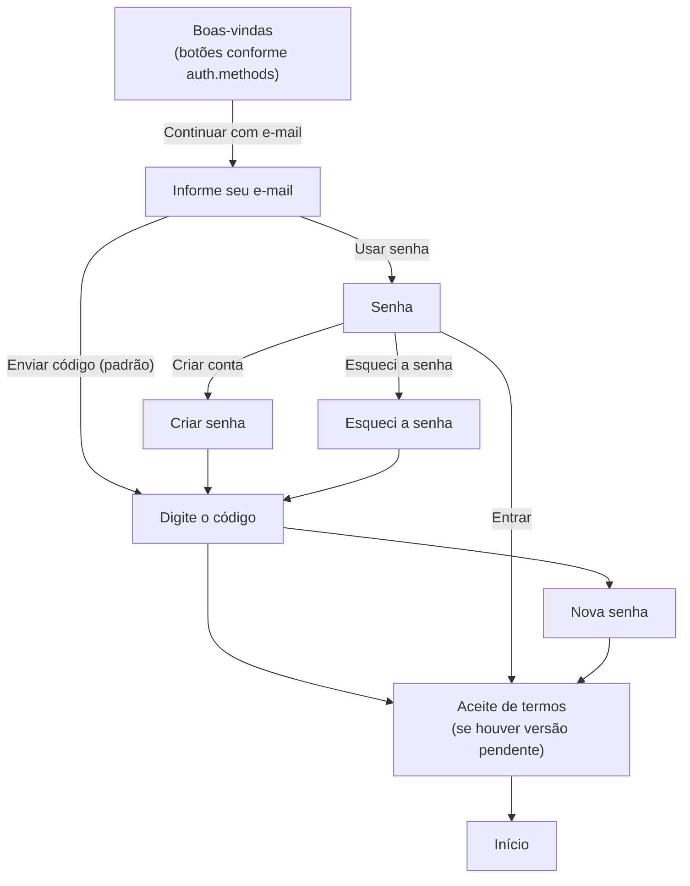
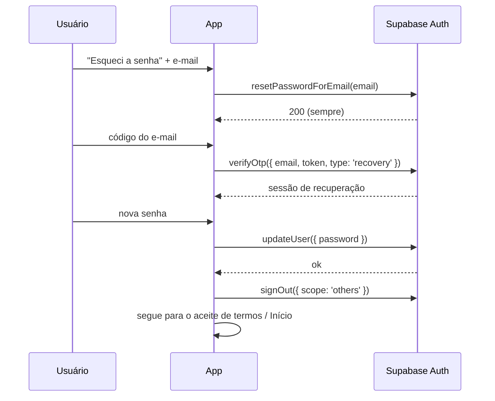

# Spec — Identidade e login

> **Status:** proposed · **Contexto:** `identity` · **Spec principal:** [base-app.md](base-app.md)
> **ADRs:** [0004](../adr/0004-supabase-auth-and-jwt-verification.md),
> [0005](../adr/0005-data-access-sql-migrations-kysely-rls.md),
> [0011](../adr/0011-b2c-user-as-tenant.md), [0013](../adr/0013-extensible-core.md)

## 1. Visão geral

O Supabase Auth cuida de credenciais, sessões e do envio dos e-mails de login. O template
cuida de:

- configurar o Auth como código (`supabase/config.base.toml`, que gera o `config.toml`, e `supabase/templates/`);
- integrar o SDK no app, com sessão cifrada no aparelho;
- verificar o JWT na API, sem chamar o Supabase a cada requisição;
- manter o perfil mínimo do usuário (`identity.profiles`);
- exigir login recente nas ações sensíveis.

Dois métodos de login no base-app: **código por e-mail** (`email_otp`) e **e-mail + senha**
(`email_password`). Não existe tabela de senha, código de redefinição nem JWT emitido pela
nossa API. Métodos adicionais entram só por extensão (`extensionAuthMethods`, base-app.md
§3.4).

Fora do escopo: login social, modo visitante, MFA para o usuário final (Q-AU-2).

## 2. Requisitos

### 2.1 Funcionais

| ID | Requisito |
|----|-----------|
| ID-01 | Os métodos ativos vêm de `product.config.ts` (`auth.methods`, subconjunto de `email_otp` e `email_password`). Método desligado não aparece no app (ver Q-AU-1 sobre o `config.toml`) |
| ID-02 | **Código por e-mail:** o usuário informa o e-mail, recebe um código de 8 dígitos válido por 600 s e entra. Fluxo único para cadastro e login (`shouldCreateUser: true`) |
| ID-03 | **E-mail + senha:** cadastro com confirmação do e-mail por código; o primeiro login com senha só é possível depois da confirmação. A senha **nunca** vale antes de o dono do e-mail provar a posse dele (pré-sequestro: plano A ou B de §3.2 e §8) |
| ID-04 | **Política de senha:** mínimo 10 caracteres, máximo 72 bytes (limite do bcrypt), com letras e dígitos. Proteção contra senhas vazadas ligada quando o plano do Supabase permitir. O app valida antes de enviar; o Auth é a barreira real |
| ID-05 | **Redefinição de senha por código:** `resetPasswordForEmail` → código no e-mail → `verifyOtp({ type: 'recovery' })` → `updateUser({ password })`. Sem link e sem deep link: o template usa `{{ .Token }}` |
| ID-06 | **Troca de senha:** o usuário já logado chama `reauthenticate()`, recebe um código por e-mail e envia `updateUser({ password, nonce })`. `secure_password_change = true` impede troca sem o código |
| ID-07 | **Troca de e-mail:** exige login recente (ID-09) e confirmação nos dois endereços (`double_confirm_changes = true`) |
| ID-08 | A sessão persiste entre aberturas do app, cifrada no aparelho (ID-N1), e é renovada enquanto o app está em primeiro plano |
| ID-09 | **Login recente:** ações sensíveis da nossa API (`requireRecentAuth`) exigem que o maior `timestamp` de `amr` no JWT seja de até `recentAuthMaxAgeSec` (padrão 300 s). Para provar, o app refaz o login no mesmo método num cliente separado (§3.4) |
| ID-10 | **Sair deste aparelho** (`signOut({ scope: 'local' })`) e **sair de todos** (`signOut({ scope: 'global' })`, em Configurações) |
| ID-11 | Perfil: nome de exibição (opcional, 1 a 80 caracteres) e idioma (um dos `locales`). Trocar o idioma atualiza também `user_metadata.locale`, que escolhe o idioma dos e-mails |
| ID-12 | E-mails de login em pt-BR, en e es, a partir de `supabase/templates/`, escolhendo o ramo por `{{ .Data.locale }}` (spike S-AU-1) |
| ID-13 | `GET /v1/me` devolve o perfil e o estado dos termos (vindo do contexto `privacy`); cria o perfil na primeira chamada |
| ID-14 | O adaptador do Supabase Auth no app aceita um `captchaToken` opcional, obtido do `CaptchaProvider` registrado por uma extensão. **Toda** chamada que aceita `captchaToken` (cadastro, `signInWithPassword`, `signInWithOtp`, `resetPasswordForEmail`, `resend`, `reauthenticate`, login social e anônimo) passa por `withCaptcha(provider, action, call)`, que é do núcleo (`apps/mobile/src/features/auth/api/with-captcha.ts`; contrato em base-app.md §3.4.2 e mobile-app-shell.md §3.8). No base-app o provedor é nulo, `withCaptcha` chama `call(undefined)` e nenhuma chamada leva o campo |
| ID-15 | O Auth envia os e-mails direto pelo SMTP do Resend, de um **subdomínio de envio dedicado** (ex.: `mail.<domínio>`), com SPF, DKIM e DMARC (§3.8). A API não participa do envio. O texto de todo e-mail com código traz "não compartilhe este código" |
| ID-17 | Contas que nunca confirmaram o e-mail são removidas depois de 3 dias por `ops.purge_unconfirmed_users()` (`pg_cron`, ADR 0008) |
| ID-18 | O projeto aceita no máximo 300 contas novas por hora (hook `before_user_created`, §3.7); acima disso o cadastro responde 429 |
| ID-16 | `AuthContext` expõe `isAnonymous`, `appRoles` e `providers`, lidos do JWT e validados (§3.5). `platform/auth` exporta `verifyAccessToken(token)` para rotas de extensão que recebem um segundo token no corpo. O base-app nunca liga o login anônimo |

### 2.2 Não funcionais

| ID | Requisito |
|----|-----------|
| ID-N1 | Sessão no aparelho cifrada com AES-256-GCM e nonce aleatório a cada gravação; chave no `expo-secure-store`. Dado adulterado ou chave perdida → sign-out limpo |
| ID-N2 | Access token com vida de 15 min (`jwt_expiry = 900`); refresh token com rotação e detecção de reuso |
| ID-N3 | A API aceita só `ES256` e `RS256`, valida `iss` = `<SUPABASE_URL>/auth/v1`, `aud` = `authenticated`, `exp` e `iat` (tolerância 30 s) e `role` = `authenticated`. Nenhum `HS256` (segredo compartilhado) |
| ID-N4 | Nenhuma tela do app nem resposta da nossa API revela se um e-mail está cadastrado (mensagens genéricas, §3.6). Limite do que não controlamos: ver R-ID-2 |
| ID-N5 | Rate limits do Auth no `config.toml` (§3.7) e rate limit por usuário nos endpoints deste contexto |
| ID-N6 | Nenhum e-mail, código, token ou nome em logs, métricas, traces ou Sentry. O usuário aparece só pelo UUID, dado pseudônimo com retenção máxima de 30 dias (logs) e 90 dias (Sentry) |
| ID-N7 | Consulta ao JWKS com timeout de 3 s; chaves em cache por 10 min |

## 3. Design técnico

### 3.1 Telas e navegação (app)



As telas ficam em `apps/mobile/src/features/auth/ui/`. Uma tela por fluxo; diferença entre iOS
e Android se resolve com `Platform.select` ou `*.ios.tsx`, nunca com cópia de arquivo. A
estrutura da feature segue base-app.md §3.3:

| Pasta | Conteúdo |
|-------|----------|
| `model/` | máquina de estados do login, contagem de reenvio, normalização do e-mail (trim + minúsculas), validação de senha |
| `api/` | hooks de `GET/PATCH /v1/me` |
| `adapters/` | `supabase-client.ts` (cliente principal), `encrypted-storage.ts`, `step-up-client.ts`, mapeamento dos erros do SDK para chaves de i18n |
| `ui/` | telas |

### 3.2 Sequências por método

**Código por e-mail**

```mermaid
sequenceDiagram
  participant U as Usuário
  participant App
  participant Auth as Supabase Auth
  participant Mail as Resend (SMTP)
  U->>App: e-mail
  App->>Auth: signInWithOtp({ email, shouldCreateUser: true, data: { locale }, captchaToken? })
  Auth->>Mail: e-mail com {{ .Token }} (8 dígitos, 600 s)
  Auth-->>App: 200 (sempre, exista a conta ou não)
  App-->>U: "Se o e-mail estiver correto, você vai receber um código"
  U->>App: código
  App->>Auth: verifyOtp({ email, token, type: 'email' })
  Auth-->>App: sessão (access 15 min + refresh)
  App->>App: grava sessão cifrada; Purchases.logIn; GET /v1/me
```

**E-mail + senha**

- Cadastro, **plano A** (só se o spike S-AU-2 provar que o Auth invalida a senha de um
  cadastro não confirmado quando o dono do e-mail confirma): `signUp({ email, password,
  options: { data: { locale } } })` → código de confirmação (`verifyOtp({ type: 'signup' })`)
  → sessão. Antes da confirmação, `signInWithPassword` falha com `email_not_confirmed`; o app
  leva à tela do código e oferece reenvio (`resend({ type: 'signup' })`).
- Cadastro, **plano B** (**padrão até o spike S-AU-2 concluir**): o app nunca chama `signUp`
  com senha. "Criar conta com senha" faz `signInWithOtp({ shouldCreateUser: true })` →
  `verifyOtp({ type: 'email' })` → tela "Criar senha" → `updateUser({ password })` (com `nonce`
  de `reauthenticate()` se o spike S-AU-3b mostrar que o Auth o exige). Como a API do Auth é
  pública, um atacante ainda pode chamar `signUp` com senha direto; por isso o plano B inclui
  a migration `identity.clear_unverified_password()`: um trigger em `auth.users`
  (`after update of email_confirmed_at ... when old.email_confirmed_at is null and
  new.email_confirmed_at is not null`) zera `encrypted_password` na primeira confirmação do
  e-mail. A função é `SECURITY DEFINER`, dona de `auth_fn_owner` (`update (banned_until, encrypted_password)`
  em `auth.users`), com `search_path = ''`. Como o app nunca define senha antes da
  confirmação, a regra "nenhuma senha vale antes da primeira confirmação" não atinge usuário
  legítimo. Quem controla o trigger: o spike confirma se o `migrator` pode criá-lo em
  `auth.users`; se não, a migration é aplicada uma vez por quem cria o projeto, e o pgTAP
  confere a existência do trigger.
- Login: `signInWithPassword({ email, password })`.
- Redefinição:



Depois de redefinir a senha, o app encerra as outras sessões (`scope: 'others'`), porque quem
redefine costuma estar recuperando uma conta que pode estar comprometida.

**Trocas dentro da conta**

| Operação | Chamadas | Proteção no servidor |
|----------|----------|----------------------|
| Trocar senha | `reauthenticate()` → código por e-mail → `updateUser({ password, nonce })` | `secure_password_change = true`: sem o `nonce` o Auth recusa |
| Trocar e-mail | login recente (§3.4) → `updateUser({ email })` → um código para cada endereço → `verifyOtp({ type: 'email_change' })` (parâmetros exatos no spike S-AU-3a) → `refreshSession()` | `double_confirm_changes = true`: as duas caixas precisam confirmar |
| Mudar idioma | `PATCH /v1/me` e, se der certo, `updateUser({ data: { locale } })` | — |

A checagem de login recente da troca de e-mail é feita no app, porque a chamada vai direto ao
Auth. A barreira real é a confirmação nos dois endereços.

### 3.3 Sessão no aparelho

- O cliente do Supabase usa um `storage` cifrado (`encrypted-storage.ts`):
  - chave AES-256 aleatória no `expo-secure-store` com
    `keychainAccessible: AFTER_FIRST_UNLOCK_THIS_DEVICE_ONLY`;
  - a sessão vai cifrada para o AsyncStorage, porque o SecureStore pode recusar valores acima
    de 2048 bytes;
  - formato do valor: `base64(version[1] || iv[12] || ciphertext || tag[16])`, com a chave de
    armazenamento como dado associado (AAD), para que um texto cifrado não possa ser trocado
    de lugar;
  - IV aleatório de 12 bytes (`expo-crypto`) a cada gravação, nunca reutilizado;
  - implementação com `@noble/ciphers` (decisão; trocar por módulo nativo se a medição de
    abertura do app exigir).
- Falha de decifragem (versão desconhecida, tag inválida, chave ausente): o adaptador apaga a
  chave e o valor, e o app volta a Boas-vindas com a mensagem "sua sessão expirou". Nunca usa
  o dado adulterado.
- `autoRefreshToken` só em primeiro plano: `startAutoRefresh()` e `stopAutoRefresh()` ligados
  ao `AppState`.
- Android: `allowBackup="false"` e `dataExtractionRules` (requisito SH-N5 de
  mobile-app-shell.md). No iOS a chave é `THIS_DEVICE_ONLY`, então o AsyncStorage restaurado
  em outro aparelho não decifra.
- Sair deste aparelho: `signOut({ scope: 'local' })`. Sair de todos: `scope: 'global'`. O
  access token já emitido continua válido até expirar (≤ 15 min); isso é aceito (R-ID-1).
  Depois de sair, o app também chama `Purchases.logOut()` e limpa o cache do TanStack Query.

### 3.4 Login recente (step-up)

`requireRecentAuth` é a regra do `defineRoute` (base-app.md §3.6): o maior
`amr[].timestamp` do JWT precisa ser ≥ agora − `recentAuthMaxAgeSec`; senão responde 401
`auth.recent_auth_required`.

```mermaid
sequenceDiagram
  participant App
  participant Su as Cliente de step-up (persistSession: false)
  participant Auth as Supabase Auth
  participant API
  App->>API: POST /v1/account/deletion-request
  API-->>App: 401 auth.recent_auth_required
  App->>App: abre o modal reauth
  App->>Su: código por e-mail ou senha (mesmo método)
  Su->>Auth: signInWithOtp / signInWithPassword + verifyOtp
  Auth-->>Su: sessão nova (amr com timestamp atual)
  App->>App: user_id da sessão nova == user_id atual?
  alt mesmo usuário
    App->>App: revoga a sessão antiga (listener de sign-out suspenso) e instala a nova com setSession
    App-->>App: usuário confirma de novo a ação (gesto)
  else usuário diferente
    App->>App: descarta a sessão nova; erro "use a mesma conta"
  end
```

- O cliente de step-up é criado só para essa operação, com `persistSession: false`,
  `autoRefreshToken: false` e `detectSessionInUrl: false`. Reautenticar com outra conta nunca
  troca a sessão ativa.
- O app não repete a ação sozinho: o usuário confirma de novo (SH-N6).
- O step-up de e-mail usa `shouldCreateUser: false`.

### 3.5 Verificação do JWT na API

`apps/web/src/platform/http/auth.ts`:

1. Lê `Authorization: Bearer <token>`; ausente → 401 `auth.missing_token`. Token com mais de
   4096 caracteres → 401 `auth.invalid_token` sem tentar verificar.
2. Verifica com `jose`:

```ts
const jwks = createRemoteJWKSet(new URL(`${env.SUPABASE_URL}/auth/v1/.well-known/jwks.json`), {
  cacheMaxAge: 600_000,      // 10 min
  cooldownDuration: 60_000,  // no máximo uma busca por minuto ao ver kid desconhecido
  timeoutDuration: 3_000,
});

const { payload } = await jwtVerify(token, jwks, {
  algorithms: ['ES256', 'RS256'],
  issuer: `${env.SUPABASE_URL}/auth/v1`,
  audience: 'authenticated',
  clockTolerance: 30,
  requiredClaims: ['sub', 'exp', 'iat', 'session_id'],
});
```

3. Valida o payload com Zod (`sub` e `session_id` UUID, `role === 'authenticated'`, `aal` ∈
   {`aal1`, `aal2`}, `amr` lista de `{ method, timestamp }`, `email` opcional, `is_anonymous`
   booleano opcional, `app_metadata.roles` e `app_metadata.providers`). Qualquer outro campo é
   descartado. `is_anonymous` ausente vale `false`. `roles` e `providers` são listas de no
   máximo 10 itens, cada um `/^[a-z][a-z0-9_]{0,31}$/`; ausente, ou inválido em qualquer item
   (lista inteira descartada), vira `[]` e gera um log de aviso sem o conteúdo. O
   `app_metadata` só é gravável pela chave secreta do Supabase, por isso pode ser lido; ainda
   assim é validado.
4. Confere o marcador de conta excluída (`auth:deleted:v1:<user_id>` no Redis, definido pela
   exclusão de conta). Presente → 401 `auth.account_deleted`.
5. Monta o contexto:

```ts
type AuthContext = {
  userId: string;
  sessionId: string;
  aal: 'aal1' | 'aal2';
  amr: ReadonlyArray<{ method: string; timestamp: number }>;
  email: string | null;               // só para exibição; nunca logado
  isAnonymous: boolean;               // claim `is_anonymous`; ausente = false
  appRoles: readonly string[];        // app_metadata.roles, validado; inválido = []
  providers: readonly string[];       // app_metadata.providers, mesma validação
  dbClaims: { sub: string; role: 'authenticated'; aal: string; session_id: string };
};
```

`dbClaims` é o único objeto que vai para `userScopedDb` (base-app.md §3.8), por bind
parameter. `user_metadata`, `app_metadata`, `appRoles`, `providers` e `isAnonymous` nunca entram
nele; o `user_metadata.locale` só é
lido (como sugestão validada contra a allowlist) para criar o perfil.

**`verifyAccessToken` público.** As etapas 1 a 5 vivem numa função exportada por
`platform/auth`:

```ts
export function verifyAccessToken(token: string): Promise<Result<AuthContext, AuthError>>;
```

Ela faz as mesmas checagens do pipeline (JWKS, allowlist de `alg`, `iss`, `aud`, `exp`, limite
de tamanho e marcador de conta excluída) e o pipeline a usa para o header `Authorization`. Serve
a rotas de extensão que recebem um segundo token no corpo (ex.: fusão de visitante). Regras:
nunca lê token de query string; só pode ser chamada em `app/api/**` e `platform/**`, e a regra
`no-direct-jwt-verify` proíbe `jwtVerify` e afins fora de `platform/auth`; toda rota tem
`rateLimit` obrigatório, então não há oráculo de verificação sem limite; o `AuthError` carrega o mesmo `code` da tabela abaixo; o chamador
é responsável por não logar o token.

Resultados de falha:

| Situação | Resposta |
|----------|----------|
| `alg` fora da allowlist (`none`, `HS256`), assinatura inválida, `iss`/`aud` errados, `role` ≠ `authenticated` | 401 `auth.invalid_token` e log de segurança |
| `exp` vencido | 401 `auth.token_expired` |
| JWKS fora do ar e sem chave em cache | 503 `auth.unavailable` com `Retry-After`; nunca aceita sem verificar |
| `kid` desconhecido | uma nova busca do JWKS (respeitando o intervalo mínimo); se continuar desconhecido, 401 |

A verificação é local: sem chamada ao Supabase por requisição. O custo é que um token de
sessão revogada continua valendo até expirar (R-ID-1).

O projeto Supabase precisa usar chaves de assinatura assimétricas; o segredo legado HS256
fica desativado (how-to de configuração do Supabase).

### 3.6 Anti-enumeração

| Ponto | Comportamento |
|-------|---------------|
| Pedido de código | resposta igual exista a conta ou não; texto "Se o e-mail estiver correto, você vai receber um código" |
| Cadastro com e-mail já confirmado | com confirmação ligada o Auth devolve sucesso sem revelar; o app mostra o mesmo "verifique seu e-mail" |
| Login com senha | erro único `invalid_credentials` para e-mail inexistente e senha errada |
| Redefinição de senha | resposta igual para e-mail com e sem conta |
| Erros da nossa API | nenhum código ou mensagem distingue "e-mail não existe" |

### 3.7 Configuração do Auth (`supabase/config.base.toml`)

As chaves abaixo ficam em `supabase/config.base.toml`. O `supabase/config.toml` é **gerado** por
`pnpm supabase:config` (mescla com os fragmentos de `supabase/config.d/`) e nunca é editado à
mão (ADR 0014).

| Chave | Valor | Motivo |
|-------|-------|--------|
| `auth.site_url` | origem web do produto | base para os templates; não há links nos e-mails de login |
| `auth.additional_redirect_urls` | `[]` | os fluxos são por código; nenhum redirect é necessário |
| `auth.jwt_expiry` | 900 | ID-N2 |
| `auth.enable_refresh_token_rotation` | true | detecção de reuso |
| `auth.refresh_token_reuse_interval` | 10 | tolera corrida de rede |
| `auth.enable_signup` | true | cadastro por código e por senha |
| `auth.enable_anonymous_sign_ins` | false | não há modo visitante |
| `auth.enable_manual_linking` | false | sem vínculo de identidades |
| `auth.minimum_password_length` | 10 | ID-04 |
| `auth.password_requirements` | `letters_digits` | ID-04 |
| `auth.email.enable_confirmations` | true | e-mail verificado antes do primeiro login com senha |
| `auth.email.double_confirm_changes` | true | ID-07 |
| `auth.email.secure_password_change` | true | ID-06 |
| `auth.email.max_frequency` | `60s` | intervalo mínimo entre e-mails para o mesmo endereço (S-AU-4 confirma a chave e o efeito) |
| `auth.email.otp_length` / `otp_expiry` | 8 / 600 | ID-02; com 600 s e 30 verificações por 5 min por IP, 1% de chance de acerto exige cerca de 16 700 IPs por janela (10^8 códigos); plano B de S-AU-4: 10 / 300 |
| `auth.email.smtp` | Resend (`smtp.resend.com`), senha em `env(RESEND_SMTP_PASSWORD)` | ID-15; sem SMTP próprio o limite de e-mails do Supabase é mínimo |
| `auth.email.template.<tipo>` | `content_path` para `supabase/templates/<tipo>.html` | ID-12 |
| `auth.rate_limit.email_sent` | 60 por hora (mínimo 30, máximo 300; = 1,5 × o pico horário esperado) | **teto global do projeto**, não por IP nem por destinatário (R-ID-3). Alerta em 70% (§3.8) |
| `auth.rate_limit.sign_in_sign_ups` | 30 por 5 min por IP | força bruta |
| `auth.rate_limit.token_verifications` | 30 por 5 min por IP (plano B de S-AU-4: 10) | força bruta de OTP; teto também invariante |
| `auth.hook.before_user_created` | `pg-functions://postgres/identity/before_user_created` | teto de 300 contas novas por hora no projeto (ID-18); a função conta `auth.users` da última hora e devolve erro 429; `execute` só para `supabase_auth_admin` |
| `auth.external.<provedor>.enabled` | false, para todos (apple, google, github, ...) | superfície não usada; extensão liga em fragmento |
| `auth.sms` / `auth.mfa.*.enroll_enabled` / `auth.saml.enabled` / `auth.oauth_server.enabled` / `auth.web3.*.enabled` | false | sem telefone, MFA de usuário final, SAML, servidor OAuth nem web3 (Q-AU-2) |
| `auth.sessions.timebox` / `inactivity_timeout` | `720h` / `168h` | teto de vida (30 dias) e de inatividade (7 dias) do refresh token; se o plano não permitir, vale R17 |
| `realtime.enabled` / `storage.enabled` | false | sem Realtime nem Storage; a migration revoga `anon` e `authenticated` em `realtime` e `storage` e o pgTAP confere |
| `db.pooler.default_pool_size` / `max_client_conn` | 15 / 200 | orçamento de conexões (base-app §3.13) |
| `auth.rate_limit.token_refresh` | padrão do Supabase | renovação |
| `api.enabled` | false | Data API (PostgREST) desligada; `pg_graphql` removido por migration (base-app.md §3.8) |
| `auth.captcha` | desligado | CAPTCHA é ponto de extensão (ID-14); uma extensão o liga num fragmento de `supabase/config.d/` (ADR 0014) |

**Invariantes do `config.toml` gerado.** O teste `pnpm supabase:config:check` roda sobre o
arquivo gerado, no CI do núcleo e no de toda versão derivada, e falha se alguma destas regras
for violada (o fragmento só pode endurecer):

O gerador e o check também falham se existir `supabase/config.json` ou
`supabase/config.jsonc`: nenhum formato concorrente pode sobrepor o TOML validado
(ADR 0014).

| Chave | Regra |
|-------|-------|
| `api.enabled` | false |
| `auth.jwt_expiry` | ≤ 900 |
| `auth.email.secure_password_change`, `double_confirm_changes`, `enable_confirmations` | true |
| `auth.additional_redirect_urls` | vazio, ou só `https://` explícito e sem curinga |
| `auth.enable_anonymous_sign_ins`, `enable_manual_linking` | false no núcleo. Um fragmento pode ligar com `# allow-override` **somente com CAPTCHA ligado** no `config.toml` gerado (`auth.captcha.enabled = true`, `provider` e `secret = env(...)`); valor `true` com CAPTCHA desligado falha o check mesmo com o marcador. Isso amarra a ordem de implantação: o modo visitante só liga depois do CAPTCHA |
| `auth.email.otp_length` / `otp_expiry` | ≥ 8 / ≤ 600 |
| `auth.rate_limit.token_verifications`, `sign_in_sign_ups` | ≤ 30 por 5 min |
| `auth.rate_limit.email_sent` | ≤ 300 por hora |
| `auth.external.*.enabled`, MFA, SMS, SAML | false, salvo marcador de exceção |
| `auth.email.smtp.pass` | só `env(...)` |
| `auth.hook.before_user_created` | presente |

Sobrescrever uma dessas chaves num fragmento sem o marcador `# allow-override: <chave>
<motivo>` na linha anterior faz o gerador falhar; com o marcador, o gerador lista a exceção no
cabeçalho do `config.toml` e o teste a aceita só se o novo valor continuar dentro da regra
(ligar um provedor externo, por exemplo, é exceção legítima de extensão). As chaves com invariante
extra são `enable_anonymous_sign_ins` e `enable_manual_linking` (exigem CAPTCHA ligado). O spike S-TM-4
confirma se o `supabase config push` aplica todas essas chaves; as que só valem no painel
entram no how-to de configuração, com o item de conferência.

Notificações de segurança do Auth (aviso por e-mail quando a senha ou o e-mail muda) ficam
ligadas se a versão do Supabase tiver o recurso (spike S-AU-3b).

**Templates.** Um arquivo por tipo (`confirmation`, `magic_link`, `recovery`, `email_change`,
`reauthentication` e, se existirem, os de notificação). Cada arquivo escolhe o texto por ramos
fixos:

```gotemplate
{{ if eq .Data.locale "en" }}Your code: {{ .Token }}
{{ else if eq .Data.locale "es" }}Tu código: {{ .Token }}
{{ else }}Seu código: {{ .Token }}{{ end }}
```

`locale` só decide o ramo; nunca é impresso. Valor ausente ou desconhecido cai no ramo do
`defaultLocale`. O spike S-AU-1 confirma se `.Data` está disponível em todos os tipos e se o
assunto também aceita ramos; se não aceitar, o assunto é neutro e trilíngue.

### 3.8 Domínio de envio, e-mail e alertas

**Domínio dedicado.** Os e-mails saem de um subdomínio de envio só para o Auth (ex.:
`mail.<domínio>`), nunca do domínio raiz do produto, para que uma queda de reputação não
derrube os e-mails institucionais.

| Registro | Valor |
|----------|-------|
| SPF | o registro que o Resend entrega para o subdomínio de retorno (`send.mail.<domínio>`), com `-all` ou `~all` só no começo |
| DKIM | os registros `resend._domainkey.mail.<domínio>` entregues pelo Resend (chave de 2048 bits) |
| DMARC | `_dmarc.mail.<domínio>`: `v=DMARC1; p=reject; sp=reject; adkim=s; aspf=s; pct=100; rua=mailto:<caixa monitorada>`. Subir por `p=quarantine` por 14 dias lendo os relatórios, e só então `reject` |

- Conta do Resend com 2FA e papéis mínimos; a credencial SMTP é uma chave **só de envio**,
  restrita a esse domínio, rotacionada a cada trimestre (how-to de rotação).
- O Resend guarda o corpo dos e-mails (incluindo o código). Reduzir a retenção de conteúdo ao
  mínimo que o plano permitir; o que sobrar é risco residual R21 (código de uso único com 600 s
  de vida; acesso à conta do Resend protegido por 2FA).
- Alerta de reputação: o Resend avisa o dono da conta por e-mail antes de suspender; o dono é
  uma caixa monitorada. Limiares de ação: bounce ≥ 2% ou reclamação ≥ 0,05% (os limites do
  provedor são 4% e 0,08%). Nas 4 primeiras semanas depois do lançamento, revisão diária do
  painel; depois, semanal (runbook `docs/how-to/email-abuse-response.md`).
- Alerta de volume: `ops.check_signals()` (ADR 0008) conta, na última hora, as ações de
  `auth.audit_log_entries` que correspondem a envio de e-mail (lista fechada no spike S-AU-4) e
  avisa o operador em 70% e 90% de `email_sent`. O app e a página de exclusão reportam ao Sentry
  o erro `over_email_send_rate_limit` (evento sem PII, `fingerprint` fixo; regra: 3 eventos em
  10 min).
- Runbook (`docs/how-to/email-abuse-response.md`): reduzir `email_sent` e
  `token_verifications`; ligar CAPTCHA por extensão; rotacionar a credencial SMTP; confirmar o
  DMARC; contatar o suporte do Resend. A aceitação de R3 depende destes itens.

**Limpeza de contas não confirmadas.** `ops.purge_unconfirmed_users()` (dona
`auth_fn_owner`, `pg_cron` diário) apaga em lotes de 500 as contas com `email_confirmed_at is
null` e `created_at` com mais de 3 dias, e grava o evento `ops.purge_unconfirmed_users` com a
contagem.

**Teto de contas novas.**

```sql
create function identity.before_user_created(event jsonb) returns jsonb
language plpgsql security definer set search_path = '' as $$
declare c_cap constant int := 300;
begin
  if (select count(*) from auth.users where created_at > now() - interval '1 hour') >= c_cap then
    return jsonb_build_object('error', jsonb_build_object(
      'message', 'signups temporarily limited', 'http_code', 429));
  end if;
  return '{}'::jsonb;
end $$;
alter function identity.before_user_created(jsonb) owner to auth_fn_owner;
revoke all on function identity.before_user_created(jsonb) from public, anon, authenticated;
grant usage on schema identity to supabase_auth_admin;
grant execute on function identity.before_user_created(jsonb) to supabase_auth_admin;
```

## 4. Modelo de dados

```sql
-- schema identity
create table identity.profiles (
  user_id      uuid primary key references auth.users(id) on delete cascade,
  display_name text check (display_name is null or char_length(display_name) between 1 and 80),
  locale       text not null check (locale ~ '^[a-z]{2,3}(-[A-Z]{2})?$'), -- valor real validado contra product.config na aplicação
  created_at   timestamptz not null default now(),
  updated_at   timestamptz not null default now()
);

alter table identity.profiles enable row level security;
alter table identity.profiles force row level security;

revoke all on identity.profiles from public, anon, authenticated, identity_system;
grant usage on schema identity to authenticated, identity_system;
grant select, insert on identity.profiles to authenticated;
grant update (display_name, locale, updated_at) on identity.profiles to authenticated;
grant select, delete on identity.profiles to identity_system;

create policy profiles_select_own on identity.profiles for select to authenticated
  using (user_id = (select auth.uid()));
create policy profiles_insert_own on identity.profiles for insert to authenticated
  with check (user_id = (select auth.uid()));
create policy profiles_update_own on identity.profiles for update to authenticated
  using (user_id = (select auth.uid()))
  with check (user_id = (select auth.uid()));

-- o papel de sistema só lê e apaga (purga de conta)
create policy profiles_system_select on identity.profiles for select to identity_system using (true);
create policy profiles_system_delete on identity.profiles for delete to identity_system using (true);

create function identity.touch_updated_at() returns trigger
language plpgsql set search_path = '' as $$
begin new.updated_at = now(); return new; end $$;
create trigger profiles_touch before update on identity.profiles
  for each row execute function identity.touch_updated_at();
```

| Tabela | `authenticated` | `identity_system` | `anon`, `api_runtime` |
|--------|-----------------|-------------------|-----------------------|
| `identity.profiles` | select, insert e update de `display_name` e `locale` na própria linha; sem delete | select e delete (purga) | nenhum grant |

- Não há índice além da chave primária: toda consulta é por `user_id`.
- O perfil nasce sob demanda (`ensureProfile`, `insert ... on conflict do nothing`) no primeiro
  `GET /v1/me`, sem trigger em `auth.users`. O idioma inicial é o `user_metadata.locale`
  quando está na allowlist de `locales`; senão, `defaultLocale`.
- O e-mail não é copiado: vem do JWT (e do Auth).
- Se o `insert` falha por violação da FK (`23503`), a conta já foi excluída: a API responde
  401 `auth.account_deleted`.
- Handler de `AccountPurgeRequested` do contexto: `delete from identity.profiles where user_id
  = $1`, com o papel `identity_system`.

## 5. Contratos de API

| Método | Path | Auth | Rate limit | Request | Response |
|--------|------|------|------------|---------|----------|
| GET | `/v1/me` | usuário | 60/min por usuário | — | `Me` |
| PATCH | `/v1/me` | usuário | 20/min por usuário | `UpdateProfileBody` | `Me` |

```ts
// packages/contracts/src/identity.ts
export const Locale = z.enum(['pt-BR', 'en', 'es']); // derivado de product.config em runtime

export const Me = z.object({
  id: z.string().uuid(),
  email: z.string().email().nullable(),
  displayName: z.string().min(1).max(80).nullable(),
  locale: Locale,
  createdAt: z.string().datetime(),
  consents: z.object({
    needsAcceptance: z.array(z.enum(['terms', 'privacy'])),   // vem de privacy.getConsentStatus
  }),
}).strict();

export const UpdateProfileBody = z.object({
  displayName: z.string().trim().min(1).max(80).nullable().optional(),
  locale: Locale.optional(),
}).strict().refine((b) => b.displayName !== undefined || b.locale !== undefined, {
  message: 'at least one field is required',
});
```

```json
{
  "id": "6f0e1c2a-8b6d-4f0a-9d63-0c5c9f1a2b3c",
  "email": "user@example.com",
  "displayName": "Ana",
  "locale": "pt-BR",
  "createdAt": "2026-11-24T12:00:00Z",
  "consents": { "needsAcceptance": ["terms"] }
}
```

- `displayName` é normalizado (NFC, sem caracteres de controle) antes de gravar; `null` limpa
  o campo. Quem renderiza escapa, porque o valor é texto livre do usuário.
- `GET /v1/me` é a primeira chamada autenticada depois do login; o app a usa para decidir o
  gate de termos.
- A identidade vem só do JWT; nenhum endpoint deste contexto aceita `user_id`.

Erros (`code`):

| `code` | Status | Quando |
|--------|--------|--------|
| `auth.missing_token` | 401 | sem `Authorization` |
| `auth.invalid_token` | 401 | assinatura, `alg`, `iss`, `aud`, `role` ou formato inválidos |
| `auth.token_expired` | 401 | `exp` vencido |
| `auth.recent_auth_required` | 401 | rota com `requireRecentAuth` e login antigo |
| `auth.account_deleted` | 401 | conta excluída com token ainda válido |
| `auth.unavailable` | 503 | JWKS fora do ar e sem cache |
| `validation.failed` | 400 | body inválido, campo desconhecido ou vazio |
| `rate_limited` | 429 | limite da rota |

Os erros do Supabase Auth que o app trata no cliente (`invalid_credentials`,
`email_not_confirmed`, `otp_expired`, `over_email_send_rate_limit`, `same_password`,
`weak_password`) viram chaves de i18n `auth.errors.<código>`; nenhuma mensagem do SDK vai
direto para a tela.

## 6. Edge cases

| Situação | Comportamento |
|----------|---------------|
| **Pré-sequestro:** atacante cadastra o e-mail da vítima com senha direto na API do Auth, não confirma; depois a vítima entra por código | a senha do atacante não pode continuar valendo depois que a vítima confirma o e-mail (plano A ou B de §3.2). Teste de integração bloqueante: o atacante chama `signUp` com senha, a vítima faz `signInWithOtp` e `verifyOtp`, e o `signInWithPassword` do atacante falha |
| E-mail já cadastrado tenta cadastro de novo | resposta igual a sucesso ("verifique seu e-mail"); sem vazamento |
| E-mail digitado com maiúsculas ou espaços | o app normaliza (trim + minúsculas) antes de qualquer chamada |
| Código vencido (600 s) | `otp_expired`: mensagem "código vencido" e botão de reenvio |
| Reenvio de código | botão desabilitado por 60 s com contagem regressiva (alinhado a `max_frequency`) |
| Código errado várias vezes | o Auth limita por IP (30 em 5 min; 10 no plano B de S-AU-4); o app mostra "código inválido" e, no limite, "aguarde e tente de novo", sem dizer o motivo exato |
| `over_email_send_rate_limit` (orçamento do projeto esgotado) | mensagem genérica "não foi possível enviar agora, tente em alguns minutos"; métrica e alerta (R-ID-3) |
| Sessão adulterada ou chave do SecureStore perdida | sign-out limpo e mensagem "sua sessão expirou" |
| Refresh token revogado ou reutilizado | o refresh falha; o app limpa a sessão e volta a Boas-vindas |
| Conta excluída com access token ainda válido | 401 `auth.account_deleted`; o app limpa a sessão e o RevenueCat (`logOut`) e mostra Boas-vindas |
| Step-up com outra conta | descartada; a sessão ativa não muda |
| Step-up concluído mas `setSession` falha | sign-out; o usuário entra de novo |
| Duas sessões do mesmo usuário em aparelhos diferentes | permitidas |
| JWT com `role` `anon` ou `service_role` | 401 |
| Relógio do aparelho errado | a validação é no servidor, com tolerância de 30 s; o app não decide expiração pelo relógio local |
| `locale` malicioso em `user_metadata` | só escolhe entre os ramos fixos do template; nunca é impresso. No perfil, valor fora da allowlist cai no `defaultLocale` |
| Usuário troca o idioma no perfil | `user_metadata.locale` é atualizado em seguida; se a segunda chamada falhar, o próximo e-mail sai no idioma anterior (aceito) |
| Dois `GET /v1/me` simultâneos na primeira chamada | `insert ... on conflict do nothing`; ambos recebem o mesmo perfil |

### Riscos residuais registrados

| # | Risco | Por que é aceito |
|---|-------|------------------|
| R-ID-1 | O access token vale até 15 min depois de "sair de todos os aparelhos", troca de senha ou exclusão (verificação local, sem introspecção) | vida curta do token; conta excluída tem o marcador `auth.account_deleted` |
| R-ID-2 | A API do Supabase Auth, chamada com a publishable key, permite enumerar e-mails (ex.: OTP com `shouldCreateUser: false`, usado pela página de exclusão) | o app e a nossa API não revelam nada; só um CAPTCHA (extensão) reduz isso |
| R-ID-3 | **O base-app não tem limite de e-mails por destinatário.** Só há `max_frequency` (1 e-mail por minuto por endereço) e os limites por IP do Auth. O orçamento `email_sent` (60 por hora) é **global do projeto**: um atacante com vários IPs pode esgotá-lo e impedir o login e a exclusão de conta de todos, ou encher a caixa de uma vítima (até ~60 e-mails por hora) | aceito **somente** com o teto `email_sent`, o domínio de envio dedicado com SPF, DKIM e DMARC (§3.8), o alerta de volume em 70% e 90%, o alerta de Sentry e o runbook `email-abuse-response`. O `CaptchaProvider` (ID-14) é o caminho de endurecimento em versões derivadas |
| R-ID-6 | O Resend guarda o corpo dos e-mails, incluindo o código (R21 do threat model) | código de uso único e 600 s; 2FA e papéis mínimos na conta; retenção mínima do plano |
| R-ID-4 | Quem roubar um access token pode chamar o Auth direto (ex.: `updateUser({ data })`), fora do nosso `requireRecentAuth` | troca de senha e de e-mail exigem código por e-mail (ID-06, ID-07); avisos de segurança por e-mail |
| R-ID-5 | A trilha de login e de troca de senha/e-mail fica só nos logs do Auth (a API não vê essas chamadas) | retenção da plataforma; ver Q-AU-3 |

## 7. Plano de testes

**Unit**

- `verifyAccessToken`: aceita token válido; recusa `alg: none`, `HS256`, `iss` e `aud`
  errados, expirado, `sub` ou `session_id` que não são UUID, `role` ≠ `authenticated`, token
  acima de 4096 caracteres; tolerância de 30 s; JWKS fora do ar sem cache → `auth.unavailable`.
- `requireRecentAuth`: dentro e fora da janela; `amr` vazio; `amr` com vários métodos.
- `encrypted-storage`: ida e volta; IV diferente a cada gravação; tag adulterada, versão
  desconhecida e chave ausente levam a sign-out; AAD trocado falha.
- Máquina de estados do login (e-mail → código → consentimento), contagem de reenvio,
  normalização do e-mail, validação de senha (10 caracteres, letras e dígitos, 72 bytes).
- Mapeamento dos erros do SDK para chaves de i18n; nenhuma mensagem do SDK vai para a tela.
- `CaptchaProvider` nulo: nenhuma chamada ao Auth leva `captchaToken`; com provedor falso, todas
  levam, e um teste estático garante que toda chamada do SDK com `captchaToken` passa por
  `withCaptcha`. `withCaptcha` propaga `CaptchaError` sem chamar o Auth e chama `release` no
  token quando a chamada falha antes de usá-lo.
- `AuthContext`: `is_anonymous` ausente → `false`; `app_metadata.roles` e `providers` válidos
  entram; mais de 10 itens, item fora do padrão ou tipo errado → `[]` e log de aviso sem o
  valor; `appRoles`, `providers` e `isAnonymous` não aparecem em `dbClaims`.
- `verifyAccessToken` exportado: mesmos resultados do pipeline para token válido, `alg: none`,
  expirado e conta excluída; token fora do header não é aceito de query string.
- Step-up: usuário diferente é descartado; usuário igual instala a sessão nova.

**Integração (Supabase local, e-mails no Mailpit)**

- `GET /v1/me` cria o perfil na primeira chamada e devolve o mesmo nas seguintes; chamadas
  simultâneas não duplicam.
- Usuário A não lê nem altera o perfil de B (endpoint e pgTAP); `PATCH` com campo desconhecido
  → 400.
- Pré-sequestro: o atacante chama `signUp` com senha direto na API do Auth; a vítima entra por
  código; `signInWithPassword` do atacante falha (plano A ou B). Com o plano B, o trigger zera a
  senha só na primeira confirmação e o app define a senha depois do primeiro login.
- Invariantes do `config.toml` gerado (`pnpm supabase:config:check`): cada linha da tabela de
  §3.7; um fragmento de teste que afrouxa uma chave protegida falha sem o marcador;
  `enable_anonymous_sign_ins = true` ou `enable_manual_linking = true` passa com o marcador e
  CAPTCHA ligado, e falha com o marcador e CAPTCHA desligado.
- `before_user_created` recusa a conta 301 da hora com 429; `ops.purge_unconfirmed_users()`
  apaga só conta não confirmada com mais de 3 dias.
- Confirmação obrigatória: `signInWithPassword` antes de confirmar falha; depois de confirmar
  funciona.
- Redefinição por código ponta a ponta; as outras sessões são encerradas.
- Troca de senha sem `nonce` é recusada; com `nonce` correto passa.
- Troca de e-mail só vale depois dos dois códigos.
- `userScopedDb` com `user_metadata` contendo aspas e `;` não altera a query (as claims vão
  por bind e sem `user_metadata`).
- Token de usuário excluído → 401 `auth.account_deleted` (marcador) e, sem o marcador, pela
  violação de FK.
- Templates: o e-mail renderizado nos três idiomas; `locale` malicioso não aparece no corpo.
- Nenhum log nem evento do Sentry contém e-mail, código ou token (teste de redaction).

**E2E (Maestro)**

- Código lido do Mailpit → Início.
- E-mail + senha → código de confirmação → Início.
- Redefinição de senha por código.
- Trocar senha dentro da conta (código do Mailpit).

### Critérios de aceite

- [ ] Os dois métodos levam de Boas-vindas ao Início num aparelho iOS e num Android reais.
- [ ] Desligar um método em `product.config.ts` some com o botão correspondente.
- [ ] A API recusa todos os tokens inválidos da lista de testes unitários, inclusive quando
      verificados por `verifyAccessToken` numa rota de extensão fake.
- [ ] `AuthContext` traz `isAnonymous`, `appRoles` e `providers` validados e nenhum deles chega a
      `dbClaims`.
- [ ] O teste de pré-sequestro passa (bloqueia o release se falhar) e o spike S-AU-2 registrou
      o plano escolhido.
- [ ] Login anônimo e vínculo manual só passam no `config:check` com `# allow-override` e CAPTCHA ligado.
- [ ] `pnpm supabase:config:check` passa no `config.toml` gerado (OTP de 8 dígitos e 600 s, limites
      por IP, `email_sent`, superfícies desligadas, hook de contas novas).
- [ ] SPF, DKIM e DMARC do subdomínio de envio estão verificados e o runbook
      `email-abuse-response` existe.
- [ ] Sessão adulterada no armazenamento leva a sign-out sem travar o app.
- [ ] Redefinição e troca de senha funcionam sem nenhum deep link.
- [ ] Os e-mails chegam nos três idiomas.
- [ ] Os riscos R-ID-2 e R-ID-3 estão no threat model e no how-to de operação.

## 8. Questões em aberto e spikes

| # | Item | Padrão adotado até decisão |
|---|------|----------------------------|
| S-AU-1 | Os templates do Supabase escolhem o idioma por `{{ .Data.locale }}` em todos os tipos de e-mail? O assunto aceita ramos? | ramos fixos no corpo; assunto neutro e trilíngue se o assunto não aceitar |
| S-AU-2 (onda 6, primeiro) | Pré-sequestro: o Auth invalida a senha de um cadastro não confirmado quando o dono do e-mail confirma por código? Qual `type` o `verifyOtp` aceita (`email` ou `signup`)? O `migrator` consegue criar o trigger em `auth.users`? | **Plano B** (§3.2). Se a senha do atacante for invalidada de forma nativa, vale o plano A e o trigger fica como defesa em profundidade |
| S-AU-3a (onda 6) | Troca de e-mail com `double_confirm_changes` e OTP: parâmetros exatos dos dois `verifyOtp` | dois códigos com `type: 'email_change'` |
| S-AU-3b (onda 6) | A troca de senha exige o `nonce` sempre, ou o Auth isenta sessões recentes (a documentação fala em janela de 24 h)? Existem notificações de segurança por e-mail? | exige o `nonce`; sem notificação nativa, ficam só os códigos. Se o `nonce` puder ser dispensado, AU-7 sobe de gravidade e a troca de senha passa a exigir também o login recente no app |
| S-AU-4 (onda 6, bloqueante) | O Auth invalida o OTP depois de N tentativas erradas? O limite por IP agrupa o IPv6 por /64? Chave e efeito de `max_frequency`; quais ações de `auth.audit_log_entries` contam como envio de e-mail? | **Plano A:** 8 dígitos, 600 s e 30 verificações por 5 min. **Plano B**, se não houver invalidação por tentativas ou o IPv6 não for agrupado: 10 dígitos, 300 s e 10 verificações por 5 min (chance de 1% exigiria 10^8 tentativas), mais a recomendação de CAPTCHA para app público |
| Q-AU-1 | O Supabase não tem chave separada para ligar e desligar login por código e por senha no mesmo provedor de e-mail | "método desligado" vale para o app e para o contrato; o `config.toml` mantém o provedor de e-mail ligado |
| Q-AU-2 | MFA (TOTP) para o usuário final | fora da v1; o Supabase suporta quando for necessário |
| Q-AU-3 | Auditar troca de senha e de e-mail em `audit.events` | **não**: as chamadas não passam pela API; o log de auditoria do Supabase Auth as cobre (ADR 0009 alinhado) |
