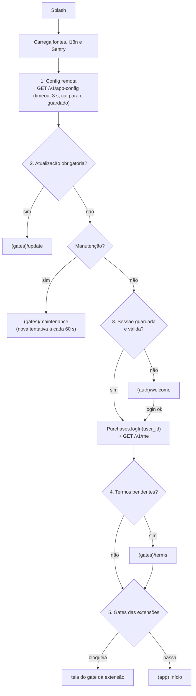

# Spec — Casca do app mobile

> **Status:** proposed · **App:** `apps/mobile` · **Spec principal:** [base-app.md](base-app.md)
> **ADRs:** [0002](../adr/0002-mobile-expo-react-native.md),
> [0012](../adr/0012-ci-cd-and-release.md), [0013](../adr/0013-extensible-core.md)

## 1. Visão geral

Tudo do app que não é feature de produto: sequência de abertura (gates), navegação, client da
API, idiomas, tema, tratamento de erro, rede, observabilidade, atualizações OTA e o registro de
extensões. Uma feature nova de produto entra como uma pasta em `src/features/` e uma rota em
`src/app/`, sem mexer na casca.

Portas de analytics, atribuição e anúncios, permissão de rastreamento (ATT) e notificações push
**não** fazem parte do base-app: ficam disponíveis em versões derivadas, que as acrescentam pelo
registro de extensões (§3.8).

## 2. Requisitos

| ID | Requisito |
|----|-----------|
| SH-01 | Abertura com gates em ordem fixa (§3.1): config remota → atualização ou manutenção → restauração da sessão → aceite de termos → gates das extensões. Nenhuma tela de produto aparece antes de todos passarem |
| SH-02 | Navegação com Expo Router; grupos `(auth)` e `(app)` protegidos por guard de sessão; `(ext)` reservado a extensões |
| SH-03 | Um único client HTTP tipado, gerado de `packages/contracts`, para todas as chamadas à API (§3.3) |
| SH-04 | Idiomas pt-BR, en e es; ordem de escolha: perfil → aparelho → `defaultLocale`. Trocar o idioma atualiza o perfil |
| SH-05 | Tema claro, escuro e do sistema, com tokens centralizados |
| SH-06 | Erros com código da API viram mensagem traduzida (`errors.<code>`); erro desconhecido vira mensagem genérica com o `requestId` para suporte |
| SH-07 | Aviso de sem conexão; ações que precisam de rede ficam desabilitadas com explicação |
| SH-08 | Atualização OTA (EAS Update) checada na abertura e aplicada na abertura seguinte |
| SH-09 | Configurações reúne: conta (nome, e-mail, trocar e-mail e senha), assinatura (plano, restaurar, gerenciar), preferências (idioma, tema), documentos legais, exportar dados, sair, sair de todos os aparelhos, excluir conta, e os itens das extensões |
| SH-10 | O app funciona com a lista de extensões vazia, coberto por teste (§3.8) |

Não funcionais:

| ID | Requisito |
|----|-----------|
| SH-N1 | TypeScript strict; `no-console` no lint; o logger do app, em produção, só manda breadcrumbs ao Sentry |
| SH-N2 | Sentry com `sendDefaultPii: false`, usuário identificado só pelo UUID, `beforeSend` removendo e-mail, códigos e tokens, sem corpo de requisição em breadcrumbs |
| SH-N3 | Acessibilidade: `accessibilityRole` e `accessibilityLabel` em todo controle, área de toque ≥ 44 pt, fonte do sistema respeitada, contraste AA, `reduceMotion` respeitado |
| SH-N4 | Abertura até o Início ≤ 3 s num Android intermediário (Hermes, nova arquitetura, telas carregadas sob demanda) |
| SH-N5 | Android de release com **R8** (minificação e remoção de recursos), `allowBackup="false"` e `dataExtractionRules` excluindo o armazenamento da sessão da cópia na nuvem e da transferência entre aparelhos |
| SH-N6 | **Nenhuma rota tem efeito colateral ao montar.** O Expo Router expõe toda rota como deep link (`<scheme>://settings/delete-account`); ações só acontecem por gesto do usuário, e os parâmetros de rota são validados com Zod |
| SH-N7 | **2FA obrigatório na organização do Expo.** Atualizações OTA assinadas (§3.6), com a chave privada **só** num job que não instala dependências; o CI usa token de robô com escopo mínimo |
| SH-N8 | **Proteção de tela:** as telas do código de login, de reautenticação e de exportação de dados usam `usePreventScreenCapture` (`expo-screen-capture`): sem captura e sem miniatura no seletor de apps |
| SH-N9 | **E-mail e código nunca vão em parâmetro de rota.** Passam por um store em memória do fluxo de login (`useAuthFlowStore`); o Sentry descarta parâmetros de navegação nos breadcrumbs (`beforeBreadcrumb`). Teste estático: nenhum `router.push`/`href` com `email` ou `code` nos params |
| SH-N10 | **`Linking.openURL` só pelo helper `openExternalUrl(url)`**: exige `https:` e host na allowlist (origem web de `product.config.ts`, `apps.apple.com`, `play.google.com` e `*.revenuecat.com`/`*.rev.cat` para o paywall); `managementURL` de SDK fora da allowlist cai no link público da loja. Lint barra `Linking.openURL` fora do helper |
| SH-N11 | **Sem tráfego em texto claro:** `usesCleartextTraffic: false` no Android e nenhuma exceção de ATS (`NSAllowsArbitraryLoads` ausente) no iOS. Teste sobre o `app.config.ts` resolvido na onda 3 e sobre o manifesto do build de release na onda 12 |

## 3. Design técnico

### 3.1 Sequência de abertura (gates)

Os gates rodam nesta ordem; o primeiro que bloqueia decide a tela.



- O resolvedor é uma **função pura** (`features/boot/model/resolve-boot.ts`) que recebe o estado
  (`config`, `session`, `me`, resultados dos gates das extensões) e devolve a rota. Os testes
  cobrem todas as combinações.
- Sem rede e sem configuração guardada: segue com os padrões (sem bloqueio).
- Sem rede e com configuração guardada: só atualização obrigatória bloqueia; manutenção
  guardada não bloqueia, conforme app-config AC-07.
- Sessão guardada e sem rede: entra em `(app)` em modo offline; os termos são reavaliados quando
  `GET /v1/me` voltar a responder.
- Se o access token guardado expirou, uma falha temporária de rede na renovação
  não apaga a sessão cifrada. O modo offline usa somente o resumo da sessão;
  nenhuma chamada protegida recebe o token expirado. Na reconexão, a sessão é
  revalidada antes de `GET /v1/me`, inclusive quando o UUID continua igual.
- Sessão guardada mas refresh token revogado: o primeiro 401 que não se resolve com renovação leva
  a Boas-vindas com "sua sessão expirou".
- `evaluateGate` (app-config.md) é quem decide os passos 1 e 2.
- Gates das extensões (`MobileExtension.bootGates`) rodam depois dos do núcleo, na ordem do
  registro.

### 3.2 Rotas (Expo Router)

```
src/app/
├── _layout.tsx                  providers + gates de boot (Stack.Protected por guard)
├── +not-found.tsx
├── (gates)/
│   ├── update.tsx
│   ├── maintenance.tsx
│   └── terms.tsx                aceite de termos e privacidade
├── (auth)/                      guard: só sem sessão
│   ├── _layout.tsx
│   ├── welcome.tsx
│   ├── email.tsx
│   ├── code.tsx
│   ├── password.tsx
│   ├── sign-up.tsx
│   ├── forgot-password.tsx
│   └── new-password.tsx
├── (app)/                       guard: sessão + termos aceitos + gates das extensões
│   ├── _layout.tsx
│   ├── (tabs)/
│   │   ├── _layout.tsx
│   │   ├── index.tsx            Início (feature de exemplo)
│   │   └── settings.tsx         Configurações
│   ├── settings/
│   │   ├── account.tsx          nome, e-mail
│   │   ├── change-email.tsx
│   │   ├── change-password.tsx
│   │   ├── subscription.tsx     plano, restaurar, gerenciar
│   │   ├── preferences.tsx      idioma e tema
│   │   ├── legal.tsx
│   │   ├── export-data.tsx
│   │   └── delete-account.tsx
│   ├── paywall.tsx              modal do paywall remoto (ou paywall-unavailable)
│   └── reauth.tsx               modal de login recente
└── (ext)/                       reservado a extensões: arquivos novos, sem editar os existentes
```

Arquivos em `src/app/` só importam telas de `src/features/*/ui` e não têm lógica (regra de
lint). Os grupos usam `Stack.Protected` com guards derivados do resolvedor de boot, então uma
rota protegida não é alcançável por deep link sem passar pelos gates.

### 3.3 Client da API

`shared/api-client` cria o client a partir de `packages/contracts`:

| Regra | Detalhe |
|-------|---------|
| Base URL | `EXPO_PUBLIC_API_URL` por ambiente |
| Headers em **toda** requisição | `X-Request-Id` (UUID v7 novo por requisição, o mesmo no breadcrumb do Sentry; o servidor o registra só como `clientRequestId` e devolve o próprio `X-Request-Id`, que o app também põe no breadcrumb), `X-App-Version` (versão nativa de `expo-application`, não a do OTA) e `X-Platform` (`ios` ou `android`) |
| `Authorization` | access token atual **só** em rotas que o contrato não declara públicas (`security: []`); rotas públicas nunca recebem o token |
| Timeout | 10 s (`AbortController`) |
| Retry | só em GET: 2 tentativas, backoff exponencial com jitter, em erro de rede, 5xx e 429 (respeita `Retry-After`) |
| `401` | uma renovação de sessão (compartilhada entre requisições simultâneas) e **no máximo uma repetição**, só se a requisição for idempotente (GET, HEAD ou com `Idempotency-Key`); segundo 401 → sign-out |
| `401 auth.recent_auth_required` | abre o modal `reauth`; a ação não é repetida sozinha (o usuário confirma de novo) |
| `401 auth.account_deleted` | limpa a sessão e o RevenueCat; Boas-vindas |
| `426 app.update_required` | leva à tela de atualização |
| `503 app.maintenance` | leva à tela de manutenção |
| Erros | `application/problem+json`: o `code` é traduzido por `errors.<code>` (i18n); código desconhecido vira a mensagem genérica com o `requestId` |
| Resposta | validada com o schema Zod do contrato; divergência vira `client.contract_mismatch` reportado ao Sentry |
| Estado de servidor | TanStack Query, sem persistência em disco |

Erros de rede e de contrato nunca mostram texto técnico ao usuário.

### 3.4 Idiomas, tema e bibliotecas

- **i18n:** `i18next` + `react-i18next` + `expo-localization`. Um arquivo por namespace e idioma:
  `src/shared/i18n/locales/<idioma>/<namespace>.json` (idiomas `pt-BR`, `en`, `es`). Namespaces do
  núcleo: `common`, `errors`, `auth`, `settings`, `billing`, `privacy`, `gates`, `legal`. Textos
  só nesses arquivos. Ordem de escolha do idioma: perfil → aparelho → `defaultLocale`. Um script
  de CI compara as chaves dos três idiomas por namespace; chave faltando quebra o build. Em
  produção, chave faltando cai no `defaultLocale` e registra breadcrumb.
- **Tema:** `src/shared/theme` (cores, espaçamento, tipografia, raio, com variantes clara e
  escura); preferência `light | dark | system` no AsyncStorage (não é dado sensível).
- **TanStack Query:** `focusManager` ligado ao `AppState` e `onlineManager` ao NetInfo; `staleTime`
  padrão de 30 s; as tentativas de repetição são do client HTTP, não do Query.
- **Sentry (`@sentry/react-native`):** SH-N2; `beforeSend` com a mesma redaction da API
  (`token`, `secret`, `password`, `authorization`, `code`, `email`).
- **Sem conexão:** banner global (NetInfo); botões de ações que precisam de rede ficam
  desabilitados com explicação.

### 3.5 Telas de erro e Configurações

- Erro de tela inesperado: `ErrorBoundary` com mensagem genérica, botão "tentar de novo" e o
  `requestId` quando houver.
- Configurações lista os itens do SH-09 em seções; os `settingsItems` das extensões entram numa
  seção própria, sem alterar a ordem dos itens do núcleo.

### 3.6 Atualizações OTA e build

- `expo-updates` com `runtimeVersion: { policy: 'fingerprint' }` e **um canal por ambiente**
  (`development`, `preview`, `production`).
- **Code signing** (SH-N7): `codeSigningCertificate` e `codeSigningMetadata` em `app.config.ts`;
  o app recusa bundle OTA sem assinatura válida. A chave privada fica fora do EAS (segredo do
  GitHub Environment `release`, com aprovação). Quem comprometer a conta do EAS não consegue
  publicar JavaScript para todos os usuários.
- **Pipeline de assinatura em dois jobs** (`release-ota.yml`, ADR 0012):
  1. `build`: instala dependências (lockfile congelado, `allowBuilds` explícito), roda
     `expo export` e publica o `dist/` e o SHA-256 como artefato. **Não tem acesso a segredo
     nenhum.**
  2. `sign-and-publish`: Environment `release`, com aprovação humana. **Não roda `pnpm install`
     nem scripts de pacote.** Baixa o artefato, confere o SHA-256, confere que o commit é
     ancestral da `main` e instala só o `eas-cli` de um lockfile próprio e mínimo
     (`.github/release-tools/`), com `npm ci --ignore-scripts`. Publica com `eas update
     --skip-bundler --private-key-path` usando a chave que existe só nesse job.
  Um pacote ou script comprometido no `build` produz, no máximo, um bundle ruim que o aprovador
  vê no diff do commit; não alcança a chave. O que sobra de risco é o próprio `eas-cli`
  (versão pinada, sem scripts). Quando o EAS oferecer assinatura por KMS com federação OIDC, a
  chave sai do segredo do GitHub (reavaliar no ADR 0012).
- **Rotação e perda da chave:** o certificado vai embutido no app, então trocar a chave exige
  um build novo. Guardar uma cópia cifrada da chave offline. Perdida ou exposta a chave: gerar par
  novo, lançar um build com o certificado novo, publicar OTA só para esse `runtimeVersion` e
  subir `minSupported` (app-config) para tirar quem ficou no certificado antigo. Roteiro no how-to
  `docs/how-to/rotate-ota-signing-key.md`.
- Verificação na abertura (`checkAutomatically: 'ON_LOAD'`), aplicação na abertura seguinte.
- Mudança nativa muda o fingerprint e exige build novo; a atualização obrigatória (app-config.md)
  cobre quem ficou para trás.
- Rollback: o `expo-updates` volta ao bundle embutido se a atualização falhar ao iniciar; o canal
  pode ser apontado para a versão anterior (`eas update:republish` ou rollback para o embutido).
- Android (SH-N5), pelo `expo-build-properties` e por um config plugin do template:
  `enableProguardInReleaseBuilds` e `enableShrinkResourcesInReleaseBuilds` (R8),
  `android:allowBackup="false"` e `res/xml/data_extraction_rules.xml` excluindo os domínios de
  `cloud-backup` e `device-transfer`, com `fullBackupContent` equivalente para o Android 11 ou menor.
- Org do Expo com 2FA exigido para todos os membros e token de robô com o menor escopo para o CI.

### 3.7 Segurança do app

- Nenhuma chave secreta no bundle. Só estas variáveis `EXPO_PUBLIC_*` existem: URL da API, URL e
  publishable key do Supabase, chaves públicas do SDK do RevenueCat, DSN do Sentry, mais as que
  uma extensão declarar em `publicEnv` (§3.8). O schema do env público é validado no boot.
- **Rotas sem efeito ao montar (SH-N6):**
  - o hook `useValidatedParams(schema)` valida os parâmetros de rota com Zod e leva a
    `+not-found` se forem inválidos;
  - uma regra de lint (`app/no-mutation-on-mount`) proíbe chamar `mutate`, `mutateAsync` ou
    funções de `adapters/` dentro de `useEffect` em `src/app/**` e em `features/**/ui`;
  - um teste (RNTL) renderiza cada arquivo de `src/app/**` com parâmetros vazios e hostis e
    confere que nenhuma requisição de escrita é feita.
- A sessão fica cifrada no armazenamento (identity-and-auth.md).
- Deep links só abrem rotas; o `reauth` e as telas de exclusão e exportação exigem gesto.
- **Telas sensíveis e links externos:** SH-N8 (captura), SH-N9 (e-mail fora de rota) e SH-N10
  (`openExternalUrl`). O arquivo de exportação é gravado no cache, apagado depois do
  compartilhamento e varrido na próxima abertura.

### 3.8 Registro de extensões

`apps/mobile/src/extensions/index.ts` exporta `mobileExtensions: MobileExtension[]`, vazio no
base-app (base-app.md §3.4.2). Tipos de apoio:

```ts
// apps/mobile/src/extensions/types.ts
export interface MobileExtension {
  readonly name: string;                                  // kebab-case, único
  readonly authMethods?: readonly AuthMethodEntry[];
  readonly bootGates?: readonly BootGate[];               // executados depois dos gates do núcleo
  readonly settingsItems?: readonly SettingsItem[];
  readonly providers?: readonly ProviderComponent[];      // envolvem a árvore abaixo dos do núcleo
  readonly i18nNamespaces?: readonly I18nNamespace[];
  readonly captchaProvider?: CaptchaProvider;             // usado pelo adaptador do Supabase Auth
  readonly publicEnv?: z.ZodObject<z.ZodRawShape>;        // só EXPO_PUBLIC_*, validadas junto com o env público do app no boot
}

export type AuthMethodEntry = { id: string; Component: React.ComponentType<AuthMethodProps> };
// Superfície mínima: nenhuma sessão, token nem cliente do Supabase chegam ao componente da extensão
export type AuthMethodProps = {
  readonly locale: Locale;
  readonly busy: boolean;
  setBusy(busy: boolean): void;
  onError(key: AuthErrorKey): void;
  signInWithIdToken(input: { provider: string; token: string; nonce?: string }): Promise<Result<void, AuthErrorKey>>;  // passa por withCaptcha; o núcleo instala a sessão
};
export type SettingsItem = { id: string; section: 'extensions'; Component: React.ComponentType<SettingsItemProps> };
export type SettingsItemProps = { session: SessionSummary; navigate(route: string): void };
export type ProviderComponent = React.ComponentType<{ children: React.ReactNode }>;
export type I18nNamespace = { name: string; resources: Readonly<Record<Locale, Record<string, unknown>>> };

export type SessionSummary = { readonly userId: string; readonly isAnonymous: boolean };  // sem tokens
export type BootContext = { config: AppConfig; session: SessionSummary | null; me: Me | null };
export type BootGateResult = { status: 'pass' } | { status: 'block'; href: Href };
export interface BootGate {
  readonly name: string;
  evaluate(ctx: BootContext): BootGateResult | Promise<BootGateResult>;
}

export type CaptchaAction =
  | 'sign_up' | 'sign_in_password' | 'sign_in_otp' | 'reset_password'
  | 'anonymous' | 'resend' | 'reauth' | 'social';
export type CaptchaToken = { readonly token: string; readonly issuedAt: number };
export type CaptchaErrorCode = 'unavailable' | 'cancelled' | 'timeout' | 'failed';
export class CaptchaError extends Error { constructor(readonly code: CaptchaErrorCode) { super(code); } }
export interface CaptchaProvider {
  readonly kind: string;
  prewarm(action: CaptchaAction): void;                   // aquece o desafio sem bloquear a tela
  getToken(action: CaptchaAction): Promise<CaptchaToken>; // rejeita com CaptchaError
  release(token: CaptchaToken): void;                     // descarta token não usado
  dispose(): void;
}
```

**Fachada para extensões (`apps/mobile/src/extensions/api.ts`).** Extensões não importam o cliente
cru do Supabase nem o `api-client` do núcleo (regra do dependency-cruiser
`supabase-client-only-in-auth`: o cliente cru só é usado em `features/auth`). A fachada exporta:

- `extensionAuth`: `signInAnonymously()`, `signInWithIdToken({ provider, token, nonce? })`,
  `linkIdentity({ provider })`, `unlinkIdentity({ identityId })` (exige login recente),
  `updateEmail(email)`, `verifyEmailChangeOtp({ email, token })`, `refreshSession()`,
  `signOutEverywhere()` (encerra todas as
  sessões da conta, `signOut({ scope: 'global' })`; exige login recente) e `withPreviousSession(fn)`. Toda chamada que
  aceita CAPTCHA passa por `withCaptcha`.
- `withPreviousSession<T>(fn: (previousAccessToken: string) => Promise<T>): Promise<T>`:
  captura a sessão atual (ex.: a de visitante) antes de uma troca de conta e entrega à `fn`
  **só** o access token anterior, para o corpo de uma rota de fusão. A captura usa um cliente
  secundário privado com armazenamento isolado; não usa a sessão primária para obter nem descartar
  a sessão anterior. Se não houver sessão/token anterior, rejeita com um erro estável sem chamar a
  `fn`; se um cliente secundário foi capturado, o cleanup dele ainda ocorre. Se a criação do cliente
  secundário falhar antes de devolver o handle, o adaptador limpa qualquer estado parcial e rejeita
  com erro estável. A captura nunca tenta ler a sessão primária como alternativa.
- O resultado de `fn` pode ser `undefined`, `null`, boolean, string, número finito, array ou record
  simples composto recursivamente desses valores. A fachada copia e congela arrays e records antes
  de devolvê-los, para que mutações posteriores do objeto original não introduzam o token no
  resultado. Recusa funções, símbolos, `bigint`, números não finitos, accessors, ciclos, instâncias
  de classes e objetos opacos. A validação inspeciona descritores de propriedades e não executa
  getters. Strings em valores e chaves são recusadas quando contêm o token anterior; nomes como
  `token` e `accessToken`, por si só, não são proibidos.
- Após capturar uma sessão, o cleanup do cliente secundário ocorre em `finally`, inclusive se a
  leitura do token, a callback ou a validação do resultado falhar. O cleanup só descarta a sessão
  capturada, preservando uma nova sessão primária instalada pela callback. Falhas da captura, da
  leitura, da callback, da validação e do cleanup viram o mesmo erro `Extension callback failed.`;
  mensagens e causas de terceiros nunca são devolvidas ou logadas.
- A inspeção estrutural de objetos pode acionar traps de `Proxy`; exceções são sanitizadas, mas a
  fachada não é sandbox e não impede efeitos colaterais arbitrários de código JavaScript da
  extensão ou de traps de proxy. Extensões continuam sendo código confiável no mesmo processo.
  `withPreviousSession` é o único ponto em que código de extensão recebe um access token; o token
  nunca é persistido nem devolvido no resultado.
- `useSessionSummary()`: `{ userId, isAnonymous } | null`, atualizado quando a sessão muda.
- `extensionApiClient`: o cliente HTTP autenticado do núcleo (mesmos headers de versão, plataforma
  e `clientRequestId`, mesmo tratamento de `problem+json` e mesmo refresh), para as rotas
  `/v1/<extensão>/...`.
- `SettingsItem` recebe `{ session: SessionSummary; navigate(route: string): void }`.

`AuthMethodProps` continua mínimo, mas o componente pode usar `extensionAuth`.

`withCaptcha(provider, action, call)` é do núcleo, em
`features/auth/api/with-captcha.ts`; o adaptador do Supabase Auth passa por ele toda chamada que
aceita `captchaToken` (identity-and-auth.md, ID-14). Sem provedor, `call(undefined)`. Se a obtenção
do desafio falhar, a chamada de Auth não roda; se Auth falhar ou devolver `Result` de erro, o token
não consumido é liberado pelo provedor.

Regras da composição (`src/composition/`):

- `publicEnv`: chave sem o prefixo `EXPO_PUBLIC_`, ou com `SECRET`, `KEY_PRIVATE` ou `TOKEN` no
  nome, ou repetida (no núcleo ou em outra extensão), faz o boot e o teste falharem. Site key de
  CAPTCHA é pública e passa;
- a suíte de contrato do `CaptchaProvider` e o teste de `AuthMethodProps` (nenhum campo de sessão)
  rodam para toda extensão registrada;
- nomes de extensão únicos e em kebab-case; duplicado faz o app falhar no boot de desenvolvimento
  e no teste;
- no máximo **um** `captchaProvider` em todas as extensões (duas fazem o boot falhar em
  desenvolvimento e o teste de composição);
- `CaptchaProvider.dispose()` roda uma única vez quando termina o último registro de runtime que
  usa aquela instância. Cleanup de um provider ainda compartilhado não o descarta; cleanups
  simultâneos não chamam `dispose()` duas vezes; o replay de efeitos do React StrictMode não
  descarta uma instância reinstalada no mesmo ciclo de composição;
- provedores das extensões envolvem a árvore **abaixo** dos do núcleo, na ordem do array;
- `bootGates` rodam depois dos do núcleo; um gate que lança erro é tratado como `block` para uma
  tela de erro, nunca como `pass`;
- `i18nNamespaces` registram os recursos nos três idiomas; a verificação de chaves do CI também os
  cobre;
- rotas de extensão ficam em `src/app/(ext)/**` (arquivos novos).

Nenhuma extensão importa internals de `features/`, `composition/` ou `shared/api-client/` do
núcleo (dependency-cruiser). Acesso a auth, sessão e HTTP passa por `extensions/api.ts`; só a
fachada, `AppProviders`, os próprios módulos de composição e testes podem importar os contratos
privados de `composition/`.

## 4. Edge cases

| Situação | Comportamento |
|----------|---------------|
| App abre sem rede e sem configuração guardada | segue com os padrões; sessão guardada leva ao Início em modo offline |
| Última configuração guardada mandava atualizar e não há rede | mostra a tela de atualização (AC-07 de app-config.md) |
| Sessão guardada mas refresh token revogado | primeiro 401 sem solução leva a Boas-vindas com "sua sessão expirou" |
| Sessão cifrada adulterada | sign-out limpo (identity-and-auth.md) |
| Dois 401 simultâneos | uma só renovação de sessão, compartilhada |
| Deep link para `settings/delete-account` com o app fechado | passa pelos gates e abre a tela, que não executa nada sem gesto |
| Deep link com parâmetro inválido | `+not-found` |
| Usuário troca o idioma do aparelho com o app aberto | o idioma do perfil continua valendo; só segue o aparelho se o perfil não tiver idioma |
| Chave de tradução faltando em produção | cai no `defaultLocale` e registra breadcrumb (o CI devia ter barrado) |
| Atualização OTA quebrada ou sem assinatura válida | o `expo-updates` recusa ou volta ao bundle embutido na próxima abertura |
| Resposta da API fora do contrato | `client.contract_mismatch` no Sentry e mensagem genérica |
| `426` ou `503 app.maintenance` no meio do uso | o client leva à tela de atualização ou manutenção sem perder a sessão |
| Extensão com gate que falha | tela de erro com tentar de novo; o usuário não passa |
| Relógio do aparelho errado | o app nunca decide expiração pelo relógio local |
| Fonte do sistema muito grande | layout com rolagem; nenhum controle some |

## 5. Plano de testes

**Unit (Jest)**

- `resolveBoot` para todas as combinações de config (ok, atualização, manutenção), sessão
  (nenhuma, válida, revogada), termos (pendentes ou não) e gates de extensão (passa, bloqueia).
- Client HTTP com `fetch` simulado: headers em toda requisição; token ausente em rota pública;
  renovação única com 401 simultâneos; repetição só de requisição idempotente; segundo 401 faz
  sign-out; 426 e 503 `app.maintenance` levam às telas certas; retry só em GET; `problem+json`
  vira chave `errors.<code>`; resposta fora do contrato.
- Resolução de idioma (perfil → aparelho → padrão) e script de chaves de tradução (falha ao
  remover uma chave do `es`).
- `useValidatedParams`.
- Fachada: cada função de `extensionAuth` que aceita CAPTCHA passa por `withCaptcha`;
  `withPreviousSession` cobre os tipos de retorno permitidos e recusa todos os tipos opacos,
  accessors, ciclos e ocorrências do token em chaves ou strings; aceita `undefined` e nomes de
  campo token-like sem conteúdo sensível; retorna cópia profunda congelada; getters não executam;
  erros da captura, leitura do token, callback, validação e cleanup são sanitizados; falha de captura
  não usa a sessão primária nem chama a callback sem token; cleanup roda se a leitura do token ou
  callback falhar e não encerra uma nova sessão primária; `useSessionSummary` atualiza na troca de
  sessão sem renderizar o resumo do usuário anterior após trocar a porta; `extensionApiClient` envia
  os headers do núcleo.
- Composição de extensões: nomes duplicados, dois `captchaProvider`, ordem dos providers e dos
  gates; `publicEnv` com prefixo errado, com `SECRET`, `KEY_PRIVATE` ou `TOKEN`, e com chave
  repetida falha; site key de CAPTCHA passa.
- `openExternalUrl`: `http:`, host fora da allowlist e `javascript:` recusados; `managementURL`
  fora da allowlist cai na URL pública da loja. Teste estático: nenhum `Linking.openURL` fora do
  helper; nenhum `email` ou `code` em params de rota; telas de código e exportação chamam
  `usePreventScreenCapture`.
- `app.config.ts` resolvido: `usesCleartextTraffic: false` e nenhuma exceção de ATS.

**Componente (React Native Testing Library)**

- Telas de gate, de erro e de Configurações com rótulos de acessibilidade.
- **Teste de lista vazia:** com `mobileExtensions = []` o app resolve o boot, renderiza o Início e
  as Configurações com os itens do núcleo e nenhuma tela de extensão.
- **Extensão falsa:** um `MobileExtension` de teste adiciona um gate, um item de Configurações e um
  namespace de i18n, e tudo aparece.
- Rotas sem efeito ao montar (SH-N6): cada arquivo de `src/app/**` renderizado com parâmetros
  hostis não faz requisição de escrita.

**E2E (Maestro)**

- Abertura → Boas-vindas → login → Início.
- Atualização obrigatória; manutenção.
- Terms: mudar a versão → tela de aceite.

### Critérios de aceite

- [ ] Com `app-config` em manutenção, nenhuma tela de produto aparece.
- [ ] Os gates rodam na ordem de SH-01, verificado pelo teste do resolvedor.
- [ ] Nenhuma tela fora de `features/*/ui`; `src/app/` sem lógica (regra de lint).
- [ ] O script de chaves de tradução passa e falha ao remover uma chave do `es`.
- [ ] Um evento do Sentry gerado num erro forçado não contém e-mail nem token.
- [ ] O app funciona com a lista de extensões vazia.
- [ ] Um build Android de release tem R8, `allowBackup=false` e `dataExtractionRules` (verificado no
      manifesto gerado).
- [ ] Uma atualização OTA sem assinatura válida é recusada.
- [ ] O job que assina o OTA não instala dependências do app nem roda scripts de pacote e só roda
      com aprovação no Environment `release`; o job de `build` não tem segredo.
- [ ] Telas do código e da exportação têm proteção de captura; o arquivo de exportação é apagado;
      nenhum e-mail em parâmetro de rota; `openExternalUrl` é o único caminho para links externos.
- [ ] O manifesto do build de release não permite tráfego em texto claro.
- [ ] Uma extensão fake usa `extensionAuth`, `withPreviousSession`, `useSessionSummary`,
      `extensionApiClient` e `SettingsItem` pela fachada, sem importar o cliente do Supabase (a
      regra de lint reprova a importação); o token de `withPreviousSession` não aparece em log,
      storage nem retorno.
- [ ] Uma extensão fake com `publicEnv` válido passa e uma com `EXPO_PUBLIC_API_SECRET` falha.
- [ ] Leitor de tela (VoiceOver e TalkBack) percorre Boas-vindas, login e Configurações.
- [ ] A abertura até o Início leva ≤ 3 s num Android intermediário.

## 6. Questões em aberto

| # | Item | Padrão adotado |
|---|------|----------------|
| Q-SH-1 | Tipos de apoio de `MobileExtension` (`BootGate`, `SettingsItem`, `AuthMethodEntry`, `I18nNamespace`, `CaptchaProvider`) não estão definidos em base-app.md | definidos em §3.8; base-app.md §3.4.2 só os nomeia |
| Q-SH-2 | Algoritmo e armazenamento da chave de code signing do OTA | `rsa-v1_5-sha256`, chave privada no GitHub Environment `release` com aprovação, usada só pelo job `sign-and-publish`, sem instalação de dependências do app; KMS com OIDC quando houver (ADR 0012) |
| Q-SH-3 | Persistir o cache do TanStack Query em disco | não; evita dado em claro no aparelho |
